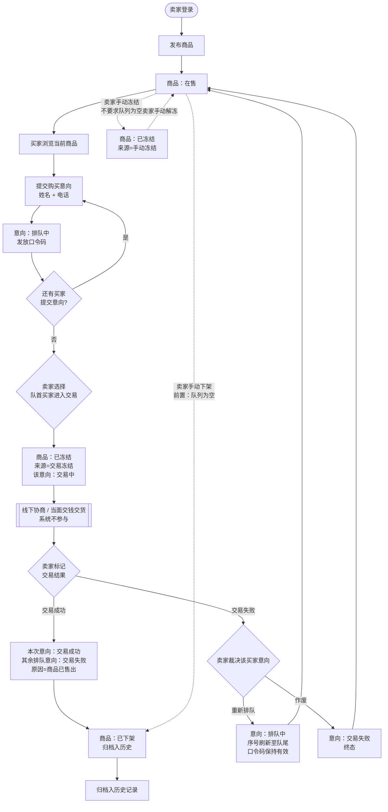
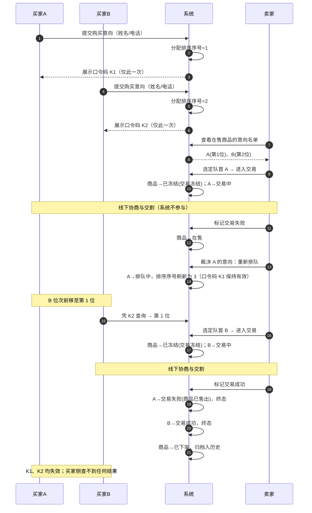
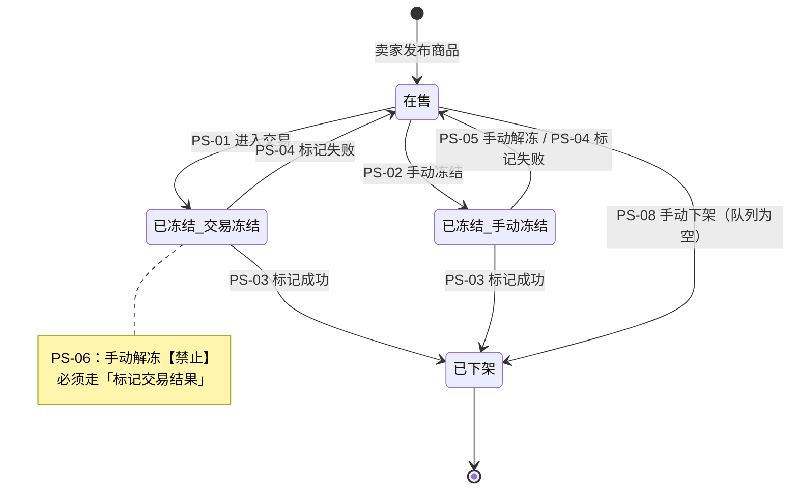
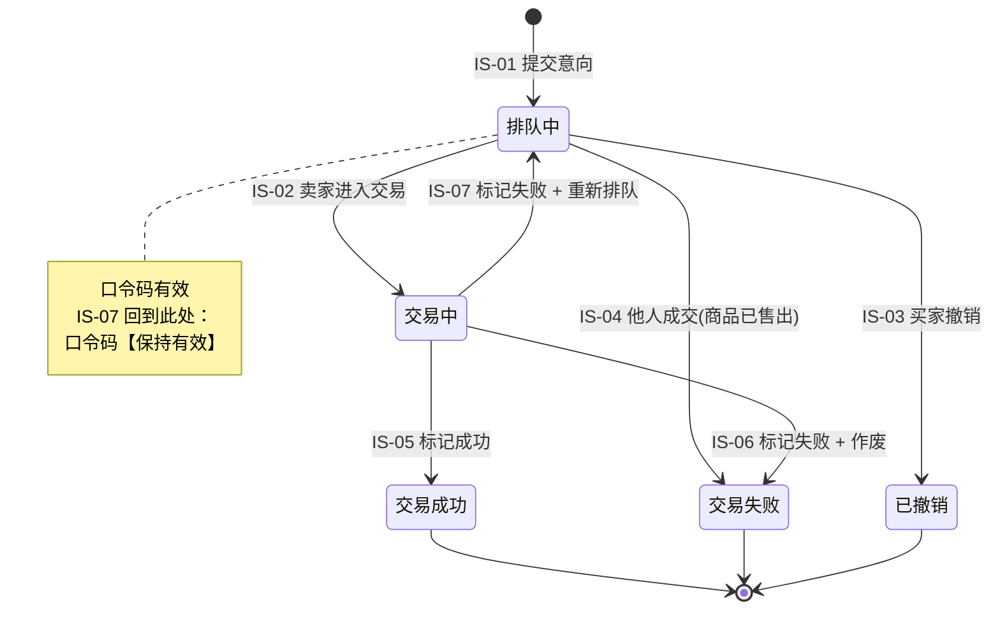
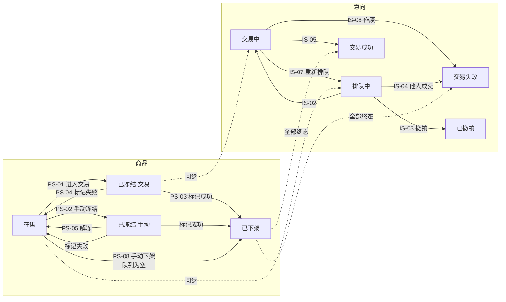

# 第 4 章　业务流程与状态模型

> 所属文档：《需求规格说明书》｜上游依据：《粗略分析》§4、§5；澄清 Q3、Q4、Q8、Q11、Q16、Q17、Q18、Q22；`DEC-01`、`DEC-02`、`DEC-04`、`DEC-15`、`DEC-38`

---

## 4.1 主流程

### 4.1.1 流程步骤

| 步 | 动作 | 执行者 | 系统行为 | 商品状态变化 | 意向状态变化 |
| --- | --- | --- | --- | --- | --- |
| 1 | 登录后台 | 卖家 | 校验账号密码，建立会话 | — | — |
| 2 | 发布商品 | 卖家 | 校验字段（名称必填、价格 0<价格≤999,999.99、图片选填≤5MB），创建商品 | — → **在售** | — |
| 3 | 浏览当前商品 | 买家 | 展示当前商品（无商品则不显示；已冻结则标注「已冻结」） | 在售 | — |
| 4 | 提交购买意向 | 买家 | 校验姓名、电话；分配**排序序号**（事务内自增）；生成**口令码** | 在售（不变） | — → **排队中** |
| 5 | 获取口令码 | 买家 | 成功页**当场展示**口令码，并提醒买家保存 | 在售（不变） | 排队中 |
| 6 | 继续排队 / 自助操作 | 买家 | 后续买家继续入队；各买家可凭口令码查位次、改信息、撤销 | 在售 | 排队中 |
| 7 | 进入交易 | 卖家 | 选定**队首**买家；商品转冻结 | 在售 → **已冻结**（来源：交易冻结） | 排队中 → **交易中** |
| 8 | 线下协商与交割 | 买卖双方 | **系统不参与**（见 §4.3） | 已冻结 | 交易中 |
| 9a | 标记交易成功 | 卖家 | ① 其余排队意向自动置「交易失败（商品已售出）」；② 本次意向置「交易成功」；③ 商品下架并归档；④ 口令码随各意向进入终态而失效 | 已冻结 → **已下架**（终态） | 交易中 → **交易成功**（终态）；其余 → **交易失败**（终态） |
| 9b | 标记交易失败 | 卖家 | 商品恢复在售；卖家裁决该买家意向 | 已冻结 → **在售** | 交易中 → **重新排队**（回到排队中，序号刷新至队尾）／**交易失败**（终态，作废） |
| 10 | 手动冻结 / 解冻 | 卖家 | 冻结：在售 → 已冻结（来源：手动冻结，**不要求队列清空**） 解冻：**仅手动冻结的商品可用**；交易冻结禁用 | 在售 ⇄ 已冻结 | 不变 |
| 11 | 手动下架 | 卖家 | **前置条件：商品在售且队列为空**；下架并归档 | 在售 → **已下架**（终态） | — |
| 12 | 查看历史商品 | 卖家 | 列表按时间倒序、每页 10 条；详情展示该商品的意向名单与**每次交易结果** | 已下架 | 全部终态 |
| 13 | 修改密码 | 卖家 | **全部会话失效**，需重新登录 | — | — |

### 4.1.2 主流程图

### 4.1.3 关键流程说明

| 编号 | 说明 |
| --- | --- |
| N-01 | **提交意向不冻结商品**。只有卖家「进入交易」才冻结商品（`BR-13`）。提交只是排队。 |
| N-02 | **商品冻结期间不再接受任何新意向**，页面提示「商品交易中，暂停接收新意向」（`BR-02`、`FR-18`）。 |
| N-03 | **交易成功的处理顺序**：先处理其余排队意向 → 再置本次意向成功 → 最后商品下架。该顺序保证结果一致（`BR-03`）。 |
| N-04 | **交易失败后商品立即恢复在售**，队列继续；若前面的人作废或重排，后面的人依次前移（`BR-04`、`BR-20`）。 |
| N-05 | **系统不做超时自动恢复**：商品从「已冻结」出去只有三条路——标记成功、标记失败、手动解冻（仅手动冻结可用）（`BR-16`）。 |
| N-06 | **手动冻结不要求队列为空**；**手动下架要求队列为空**。二者前置条件不同，不可混用（澄清 Q18、`DEC-01`）。 |

---

## 4.2 交易时序

以「首次交易失败 → 重新排队 → 第二次交易成功」为例，展示三方交互：

**时序说明**

| 编号 | 说明 |
| --- | --- |
| SQ-01 | 口令码**只在提交成功页展示一次**，系统不重发、无通知（`BR-24`、`FR-21`）。买家丢失即需卖家在后台查看后线下转告（`FR-24`，【开发方新增】）。 |
| SQ-02 | 「重新排队」**复用原意向记录**，不新建记录；口令码**保持有效**，买家可继续用原码查询（`BR-27`、`DEC-04`）。 |
| SQ-03 | 「重新排队」后该意向的**排序序号刷新**至队尾，但**原始提交时间保留不变**（`DEC-15`）。 |
| SQ-04 | 商品下架后，**所有**口令码失效，买家侧**查不到任何结果**（含「未成交」），但卖家后台历史记录完整保留（`BR-31`、`BR-21`）。 |

---

## 4.3 系统外业务

以下环节**不在系统内实现**，但会驱动系统状态的变更，需在需求层面明确其边界：

| 编号 | 系统外业务 | 说明 |
| --- | --- | --- |
| X-01 | **线下协商与交割** | 系统不承载议价、付款、交付过程。卖家在系统中标记的「交易结果」是**对线下事实的登记**，系统不校验其真实性。 |
| X-02 | **卖家与买家的直接联系** | 卖家可从后台取得买家姓名与电话并在系统外联系（电话/当面）。这也正是「买家反悔」等同交易失败（`BR-17`）的判定来源——由卖家线下得知后回系统标记。 |
| X-03 | **口令码的线下转告** | 当买家丢失口令码时，卖家在后台查得原文后于系统外告知（`BR-30`、`FR-24`，【开发方新增】）。 |
| X-04 | **交易开始时间的产生** | 卖家点击「进入交易」即产生该时间戳（同时触发商品冻结），该动作**属于关键操作**，须记入操作日志（澄清 Q22、`NFR-12`）。 |

---

## 4.4 商品状态机

### 4.4.1 状态定义

商品状态**仅三种**，全局至多 1 件处于「在售」或「已冻结」（`BR-11`）：

| 状态 | 含义 | 对外可见性 |
| --- | --- | --- |
| **在售** | 可浏览、可提交意向 | 买家可见 |
| **已冻结** | 详情仍可浏览，但**不接受新意向**、不能进入交易 | 买家可见（标注「已冻结」） |
| **已下架** | 终态。永久撤下，归入历史记录 | 买家**不可见**（`FR-19`） |

**冻结来源**：商品处于「已冻结」时，必须记录**冻结来源**，因为它决定后续允许的解除方式：

| 来源 | 产生方式 | 手动解冻 | 结束方式 |
| --- | --- | --- | --- |
| **交易冻结** | 卖家「进入交易」时自动产生 | **禁止**（按钮禁用） | **只能**通过「标记交易成功 / 交易失败」 |
| **手动冻结** | 卖家在后台主动冻结 | **允许** | 手动解冻，或标记交易结果 |

### 4.4.2 状态迁移表

| 编号 | 当前状态 | 触发动作 | 执行者 | 前置条件 | 目标状态 | 关联需求 |
| --- | --- | --- | --- | --- | --- | --- |
| **PS-01** | 在售 | 卖家进入交易 | 卖家 | 队首存在买家 | 已冻结（来源：交易冻结） | `FR-07` |
| **PS-02** | 在售 | 卖家手动冻结 | 卖家 | **在售即可，不要求队列清空** | 已冻结（来源：手动冻结） | `FR-05` |
| **PS-03** | 已冻结 | 卖家标记交易成功 | 卖家 | — | 已下架（终态） | `FR-09` |
| **PS-04** | 已冻结 | 卖家标记交易失败 | 卖家 | — | 在售 | `FR-10` |
| **PS-05** | 已冻结（来源：**手动冻结**） | 卖家手动解冻 | 卖家 | **仅此来源可用** | 在售 | `FR-06` |
| **PS-06** | 已冻结（来源：**交易冻结**） | 卖家手动解冻 | 卖家 | **不允许**——按钮禁用 | —（不迁移） | `FR-06` |
| **PS-07** | 已下架 | —（终态，无出边） | — | — | — | — |
| **PS-08** | 在售 | 卖家手动下架 | 卖家 | **队列为空** | 已下架（终态） | `FR-23`【开发方新增】 |

### 4.4.3 商品状态图

### 4.4.4 已修正的历史缺陷

| 编号 | 缺陷 | 修正 | 依据 |
| --- | --- | --- | --- |
| FIX-01 | 原设计中「已冻结」不区分来源，导致**交易中的商品也能被手动解冻**——解冻后商品回到在售并接受新意向，而原买家仍卡在「交易中」，产生「商品在售 + 有人正在交易」的不一致状态 | **交易冻结禁止手动解冻**（`PS-06`）；结束交易必须走「标记交易结果」 | 澄清 Q16（确认漏洞）、Q17（确认修正） |

> `FIX-01` 是本项目在需求分析阶段**提前发现并修正**的设计缺陷。`INV-04`（见第 8 章）因此由「业务约定」升级为**系统强制保证**。

### 4.4.5 关于 PS-08（手动下架）的说明

| 项 | 内容 |
| --- | --- |
| **为什么需要** | 「冻结 → 标记交易结果 → 下架」这条路径上**只有交易成功才能下架**——标记交易失败只会让商品回到在售（`PS-04`）。因此需要一条**不依赖成交**的撤下通道。 |
| **为什么要求队列为空** | 避免「队列中的买家被无理由作废」，从而不破坏系统最核心的**先到先得**承诺。 |
| **与 `DEC-02` 的呼应** | `DEC-02` 要求「商品下架前所有意向均须处于终态」。PS-08 要求队列为空，两条规则**互相印证**：下架动作不会产生悬空的排队意向，因此**不需要**在下架时批量处理队列（批量转失败只是防御性逻辑）。 |
| **前端表现** | 队列非空时「手动下架」入口**禁用**，并提示卖家需先处理完队列中的意向。 |

---

## 4.5 购买意向状态机

### 4.5.1 状态定义

| 状态 | 含义 | 是否终态 | 口令码是否有效 |
| --- | --- | --- | --- |
| **排队中** | 在队列中等待，位次可查 | 否 | ✅ 有效 |
| **交易中** | 卖家已选定该买家，正在线下协商 | 否 | ✅ 有效 |
| **交易成功** | 成交，商品已售予该买家 | **是** | ❌ 失效 |
| **交易失败** | 未成交（作废 / 商品已售出） | **是** | ❌ 失效 |
| **已撤销** | 买家自行撤销，退出队列 | **是** | ❌ 失效 |

> **关键口径（`BR-27`）**：「**重新排队**」**不是终态**，而是从「交易中」**回到**「排队中」。因此该意向的口令码**保持有效**。

### 4.5.2 状态迁移表

| 编号 | 当前状态 | 触发动作 | 执行者 | 目标状态 | 关联需求 |
| --- | --- | --- | --- | --- | --- |
| **IS-01** | — | 提交购买意向 | 买家 | 排队中（分配排序序号） | `FR-13` |
| **IS-02** | 排队中 | 卖家选定其进入交易 | 卖家 | 交易中 | `FR-07` |
| **IS-03** | 排队中 | 买家凭口令码撤销意向 | 买家 | 已撤销（终态，退出队列） | `FR-17` |
| **IS-04** | 排队中 | 卖家标记交易成功（**他人**成交） | 卖家 | 交易失败（终态，失败类型：商品已售出） | `FR-09` |
| **IS-05** | 交易中 | 卖家标记交易成功 | 卖家 | 交易成功（终态） | `FR-09` |
| **IS-06** | 交易中 | 卖家标记交易失败 + **作废** | 卖家 | 交易失败（终态，失败类型：卖家作废） | `FR-10` |
| **IS-07** | 交易中 | 卖家标记交易失败 + **重新排队** | 卖家 | 排队中（**复用原记录**，排序序号刷新至队尾） | `FR-10` |
| **IS-08** | 交易成功 | —（终态，无出边） | — | — | — |
| **IS-09** | 交易失败 | —（终态，无出边） | — | — | — |
| **IS-10** | 已撤销 | —（终态，无出边） | — | — | — |

### 4.5.3 意向状态图

### 4.5.4 关于 IS-07（重新排队）的说明

| 项 | 内容 |
| --- | --- |
| **不新建记录** | 复用**原意向记录**，状态从「交易中」直接回到「排队中」。业务方明确「重新排队是同一条意向回到队列继续等，不会新生成一条记录」（澄清 Q22），与 `DEC-04` 一致。 |
| **口令码保持有效** | 因不经过终态，买家可继续使用**原口令码**查询（`BR-27`）。这也是 `GAP-01`（静默买家漏洞）得以消解的原因。 |
| **排序序号刷新** | 该意向的**排序序号**更新为新的值，从而排到队尾；**原始提交时间保留不变**（`DEC-15`）。 |
| **连带要求：需流水表** | 因复用原记录，每次失败的过程会被覆盖。**必须**另建「意向交易流水表」保留每一次失败的类型与备注，否则无法满足业务方 Q15「每次失败记录都能查到」的要求（见第 9 章）。 |

---

## 4.6 两状态机的联动规则

| 编号 | 规则 | 依据 |
| --- | --- | --- |
| **BR-01** | 商品进入交易冻结时，仅**该条**意向变为「交易中」，队列中其余意向保持「排队中」。 | 澄清 Q3 |
| **BR-02** | 商品被交易冻结期间，**任何**新意向都不允许提交，页面提示「商品交易中，暂停接收新意向」。 | 澄清 Q3、Q23 |
| **BR-03** | 交易成功时，**先**将其余排队意向置为「交易失败（类型：商品已售出）」，**再**把本次意向置为「交易成功」，**最后**商品下架。（顺序保证结果一致） | 澄清 Q4、Q6 |
| **BR-04** | 交易失败时，商品恢复在售；该买家意向按卖家裁决变为「作废」或「重新排队」；其余排队意向状态不变、位次前移。 | 澄清 Q4、Q11 |
| **BR-05** | **见第 8 章 `BR-20`**——「重新排队」= 复用原意向记录，状态回到「排队中」，**排序序号刷新**至队尾。**本规则正文以第 8 章为准**，此处仅保留编号与指向。 | 澄清 Q11；`DEC-04`、`DEC-15` |
| **BR-06** | 买家的「撤销意向」与卖家的「作废 / 重新排队」是两回事，不可互相触发。 | 澄清 Q9 |
| **BR-07** | 手动解冻**仅对来源为「手动冻结」的商品开放**；来源为「交易冻结」的商品，解冻入口禁用。 | 澄清 Q17 |
| **BR-08** | 处于「交易冻结」的商品，结束与买家交易的**唯一路径是「标记交易结果」**（成功或失败）。 | 澄清 Q17 |
| **BR-09** | 手动下架**仅对「在售」且队列为空**的商品开放。 | `DEC-01` |
| **BR-10** | 商品下架前，其名下所有意向**必须已处于终态**；交易成功时由系统自动将其余排队意向转为「交易失败（商品已售出）」。 | `DEC-02` |

> **编号引用说明**：`BR-05` 与第 8 章 §8.3 的 `BR-20` 是**同一条规则**。为避免同一规则在两处各自表述而产生口径漂移，**本规则正文以第 8 章 `BR-20` 为准**，本节仅保留编号与指向（详见第 8 章 §8.5、§8.8 `8-D`）。

### 4.6.1 联动关系总览图

---

## 4.7 本章引用的上游依据

| 内容 | 来源 |
| --- | --- |
| 主流程各步骤 | 基线需求 1–7、澄清 Q1、Q3、Q4、Q5、Q8、Q10、Q11、Q17、Q18、Q22 |
| 商品状态定义与冻结来源 | 澄清 Q4、Q16、Q17、Q18；`DEC-01` |
| 意向状态定义 | 澄清 Q4、Q8、Q9、Q10、Q11、Q22 |
| 重新排队不新建记录 | 澄清 Q22、`DEC-04` |
| 排序序号刷新 | `DEC-10`、`DEC-15` |
| 口令码有效性口径 | 澄清 Q20、`DEC-02`；见第 7 章 |
| 手动下架（PS-08） | `DEC-01`【开发方新增】 |
| 时序图与状态图 | 分析方依据上述规则绘制，供开发与测试直接引用 |

> **给后续编写者的提示**：本章是第 5 ~ 9 章的基础。第 5、6 章的功能需求应逐条对应到本章的状态迁移编号（`PS-xx`、`IS-xx`）；第 8 章的业务规则汇总应与 §4.6 保持一致；第 9 章的数据字典须体现「冻结来源」「排序序号 / 原始提交时间」「失败类型 / 失败备注」三组双字段。
