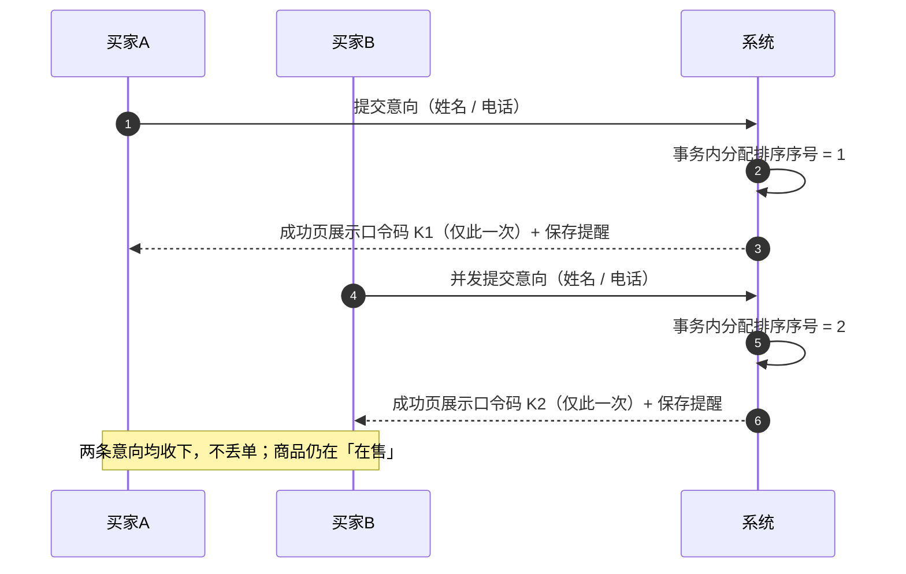

# 第 5 章　买家端需求

> 所属文档：《需求规格说明书》
> 上游依据：《粗略分析》§6.2（`FR-12` ~ `FR-22`）、§6.3（`UX-01` ~ `UX-07`）；澄清 Q1、Q3、Q5、Q8、Q10、Q18、Q19、Q22、Q23、Q24；`DEC-07`、`DEC-08`、`DEC-11`、`DEC-12`、`DEC-20`、`DEC-23`、`DEC-26`、`DEC-34`、`DEC-37`、`DEC-38`

---

## 5.1 本章说明

| 项 | 内容 |
| --- | --- |
| **目的** | 定义买家端（**无需登录的访客侧**）的全部功能需求、展示规则与交互要求 |
| **角色前提** | 买家**不注册、不登录、不设账号**（基线需求 3、澄清 Q5、`O-01`）。买家在系统中的**唯一身份凭证是口令码** |
| **与其他章的关系** | ① 功能对应第 4 章的意向状态迁移 `IS-01`、`IS-03`；② 口令码的**完整规则见第 7 章**，本章只描述买家可见的行为；③ 页面的字段、按钮、空态、错误态见第 10 章；④ 买家端**无接口契约**（服务端渲染，`A-02`） |
| **页面规模** | 买家端共 **4 个页面**：当前商品页（首页）、提交表单、提交成功、口令码查询与操作（`DEC-38`、`NFR-10`） |
| **技术形态** | 服务端渲染（JSP）+ 移动端优先的响应式布局（`C-05`、`DEC-20`）。**URL 不含商品 ID**（`A-03`） |
| **辅助编号** | 本章自定的辅助编号——异常项 `E5-xx`、展示硬约束 `K5-xx`、结构约定 `S5-xx`、边界 `B5-xx`——**均以章号限定作用域**，与全局编号（`FR` / `BR` / `PS` / `IS` / `UX` / `C` / `O` / `DEC` / `Q`）互不冲突 |

> **本章的一条主线**：买家只能做三件事——**看商品 → 提交意向（拿口令码）→ 凭码查状态**。这是业务方对买家流程的完整描述（澄清 Q23），本章所有条目都归到这条主线上。

---

## 5.2 功能条目总览

| 编号 | 功能 | 一句话说明 | 关联状态迁移 | 依据 |
| --- | --- | --- | --- | --- |
| `FR-12` | 浏览当前商品 | 无需登录即可浏览；冻结期间仍可浏览 | — | 澄清 Q3、Q19 |
| `FR-13` | 提交购买意向 | 填姓名 + 联系电话；**不冻结商品** | `IS-01` | 澄清 Q3、Q5、Q24 |
| `FR-14` | 获取口令码 | 提交成功页**当场展示、仅此一次**，须提醒保存 | — | 澄清 Q1、Q23 |
| `FR-15` | 凭口令码查询意向 | 查**当前位次**与**是否已进入交易** | — | 澄清 Q1、Q8、Q23 |
| `FR-16` | 凭口令码修改信息 | 改姓名、电话；**不影响位次** | — | 澄清 Q1、Q5、Q8 |
| `FR-17` | 凭口令码撤销意向 | **仅「排队中」可撤销**；撤销后退出队列 | `IS-03` | 澄清 Q8、Q10 |
| `FR-18` | 交易中状态提示 | 冻结期间不可提交，页面提示「商品交易中，暂停接收新意向」 | — | 澄清 Q3、Q23 |
| `FR-19` | 当前商品展示规则 | **不设商品列表**；首页直接展示当前商品 | — | 澄清 Q19、`DEC-38` |
| `FR-20` | 意向查询入口 | **不提供**「我的意向」列表页；唯一途径是输入口令码 | — | 澄清 Q19 |
| `FR-21` | 无主动通知 | 系统不向买家发送**任何**通知 | — | 澄清 Q18、`DEC-08` |
| `FR-22` | 口令码输入反馈 | 三态响应：错误口令 / 失效口令 / 有效口令 | — | 澄清 Q19、`DEC-11` |

> **注**：`FR-19` ~ `FR-22` 四条实质上是**规则与边界**而非独立操作入口，但它们决定买家端的页面结构与提示口径，故与其他功能条目同列，并逐条展开。

---

## 5.3 逐条展开

> 每条按**触发条件 / 输入 / 处理规则 / 输出 / 异常**五要素展开，可直接转测试用例。

### FR-12　浏览当前商品

| 项 | 内容 |
| --- | --- |
| **触发条件** | 买家访问买家端首页（无需登录、无需任何凭证） |
| **输入** | 无。**URL 不含商品 ID**（单一商品槽位设计，`A-03`、`DEC-38`） |
| **处理规则** | 查询**当前商品**（处于「在售」或「已冻结」的那一件，由 `BR-11` 保证至多一件）；按 `FR-19` 的展示规则渲染 |
| **输出** | 商品名称、描述、图片（无图显示占位图）、价格、当前状态（在售 / 已冻结） |
| **异常** | 无当前商品（既无在售也无冻结）→ 按 `FR-19` **不显示商品**（空态，无占位商品） |
| **关联** | `BR-11`、`BR-14`、`FR-19`、`DEC-38` |

> **关键口径**：商品处于「已冻结」时，**详情仍可浏览**（`BR-14`），只是不能提交意向。

### FR-13　提交购买意向

| 项 | 内容 |
| --- | --- |
| **触发条件** | 商品处于「**在售**」时，买家在首页进入提交表单并提交 |
| **输入** | **姓名**（必填）、**联系电话**（必填）。除此以外不采集任何信息（澄清 Q5） |
| **处理规则** | ① 校验姓名、电话非空且长度合法（长度上限见第 10 章字段定义）； ② 校验商品当前为「**在售**」，否则拒绝； ③ 校验队列未达上限（**1000 条**，详见异常表）； ④ 在**同一事务内**分配**排序序号**（独立自增，`DEC-10`、`DEC-15`）； ⑤ 生成 12 位**口令码**（规则见第 7 章）； ⑥ 该意向状态置「**排队中**」（`IS-01`）； ⑦ **商品状态不变**——提交意向**不等于**冻结商品（`BR-13`） |
| **输出** | 跳转**提交成功页**，展示该意向的口令码（`FR-14`） |
| **异常** | 见 §5.3.1 异常与边界汇总 |
| **关联** | `BR-13`、`IS-01`、`NFR-01`、`NFR-07`、`NFR-17`、`DEC-10`、`DEC-15`、`DEC-23`、`DEC-26`、`DEC-37` |

> **关键口径（易错点）**：`BR-13` 明确「提交意向不等于冻结商品」。买家的提交动作**只影响意向状态**（新增一条「排队中」），**不改变商品状态**。商品只有在卖家点「进入交易」时才冻结（`PS-01`）。

### FR-14　获取口令码

| 项 | 内容 |
| --- | --- |
| **触发条件** | `FR-13` 提交成功时**自动触发** |
| **输入** | 无 |
| **处理规则** | 在**提交成功页当场展示**该口令码原文；**仅展示这一次**，系统不重发、无通知（`BR-24`、`FR-21`）。页面须**提醒买家保存**该口令码 |
| **输出** | 口令码原文（12 位大写字母 + 数字，`DEC-07`）＋ 保存提醒文案 |
| **异常** | 买家未保存即离开 → **无自助找回渠道**（`BR-30`）；唯一补救途径是卖家在后台查看后于系统外转告（`FR-24`，【开发方新增】） |
| **关联** | `BR-24`、`BR-30`、`FR-24`、`UX-04`（业务方硬性要求）、`DEC-07` |

> 本节为**业务方明确要求**的强制项（澄清 Q23 ①）：口令码直接展示 + 提醒保存。详见 §5.7。

### FR-15　凭口令码查询意向

| 项 | 内容 |
| --- | --- |
| **触发条件** | 买家在口令码查询页输入口令码并提交（无需登录） |
| **输入** | 口令码（12 位） |
| **处理规则** | 按第 7 章的三态规则校验；校验通过（**有效口令**）时返回该意向的当前信息 |
| **输出** | ① 意向**当前位次**（「当前排第 N 位」）；② **是否已进入交易**（状态标识）。 意向处于「排队中」时返回位次；处于「交易中」时返回「已进入交易」标识 |
| **异常** | ① **错误口令**（库中无此码）→ 提示口令不正确； ② **失效口令**（码存在但意向已终态）→ 提示**已失效**，**不返回任何买家信息、不说明原因**； ③ 空值/格式不符 → 前端提示，不发起校验 |
| **关联** | `BR-28`、`BR-29`、`FR-22`、`NFR-13`、`DEC-11` |

### FR-16　凭口令码修改信息

| 项 | 内容 |
| --- | --- |
| **触发条件** | 买家凭**有效口令码**进入查询页后，选择「修改姓名 / 电话」 |
| **输入** | 新的姓名和 / 或新的联系电话（两项均可独立修改） |
| **处理规则** | 校验后更新该意向的姓名、联系电话；**改动不影响排队位次**（不改排序序号、不重新排队——澄清 Q1、Q5） |
| **输出** | 修改成功提示；返回该意向当前状态 |
| **异常** | 口令码已失效（意向终态）→ 不可修改，只提示已失效；字段校验失败 → 提示 |
| **关联** | 澄清 Q1、Q5、Q8；`BR-32` |

> **与「重复提交」的区分**：买家改信息**只能**走口令码通道，**不能**通过再次提交同名联系方式的意向来覆盖（澄清 Q24、`DEC-37`、`BR-23`）。

### FR-17　凭口令码撤销意向

| 项 | 内容 |
| --- | --- |
| **触发条件** | 买家凭**有效口令码**进入查询页后，选择「撤销意向」 |
| **输入** | 口令码（＋前端二次确认，是否启用见 §5.7 效力分级） |
| **处理规则** | **仅当意向处于「排队中」时**允许撤销；撤销后意向置「**已撤销**」（终态，`IS-03`），**退出队列** |
| **输出** | 撤销成功提示 |
| **异常** | ① 意向已处于「**交易中**」→ **不允许撤销**（`BR-19`、澄清 Q10、`O-09`）； ② 口令码已失效 → 只提示已失效 |
| **关联** | `IS-03`、`BR-19`、`BR-06`、澄清 Q9、Q10、`O-08` |

> **关键口径**：买家的「**撤销**」与卖家的「**作废 / 重新排队**」是**两回事**，互相不可触发（`BR-06`、澄清 Q9）。买家侧**只有「撤销」一个操作**，不存在「作废」「重新排队」按钮（`O-08`）。

### FR-18　交易中状态提示

| 项 | 内容 |
| --- | --- |
| **触发条件** | 商品处于「已冻结」（来源：交易冻结）期间，买家访问买家端 |
| **输入** | 无 |
| **处理规则** | ① 页面提示「**商品交易中，暂停接收新意向**」；② 提交意向入口**不可用**（隐藏或禁用）；③ 商品详情**仍可浏览** |
| **输出** | 状态提示文案 + 商品详情（只读） |
| **异常** | 若买家绕过前端直接发起提交 → 服务端**一律拒绝**（`INV-03`） |
| **关联** | `BR-02`、`BR-14`、`INV-03`、`UX-06`（业务方硬性要求）、澄清 Q3、Q23 |

### FR-19　当前商品展示规则

| 项 | 内容 |
| --- | --- |
| **触发条件** | 买家访问买家端首页 |
| **输入** | 无 |
| **处理规则** | **买家端不设「商品列表」页**，首页直接展示**当前商品**。按下列四态分别表现（见 §5.4 展开） |
| **输出** | 商品卡片 / 空态 / 冻结态 |
| **异常** | — |
| **关联** | `DEC-38`、`BR-11`、`FR-12`、`O-13` |

### FR-20　意向查询入口

| 项 | 内容 |
| --- | --- |
| **触发条件** | 买家希望查看自己已提交的意向 |
| **输入** | 口令码 |
| **处理规则** | 买家端**不提供**「我的意向 / 我的订单」列表页，**也不提供**凭姓名或电话反查意向的入口。查询自己意向的**唯一途径是输入口令码** |
| **输出** | 口令码查询页（`FR-15`） |
| **异常** | 买家遗失口令码 → 走 `FR-24` 的线下兜底路径 |
| **关联** | 澄清 Q19、`BR-32`、`NFR-05` |

> **为什么不做反查**：买家姓名、电话属个人信息；系统无身份验证手段，若能凭电话反查意向即等于任何人可查他人信息（`NFR-05`、澄清 Q18）。

### FR-21　无主动通知

| 项 | 内容 |
| --- | --- |
| **触发条件** | 系统发生任何状态变化时 |
| **输入** | — |
| **处理规则** | 系统**不向买家发送任何通知**——无短信、无邮件、无站内信、无推送（`DEC-08`、`O-14`）。买家只能**主动**凭口令码查询 |
| **输出** | 无（无通知即无输出） |
| **异常** | — |
| **关联** | 澄清 Q18、`DEC-08`、`O-14`、`FR-24` |

> **须作为业务约束理解，不得视为缺陷**：这是业务方的明确决定。正因如此，系统才需要 `FR-24`（卖家后台可查口令码）作为兜底能力。

### FR-22　口令码输入反馈

| 项 | 内容 |
| --- | --- |
| **触发条件** | 买家在口令码查询页提交口令码 |
| **输入** | 口令码 |
| **处理规则** | 按第 7 章的三态规则给出**明确且可区分**的反馈（详见 §5.6） |
| **输出** | 三种结果之一：**错误口令**（不存在）/ **失效口令**（存在但意向已终态）/ **有效口令**（返回位次与交易状态） |
| **异常** | 任何情况下「失效口令」**不得**透露交易结果、**不得**返回买家信息（`BR-29`、`NFR-13`） |
| **关联** | `BR-28`、`BR-29`、`NFR-13`、`DEC-11` |

### 5.3.1 异常与边界汇总

| 编号 | 场景 | 系统行为 | 依据 |
| --- | --- | --- | --- |
| E5-01 | 商品**已冻结**期间买家提交意向 | **拒绝**提交，提示「商品交易中，暂停接收新意向」 | `BR-02`、`INV-03` |
| E5-02 | 商品**已下架** | 买家端**不显示**该商品，无任何查询入口 | `FR-19`、澄清 Q19 |
| E5-03 | 提交时**姓名或电话为空** | 拒绝提交并提示必填项 | 澄清 Q5 |
| E5-04 | 意向队列已达 **1000 条**上限 | 拒绝新提交并提示（防御性上限） | `NFR-07`、`DEC-23` |
| E5-05 | **同一电话**对同一商品重复提交 | **允许**，每次提交独立成条，不合并、不覆盖 | `BR-23`、`DEC-37`、澄清 Q24 |
| E5-06 | 提交接口被高频调用 | 服务端**基础限流** + 前端**防抖**；**不做**图形验证码 | `NFR-17`、`DEC-26` |
| E5-07 | 两个买家「几乎同时」提交 | **两条都收下**，按事务内自增序号确定先后，不丢单 | `NFR-01`、`DEC-10`、`DEC-15` |
| E5-08 | 口令码**输错**（库中不存在） | 提示口令不正确，可重试，**不做错误次数限制** | `DEC-12`、`NFR-15` |
| E5-09 | 口令码**已失效**（意向终态） | 提示已失效，**不返回信息、不说明原因** | `BR-29`、`BR-31` |
| E5-10 | 买家在「交易中」尝试撤销 | 拒绝，提示交易已由卖家发起、无法撤销 | `BR-19`、澄清 Q10 |
| E5-11 | 买家丢失口令码 | 无自助找回；由卖家后台查看后线下转告 | `BR-30`、`FR-24` |
| E5-12 | 网络中断导致重复提交 | 每次提交独立成条（`E5-05`）；前端防抖降低重复概率 | `DEC-26`、`DEC-37` |

---

## 5.4 专题一：当前商品展示规则（`FR-19`、`DEC-38`）

### 5.4.1 四态表现

| 当前商品状态 | 买家端首页表现 | 提交意向入口 |
| --- | --- | --- |
| **无商品**（既无在售也无冻结） | **不显示商品**（空态，不生成占位商品，不展示历史） | 不存在 |
| **在售** | 正常展示：图片（无图显示占位图）、名称、描述、价格 | **可用** |
| **已冻结** | **仍展示**商品详情，并标注「**已冻结**」；页面提示「商品交易中，暂停接收新意向」 | **不可用**（隐藏或禁用） |
| **已下架** | **不显示**（买家端无历史浏览入口） | 不存在 |

### 5.4.2 三条结构约定

| 编号 | 约定 | 依据 |
| --- | --- | --- |
| S5-01 | **买家端不设「商品列表」页**。因 `BR-11` 规定同一时间至多 1 件商品处于在售或已冻结，列表最多只有 1 条，不构成列表 | `DEC-38` |
| S5-02 | **买家端 URL 不含商品 ID**。页面只需查出「当前商品」一条记录，天然不需要 ID 参数；由此也**不存在「旧链接访问已下架商品」的问题** | `A-03`、`DEC-38` |
| S5-03 | **不提供历史商品浏览入口**，也没有「我的意向」列表页 | 澄清 Q19、`O-13`、`FR-20` |

> **溯源提示（写作注意）**：`S5-02` 的正确理由是「**单一商品槽位设计**」，**不是**「因为服务端渲染」——服务端渲染同样可以携带查询参数（`DEC-38` 的分析方核对结论）。

---

## 5.5 专题二：提交意向与口令码展示（`FR-13`、`FR-14`）

### 5.5.1 正常路径

| 步 | 动作 | 系统行为 |
| --- | --- | --- |
| 1 | 买家在首页点击「提交购买意向」 | 进入提交表单（姓名、联系电话） |
| 2 | 买家填写并提交 | 校验字段 → 校验商品为「在售」→ 校验队列未达上限 |
| 3 | 系统受理 | **同一事务内**分配排序序号（自增）→ 生成 12 位口令码 → 意向置「排队中」 |
| 4 | 跳转提交成功页 | **当场展示口令码**，并**提醒买家保存** |
| 5 | 商品状态 | **保持不变**（提交不冻结商品） |

### 5.5.2 提交时序（含并发）

### 5.5.3 口令码展示的三条硬约束

| 编号 | 约束 | 依据 |
| --- | --- | --- |
| K5-01 | 展示时机 = **提交成功页**，**当场**展示 | `BR-24`、澄清 Q23 |
| K5-02 | **仅展示这一次**；系统不重发、页面不可回看 | `BR-24`、澄清 Q19 |
| K5-03 | 必须**提醒买家保存**（业务方明确要求，属强制项） | `UX-04`、澄清 Q23 |

> 口令码的格式、生成与存储规则见第 7 章；本节只约束**买家可见的展示行为**。

---

## 5.6 专题三：口令码查询与三态响应（`FR-22`）

### 5.6.1 三态判定与返回内容

| 返回结果 | 判定条件 | 是否返回买家信息 | 提示口径 |
| --- | --- | --- | --- |
| **错误口令** | 口令码在数据库中**不存在** | 否 | 提示口令不正确，可重试 |
| **失效口令** | 口令码存在，但对应意向**已处于终态** | **否** | 只说**已失效**，**不说明原因**（不得出现「商品已售出」「交易失败」等字样） |
| **有效口令** | 口令码存在，且意向为「排队中」或「交易中」 | 是 | 返回位次与交易状态 |

### 5.6.2 两条容易被写错的边界

| 编号 | 边界 | 正确口径 |
| --- | --- | --- |
| B5-01 | 失效提示能不能带原因 | **不能**。业务方要求「买家查不到任何结果（含未成交）」（澄清 Q19）；说明原因即突破该边界（`BR-29`） |
| B5-02 | 失效是否与商品下架挂钩 | **无关**。口令码有效性**只看所属意向是否终态**，与商品状态无关（`BR-26`、`INV-07`）。把「商品下架」写进失效条件即为错误 |

### 5.6.3 有效口令下的查询输出

| 意向当前状态 | 卖家端返回给买家的内容 |
| --- | --- |
| **排队中** | 「当前排第 **N** 位」（N 由排序序号决定） |
| **交易中** | 「**已进入交易**」标识（此时该意向已不在队列中） |

> 文案的最终用词在第 10 章的《提示文案表》中统一维护（`UX-07`、`NFR-09`）。

---

## 5.7 买家侧交互要求（`UX-01` ~ `UX-07`，按澄清 Q23 效力分级）

> **效力分级是本节的编写基准，不可混淆**：

| 分级 | 含义 | 对应编号 |
| --- | --- | --- |
| **① 必须满足** | 业务方**明确要求**，验收时必须逐条核对 | `UX-04`、`UX-06`（部分） |
| **② 明确不做** | 业务方明确表示**不需要** | `UX-05`（**已取消**） |
| **③ 开发方自定** | 业务方**未规定**，由开发方按体验自行决定，**不强制** | `UX-01`、`UX-02`、`UX-03`、`UX-06`（部分） |

### 5.7.1 逐条说明

| 编号 | 要求 | 效力 | 说明 |
| --- | --- | --- | --- |
| `UX-01` | 提交购买意向前二次确认（回显姓名、电话） | **开发方建议** | 业务方未规定，可按体验自行决定 |
| `UX-02` | 撤销意向前二次确认（提示不可恢复） | **开发方建议** | 同上 |
| `UX-03` | 修改姓名 / 电话前提示（不影响位次） | **开发方建议** | 同上 |
| **`UX-04`** | **成功页口令码展示与保存提醒** | **必须**（业务方明确要求） | 口令码**直接展示** + **提醒买家保存**。一键复制、「我已保存」勾选等属**可选加强** |
| ~~`UX-05`~~ | ~~交易流程说明页 / 说明文字~~ | **取消** | 业务方明确：**不需要**单独说明页，**也不需要**说明文字 |
| `UX-06` | 关键状态提示 | **部分必须** | **必须**：〈商品交易中，暂停接收新意向〉页面提示 ｜ 〈当前排第 N 位〉凭码可查 ｜ 〈是否已进入交易〉凭码可查 **可自行把握**：〈口令码已失效〉｜〈意向已撤销〉 |
| `UX-07` | 文案一致性 | **生效** | 上述提示文案集中在第 10 章《提示文案表》维护，供前端直接引用 |

### 5.7.2 业务方硬性要求清单（验收逐条核对项）

| 序号 | 硬性要求 | 依据 |
| --- | --- | --- |
| 1 | 提交成功后**口令码直接展示**，并**提醒买家保存** | 澄清 Q23 ①、`UX-04` |
| 2 | 页面提示「**商品交易中，暂停接收新意向**」 | 澄清 Q23 ①、`FR-18`、`UX-06` |
| 3 | 凭口令码**可查「当前排第 N 位」**与**「是否已进入交易」** | 澄清 Q23 ①、`FR-15`、`UX-06` |

### 5.7.3 业务方明确不要求清单

| 序号 | 不做的内容 | 依据 |
| --- | --- | --- |
| 1 | **不需要**单独的「交易流程说明」页 | 澄清 Q23 ②、`UX-05` 取消 |
| 2 | **不需要**任何流程说明文字 | 澄清 Q23 ② |
| 3 | 二次确认机制**不强制**（`UX-01` ~ `UX-03` 降级为建议） | 澄清 Q23 ② |

> **买家流程的完整表述只有一句**（业务方原话）：**看商品 → 提交意向（拿口令码）→ 凭码查状态**。除此之外无任何需要向买家解释的内容。

---

## 5.8 本章不涉及的范围

| 编号 | 不做的事 | 依据 |
| --- | --- | --- |
| `O-01` | 买家注册、登录、账号体系 | 基线需求 3、澄清 Q5 |
| `O-07` | 买家主动「确认进入交易」 | 澄清 Q8 |
| `O-08` | 买家侧「作废」「重新排队」操作入口 | 澄清 Q9 |
| `O-09` | 买家在交易中撤销 | 澄清 Q10 |
| `O-13` | 买家侧历史商品浏览、意向购买人名单展示 | 澄清 Q19 |
| `O-14` | 系统向买家发送的任何主动通知 | 澄清 Q18、`DEC-08` |
| `O-19` | 口令码错误次数限流与锁定 | `DEC-12` |
| `O-22` | 同一电话的重复意向校验 | `DEC-37` |
| — | 「我的意向 / 我的订单」列表页 | 澄清 Q19、`FR-20` |
| — | 商品列表页 | `DEC-38`、`FR-19` |
| — | 在线支付、物流、评价 | 基线需求 4、`O-04`、`O-05` |

---

## 5.9 本章引用的上游依据

| 内容 | 来源 |
| --- | --- |
| 买家端功能条目 `FR-12` ~ `FR-22` | 《粗略分析》§6.2 |
| 买家侧交互要求 `UX-01` ~ `UX-07` 及效力分级 | 《粗略分析》§6.3；澄清 **Q23** |
| 提交意向不冻结商品 | 澄清 Q3、`BR-13` |
| 口令码当场展示、仅一次、须提醒保存 | 澄清 Q1、Q19、Q23；`BR-24` |
| 口令码三态校验与失效不说明原因 | 澄清 Q19；`DEC-11`、`BR-28`、`BR-29` |
| 不设商品列表、URL 不含商品 ID | **`DEC-38`** |
| 买家侧不提供历史浏览与意向列表 | 澄清 Q19、`O-13` |
| 系统不发送任何通知 | 澄清 Q18、`DEC-08` |
| 同一电话可重复提交、不做去重 | 澄清 **Q24**、`DEC-37`、`BR-23` |
| 队列上限 1000 条 | `DEC-23`、`NFR-07` |
| 提交接口基础限流 + 前端防抖 | `DEC-26`、`NFR-17` |
| 移动端优先、买家端 4 页 | `DEC-20`、**`DEC-38`**、`NFR-10` |
| 交互要求与文案口径 | 澄清 Q23、`NFR-14`、`NFR-09` |
| 意向状态迁移 `IS-01`、`IS-03` | 本说明书第 4 章 §4.5 |

---

## 5.10 待确认与开放事项

| 类型 | 编号 | 内容 | 处置 |
| --- | --- | --- | --- |
| 待开发方追认 | — | **交易失败原因对买家不可见**（含「失效口令」不说明原因） | 分析方按业务边界默认取值，见《开发方决策记录》附二；本章 §5.6 按「不可见」编写 |
| 开放项 | `OPEN-01` | 系统部署形态（单机 vs 容器化） | 不阻塞本章；见第 13 章附录 |
| 开放项 | `OPEN-02` | 数据备份与恢复策略 | 不阻塞本章；见第 13 章附录 |
| 开放项 | `OPEN-03` | 数据导出能力 | 不阻塞本章；见第 13 章附录 |
| 待补充 | — | 姓名 / 联系电话的**字段级长度上限** | 上游文档未规定；在第 10 章字段定义中一并补默认值 |
| 待补充 | — | 各提示文案的**最终用词** | 在第 10 章《提示文案表》中统一维护（`UX-07`） |

> **本章无阻塞项**。所有业务规则与开发方决策均已闭合。
