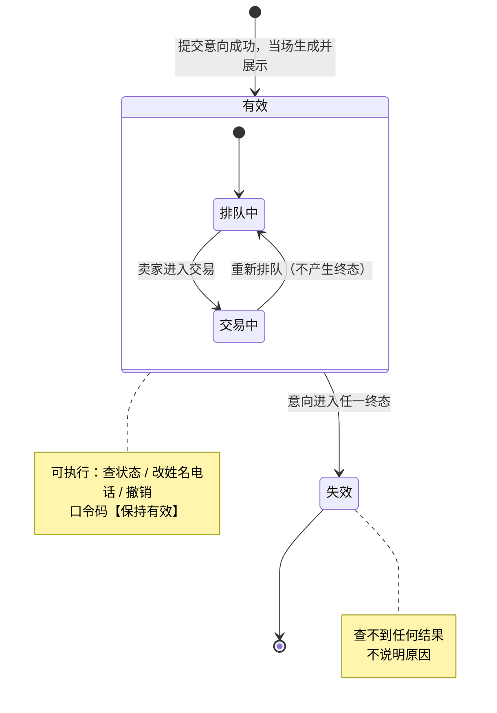

# 第 7 章　口令码专题

> 所属文档：《需求规格说明书》　｜　**版本：v1.1（开发阶段修订）**
> 上游依据：《粗略分析》§6.4（`BR-24` ~ `BR-33`）、§5.3 相关规则；澄清 Q1、Q6、Q8、Q9、Q10、Q11、Q18、Q19、Q20、Q22；`DEC-02`、`DEC-03`、`DEC-04`、`DEC-05`、`DEC-07`、`DEC-11`、`DEC-12`、`DEC-26`；**本版新增已决 `9-S`**
>
> **⚠️ v1.1 修订摘要**：`S7-04`（口令码不因下架被删除）修订为「**在购买意向表中保留，但归档时不复制到历史意向表**」——终态口令码已失效且无读取方。详见 §7.9 与本章末「修订记录」。

---

## 7.1 本章说明

| 项 | 内容 |
| --- | --- |
| **目的** | 把口令码从**生成 → 展示 → 校验 → 失效 → 找回**的完整生命周期集中定义，避免规则散落在各章时出现口径冲突 |
| **为什么单列一章** | 口令码是**无账号体系下买家唯一的身份凭证**，它同时牵扯功能需求（`FR-14`、`FR-15`、`FR-22`、`FR-24`）、数据字段（第 9 章）、状态机联动（第 4 章）与安全权衡（第 12 章）。**它是本项目需求分析中最容易写错的一块** |
| **与其他章的关系** | ① 买家可见的行为在第 5 章 §5.5、§5.6；② 卖家侧查看能力对应 `FR-24`（第 6 章）；③ 失效判定依赖第 4 章的**意向终态**定义；④ 存储要求影响第 9 章字段设计；⑤ 安全权衡登记入第 12 章 |
| **一句话结论** | **口令码的有效性只取决于「所属意向是否处于终态」，与商品状态完全无关。** |
| **辅助编号** | 本章自定的辅助编号——边界 `B7-xx`、存储要求 `S7-xx`、安全权衡 `R7-xx`——**均以章号限定作用域**，与全局编号（`FR` / `BR` / `PS` / `IS` / `UX` / `C` / `O` / `DEC` / `Q`）及《粗略分析》修订记录编号 `R1` ~ `R16` 互不冲突 |

---

## 7.2 口令码的定位与生命周期总览

### 7.2.1 定位

| 项 | 内容 |
| --- | --- |
| **是什么** | 系统在买家提交意向成功后**当场生成并展示的唯一凭证**（第 1 章术语表） |
| **为什么需要** | 买家**不注册、不登录、不设账号**（基线需求 3、`O-01`），系统需要一个不依赖账号机制的凭证来识别「这条意向是谁的」 |
| **与意向的关系** | **一一对应**，全局唯一（`BR-25`） |
| **能做什么** | **只有三件**：查状态、改姓名电话、撤销意向（`BR-32`） |
| **不能做什么** | 不能登录、不能查看他人意向、不能查看商品、不能修改商品、不能作废或重新排队（`BR-32`、`O-08`） |

### 7.2.2 生命周期总览

### 7.2.3 与意向状态的绑定关系（核心表）

| 意向状态 | 是否终态 | 口令码是否有效 | 买家可执行的操作 |
| --- | --- | --- | --- |
| **排队中** | 否 | ✅ **有效** | 查位次 / 改姓名电话 / 撤销 |
| **交易中** | 否 | ✅ **有效** | 查「是否已进入交易」/ 改姓名电话（**不可撤销**） |
| **交易成功** | **是** | ❌ 失效 | 无 |
| **交易失败** | **是** | ❌ 失效 | 无 |
| **已撤销** | **是** | ❌ 失效 | 无 |

> **关键口径（`BR-27`）**：「**重新排队**」**不是终态**，而是从「交易中」**回到**「排队中」。因此该意向的口令码**保持有效**，买家可继续使用**原口令码**查询。

---

## 7.3 生成规则

| 编号 | 规则 | 依据 |
| --- | --- | --- |
| `BR-25` | 口令码与该条购买意向**一一对应**，**全局唯一** | 澄清 Q1、Q20 |
| `BR-25` | 格式为 **12 位大写字母 + 数字**（字符集 36：A–Z 与 0–9）。**不排除易混字符** `0 / O / 1 / I` | `DEC-07`、`C-16` |
| — | **生成时机**：在 `FR-13` 提交意向的**同一事务内**生成，与该意向的排序序号一并分配 | 澄清 Q1、`DEC-10` |
| `BR-24` | 生成后**立即**在提交成功页展示（见 §7.4） | 澄清 Q1、Q19 |

**两点补充说明**

| 项 | 说明 |
| --- | --- |
| **为什么不排除易混字符** | 本系统买家需**手动输入**该码，排除 `0/O/1/I` 会同时抬高输错与输入成本。开发方**接受该取舍**，登记为**已知体验代价**，不视为缺陷（`DEC-07`） |
| **业务方的原始要求** | 业务方在 Q20 明确「需求里**没做要求**，没有长度限制、也没有格式规定，只要求它是『唯一』的」。**12 位是开发方决定**（`DEC-07`），不是业务方要求 |

> **澄清一处常见混淆**：业务方在 Q20 提到的「长度不少于 8 位」是**卖家后台登录密码**的要求（`C-17`），**不适用于口令码**。

---

## 7.4 展示规则

| 编号 | 规则 | 依据 |
| --- | --- | --- |
| `BR-24` | 口令码在提交意向成功后**当场展示在成功页面**，**且仅展示这一次** | 澄清 Q1、Q19 |
| `UX-04` | 成功页**必须提醒买家保存**该口令码（业务方**明确要求**，属强制项） | 澄清 **Q23** |
| — | 系统**不重发**、页面**不可回看**、买家侧**无任何找回入口** | `BR-24`、`BR-30` |
| `FR-21` | 系统**不向买家发送任何通知**（无短信、邮件、站内信、推送），口令码不会以任何其他途径送达买家 | 澄清 Q18、`DEC-08` |

> **展示是口令码规则中唯一的"展示机会"**：一次错过即进入 §7.9 的兜底路径。这也是业务方为何把它列为**硬性要求**的原因。

---

## 7.5 有效性与失效规则（本章核心）

### 7.5.1 判定标准

| 编号 | 规则 | 依据 |
| --- | --- | --- |
| **`BR-26`** | 口令码有效性**只取决于该条意向是否处于终态**，**与商品状态无关**：意向为「排队中」或「交易中」时**有效**；意向进入「交易成功」「交易失败」「已撤销」**任一终态即失效** | 澄清 Q20、`DEC-02` |
| `INV-07` | （数据不变量）口令码的有效性**只与所属意向是否终态相关**，与商品状态无关 | `DEC-02` |
| `INV-08` | （数据不变量）处于「**排队中**」的意向，其口令码**必然有效** | `DEC-04` 复用原意向的直接推论 |

### 7.5.2 失效的四条触发路径

| 序号 | 触发路径 | 状态迁移 | 说明 |
| --- | --- | --- | --- |
| 1 | 卖家标记**交易成功** | `IS-05` 交易中 → 交易成功 | 该买家成交，口令码失效 |
| 2 | 他人成交导致**商品已售出** | `IS-04` 排队中 → 交易失败（商品已售出） | 由 `FR-09` 自动批量处理，**买家侧查不到任何结果** |
| 3 | 卖家裁决**作废** | `IS-06` 交易中 → 交易失败（卖家作废） | 卖家在标记交易失败时选择「作废」 |
| 4 | 买家自行**撤销** | `IS-03` 排队中 → 已撤销 | 仅「排队中」可撤销 |

> **注意**：卖家标记**交易失败**本身并**不必然**使口令码失效——若卖家同时选择「**重新排队**」，则意向回到「排队中」，口令码**保持有效**（`BR-27`、`IS-07`）。

### 7.5.3 「失效」不等于「商品下架」

| 编号 | 边界 | 正确口径 |
| --- | --- | --- |
| **B7-01** | 商品下架会不会导致口令码失效 | **不直接导致**。口令码失效**只看意向是否终态**。之所以「商品下架后所有口令码都失效」，是因为下架的前提是**其名下所有意向均已处于终态**（`INV-05`），而终态才使口令码失效——**两个规则是「必然同时成立」，不是「因果」** |
| **B7-02** | 商品仍在售 / 已冻结时口令码是否有效 | **有效**。只要意向不是终态，即使商品已冻结，买家仍可用口令码查询 | 
| **B7-03** | 意向终态时商品是否一定下架 | **不一定**。交易失败（作废）后商品恢复在售（`PS-04`），此时该意向的口令码**已失效**，但商品**仍在售** |

> **这是本章最容易被写错的一条**：**把「商品下架」写入口令码失效条件**是错的（详见 §7.11 易错点集中第 2 条）。

### 7.5.4 失效后买家侧的表现

| 编号 | 规则 | 依据 |
| --- | --- | --- |
| `BR-31` | 口令码失效后，买家**无法**再查询或修改任何内容，也**无法获知任何结果**（**包括「未成交」「已成交」**） | 澄清 Q6、Q19 |
| — | 买家侧**查不到任何结果**，但**卖家后台历史记录完整保留**（含姓名、电话、提交时间、对应结果） | `BR-21`、澄清 Q6、Q15 |
| — | 已下架商品在买家侧**不显示**，买家**没有任何查询途径** | 澄清 Q19、`FR-19` |

---

## 7.6 校验与三态响应

### 7.6.1 校验维度

| 编号 | 规则 | 依据 |
| --- | --- | --- |
| `DEC-11` | 校验「**码 → 意向**」的映射是否存在，以及该意向**是否处于终态**。**不再单独校验商品是否下架** | `DEC-02`、`DEC-11` |
| `BR-28` | 校验返回**三种**结果（见下表） | 澄清 Q19、`DEC-11` |
| `NFR-13` | 反馈须**可理解**，且**区分「错误口令」与「失效口令」** | 澄清 Q19、`DEC-11` |

### 7.6.2 三态响应定义

| 返回结果 | 判定条件 | 是否返回买家信息 | 提示口径 |
| --- | --- | --- | --- |
| **错误口令** | 口令码在数据库中**不存在** | **否** | 提示口令不正确，可重试 |
| **失效口令** | 口令码存在，但对应意向**已处于终态** | **否** | 只说**已失效**，**不说明原因** |
| **有效口令** | 口令码存在，且对应意向为「**排队中**」或「**交易中**」 | **是** | 返回位次与交易状态 |

### 7.6.3 两条不得越界的约束

| 编号 | 约束 | 依据 |
| --- | --- | --- |
| **`BR-29`** | 「失效口令」的提示**只说已失效、不说明原因**，**不得透露**「商品已售出」「交易失败」等结果 | 澄清 Q19、`DEC-11`（合并原 `DEC-36`） |
| `BR-32` | 即使校验通过（有效口令），买家**也只能**执行三件操作，无其他数据出口 | 澄清 Q8 |

> **为什么必须严格**：业务方在 Q19 明确「买家**查不到任何结果**（包括『没成交』这个结果）」。若失效提示带出原因，等于**绕过了业务方划定的信息边界**——这属于**需求违背**，不是文案瑕疵。

### 7.6.4 错误次数策略

| 编号 | 规则 | 依据 |
| --- | --- | --- |
| `BR-33` | 口令码查询接口**不做错误次数限制** | `DEC-12` |
| `NFR-15` | 同上，登记为非功能需求 | `DEC-12` |

> **`BR-33` 的取舍前提（原 `BR-34`，已不在规则清单内）**：该取舍成立的前提是**口令码长度保持 12 位**；若将来缩短长度，**必须同步启用错误次数限流**。该前提属**取舍前提而非业务规则**，已从第 8 章规则清单删除、**编号 `BR-34` 保留不复用**，改由**第 12 章「已接受的风险」**登记（见第 8 章 §8.6 第 5 项、§8.2.1）。
>
> **与「提交接口限流」的区分（易被误读为同一项）**：`DEC-26`（`NFR-17`）的「基础限流 + 前端防抖」针对的是**提交购买意向接口**（唯一的匿名写入口），而 `DEC-12` 针对的是**口令码查询接口**。**两者分列，不矛盾**（`DEC-12` 分析方备注）。

---

## 7.7 可执行操作全集

| 编号 | 规则 | 依据 |
| --- | --- | --- |
| `BR-32` | 口令码可执行的操作**仅限三件**：① **查询状态**（位次 / 是否已进入交易）；② **修改姓名、联系电话**；③ **撤销意向**。**无其他用途** | 澄清 Q8 |

| 操作 | 允许的意向状态 | 效果 | 约束 |
| --- | --- | --- | --- |
| **查询状态** | 排队中 / 交易中 | 排队中 → 返回「当前排第 N 位」；交易中 → 返回「已进入交易」 | 终态时返回「失效」，不返回信息 |
| **修改姓名 / 电话** | 排队中 / 交易中 | 更新该意向的姓名、电话 | **不影响排队位次**（不改排序序号、不重新排队，澄清 Q1、Q5） |
| **撤销意向** | **仅排队中** | 意向 → 已撤销（终态），退出队列，后续买家位次前移 | **交易中不可撤销**（`BR-19`、澄清 Q10、`O-09`） |

**明确不在口令码能力范围内的操作**

| 操作 | 为什么不能 |
| --- | --- |
| 「作废」/「重新排队」 | 这是**卖家**在交易失败后的裁决权，买家侧**没有这两个按钮**（`BR7-06`、`BR-18`、澄清 Q9、`O-08`） |
| 买家主动「确认进入交易」 | 进入交易由**卖家**发起（澄清 Q8、`O-07`） |
| 查看他人意向 / 名单 | 无身份验证手段，将导致个人信息越权访问（`NFR7-05`） |
| 修改已提交的意向内容（除姓名电话外） | 仅姓名、电话两项可改（澄清 Q5） |
| 再次获取口令码 | **仅展示一次**，无自助重发（`BR-24`、`BR-30`） |

---

## 7.8 丢失、找回与后台代查

| 编号 | 规则 | 依据 |
| --- | --- | --- |
| `BR-30` | 口令码**无买家自助找回渠道**；**卖家后台可查看非终态意向的口令码**并在线下转告买家 ⇒ 口令码须**可反查原文**（明文或可逆存储） | 澄清 Q19、`DEC-03`、`DEC-05` |
| `NFR-16` | 同上，登记为**已接受的安全权衡**，须在安全章节说明 | `DEC-03`、`DEC-05` |
| `FR-24` | 功能入口：卖家后台在意向名单中查看**非终态意向**（排队中 / 交易中）的当前口令码（**开发方新增**） | `DEC-03`、`DEC-05` |
| `X-03` | 口令码的**线下转告**属**系统外业务**：系统只提供查询手段，告知动作由卖家在系统外完成 | 第 4 章 §4.3 |

**丢失场景的完整处理路径**

| 步 | 动作 | 执行者 | 在系统内还是系统外 |
| --- | --- | --- | --- |
| 1 | 买家发现口令码丢失 | 买家 | — |
| 2 | 买家联系卖家（线下） | 买卖双方 | **系统外** |
| 3 | 卖家在后台意向名单中查得口令码原文 | 卖家 | **系统内** |
| 4 | 卖家口头 / 电话告知买家 | 卖家 | **系统外** |
| 5 | 买家凭码查询、改信息或撤销 | 买家 | **系统内** |

> **前提**：该意向必须处于**非终态**。若意向已终态，口令码已失效，展示亦无意义——买家**无法再获得任何结果**（`BR-31`），这是业务方明确接受的限制（见第 13 章「已知限制」）。

---

## 7.9 存储要求

| 编号 | 要求 | 依据 |
| --- | --- | --- |
| **S7-01** | 口令码须**可反查原文**——允许**明文存储**，或采用**可逆加密**。**不可**只存单向哈希 | `BR-30`、`DEC-03`、`DEC-05` |
| S7-02 | 口令码字段**非空、全局唯一**（唯一索引） | `BR-25` |
| S7-03 | 口令码与意向**一一对应**，不作为独立实体的主键 | `BR-25` |
| S7-04 | 口令码**不因商品下架而被删除**——**在购买意向表中**须完整保留；但**归档时口令码不复制到历史意向表**，即**历史记录中不含口令码字段** | `BR-21`、`DEC-19`；**已决 `9-S`（v1.1 修订）** |

> `S7-01` 是**由 `BR-30` 倒逼**出来的存储要求：因为卖家后台要能看到码的原文，所以不能只存哈希。该要求在 `DEC-03` 的分析方解读中被明确指出。
>
> **⚠️ `S7-04` 的 v1.1 修订说明**：本条原表述为「口令码**不因商品下架而被删除**——历史记录须完整保留（含口令码字段），以支持卖家后台的历史查询」。
> 修订理由（已决 `9-S`）：
> ① **口令码在归档时必已失效**——归档前置条件是「名下所有意向均已终态」（`INV-05`、`BR-10`），而意向一旦终态口令码即失效（`BR-26`）；
> ② **口令码的查看能力只对非终态意向开放**——`FR-24`／`NFR-16` 明确「对终态意向**不返回可用值**」，故历史中的口令码**无任何读取方**；
> ③ **原动机不成立**——本条给出的理由是「支持卖家后台的历史查询」，但历史查询（`I11-16`）**只展示姓名、电话、意向提交时间与对应交易结果**，**不消费口令码**；
> ④ **附带收益**——删除历史口令码后，`token` 的「全局唯一」只需在**购买意向表**内成立，原本存在的**跨表唯一性缺口随之消除**（详见第 9 章 §9.13.2）。
> **边界提示**：删除后若将来出现「凭口令码查询历史结果」的需求，将**无法实现**；但该需求与 `BR-31`（口令码失效后买家查不到**任何**结果）**直接冲突**，属明确不做的事项（`R7-05`／`R12-09`），故本修订与既有需求**不矛盾**。

---

## 7.10 安全权衡与已接受的风险

> 本节是本专题的**必要组成**：口令码的若干取舍都属「明知有代价但接受」。**已登记的取舍必须显式写出，并注明接受理由**，否则在验收与安全评审中会被当作遗漏（第 13 章 §13.3.5 对已接受风险有明确验收要求）。

| 序号 | 取舍 | 代价 | 接受理由 | 依据 |
| --- | --- | --- | --- | --- |
| **R7-01** | 口令码**明文可反查**（不存哈希） | 数据库泄露 ⇒ 全部凭证泄露 | 卖家后台须能查看原文以兜底转告（`BR-30`）；本系统为**单卖家小规模场景**，风险可接受 | `DEC-05`、`NFR-16` |
| **R7-02** | 口令码查询**不做错误次数限流** | 可被无限次尝试 | 12 位码空间约 **36¹² ≈ 4.7×10¹⁸**，穷举不现实 | `DEC-12`、`NFR-15`、`NFR7-02` |
| **R7-03** | 口令码**不排除易混字符** `0/O/1/I` | 买家手动输入更易输错 | 缩短字符集同时会抬高输入成本；开发方接受该体验代价 | `DEC-07` |
| **R7-04** | 明确区分「**错误口令**」与「**失效口令**」 | 攻击者可判断某码是否**曾经存在**，构成轻量枚举探测面 | 换取「口令码防误输」体验；因 `R7-02` 的码空间足够大，风险可接受 | `DEC-11` |
| **R7-05** | 口令码失效后买家**查不到任何结果**（含未成交） | 未成交的买家得不到任何反馈（系统也无通知） | 业务方明确要求（澄清 Q19）；属**业务约束**而非缺陷 | 澄清 Q19、`BR-31` |
| **R7-06** | 系统**不发送任何通知** | 买家只能主动查询，可能长期不知情 | 业务方明确决定（澄清 Q18、`DEC-08`） | `DEC-08` |

> **`R7-02` 的取舍前提（原 `BR-34`，已不在规则清单内）**：`R7-02` 成立的前提是**口令码长度保持 12 位**。若将来缩短长度，**必须同步启用错误次数限流**，否则该取舍不再成立。该前提属**取舍前提而非业务规则**，已从第 8 章规则清单删除、**编号保留不复用**，改由**第 12 章「已接受的风险」**登记。
>
> **`R7-04` 的边界**：区分三态**不等于**可以透露交易结果。「失效口令」的文案**不得说明失效原因**（`BR-29`）。

---

## 7.11 易错点集中（写作与验收核对清单）

> 本节汇总口令码规则中最容易被写错的 8 处口径，供评审时逐条核对。

| 序号 | 常见错误写法 | **正确口径** | 依据 |
| --- | --- | --- | --- |
| 1 | 把「**重新排队**」当作终态 | **重新排队不产生终态**，意向从「交易中」回到「排队中」，**口令码保持有效** | `BR-27` |
| 2 | 把「**商品下架**」写入口令码失效条件 | 口令码失效**只看意向是否终态，与商品状态无关** | `BR-26`、`INV-07` |
| 3 | 「失效口令」的提示**带原因** | 只说已失效，**不得透露**「商品已售出」「交易失败」 | `BR-29` |
| 4 | 认为**交易失败必然使口令码失效** | **不必然**——若同选「重新排队」，则口令码保持有效 | `BR-27`、`IS-07` |
| 5 | 把口令码写成「**服务端对意向的数字签名**」 | 那是**实现方案**而非需求；需求口径是「**唯一、即显即存**」 | `R6`（《粗略分析》修订说明） |
| 6 | 认为口令码需要**登录或账号** | 口令码**本身就是**无账号体系下的身份凭证，不代表账号 | 基线需求 3、`O-01` |
| 7 | 买家侧写「**找回口令码**」功能 | 买家侧**无自助找回**；唯一路径是卖家后台查看后**线下转告** | `BR-30`、`FR-24` |
| 8 | 认为口令码**可重复查看** | **仅展示一次**（提交成功页），系统不重发 | `BR-24` |

---

## 7.12 相关历史：GAP-01（静默买家漏洞）

| 编号 | 原问题 | 当前状态 |
| --- | --- | --- |
| `GAP-01` | 无通知机制（澄清 Q18）+ 交易结束口令码失效（澄清 Q20）+ 重新排队 ⇒ 买家在系统内**无法获知新口令码**，只能靠卖家在系统外告知；若卖家忘记告知，该买家成为「**静默买家**」 | **已消解（正式关闭）** |

**消解过程（本项目需求分析的一个实例）**

| 步 | 内容 |
| --- | --- |
| 1 | 分析方由「Q18 无通知」+「Q20 交易结束即失效」交叉阅读推出漏洞，业务方在 Q20 追问中**确认**「这确实是个漏洞」 |
| 2 | 漏洞登记为 `GAP-01`，处置方案转 `DEC-03`（后台展示新码并转告） |
| 3 | 开发方在 `DEC-04` 中决定「**复用原意向**」——重新排队**不产生新码**，原码**保持有效** |
| 4 | 由此 `GAP-01` **自然消解**；`DEC-03` 的后台口令码展示能力**降级为兜底功能**（买家丢失口令码时使用），仍予保留 |

> **这是「漏洞由需求分析发现、由设计决策闭合」的典型案例**。若被问到「你们发现的漏洞后来怎么处理的」，这是标准答案。
>
> **与 `GAP-01` 相关的口径**：`BR-27`（重新排队不产生终态）既是口令码规则，也是 `GAP-01` 的消解条件——两者是**同一条裁定的两面**（《开发方决策记录》附一冲突 1）。

---

## 7.13 本章引用的上游依据

| 内容 | 来源 |
| --- | --- |
| 口令码规则 `BR-24` ~ `BR-33` | 《粗略分析》§6.4 |
| 提交成功后当场生成并展示、仅一次 | 澄清 Q1、Q19；`BR-24` |
| 12 位大写字母 + 数字、不排除易混字符 | **`DEC-07`**、`C-16` |
| 失效以**意向终态**为准、与商品状态无关 | **`DEC-02`**、`BR-26`、`INV-07` |
| **重新排队不产生终态**、口令码保持有效 | **`DEC-04`**、附一冲突 1 裁定、`BR-27`、`INV-08` |
| 三态校验响应 | **`DEC-11`**、`BR-28` |
| 失效提示不说明原因 | 澄清 Q19；`DEC-11`（合并原 `DEC-36`）、`BR-29` |
| 后台可查口令码（**开发方新增**） | **`DEC-03`、`DEC-05`**、`BR-30`、`FR-24`、`NFR-16` |
| 不做错误次数限制 | **`DEC-12`**、`BR-33`、`NFR-15` |
| 缩短长度须同步限流（**取舍前提，非业务规则**） | 【分析方提示】；**改由第 12 章「已接受的风险」登记**（原 `BR-34` 已删除、编号不复用） |
| 失效后查不到任何结果 | 澄清 Q6、Q19；`BR-31` |
| 可执行操作仅三件 | 澄清 Q8；`BR-32` |
| 系统不发送任何通知 | 澄清 Q18；`DEC-08`、`FR-21` |
| 口令码只展示一次、无自助找回 | 澄清 Q19 |
| 买家侧业务方硬性要求（展示 + 保存提醒） | 澄清 **Q23**、`UX-04` |
| `GAP-01` 消解 | 《粗略分析》§6.4；《开发方决策记录》附一冲突 1 |
| 意向终态定义 | 本说明书第 4 章 §4.5.1、§4.5.4 |

---

## 7.14 待确认与开放事项

| 类型 | 编号 | 内容 | 处置 |
| --- | --- | --- | --- |
| 待开发方追认 | — | 「**失效口令**」提示**不说明原因** | 分析方按业务边界默认取值（`BR-29`），见《开发方决策记录》附二；本章按「不说明」编写 |
| 待补充 | — | 三态提示的**最终文案用词** | 在第 10 章《提示文案表》统一维护（`UX-07`、`NFR-09`） |
| 待补充 | — | 口令码输入框是否做**大小写自动转换 / 去空格 / 分组显示**等输入体验处理 | 上游未规定，属开发方自定项；在第 10 章补 |
| 已闭合 | — | 口令码校验是否检查商品状态 | **不检查**（`DEC-02` 已定：只查意向是否终态） |
| 已闭合 | `GAP-01` | 静默买家漏洞 | **已消解**，见 §7.12 |
| 开放项 | `OPEN-01` | 系统部署形态（单机 vs 容器化） | 不阻塞本章；见第 13 章附录 |
| 开放项 | `OPEN-02` | 数据备份与恢复策略 | 不阻塞本章；注意备份须覆盖口令码字段所在的**购买意向表**（历史意向表已不含口令码，见 §7.9 `S7-04`） |
| 开放项 | `OPEN-03` | 数据导出能力 | 不阻塞本章；见第 13 章附录 |

> **本章无阻塞项**。所有业务规则与开发方决策均已闭合。

---

## 修订记录

> 本节记录本章的版本变更。**本次修订使《需求规格说明书》整体版本由 v1.0 升至 v1.1。**

| 版本 | 阶段 | 修订内容 | 依据 |
| --- | --- | --- | --- |
| **v1.0** | 阶段一 · 需求分析 | 本章初稿。含 `B7-xx`、`S7-01 ~ S7-04`、`R7-01 ~ R7-06`、`GAP-01` 消解过程 | 《粗略分析》§6.4、澄清 Q1~Q23、`DEC-02~DEC-12` |
| **v1.1** | **阶段二 · 开发（后端数据层）** | **`S7-04` 修订**（见下）；章首题注与 §7.14 的 `OPEN-02` 说明同步更新 | 已决 `9-S`（数据字典 v1.1）；开发方裁定 |

### v1.1 修订明细

| 序号 | 修订位置 | 修订前 | 修订后 | 依据 |
| --- | --- | --- | --- | --- |
| 1 | **§7.9 `S7-04`** | 口令码**不因商品下架而被删除**——历史记录须完整保留（含口令码字段），以支持卖家后台的历史查询 | 口令码**不因商品下架而被删除**——**在购买意向表中**须完整保留；但**归档时口令码不复制到历史意向表**，即**历史记录中不含口令码字段** | 已决 `9-S` |
| 2 | §7.9 附注 | 仅说明 `S7-01` 的由来 | **新增 `S7-04` 的 v1.1 修订说明**（4 条理由 + 边界提示） | 已决 `9-S` |
| 3 | 章首题注 | 无版本标注 | 标注 **v1.1（开发阶段修订）**、修订摘要 | 本次修订 |
| 4 | §7.14 `OPEN-02` 行 | 「注意备份须覆盖口令码字段所在的数据表」 | 明确为「**购买意向表**」，并注明历史意向表已不含口令码 | 已决 `9-S` |
| 5 | 本章末 | 无修订记录 | **新增本节「修订记录」** | 本次修订 |

> **v1.1 未修订的内容（有意保留）**：`S7-01`（可反查原文）、`S7-02`（非空、全局唯一）、`S7-03`（不作为独立实体主键）、`BR-24 ~ BR-33`、`R7-01 ~ R7-06`、`B7-01 ~ B7-03`、`GAP-01` 的消解结论**均不变**。
> `S7-02` 的「全局唯一」在第 9 章 v1.1 后**更严谨**了：因历史意向表已不含 `token`，该唯一性只需在**单表**内成立。
