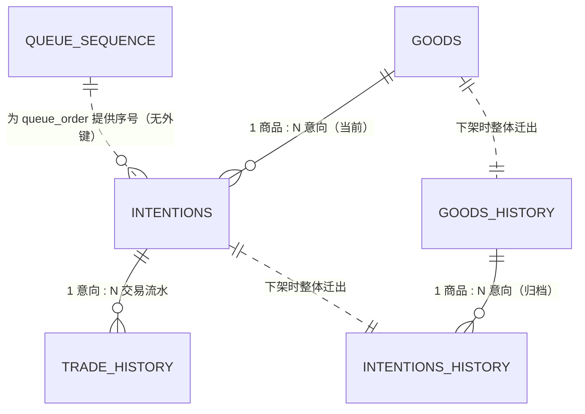

# 第 9 章　数据字典

> 所属文档：《需求规格说明书》　｜　**版本：v1.1（开发阶段修订）**　｜　上游依据：《粗略分析》§7.1、§7.2、§7.3；《需求规格说明书》第 3 章 §3.3、第 4 章；`DEC-01`、`DEC-04`、`DEC-05`、`DEC-06`、`DEC-07`、`DEC-09`、`DEC-10`、`DEC-13`、`DEC-14`、`DEC-15`、`DEC-17`、`DEC-19`、`DEC-21`、`DEC-22`、`DEC-23`、`DEC-24`、`DEC-25`、`DEC-26`、`DEC-27`、`DEC-32`、`DEC-34`、`DEC-37`；**本版新增已决 `9-S`、`9-T`**
>
> **⚠️ v1.1 修订摘要**（详见本章末「修订记录」）：① 主键形态改为**「表前缀 + 标准 UUID」**、列宽 `varchar(50)`（`9-S`）；② 新增**队列序号辅助表** `simpleshop_queue_sequence`，表清单由 6 张增至 **7 张**（`9-S`）；③ 历史意向表**删除 `queue_order` 与 `token`**（`9-S`）；④ 明确**值校验不下沉数据库**（`9-T`）。

---

## 9.1 本章说明

| 项 | 内容 |
| --- | --- |
| **目的** | 定义系统全部业务数据的表结构与字段口径，作为建表、接口契约（第 11 章）与测试造数的依据。 |
| **来源** | 《粗略分析》§7.1（商品）、§7.2（购买意向）、§7.3（新增表）；第 3 章 §3.3（数据与时间规范 `C-10 ~ C-18`）。 |
| **与第 8 章的关系** | 第 8 章的 `BR` / `INV` 是本表**约束与校验**的来源；本表须能支撑 `INV-01 ~ INV-08` 的判定。 |
| **与第 4 章的关系** | 商品状态、意向状态的取值须与第 4 章 §4.4、§4.5 的状态定义**完全一致**，不得增删取值。 |
| **与第 11 章的关系** | 接口契约的字段取自本章；接口层不得引入本章未登记的持久化字段。 |
| **编号口径** | **本章不新增编号前缀**。数据规范沿用第 3 章 `C-10 ~ C-18`，校验规则引用 `C-xx` / `FR-xx` / `BR-xx` / `DEC-xx` / `INV-xx`；本章**辅助编号仅 `9-A ~ 9-T`**（§9.13）。 |
| **校验层级口径（v1.1 新增，已决 `9-T`）** | 本章的字段「**长度**」是**物理承载**，「**取值域／格式／区间**」是**业务校验**。数据库只承担**结构完整性**（非空、唯一、外键）与**纯物理性**时间先后；值校验一律由**应用层**拦截。验收以本章「约束」列为准，**不以数据库约束为准**（见 §9.10 前言、§9.13.1 `9-T`）。 |
| **本章不做什么** | ① 不重复第 3 章的技术选型（`C-xx` 正文）；② 不定义接口报文结构（见第 11 章）；③ **不定义操作日志**（`NFR-12`；已决 `9-B`：操作日志非数据库物理结构，由应用日志实现）；④ 不定义卖家会话存储（见 §9.2.7；需求层面开放项 `9-O`）；⑤ **不定义值校验的失败文案**（见第 10 章文案表）。 |

---

## 9.2 通用约定与命名规范

### 9.2.1 字段定义表的列约定

| 列 | 含义 | 填写要求 |
| --- | --- | --- |
| **字段名** | 数据库物理字段名 | 小写下划线（snake_case）；主键统一 `id`，外键 `fk_<表名简称>_id`（§9.2.2） |
| **中文名** | 业务名称 | 用于文档与界面口径 |
| **类型** | MySQL 字段类型 | 见 §9.2.6 |
| **长度** | 长度／精度 | 是否预留见 §9.2.4 |
| **必填** | `是` / `否` / `条件必填` | 「条件必填」须在「约束」列写明触发条件 |
| **约束** | 主键／外键／唯一／取值域／格式／检查约束 | 业务限制以本列为准；枚举取值见 §9.9 |
| **默认值** | 建表默认值 | 无默认值填 `无` |
| **说明** | 业务含义、展示口径、依据编号 | 须带 `BR-xx` / `DEC-xx` / 澄清 `Qxx` 依据 |

### 9.2.2 命名规范

| 对象 | 规范 | 示例 | 备注 |
| --- | --- | --- | --- |
| **表名** | 全小写下划线，统一前缀 `simpleshop_` | `simpleshop_goods` | 见 §9.3.1 表清单 |
| **主键** | 全表统一命名 `id` | `id` | 编码规则见 §9.2.3 |
| **外键** | `fk_<表名简称>_id` | `fk_good_id`（指向商品表） | 简称对照见下表 |
| **普通字段** | 全小写下划线（snake_case） | `fail_type`、`trade_start` | 不使用驼峰 |
| **时间字段** | 统一 `*_at` 后缀 | `create_at`、`update_at` | `trade_start` / `trade_end` 为**已定名并保留**，不改为 `*_at`（已决 `9-P`） |
| **布尔语义** | 不使用 `is_*` 前缀；本章无布尔字段 | — | — |

**表名简称对照（外键命名用）**

| 表名 | 中文名 | 简称 | 外键示例 |
| --- | --- | --- | --- |
| `simpleshop_goods` | 商品表 | `good` | `fk_good_id` |
| `simpleshop_intentions` | 购买意向表 | `intention` | `fk_intention_id` |
| `simpleshop_goods_history` | 历史商品表 | `goods_history` | `fk_goods_history_id` |
| `simpleshop_intentions_history` | 历史意向表 | `intention_history` | —（本系统无其他表引用它） |
| `simpleshop_trade_history` | 意向交易流水表 | `trade_history` | — |
| `simpleshop_users` | 卖家账号表 | `user` | — |

### 9.2.3 主键编码规则

> 编写者原口径：主键采用「表名称大写字母 + 唯一 UUID（12 位数字/小写字母）」，具体长度格式**先暂定，可以再议**。
> **本版状态**：该「暂定」项已在开发阶段裁定闭合——改为**「表前缀 + 标准 UUID」**，列宽 `varchar(50)`（已决 `9-S`）。

| 项 | 内容 |
| --- | --- |
| **形态** | `<表前缀> + 标准 UUID`（见下方「形态说明」） |
| **表前缀** | 商品表 `G`｜购买意向表 `I`｜历史商品表 `GH`｜历史意向表 `IH`｜意向交易流水表 `TH`｜卖家账号表 `U` |
| **UUID** | **标准 UUID v4**，即 32 位十六进制字符分 5 组、以 `-` 分隔的 36 字符标准形式（如 `3f2504e0-4f89-41d3-9a0c-0305e82c3301`），随机位 **122 位** |
| **总长度** | 37 ~ 38 字符（前缀 1~2 字符 + UUID 36 字符） |
| **列宽** | 统一 `varchar(50)`（属预留，**不收窄**，已决 `9-J`；见 §9.2.4） |
| **全局唯一** | ① **UUID 本身的随机强度**保证跨表不重复；② 表前缀进一步区分表，故主键在**全库范围内唯一**，跨表引用无需再带表名 |
| **为何不自定义生成算法** | 12 位 36 进制随机码的随机位约 62 位、且需自行实现字符集、随机数、查重重试与前缀表；标准 UUID 随机位为 **122 位**、由**语言标准库**生成（如 Java 的 `UUID.randomUUID()`），**无需自定义算法、无需查重重试**——碰撞由主键约束兜底即可（已决 `9-S`） |
| **⚠️ 归档时的前缀语义** | **归档不重新生成主键**：历史商品表沿用 `G` 前缀、历史意向表沿用 `I` 前缀（**前缀不变**，已决 `9-G`）。即**前缀表示「实体来源类型」，不表示「当前所在表」**。好处：归档**不做任何外键改写**，流水表保持只追加不可变，一个意向的 ID **终生不变**、随时可凭其查流水（见 §9.6.3） |
| **⚠️ 实现约束** | 主键赋值**必须**写成「**已有 ID 则原样保留、为空才生成**」。否则归档时会重新生成 ID，直接违反 `9-G` |
| **已闭合的待议项** | 原「待议」的随机码位数、字符集、生成算法、防碰撞重试，均随本形态确定而**闭合**（已决 `9-S`） |

> **形态说明（修订留痕）**：本规则原定为「表前缀 + 12 位随机码（`0-9` 与 `a-z`，36 进制）」，并标注「先暂定，可以再议」。开发阶段经开发方裁定改为**「表前缀 + 标准 UUID」**（已决 `9-S`），原因见上表「为何不自定义生成算法」；列宽随之由 `varchar(20)` 放宽为 `varchar(50)`（见 §9.2.4）。

### 9.2.4 长度填写口径（是否预留）

> 编写者提问：填写时对字符串长度做了预留，是否需要改为无预留。**本章口径如下**。

| 字段类别 | 是否预留 | 理由 | 本章示例 |
| --- | --- | --- | --- |
| ① **有业务字符上限的文本** | **不预留**，列宽 = 业务上限 | 需求文档里的长度**就是需求本身**（`C-13`）。若列宽大于业务上限，实现者可能据此放宽校验，且验收时无法判定 | 商品名称 `varchar(50)`、商品描述 `varchar(500)` |
| ② **格式型**（长度由格式决定） | **可预留**，但「约束」列须写明格式长度 | 其上限来自**格式**（位数／取值域），不是容量；列宽只是物理承载 | 主键 `varchar(50)`（实际 37~38 字符，见 §9.2.3）、口令码 `varchar(20)`（实际 12 位）、电话 `varchar(20)`（实际 7~20 位）、枚举 `varchar(10)` |
| ③ **技术型**（无业务可见上限） | **可预留** | 长度取决于实现（路径、哈希），不构成业务规则 | 图片路径 `varchar(512)`、密码哈希 `varchar(100)` |

> **技术说明**：MySQL InnoDB 的 `VARCHAR(n)` 按**实际内容长度**存储（`utf8mb4` 下另有 1~2 字节长度前缀），列宽声明得更大**不会**额外占用磁盘空间。因此「预留」的收益不在存储，而在将来放宽上限时免于 DDL；其**风险**是——若服务端漏做上限校验，列宽就成了实际可接受的上限，与需求不符。
>
> **结论**：① 类字段**一律不预留**；②③ 类字段可预留，但「约束」列必须写明实际格式或业务限制，**验收以「约束」列为准**。
>
> **⚠️ 外键列宽一致性（补充口径）**：凡**引用主键**的外键列（`fk_good_id`、`fk_goods_history_id`、`fk_intention_id`），其列宽**必须与被引用主键列完全一致**（即同为 `varchar(50)`）。MySQL 在建物理外键时强制要求类型一致；即使**不建**物理外键（如 `fk_intention_id`），也须保持一致，以免将来补建外键或做类型比对时出错。

### 9.2.5 用户输入文本的统一格式约束

> 为避免在多个字段重复表述，**用户（卖家与买家）输入的文本**统一适用本规则。以商品描述 `description` 上已确认的口径为准；按已决 `9-K` 补充「首尾无空格」；**换行**按已决 `9-R` 作为**非统一要求**，由各字段单独规定。

| 项 | 内容 |
| --- | --- |
| **适用字段** | 商品名称 `goods.name`、商品描述 `description`、买家姓名 `intentions.name`、失败备注 `fail_reason`，及后续新增的文本字段 |
| **不适用字段** | 联系电话 `tel` 另有专门格式（§9.5.1：7~20 位数字与 `-`） |
| **允许的字符** | 英文、中文、数字、空格及常见标点（**不含换行**——换行见下一行） |
| **换行** | **不由本规则统一规定**，按字段分别规定：**商品描述、失败备注「允许换行」**；**商品名称、买家姓名「不允许换行」**（已决 `9-R`） |
| **拒绝的字符** | **`<` 与 `>` 一律拒绝**（完全拒绝，不做转义放行） |
| **首尾空格** | **禁止首尾空格**：入库前须 `trim`。**中间空格允许**（如「iPhone 15 Pro」「John Smith」） |
| **长度** | 各字段独立规定，不随本规则变化（商品名称 ≤50、商品描述 ≤500、买家姓名 ≤50、失败备注 ≤300） |
| **校验时机** | 前端 + 后端**双重校验**（对齐 `NFR-11` 的双重校验口径） |
| **输出侧** | **仍须转义**（`C-15`、`NFR-20`）：输入拒绝是**第一层**，输出转义是**第二层**，二者不可互相替代 |
| **依据** | `DEC-22`、`C-15`、`NFR-20`；已决 `9-K`、`9-M`、`9-R` |

> **后续变更提示**：若业务上需要允许 `<` / `>`（例如要输入数学符号），应改为**转义放行**（存原文、渲染时转义），并保留输出侧转义，而不是放开校验后依赖前端过滤。

### 9.2.6 全局数据规范（沿用第 3 章 §3.3）

| 编号 | 规范 | 内容 | 本章落实位置 |
| --- | --- | --- | --- |
| `C-10` | 时间存储 | 统一以 **UTC** 存储 | 商品表 `create_at`／`update_at`／`trade_start`／`trade_end`；意向表 `create_at`；流水表 `trade_start`／`trade_end`／`create_at`；账号表 `create_at`／`update_at` |
| `C-11` | 时间展示 | 统一按**东八区（UTC+8）**展示 | 历史商品列表/详情的 `trade_end`（澄清 Q22） |
| `C-12` | 金额精度 | 人民币（元），**两位小数**，**0 < 价格 ≤ 999,999.99** | 商品表 `price` → `decimal(8,2)` |
| `C-13` | 文本长度 | 名称 **≤50 字符**；描述 **≤500 字符** | 商品表 `name`／`description` |
| `C-14` | 图片规格 | 最多 **1 张**主图；JPG／PNG；单张 **≤5MB**；不生成缩略图 | 商品表 `pic_url` |
| `C-15` | 文本安全 | 描述为纯文本，须 **XSS 防护**（输入校验 + 输出转义） | 商品表 `description`；§9.2.5 |
| `C-16` | 口令码格式 | **12 位大写字母 + 数字**（不排除易混字符 `0/O/1/I`） | 意向表 `token` |
| `C-17` | 卖家密码格式 | 长度 **≥8 位** | 账号表 `password` |
| `C-18` | 数据留存 | 业务数据**永久保留**；操作日志保留 **3 个月** | §9.11 |

### 9.2.7 其他通用口径

| 项 | 口径 | 依据 |
| --- | --- | --- |
| **软删除** | **不使用**软删除。商品下架为**归档迁出**（写入历史表后删除当前表记录） | `DEC-04` |
| **字符集／排序规则** | `utf8mb4` / `utf8mb4_unicode_ci` | 支持简体中文；仅中文一种语言（`NFR-19`） |
| **时间类型** | 建议统一 `datetime` 存 UTC 值，避免时区自动转换带来的歧义 | `C-10`、`DEC-27` |
| **外键物理约束** | 同批次归档的表之间**可建**物理外键；**流水表对意向表不建**物理外键（已决 `9-N`，§9.7.2） | 见 §9.13.1 |
| **会话存储** | 本章**不含**会话表。会话机制为 session + token、30 分钟无操作退出；其**存储方式为需求层面开放项**（已决 `9-O`，登记见 §9.13.2） | `DEC-13`、`NFR-04`；与 `OPEN-01` 联动 |

---

## 9.3 实体总览与关系

### 9.3.1 表清单

| 序号 | 表名 | 中文名 | 用途 | 生命周期 | 依据 |
| --- | --- | --- | --- | --- | --- |
| 1 | `simpleshop_goods` | **商品表** | 存放**当前**商品（在售／已冻结） | **至多 1 行**；下架即迁出至历史商品表并删除 | 《粗略分析》§7.1、`INV-01` |
| 2 | `simpleshop_intentions` | **购买意向表** | 存放**当前商品**的意向队列 | 随商品下架整体迁出并删除 | 《粗略分析》§7.2、`DEC-04` |
| 3 | `simpleshop_goods_history` | **历史商品表** | 已下架商品的归档 | 永久保留（`DEC-19`） | 《粗略分析》§7.3、`DEC-04` |
| 4 | `simpleshop_intentions_history` | **历史意向表** | 随商品归档的意向记录 | 永久保留（`DEC-19`） | 《粗略分析》§7.3、`DEC-04` |
| 5 | `simpleshop_trade_history` | **意向交易流水表** | 记录每条意向的**每一次交易结果** | 永久保留，只追加不修改（`DEC-19`） | 《粗略分析》§7.3、`DEC-04`、澄清 Q15 |
| 6 | `simpleshop_users` | **卖家账号表** | 卖家登录账号与密码 | 永久保留（`C-18`） | 澄清 Q12、`DEC-06`、`C-17` |
| 7 | `simpleshop_queue_sequence` | **队列序号表**（**辅助表**） | 为购买意向表的 `queue_order` 提供**全库单调自增**的序号来源 | 永久保留；单行（`id = 1`） | 已决 `9-S`；落实 §9.5.2「唯一自增序号在提交事务内分配」 |

> **设计要点**：意向表**只保留「当前商品」的意向**，下架即迁出（`DEC-04`）；历史中的意向由「历史意向表 + 意向交易流水表」共同承载。
> **不纳入本章**：操作日志（非数据库物理结构，§9.13 `9-B`）、卖家会话（§9.2.7）。
> **⚠️ 关于第 7 张表（辅助表）**：它**不承载业务数据、不被任何业务表引用**，仅为序号分配而设（理由见 §9.5.2）。因此：
> ① 归档时**无需处理它**（不随商品迁出）；
> ② 业务规则与接口契约均**不感知**它的存在；
> ③ 但**备份范围须包含它**——否则恢复后 `current_value` 归零会与库内既有 `queue_order` 冲突（唯一索引会直接报错，属**可发现**的失败，不会静默产生重复值）。

### 9.3.2 实体关系

| 关系 | 基数 | 说明 |
| --- | --- | --- |
| 商品 → 意向（当前） | 1 : N | 经 `fk_good_id`；单一商品槽位（`INV-01`） |
| 意向 → 交易流水 | 1 : N | 经 `fk_intention_id`；每次交易结果一条（`DEC-04`、澄清 Q15） |
| 商品 → 意向（归档） | 1 : N | 经 `fk_goods_history_id`；归档后整体迁入 |
| 当前表 → 历史表 | 1 : 1 迁出 | 非并行存在：下架时在同一事务内迁出 |
| 流水 → 意向 | N : 1（**逻辑**） | 不建物理外键：归档会移动意向行（§9.7.2） |
| 队列序号表 → 意向 | 1 : N（**逻辑·辅助**） | **不建外键**；仅提供 `queue_order` 的取值来源，见 §9.5.2 |

### 9.3.3 三组双字段对照（**验收硬要求，不可遗漏**）

| 序号 | 双字段 | 所在表 | 用途区分 | 覆盖情况 |
| --- | --- | --- | --- | --- |
| ① | 商品「**状态**」 `status` + 「**冻结来源**」 `freeze_by` | 商品表 | `status` 表达「是否冻结」；`freeze_by` 区分**手动冻结**与**交易冻结**，决定解冻入口是否可用（`BR-07`） | 两字段均已定义（`varchar(10)`）；取值域互斥，合法组合见 §9.4.3 |
| ② | 意向「**排序序号**」 `queue_order` + 「**原始提交时间**」 `create_at` | 购买意向表 | `queue_order` 决定队列位次且**重排队时刷新**；`create_at` **保留不变**，供买家侧与历史名单展示（`BR-20`、`DEC-15`） | 两字段分离（`int` + `datetime`）；**未合并为一个「提交时间」**；`queue_order` 的取值来自队列序号表（§9.5.2）；位次算法见 §9.5.3 |
| ③ | 意向「**失败类型**」 `fail_type` + 「**失败备注**」 `fail_reason` | 购买意向表、意向交易流水表 | `fail_type` 为**系统自动产生的枚举**；`fail_reason` 为**卖家手填自由文本**；**二者均买家不可见**（`DEC-24`） | 两表均有该两字段；枚举取值已穷举（§9.9.4）。意向表存**最近一次**结果快照，流水表存**每一次**结果 |

> **⚠️ 易错点**：若把「排序序号」与「原始提交时间」合并为一个字段，则「重新排队后排至队尾」与「买家侧显示最初提交时间」**无法同时满足**（`DEC-15`）。
> **⚠️ 归档口径（已决 `9-S`）**：历史意向表**不含** `queue_order` 与 `token` 两列，故双字段②③在**归档后只保留 `create_at`／`fail_type`／`fail_reason`**。原因见 §9.6.2。

---

## 9.4 商品表

### 9.4.1 字段定义

| 字段名 | 中文名 | 类型 | 长度 | 必填 | 约束 | 默认值 | 说明 |
| --- | --- | --- | --- | --- | --- | --- | --- |
| `id` | 商品 ID | varchar | 50 | 是 | 主键；前缀 `G` + 标准 UUID（§9.2.3，已决 `9-S`） | 无 | 系统内部唯一标识 |
| `name` | 名称 | varchar | 50 | 是 | 统一文本规则（§9.2.5）：拒绝 `<`、`>`；**禁止首尾空格**（中间空格允许）；**不允许换行** | 无 | **≤50 字符**（`C-13`、`DEC-22`）；已决 `9-K`、`9-R` |
| `description` | 描述 | varchar | 500 | 否 | 统一文本规则（§9.2.5）：拒绝 `<`、`>`；只允许英文、中文、数字、空格及常见标点；**允许换行** | 空 | 纯文本、可留空、无内嵌图片；**≤500 字符**，须防 XSS（`C-13`、`C-15`） |
| `pic_url` | 图片路径 | varchar | 512 | 否 | 选填；JPG／PNG；≤5MB；库内存**服务端生成的相对路径**，不采用用户原始文件名（后端校验路径长度） | 空 | **选填**，不传显示占位图；最多 1 张主图；**存文件系统、库内存路径**（`C-14`、`DEC-09`、`DEC-34`） |
| `price` | 价格 | decimal | 8,2 | 是 | **0 < 价格 ≤ 999,999.99**，两位小数 | 无 | 人民币元、两位小数（`C-12`、`DEC-21`） |
| `status` | 状态 | varchar | 10 | 是 | 取值见 §9.9.1；**本表仅出现 `on_sale` / `frozen`** | 无 | 在售／已冻结；`off_sale` 为状态机终态但**不落在本表持久行**（已决 `9-H`：下架即迁出，见 §9.4.3） |
| `freeze_by` | 冻结来源 | varchar | 10 | 条件必填 | 取值见 §9.9.2；**`status = frozen` 时必填，`on_sale` 时为空** | 空 | 交易冻结／手动冻结（`BR-07`） |
| `create_at` | 发布时间 | datetime | - | 是 | UTC 存储（`C-10`） | 当前时间 | 用于历史列表排序与展示 |
| `update_at` | 更新时间 | datetime | - | 是 | UTC 存储；状态变更时更新 | 当前时间 | 状态变更时间 |
| `trade_start` | **交易开始时间** | datetime | - | 条件必填 | **`status = frozen` 且 `freeze_by = trade` 时必填** | 无 | 卖家点「进入交易」时写入；**只记录、不对外展示**（澄清 Q22） |
| `trade_end` | **交易结束时间** | datetime | - | 条件必填 | **商品迁出至历史商品表时必填**；须 ≥ `trade_start` | 无 | 交易出结果的时间；历史列表与详情**展示此字段**（澄清 Q22） |
| `result` | 交易结果 | varchar | 10 | 条件必填 | 取值见 §9.9.5（商品级）；**商品迁出至历史商品表时必填**；后端枚举，数据库表现为字符串 | 空 | **成功卖出／手动下架**（商品级**不含**「交易失败收场」，已决 `9-I`） |

### 9.4.2 约束与校验

| 项 | 内容 |
| --- | --- |
| **单行约束** | 该表**最多包含一条记录**（`INV-01`、`BR-11`）。后端新增商品前须确认表内无记录；商品下架归档时删除该行 |
| **状态与冻结来源的合法组合** | 见 §9.4.3；非法组合（在售却有冻结来源、已冻结却无冻结来源）一律拒绝写入 |
| **时间字段一致性** | `trade_end` 不得早于 `trade_start`；`update_at` 不得早于 `create_at`；全部按 UTC 存储（`C-10`） |
| **不可修改字段** | 名称、描述、图片、价格发布后**不可修改**（`BR-15`）。**落实方式**：接口层不提供修改入口（无更新接口），而非依赖数据库约束 |
| **归档前置条件** | 迁出前，名下所有意向**必须已处于终态**（`INV-05`、`BR-10`）；手动下架另需队列为空（`BR-09`、`DEC-01`） |

### 9.4.3 状态 × 冻结来源 合法组合矩阵

| 状态 | `freeze_by` | 是否合法 | 说明 |
| --- | --- | --- | --- |
| `on_sale` | 空 | 合法 | 在售常态 |
| `on_sale` | `manual` 或 `trade` | **非法** | 在售不应带冻结来源 |
| `frozen` | `manual` | 合法 | 解冻入口**可用**（`BR-07`、`PS-05`） |
| `frozen` | `trade` | 合法 | 解冻入口**禁用**，只能标记交易结果（`BR-07`、`BR-08`、`PS-06`） |
| `frozen` | 空 | **非法** | 已冻结必须有来源 |
| `off_sale` | — | **不出现于本表** | 状态机终态（`PS-07`）；本表记录在进入该状态时即迁出至历史商品表 |

---

## 9.5 购买意向表

### 9.5.1 字段定义

| 字段名 | 中文名 | 类型 | 长度 | 必填 | 约束 | 默认值 | 说明 |
| --- | --- | --- | --- | --- | --- | --- | --- |
| `id` | 意向编号 | varchar | 50 | 是 | 主键；前缀 `I` + 标准 UUID（§9.2.3，已决 `9-S`） | 无 | 系统内部唯一标识；**归档后不变**（§9.6.3） |
| `fk_good_id` | 所属商品 ID | varchar | 50 | 是 | 外键 → 商品表 `id`（可建物理外键）；**列宽须与被引用主键一致** | 无 | 关联**当前**商品 |
| `queue_order` | **排序序号** | int | - | 是 | **唯一**；在提交事务内分配（`DEC-10`、`NFR-01`） | 无 | **独立自增**，决定队列位次；**重排队时刷新**为队尾（`BR-20`、`DEC-15`） |
| `create_at` | **原始提交时间** | datetime | - | 是 | UTC 存储；**写入后不再变更**（重排队不更新） | 当前时间 | **保留不变**，供买家侧与历史名单展示（澄清 Q22、`DEC-15`） |
| `name` | 姓名 | varchar | 50 | 是 | 统一文本规则（§9.2.5）：拒绝 `<`、`>`；**禁止首尾空格**（中间空格允许）；**不允许换行** | 无 | 买家填写；可凭口令码修改（`FR-16`）；已决 `9-K`、`9-R` |
| `tel` | 联系电话 | varchar | 20 | 是 | **7~20 位数字与 `-`** | 无 | 买家填写；可凭口令码修改（`FR-16`）；已决 `9-L`（兼容座机） |
| `status` | 状态 | varchar | 10 | 是 | 取值见 §9.9.3 | 无 | 排队中／交易中／交易成功／交易失败／已撤销 |
| `fail_type` | **失败类型** | varchar | 10 | 条件必填 | 取值见 §9.9.4；**该意向最近一次交易结果为失败时必填**，否则空 | 空 | **系统枚举**；**买家不可见**（`DEC-24`）；完整过程见 §9.7 |
| `fail_reason` | **失败备注** | varchar | 300 | 否 | 统一文本规则（§9.2.5）；**允许换行** | 空 | 卖家手填**自由文本、可空**；**买家不可见**（`DEC-24`）；已决 `9-M`、`9-R` |
| `token` | 口令码 | varchar | 20 | 是 | **全局唯一**；格式 `[A-Z0-9]{12}`（`C-16`）；**明文或可逆存储**（须可反查原文，`DEC-05`） | 无 | **12 位大写字母 + 数字**；不随「重新排队」改变（`BR-27`） |

### 9.5.2 约束与校验

| 项 | 内容 |
| --- | --- |
| **排序序号唯一性** | `queue_order` **全库唯一**的自增整数（列上建**唯一索引**），在**提交意向事务内**分配，保证并发下顺序确定且不重复（`NFR-01`、`DEC-10`）。「重新排队」时分配新值，旧值即释放 |
| **排序序号的取值来源** | **由队列序号表 `simpleshop_queue_sequence`（§9.3.1 表 7）单调分配**：在提交意向事务内对该表单行加**排他行锁**、`current_value + 1` 作为新序号，再写入意向行。该表**只增不减**，归档亦**不重置**。 **为何采用辅助表**：① 序号分配与意向行**解耦**，「重新排队刷新序号」成为一次纯计数操作；② **不依赖对意向表的范围锁**，意向插入互不阻塞；③ 序号**单调**，因此与历史中曾用过的值**永不碰撞**（已决 `9-S`）。 **未采用的备选**：`queue_order` 用 `AUTO_INCREMENT` 列（重排队时对自增列赋值语义别扭）；`MAX(queue_order) + 1` + 行锁（锁粒度落到意向表，与插入竞争） |
| **口令码唯一性** | **全局唯一**（`BR-25`）；生成后**不随重排队改变**，保持有效（`BR-27`、`INV-08`） |
| **外键约束** | `fk_good_id` → 商品表 `id`；因两表同批次归档，可建物理外键 |
| **「交易中」唯一** | 同一商品下至多 1 条 `status = trading`（`INV-02`）；由「进入交易」时对商品行的加锁校验保证 |
| **队列容量** | 基础上限 **1000 条**（`DEC-23`）。达到上限时**拒绝新提交并提示**（`NFR-07`）；计数口径 = 当前商品名下**非终态**意向数 |
| **重复提交** | **不限制**同一电话对同一商品的重复提交（`BR-23`、`DEC-37`） |
| **归档** | 商品下架时，本表相应记录**迁出至历史意向表**并在同一事务内删除（§9.6） |

### 9.5.3 队列位次的计算口径

| 项 | 内容 |
| --- | --- |
| **位次定义** | 对当前商品名下 `status = queued` 的意向，按 `queue_order` **升序**计数，秩即为位次；`trading` 的意向**不占位次**（已进入交易） |
| **队首定义** | `queue_order` 最小的 `queued` 意向；卖家只能对队首发起交易（`BR-12`、`FR-07`） |
| **重排队后的位次** | `queue_order` 刷新为新的队尾值 → 该意向变为最后一位，其余 `queued` 意向位次**依次前移**（`BR-04`、`BR-20`） |
| **撤销后的位次** | `status` 转 `revoked`，退出队列 → 其后买家位次**依次前移**（`FR-17`） |
| **对外展示口径** | 买家凭口令码可查「**当前排第 N 位**」与「**是否已进入交易**」（`FR-15`、`NFR-14`）：`queued` 时返回 N，`trading` 时返回「已进入交易」而非位次 |

---

## 9.6 历史归档表

> **归档口径**：商品下架时，把商品与其名下**全部意向整体归档**（`DEC-04`）；意向表只保留「当前商品」的意向。
> **⚠️ 前置条件**：归档发生时，名下所有意向**必须已处于终态**（`INV-05`、`BR-10`）。

### 9.6.1 历史商品表

> 字段与商品表 **1:1 同名同类型**（整表复制）；下表的「必填」为**归档后的取值状态**。

| 字段名 | 中文名 | 类型 | 长度 | 必填 | 约束 | 默认值 | 说明 |
| --- | --- | --- | --- | --- | --- | --- | --- |
| `id` | 历史商品 ID | varchar | 50 | 是 | 主键；**沿用原商品表 `id`，前缀仍为 `G`**（§9.2.3、`9-G`） | 无 | 归档不改 ID，保证意向/流水引用稳定 |
| `name` | 名称 | varchar | 50 | 是 | 继承原值（不可修改） | 无 | 同商品表 |
| `description` | 描述 | varchar | 500 | 否 | 继承原值 | 空 | 同商品表 |
| `pic_url` | 图片路径 | varchar | 512 | 否 | 继承原值；图片文件**不搬迁** | 空 | 同商品表（`DEC-09`、`DEC-34`） |
| `price` | 价格 | decimal | 8,2 | 是 | 继承原值 | 无 | 同商品表 |
| `status` | 状态 | varchar | 10 | 是 | **归档时恒写 `off_sale`**（§9.9.1） | 无 | 归档后固定为已下架 |
| `freeze_by` | 冻结来源 | varchar | 10 | 否 | **归档时恒清空** | 空 | 已下架商品无冻结来源 |
| `create_at` | 发布时间 | datetime | - | 是 | 继承原值 | 无 | 历史列表展示（澄清 Q22） |
| `update_at` | 更新时间 | datetime | - | 是 | **归档时写入**（= 归档时间） | 无 | 状态变更时间 |
| `trade_start` | 交易开始时间 | datetime | - | 否 | 继承原值；**未进入交易的手动下架商品为空** | 无 | 只记录、不展示 |
| `trade_end` | 交易结束时间 | datetime | - | 是 | 继承原值；手动下架时 = 下架时间 | 无 | **历史列表与详情展示此字段**（澄清 Q22）；亦为归档时间点 |
| `result` | 交易结果 | varchar | 10 | 是 | 取值见 §9.9.5（商品级） | 无 | 成功卖出／手动下架 |

### 9.6.2 历史意向表

> **⚠️ 本表与购买意向表不是 1:1 复制**（已决 `9-S`，修订 `9-C`）：本表**不含 `queue_order` 与 `token`** 两列。
> 与购买意向表的差异共**三处**：① 外键列改名（`fk_good_id` → `fk_goods_history_id`，**值不变**）；② **删除 `queue_order`**；③ **删除 `token`**。其余字段**同名同类型**。

| 字段名 | 中文名 | 类型 | 长度 | 必填 | 约束 | 默认值 | 说明 |
| --- | --- | --- | --- | --- | --- | --- | --- |
| `id` | 历史意向 ID | varchar | 50 | 是 | 主键；**沿用原意向表 `id`，前缀仍为 `I`**（§9.2.3、`9-G`） | 无 | 归档不改 ID，保证流水引用稳定 |
| `fk_goods_history_id` | 所属历史商品 ID | varchar | 50 | 是 | 外键 → 历史商品表 `id`；**归档时由 `fk_good_id` 改名，值不变**；**列宽须与被引用主键一致** | 无 | 关联已归档商品 |
| `create_at` | 原始提交时间 | datetime | - | 是 | 继承原值 | 无 | 历史名单展示的「意向提交时间」（澄清 Q22）；**亦为本表名单的排序键** |
| `name` | 姓名 | varchar | 50 | 是 | 继承原值 | 无 | 历史名单展示（`BR-21`） |
| `tel` | 联系电话 | varchar | 20 | 是 | 继承原值 | 无 | 历史名单展示（`BR-21`） |
| `status` | 状态 | varchar | 10 | 是 | 取值见 §9.9.3；**归档时必为终态**：`succeeded` / `failed` / `revoked`（`INV-05`、`BR-10`） | 无 | 历史商品详情的「对应交易结果」 |
| `fail_type` | 失败类型 | varchar | 10 | 条件必填 | 取值见 §9.9.4 | 空 | **买家不可见**（`DEC-24`） |
| `fail_reason` | 失败备注 | varchar | 300 | 否 | 统一文本规则（§9.2.5） | 空 | **买家不可见**（`DEC-24`） |

**两列为何删除（已决 `9-S`，修订 §9.6.3 例外条款与第 7 章 `S7-04`）**

| 列 | 删除理由 |
| --- | --- |
| `queue_order` | ① 它是**过程性辅助数据**（用于当前队列的位次排序），商品下架、队列清空后**位次已无意义**；② 卖家端历史名单**不展示**它（`I11-16` 的 `intentions[]` 只含姓名、电话、意向提交时间、对应交易结果）；③ 删除后本表名单改按 `create_at`（提交时间）排序，与 `BR-21` 的展示口径一致 |
| `token` | ① 归档时该意向**必为终态**，口令码**已失效**（`BR-26`）；② 口令码的查看能力（`FR-24`）**只对非终态意向开放**（`NFR-16`：对终态意向不返回可用值），故**无任何读取方**；③ 删除后 `token` 的「全局唯一」只需在**购买意向表**内成立，**跨表唯一性缺口随之消除**（原缺口见 §9.13.2） |

> **⚠️ 本删除**修订**了 `S7-04`（原要求「口令码不因商品下架而被删除」）**：该要求的动机是「支持卖家后台的历史查询」，而历史查询**并不消费口令码**，故该要求自始即缺少真实用途。第 7 章 `S7-04` 已同步修订。
> **⚠️ 一并说明**：删除后若将来出现「凭口令码查询历史结果」的需求，将**无法实现**——但该需求与 `BR-31`（口令码失效后买家查不到**任何**结果）**直接冲突**，属明确不做的事项（`R12-09`），因此本删除与现有需求**不矛盾**。

### 9.6.3 归档时机与归档内容

| 项 | 内容 |
| --- | --- |
| **触发时机** | 商品进入「已下架」时：① 标记交易成功（`PS-03`、`FR-09`）；② 手动下架（`PS-08`、`FR-23`，前置：队列为空） |
| **归档对象** | 商品记录 **1 行** + 名下**全部意向记录**（整体迁移） |
| **字段对应关系** | **同名同类型复制**，例外共**三处**（已决 `9-S`）：① 历史商品表 `status` 恒写 `off_sale`、`freeze_by` 恒清空；② 历史意向表外键由 `fk_good_id` **改名为** `fk_goods_history_id`（值不变）；③ 历史意向表**不含 `queue_order` 与 `token`**（该两列**不复制**，理由见 §9.6.2） |
| **意向侧复制的列** | `id`、`create_at`、`name`、`tel`、`status`、`fail_type`、`fail_reason` **逐列复制**；`fk_good_id` → `fk_goods_history_id`；**`queue_order` 与 `token` 不复制** |
| **主键处理** | **不重新生成**：历史表沿用原 `id`（前缀 `G` / `I` **不变**，已决 `9-G`）。即前缀表示「实体来源类型」，不表示当前所在表。好处：归档**不做任何外键改写**，流水表保持只追加不可变，一个意向的 ID **终生不变**（§9.2.3） |
| **归档时间** | **不单设字段**：商品侧以 `trade_end`（交易结束时间）为归档时间点；意向侧保留原 `create_at` |
| **归档后原表处理** | 当前表相应记录**删除**（非软删除）。`DEC-04` 口径为「意向表只存当前商品」 |
| **事务性** | 须在**同一事务**内完成「写入历史表 → 删除当前表记录」，保证 `INV-05` 不被违反 |
| **图片文件** | **不搬迁**：`pic_url` 路径不变，图片仍留在文件系统原位置（`DEC-09`） |
| **流水表关系** | 流水表**不动**：历史意向与其流水经 `fk_intention_id` **逻辑关联**，用于展示每一次交易结果（§9.7） |

---

## 9.7 意向交易流水表

> **必需性说明**：因「重新排队」**复用原意向记录**（`DEC-04`、澄清 Q22），若只有一张意向表，每次失败的过程会被覆盖，**无法满足业务方 Q15「每次失败记录都能查到」**。
> **已确定口径**：**一条意向记录 + 一条完整交易流水**。每条意向在历史中仍显示**一条**（Q22），但可展开查看**每一次**交易结果（Q15），并可显示「交易次数：N」。

### 9.7.1 字段定义

| 字段名 | 中文名 | 类型 | 长度 | 必填 | 约束 | 默认值 | 说明 |
| --- | --- | --- | --- | --- | --- | --- | --- |
| `id` | 流水 ID | varchar | 50 | 是 | 主键；前缀 `TH` + 标准 UUID（§9.2.3，已决 `9-S`） | 无 | 系统内部唯一标识 |
| `fk_intention_id` | 意向编号 | varchar | 50 | 是 | **逻辑外键** → 意向表／历史意向表的 `id`（**不建物理约束**，已决 `9-N`，见 §9.7.2）；**列宽须与被引用主键一致** | 无 | 关联意向，**归档前后均有效** |
| `trade_start` | 交易开始时间 | datetime | - | 是 | UTC 存储（`C-10`） | 无 | 每次「进入交易」的时间戳 |
| `trade_end` | 交易结束时间 | datetime | - | 是 | UTC 存储；须 ≥ `trade_start` | 无 | 每次「标记交易结果」的时间戳 |
| `result` | 交易结果 | varchar | 10 | 是 | 取值见 §9.9.6（**流水级**，只取 `sold` / `failed`） | 无 | 该次交易的结果 |
| `fail_type` | 失败类型 | varchar | 10 | 条件必填 | 取值见 §9.9.4；**`result = failed` 时必填** | 空 | 系统枚举；**买家不可见**（`DEC-24`） |
| `fail_reason` | 失败备注 | varchar | 300 | 否 | 统一文本规则（§9.2.5） | 空 | 卖家手填自由文本；**买家不可见**（`DEC-24`） |
| `create_at` | 记录时间 | datetime | - | 是 | UTC 存储（`C-10`） | 当前时间 | 流水**追加写入**时间（技术字段，用于审计与排序） |

### 9.7.2 约束与校验

| 项 | 内容 |
| --- | --- |
| **追加语义** | 每次卖家「标记交易结果」**追加一条**；**不更新、不删除**既有流水（历史不可变） |
| **写入时机** | ① 标记交易成功；② 标记交易失败——**无论裁决为「作废」还是「重新排队」，都记一条**（未记则无法满足 Q15） |
| **外键约束** | **不建物理外键**（已决 `9-N`）。原因：归档会把意向行从意向表迁到历史意向表，物理外键在归档事务内会**瞬时失配**；且 `ON DELETE` 语义会误删流水。故 `fk_intention_id` 为**逻辑关联**，由应用层保证 |
| **与意向状态的一致性** | 同一 `fk_intention_id` 的**最后一条**流水的 `result` / `fail_type`，应与意向表（或历史意向表）的 `status` / `fail_type` 对应 |
| **重排队是否记流水** | **记**（见上「写入时机」）。按 `BR-27`，重排队**不产生终态**，故该条流水记录的是**事件**而非终态；`fail_type = requeued` 表示该次失败的处理方式 |
| **买家可见性** | `fail_type`、`fail_reason` **买家不可见**（`DEC-24`） |
| **不可变性** | 只追加；无更新与删除接口 |

### 9.7.3 与「一条意向记录 + 一条完整交易流水」口径的对应

| 业务方关注点 | 来源 | 本章落实 |
| --- | --- | --- |
| **过程可见性**：每次失败都要能查到 | 澄清 Q15 | 由本表**逐次追加**承载。例：某意向 3 次交易 → 3 条流水（`failed/voided` → `failed/requeued` → `sold`），全程可查 |
| **记录条数**：不因重排而增殖记录 | 澄清 Q22 | 意向记录**唯一**：重排队复用原意向行（`BR-20`、`DEC-04`）；本表只增加流水行，**不新增意向行** |
| **历史意向列表展示** | 澄清 Q15、Q22 | 历史意向列表按**意向**展示一条（§9.6.2），并显示「**交易次数：N**」= 本表该意向的流水条数；可展开查看每次结果 |

---

## 9.8 卖家账号表

### 9.8.1 字段定义

| 字段名 | 中文名 | 类型 | 长度 | 必填 | 约束 | 默认值 | 说明 |
| --- | --- | --- | --- | --- | --- | --- | --- |
| `id` | 账号 ID | varchar | 50 | 是 | 主键；前缀 `U` + 标准 UUID（§9.2.3，已决 `9-S`） | 无 | 系统内部唯一标识 |
| `account` | 登录账号 | varchar | 50 | 是 | **唯一**；系统仅需**单一账号**（`FR-01`） | 无 | 账号须**持久化在数据库**（`DEC-06`） |
| `password` | 登录密码 | varchar | 100 | 是 | 业务要求**明文长度 ≥8 位**（`C-17`）；**存储为不可逆哈希，禁止明文** | 无 | 列宽按所选哈希算法预留；**不提供找回密码**（`DEC-06`、`FR-01`） |
| `create_at` | 创建时间 | datetime | - | 是 | UTC 存储（`C-10`） | 当前时间 | 账号建立时间 |
| `update_at` | 密码最后修改时间 | datetime | - | 是 | UTC 存储；修改密码时更新 | 当前时间 | 修改成功后**全部会话失效**（`DEC-17`、`NFR-04`） |

### 9.8.2 约束与校验

| 项 | 内容 |
| --- | --- |
| **账号唯一性** | `account` 全局唯一；系统仅需单一账号，不做多账号与权限分级（`FR-01`） |
| **密码长度** | 明文 **≥8 位**（`C-17`）；需求未规定复杂度与上限 |
| **密码存储** | **不可逆哈希**，不得明文（与口令码 `DEC-05` 的**可逆存储**形成对照：口令码需反查原文，密码不需要） |
| **登录失败限制** | **不做**失败次数限制，**不做**图形验证码（`DEC-25`、`DEC-26`；已接受的风险，见第 12 章） |
| **首次登录** | **不强制**修改初始密码（`DEC-32`） |
| **会话** | 会话（session + token，30 分钟无操作退出）**不属本章表结构**（§9.2.7） |
| **数据留存** | 账号数据**永久保留**（`C-18`） |

---

## 9.9 枚举字典

> **填写提示**：枚举取值须与第 4 章 §4.4、§4.5 的状态定义**逐字一致**；「买家可见性」列用于第 10、11 章的页面与接口口径。
> **存储编码口径（已确认，`9-Q`）**：枚举列在数据库中存**小写英文代码**（编写者已确认「后端枚举，数据库表现为字符串」），中文名称仅用于界面与文档。下列代码**须与第 10 章文案表、第 11 章错误码保持一致**；代码长度均 ≤10，与各列 `varchar(10)` 列宽相容。
> **⚠️ 枚举取值的校验层级（本版新增口径，已决 `9-T`）**：枚举取值的**合法性校验由应用层负责**，数据库侧**不设取值域约束**（如 `CHECK`）。理由：枚举是**代码级常量**，其取值集合随**代码发布**变化；若下沉数据库，则每增一个枚举值都需一次 DDL 变更。§9.2 的「**列宽**」是物理承载（`varchar(10)`），而「**取值域**」由本章 §9.9 与第 4 章定义、由应用层拦截。**验收以本节的取值清单为准**，不以数据库约束为准。

### 9.9.1 商品状态

| 枚举值 | 含义 | 是否终态 | 关联迁移 | 备注 |
| --- | --- | --- | --- | --- |
| `on_sale` | 在售 | 否 | `PS-01`（→已冻结·交易）、`PS-02`（→已冻结·手动）、`PS-08`（→已下架） | 商品表当前行的常态 |
| `frozen` | 已冻结 | 否 | `PS-03`（→已下架）、`PS-04`（→在售）、`PS-05`（手动冻结来源→在售）；`PS-06` 不允许 | 须同时有 `freeze_by`（`BR-07`） |
| `off_sale` | 已下架 | **是** | `PS-07`（终态，无出边） | 状态机定义的终态；**不落在商品表持久行**（下架即迁出至历史商品表，见 §9.6、§9.13 `9-H`） |

### 9.9.2 冻结来源

| 枚举值 | 含义 | 解冻入口 | 关联规则 | 备注 |
| --- | --- | --- | --- | --- |
| `manual` | 手动冻结 | **可用**（`PS-05`） | `BR-07` | 由 `PS-02` 写入；**不要求队列清空** |
| `trade` | 交易冻结 | **禁用**（`PS-06` 不允许） | `BR-07`、`BR-08` | 由 `PS-01` 写入；出去只有 `PS-03`（成功）或 `PS-04`（失败） |

### 9.9.3 意向状态

| 枚举值 | 含义 | 是否终态 | 口令码是否有效 | 买家可否撤销 | 关联迁移 |
| --- | --- | --- | --- | --- | --- |
| `queued` | 排队中 | 否 | **有效** | **可**（`BR-19`） | `IS-01`（入队）、`IS-02`（→交易中）、`IS-03`（→已撤销）、`IS-04`（→交易失败·商品已售出）、`IS-07`（重新排队回到本状态） |
| `trading` | 交易中 | 否 | **有效** | 不可（`BR-19`） | `IS-05`（→交易成功）、`IS-06`（→交易失败）、`IS-07`（→排队中） |
| `succeeded` | 交易成功 | **是** | **失效** | — | `IS-05`；`IS-08` 无出边 |
| `failed` | 交易失败 | **是** | **失效** | — | `IS-04`、`IS-06`；`IS-09` 无出边 |
| `revoked` | 已撤销 | **是** | **失效** | — | `IS-03`；`IS-10` 无出边 |

> **⚠️ 关键**：口令码有效性**只看是否终态，与商品状态无关**（`BR-26`、`INV-07`）；「重新排队」（`IS-07`）**不是终态**，口令码保持有效（`BR-27`、`INV-08`）。

### 9.9.4 失败类型

| 枚举值 | 含义 | 产生方式 | 买家可见 | 依据 |
| --- | --- | --- | --- | --- |
| `sold_out` | 商品已售出 | **系统自动** | 否 | `IS-04`、`BR-03`、`DEC-24` |
| `revoked` | 买家撤销 | **系统自动** | 否 | `IS-03`、`BR-19`、`DEC-24` |
| `voided` | 卖家作废 | 卖家裁决 | 否 | `IS-06`、`BR-18`、`DEC-24` |
| `requeued` | 重新排队 | 卖家裁决 | 否 | `IS-07`、`BR-20`、`DEC-24` |

> **⚠️ 关键口径**：
> ① `requeued` 是**事件类型**，**不是终态**：`IS-07` 后意向状态回到 `queued`，**口令码保持有效**（`BR-27`、`INV-08`）。
> ② `revoked` 在「意向状态」与「失败类型」两个枚举中**同码同义**（买家撤销 → 已撤销），便于对照。
> ③ 「失败类型」与「失败备注」**买家一律不可见**（`DEC-24`）。

### 9.9.5 商品交易结果（商品表／历史商品表 `result`）

| 枚举值 | 含义 | 关联迁移 | 依据 |
| --- | --- | --- | --- |
| `sold` | 成功卖出 | `IS-05`、`PS-03` | `BR-03`、澄清 Q15 |
| `offline` | 手动下架 | `PS-08` | `DEC-01`；队列为空时下架，无任何意向进入交易，故**不产生流水** |

> **⚠️ 商品级不含「交易失败收场」**（已决 `9-I`）：按 `BR-04`，交易失败后商品**恢复在售**（`PS-04`），不会进入「已下架」，故该值在本级**不可达**。失败情形由**流水级**记录（§9.9.6）。

### 9.9.6 交易流水结果（意向交易流水表 `result`）

| 枚举值 | 含义 | 关联迁移 | 依据 |
| --- | --- | --- | --- |
| `sold` | 该次交易成功 | `IS-05` | `BR-03`、澄清 Q15 |
| `failed` | 该次交易失败 | `IS-04`、`IS-06` | 澄清 Q15；失败类型见 §9.9.4 |

> **说明**：`sold` 在商品级与流水级**同码同义**；`failed` **仅用于流水级**。每一次「标记交易结果」产生一条流水，故一个意向可有多条 `failed` 流水（对应「重新排队」过程，§9.7.2）。

---

## 9.10 校验规则汇总

> **说明**：本节**不新增编号前缀**，规则编号沿用第 3 章 §3.3 的 `C-xx`、第 5/6 章的 `FR-xx` 与相关 `BR-xx`。
> **失败提示**列统一指向第 10 章文案表，本章不重复定义文案（避免与第 10 章冲突）。
> **⚠️ 校验时机的统一口径（本版修订，已决 `9-T`）**：本表所有**值校验**（格式、长度、取值域、数值区间、文本规则）的校验时机一律为「**前端 + 后端（应用层）**」，**数据库不参与**。数据库只保留**结构完整性**约束：非空、唯一、外键，以及纯物理性的时间先后（`trade_end ≥ trade_start`）。
> 因此原「校验时机」列中如出现「数据库」「库内」等表述，均已改为「后端」；**失败提示**列也因此全部指向第 10 章文案表——数据库约束**无法**产出符合文案表的提示。

| 编号 | 字段／对象 | 校验规则 | 校验时机 | 失败提示 | 依据 |
| --- | --- | --- | --- | --- | --- |
| `C-12` | 商品·价格 | 必填；人民币元；两位小数；**0 < 价格 ≤ 999,999.99** | 发布商品时（前端 + 后端） | 见第 10 章文案表 | 澄清 Q21、`DEC-21` |
| `C-13` | 商品·名称 | 必填；**≤50 字符**；适用统一文本规则（§9.2.5），**禁止首尾空格** | 发布商品时（前端 + 后端） | 见第 10 章文案表 | `DEC-22`、已决 `9-K` |
| `C-13` | 商品·描述 | 选填；**≤500 字符**；纯文本；适用统一文本规则（§9.2.5） | 发布商品时（前端 + 后端） | 见第 10 章文案表 | `DEC-22` |
| `C-15` | 用户输入文本（商品名称、描述、买家姓名、失败备注） | 输入侧**拒绝 `<`、`>`**、**禁止首尾空格**（§9.2.5）；输出侧**必须转义**——两层不可互补 | 输入时 + 渲染时 | 见第 10 章文案表 | `DEC-22`、`NFR-20`、已决 `9-K` |
| `C-14` | 商品·图片 | **选填**；最多 1 张；JPG／PNG；单张 **≤5MB**；超出给提示；**不生成缩略图**；路径由服务端生成 | 上传时（前端预校验 + 后端双重校验，`NFR-11`） | 见第 10 章文案表 | 澄清 Q13、Q21、`DEC-09`、`DEC-34` |
| `C-16` | 意向·口令码 | 格式 `[A-Z0-9]{12}`；**全局唯一**；须可反查原文 | **生成与写入时（后端）**；唯一性另由**数据库唯一索引**兜底 | — | `DEC-07`、`DEC-05` |
| `FR-13` | 意向·姓名 | 必填；**≤50 字符**；适用统一文本规则（§9.2.5），**禁止首尾空格** | 提交意向、凭口令码修改信息时（`FR-16`）（前端 + 后端） | 见第 10 章文案表 | 澄清 Q5、已决 `9-K` |
| `FR-13` | 意向·联系电话 | 必填；**7~20 位数字与 `-`** | 提交意向、凭口令码修改信息时（`FR-16`）（前端 + 后端） | 见第 10 章文案表 | 澄清 Q5、已决 `9-L` |
| `DEC-24` | 意向·失败备注 | 选填；**≤300 字符**；适用统一文本规则（§9.2.5） | 卖家标记交易失败并裁决时（后端） | 见第 10 章文案表 | `DEC-24`、已决 `9-M` |
| `BR-23` | 意向·联系电话 | **不做**同电话重复提交限制 | — | — | `DEC-37` |
| `DEC-23` | 意向队列 | 上限 **1000 条**；达到上限时**拒绝新提交并提示** | 提交意向时（**后端事务内计数**） | 见第 10 章文案表 | `DEC-23`、`NFR-07` |
| `BR-15` | 商品·名称／描述／图片／价格 | 发布后**不可修改**——接口层不提供修改入口 | 接口层 | — | 澄清 Q2、Q7 |
| `C-17` | 卖家账号·密码 | 明文 **≥8 位**；存储为哈希，禁止明文 | 创建账号、修改密码时（后端） | 见第 10 章文案表 | `C-17`、`DEC-17` |
| `C-18` | 全部业务数据 | **永久保留**；操作日志保留 3 个月 | — | — | `DEC-19`、`DEC-14` |
| `9-T` | 全部枚举字段（`status`／`freeze_by`／`fail_type`／`result`） | 取值须落在 §9.9 的枚举清单内 | **后端（状态机校验），前端辅助** | 见第 10 章文案表 | §9.9、已决 `9-Q`、`9-T` |

> **⚠️ 提示**：口令码的**格式**校验（`C-16`）与口令码的**有效性**校验（三态，`BR-28`）是两件事，勿混写。
> **⚠️ 唯一性为何仍由数据库兜底**：`token` 与 `queue_order` 的唯一性**不是值校验**，而是**并发正确性的前提**（`BR-25`、`NFR-01`）。应用层「先查再写」在并发下不可靠，故唯一索引**必须保留**（详见 `9-T`）。

---

## 9.11 数据留存与归档策略

| 项 | 内容 | 依据 |
| --- | --- | --- |
| 业务数据留存 | 商品、意向、历史、流水、账号**永久保留**，不做定期清理 | `DEC-19`、`C-18` |
| 队列序号辅助表留存 | **永久保留**（单行，只增不减）；**不随商品归档而重置** | 已决 `9-S` |
| 操作日志留存 | **保留 3 个月**；**不纳入本章表结构**（由应用日志实现，非数据库持久化结构） | `DEC-14`、`NFR-12`；已决 `9-B` |
| 图片文件留存 | 随商品一并保留；**存服务器文件系统**，库内只存路径；归档**不搬迁**文件 | `DEC-09`、`DEC-34` |
| 备份覆盖范围 | 备份须**同时覆盖数据库与图片目录**；**数据库侧须包含队列序号辅助表**（`simpleshop_queue_sequence`）——否则恢复后 `current_value` 归零会与库内既有 `queue_order` 冲突 | `OPEN-02`（第 3 章 §3.4）、已决 `9-S` |
| 归档与删除 | 商品下架为**归档迁出**，不是删除；归档在同一事务内完成 | `DEC-04`、`INV-05` |
| 归档不保留的字段 | 历史意向表**不含** `queue_order` 与 `token`（§9.6.2、已决 `9-S`）；此删除**不视为数据丢失**，因两者已无读取方 | 已决 `9-S` |
| 流水不可变性 | 流水只追加，不更新、不删除 | `DEC-04`、澄清 Q15 |

---

## 9.12 本章引用的上游依据

| 内容 | 来源 |
| --- | --- |
| 商品字段清单 | 《粗略分析》§7.1；基线需求 7；澄清 Q13、Q21、Q22；`DEC-09`、`DEC-21`、`DEC-22`、`DEC-34` |
| 购买意向字段清单 | 《粗略分析》§7.2；澄清 Q3、Q5、Q9、Q10、Q11、Q22；`DEC-05`、`DEC-07`、`DEC-15`、`DEC-24` |
| 历史归档表与交易流水表 | 《粗略分析》§7.3、§5.2 `IS-07` 连带要求；`DEC-04`；澄清 Q15、Q22 |
| 卖家账号表 | 澄清 Q12、Q20；`DEC-06`、`DEC-17`、`DEC-25`、`DEC-26`、`DEC-32`；第 3 章 `C-17` |
| 主键编码规则 | 编写者口径（表前缀 + 唯一标识），本章 §9.2.3；**开发阶段裁定为「表前缀 + 标准 UUID」**，已决 `9-S` |
| 长度预留口径 | 本章 §9.2.4（回答编写者提问） |
| 用户输入文本统一约束 | 编写者口径（以商品描述为准 + 首尾无空格），本章 §9.2.5；`DEC-22`、`C-15`；已决 `9-K` |
| 三组双字段要求 | 第 4 章 §4.7 提示；第 8 章 §8.6 第 2 项（冲突 2 裁定） |
| 数据与时间规范 | 第 3 章 §3.3（`C-10 ~ C-18`）；`DEC-27` |
| 队列排序与容量 | `DEC-10`、`DEC-15`、`DEC-23`、`NFR-01`、`NFR-07`；已决 `9-S`（序号表） |
| 状态取值与迁移编号 | 第 4 章 §4.4（`PS-01 ~ PS-08`）、§4.5（`IS-01 ~ IS-10`） |
| 校验层级划分（值校验不下沉数据库） | 已决 `9-T`；第 3 章 §3.3（`C-15` 的「输入校验 + 输出转义」两层） |

---

## 9.13 决策与开放事项

> 本节登记本章编制过程中产生的全部决策与遗留开放项。原 **`9-A ~ 9-R` 共 18 项**已全部决断；**本版（开发阶段）新增 `9-S`、`9-T` 两项**，本章共 **20 项已决**。

### 9.13.1 已决事项（编制过程中确定）

| 编号 | 事项 | 结论 | 落实位置 |
| --- | --- | --- | --- |
| `9-A` | 卖家账号表是否纳入本章 | **纳入** | §9.3.1 表 6、§9.8 |
| `9-B` | 操作日志表是否纳入本章 | **不纳入**——操作日志非数据库物理结构，由应用日志实现 | §9.1、§9.11 |
| `9-C` | 历史表与当前表的字段对应方式 | **同名同类型复制**（原为「整表 1:1 复制」）；例外由**两处**改为**三处**（已决 `9-S`）：① 历史商品表 `status` 恒 `off_sale`、`freeze_by` 恒清空；② 历史意向表外键改名；③ **历史意向表不含 `queue_order` 与 `token`** | §9.6.1、§9.6.2、§9.6.3 |
| `9-D` | 「重新排队」是否记入流水表 | **记**：每次「标记交易结果」均追加一条，含重排队那次 | §9.7.2 |
| `9-E` | 表名与字段命名风格 | 表名 `simpleshop_` + 小写下划线；主键统一 `id`；外键 `fk_<表名简称>_id` | §9.2.2 |
| `9-F` | 价格为整数分还是定点小数 | **定点小数** `decimal(8,2)` | §9.4.1 |
| `9-G` | 归档时是否保留原主键 | **保留原 ID，前缀不变**（`G…` / `I…`）；前缀表示「实体来源类型」而非当前所在表。归档**不做任何外键改写**，流水表保持只追加不可变 | §9.2.3、§9.6.1、§9.6.2、§9.6.3 |
| `9-H` | 商品表是否持久化 `off_sale` | **不持久化**：本表仅存 `on_sale` / `frozen`；下架即迁出至历史商品表 | §9.4.1、§9.4.3、§9.6.1 |
| `9-I` | 商品级「交易失败收场」是否保留 | **不保留**：商品级 `result` 只有 `sold` / `offline`；`failed` **仅用于流水级** | §9.4.1、§9.6.1、§9.9.5、§9.9.6 |
| `9-J` | 主键列宽是否收窄 | **保留预留，不收窄**；列宽由 `varchar(20)` **放宽为 `varchar(50)`**（随 `9-S` 的主键形态变更） | §9.2.3、§9.2.4 |
| `9-K` | 商品名称与买家姓名的字符约束 | **改为「适用统一文本规则（§9.2.5）+ 禁止首尾空格」**，不再限定「仅中英文字符和数字」；**中间空格允许** | §9.2.5、§9.4.1、§9.5.1、§9.10 |
| `9-L` | 联系电话格式 | **放宽为 7~20 位数字与 `-`**，兼容座机 | §9.5.1、§9.10 |
| `9-M` | 失败备注长度 | **放宽至 300 字符** | §9.5.1、§9.6.2、§9.7.1、§9.10 |
| `9-N` | 流水表与意向表是否建物理外键 | **不建**：`fk_intention_id` 为逻辑关联，由应用层保证 | §9.7.1、§9.7.2 |
| `9-O` | 会话（session + token）存储 | **本章不含**；作为需求层面**开放项**处理，见 §9.13.2 | §9.1、§9.2.7 |
| `9-P` | 时间字段命名 | **保留** `trade_start` / `trade_end`，不改为 `*_at` | §9.2.2、§9.4.1 |
| `9-Q` | 枚举存储编码 | **采纳** §9.9 的小写英文代码；须同步到第 10 章文案表与第 11 章错误码 | §9.9 全部小节 |
| `9-R` | 统一文本规则中的**换行** | **列为非统一要求**：换行由各字段单独规定——商品描述、失败备注**允许换行**；商品名称、买家姓名**不允许换行**。其余仍沿用统一文本规则 | §9.2.5、§9.4.1、§9.5.1 |
| **`9-S`** | **主键形态、列宽、队列序号载体、历史意向表字段**（开发阶段新增） | ① 主键改为**「表前缀 + 标准 UUID」**，列宽 `varchar(50)`；随机位由 ≈62 位提升至 **122 位**，用**语言标准库**生成，**无需自定义算法与查重重试**；② 新增**队列序号辅助表** `simpleshop_queue_sequence`（第 7 张表）为 `queue_order` 提供单调自增序号；③ 历史意向表**删除 `queue_order` 与 `token`** 两列，由此**消除跨表唯一性缺口**（原 §9.13.2 的缺口 1／2） | §9.2.3、§9.2.4、§9.3.1、§9.5.2、§9.6.2、§9.6.3、§9.7.1、§9.11 |
| **`9-T`** | **校验层级划分：值校验不下沉数据库**（开发阶段新增） | 数据库只保留**结构完整性**约束（非空、唯一、外键）与**纯物理性**时间先后（`trade_end ≥ trade_start`）；**枚举取值、格式、数值区间、文本规则、长度上限一律由应用层拦截**。理由：① 这些属**业务校验**，其失败须给出第 10 章文案表中的具体文案，数据库约束**无法**产出；② 枚举是**代码级常量**，下沉数据库会导致「每加一个枚举值都要写一次 DDL 迁移」。**保留唯一索引**，因其是 `BR-25`／`NFR-01` 的**并发正确性前提**，非值校验 | §9.9 前言、§9.10 |

### 9.13.2 遗留开放项

| 编号 | 事项 | 影响 | 建议处理 |
| --- | --- | --- | --- |
| `9-O` | **会话（session + token）的存储方式** | 需求层面开放项。与 `OPEN-01`（部署形态）联动：`C-04` 已排除缓存组件，若容器化多实例则会话需共享存储，届时须复核 `C-04` / `C-07` | 建议在编写**第 13 章附录**时与 `OPEN-01 ~ 03` 一并登记（本章不改动第 3、13 章） |
| `OPEN-01` | 系统部署形态（单机 vs 容器化） | 见第 3 章 §3.4 | 不阻塞本章 |
| `OPEN-02` | 数据备份与恢复策略 | 备份须**同时覆盖数据库与图片目录**（§9.11）；**数据库侧还须包含队列序号辅助表**（`9-S`） | 不阻塞本章 |
| `OPEN-03` | 数据导出能力 | 非必需，可延至二期 | 不阻塞本章 |

> **原「跨表唯一性缺口」处置说明（已闭合）**：编制阶段曾识别两处潜在缺口——① `token` 的「全局唯一」原本只在购买意向表与历史意向表**各自**用唯一索引落实，归档后同一 `token` 可能同时存在于两表；② `queue_order` 同理。**本版经 `9-S` 在历史意向表中删除该两列后，两处缺口均已消除**：两列**只存在于购买意向表**，「全局唯一」由**单表唯一索引**真正成立。此处置**不引入**额外校验逻辑（如「生成时双表查重」）。
> **其余待确认项**：无。本章原「待议」项（`9.2.3` 的随机码位数、字符集、生成算法、防碰撞重试）已随 `9-S` **全部闭合**。

---

## 修订记录

> 本节记录本章的版本变更。**本次修订使《需求规格说明书》整体版本由 v1.0 升至 v1.1。**

| 版本 | 阶段 | 修订内容 | 依据 |
| --- | --- | --- | --- |
| **v1.0** | 阶段一 · 需求分析 | 本章初稿。含 `9-A ~ 9-R` 共 18 项已决事项与 `9-O`、`OPEN-01 ~ 03` 开放项 | 上游《粗略分析》§7、《需求澄清记录》、《开发方决策记录》 |
| **v1.1** | **阶段二 · 开发（后端数据层）** | **本次修订共 8 处**（见下表），并新增已决事项 `9-S`、`9-T` | 数据层详细设计评审；开发方裁定 |

### v1.1 修订明细

| 序号 | 修订位置 | 修订前 | 修订后 | 依据 |
| --- | --- | --- | --- | --- |
| 1 | §9.2.3 主键编码规则 | `<表前缀><12 位随机码>`（36 进制），总长 13~14 字符，列宽 `varchar(20)`；「待议」项未闭合 | **`<表前缀> + 标准 UUID`**（36 字符标准形式），总长 37~38 字符，列宽 `varchar(50)`；原「待议」项**全部闭合** | 已决 `9-S` |
| 2 | §9.2.4 长度填写口径 | 主键属「格式型」举例为 `varchar(20)`（实际 13~14 位） | 主键举例改为 `varchar(50)`（实际 37~38 字符）；**新增「外键列宽一致性」口径** | 已决 `9-S` |
| 3 | §9.3.1 表清单 | **6 张表** | **7 张表**：新增 `simpleshop_queue_sequence`（**队列序号辅助表**），并说明其性质与备份要求 | 已决 `9-S` |
| 4 | §9.3.2 实体关系 | 5 条关系 | 新增「队列序号表 → 意向（**逻辑·辅助**，不建外键）」 | 已决 `9-S` |
| 5 | §9.3.3 三组双字段对照 | 双字段②③ 未说明归档后的保留情况 | 补充说明：历史意向表**不含** `queue_order`／`token`，故归档后只保留 `create_at`／`fail_type`／`fail_reason` | 已决 `9-S` |
| 6 | §9.5.2 约束与校验 | 仅要求 `queue_order` 「全库唯一的自增整数，事务内分配」 | **新增「排序序号的取值来源」**：由队列序号表加排他行锁单调分配；并说明**为何采用辅助表**与**未采用的备选** | 已决 `9-S` |
| 7 | **§9.6.2 历史意向表** | 与购买意向表**1:1 复制**；含 `queue_order`（唯一）、`token`（唯一） | **删除 `queue_order` 与 `token` 两列**；新增「两列为何删除」说明；名单排序键改为 `create_at` | 已决 `9-S` |
| 8 | §9.6.3 归档时机与归档内容 | 「整表 1:1 复制…仅**两处**例外」 | 改为「同名同类型复制…例外共**三处**」；**新增「意向侧复制的列」**逐列清单 | 已决 `9-S` |
| 9 | §9.4.1／§9.5.1／§9.6.1／§9.6.2／§9.7.1／§9.8.1 | 各表主键与外键列宽 `varchar(20)` | 全部改为 **`varchar(50)`**，并在「约束」列注明**外键列宽须与被引用主键一致** | 已决 `9-S` |
| 10 | §9.9 枚举字典（前言） | 未说明枚举取值的校验层级 | **新增**：枚举取值的**合法性校验由应用层负责**，数据库**不设取值域约束**；验收以 §9.9 清单为准 | 已决 `9-T` |
| 11 | §9.10 校验规则汇总 | 「校验时机」列含「数据库／库内」类表述 | 统一为「**前端 + 后端**」；**新增一行 `9-T`**（枚举字段的值校验）；补充「唯一性为何仍由数据库兜底」的说明 | 已决 `9-T` |
| 12 | §9.11 数据留存与归档策略 | 未提及队列序号辅助表 | **新增**「队列序号辅助表留存」；备份范围**新增**该辅助表；**新增**「归档不保留的字段」一行 | 已决 `9-S` |
| 13 | §9.12 本章引用的上游依据 | 主键规则记为「12 位随机码」 | 改为「表前缀 + 唯一标识，**开发阶段裁定为标准 UUID**」 | 已决 `9-S` |
| 14 | §9.13.1 已决事项 | `9-A ~ 9-R`（18 项） | `9-C`／`9-J` **结论更新**；**新增 `9-S`、`9-T`**，共 **20 项** | 本次修订 |
| 15 | §9.13.2 遗留开放项 | 未登记跨表唯一性缺口的处置 | **新增「原跨表唯一性缺口处置说明（已闭合）」**；`OPEN-02` 补充辅助表备份要求 | 已决 `9-S` |
| 16 | §9.1 本章说明 / 章首题注 | 无版本标注 | 标注 **v1.1（开发阶段修订）**、修订摘要；新增「校验层级口径」一行 | 本次修订 |
| 17 | 本章末 | 无修订记录 | **新增本节「修订记录」** | 本次修订 |

> **v1.1 的一致性影响（须一并注意）**：
> ① 第 7 章 `S7-04`（口令码随下架不被删除）**已同步修订**——历史意向表不再保留口令码；
> ② 第 11 章 `I11-16`（历史商品详情）**已同步补充**历史意向名单的排序口径为 `create_at` 升序；
> ③ 第 12 章 `NFR-02` 的可测指标**已同步修订**——取消「库内全量正则校验」这一验证手段；
> ④ 第 8 章 §8.4 `INV-05` 的「违反时的预期表现」**已同步补充**「由应用层归档前置校验拦截并回滚」。
>
> **以上第 ① ~ ④ 项的修订均已落实**（见各章末修订记录）。
