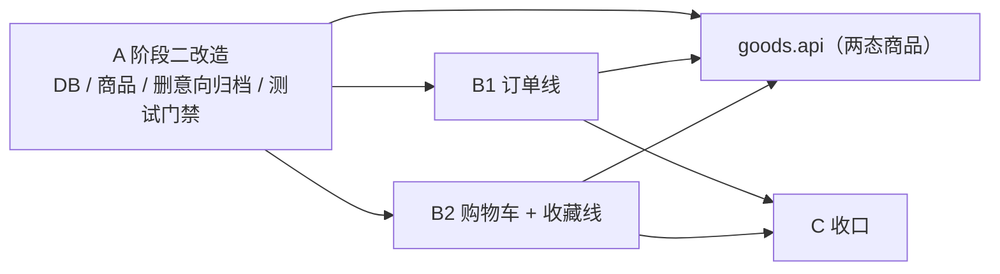

# Simple-Shop 阶段三 · 后端开发计划

> **文档性质**：阶段三后端实施计划（v0.1），说明工作项、顺序、依赖与验收口径；不含工时估算。
> **适用范围**：simple-shop-backend。前端、E2E 只列交接点，不在本文展开。
> **上游依据**：《阶段三状态模型设计》、《挑战需求B》、《需求澄清记录》、db/草稿 下的三份建表草稿。
> **口径关系**：状态、迁移与不变量以《状态模型设计》为准；本文只谈实施顺序、工作项与完成标准。
> **版本**：v0.1（初稿）　**日期**：2026-11-08

---

## 摘要（一页结论）

| 问题 | 结论 |
| --- | --- |
| 起点 | 阶段二实现：178 个主代码 Java 文件、41 个测试源文件（174 个 @Test 方法）、12 张表；意向、队列、归档、冻结仍在 |
| 目标 | 商品两态 + 下架原因；订单、订单项、购物车、收藏；意向与归档整体退场；仍是 12 张表 |
| 实施顺序 | **A 阶段二改造（串行）→ B 两条并行线（B1 订单 / B2 购物车+收藏）→ C 收口** |
| 为什么能并行 | order 与 cart/favorite 之间没有调用关系；两者都只读 goods.api，不互相依赖 |
| 串行原因 | A 阶段会重建数据库、收窄 GoodsStatus、删除 intention/history；这些是 B1、B2 共同的编译前提 |
| 共享热点 | ErrorCode、ArchUnit 规则、OpenAPI、AGENTS/README；在 A 阶段预置骨架，B 阶段按域追加 |
| 新增业务口径 | 手动下架商品的类别仍可改挂（状态模型 D3-15），否则类别会被永久引用而无法删除 |
| 完成定义（DoD） | 代码 + 单元/接口/并发测试 + mvn clean verify 通过 + 错误码与 OpenAPI 同步 + 文档同步 |
| 工时 | 本文不记录估算，实际进度只登记在 §12 |

**一句话判断**：阶段三不是“加四张表”，而是先把阶段二遗留的意向/归档体系拆干净，再让订单与购物车/收藏两条线并行生长。只要 A 阶段没有真正收口，B 阶段就会不断回头改公共代码。

---

## 1. 现状盘点

### 1.1 功能包与处置

| 包 | 现状 | 处置 |
| --- | --- | --- |
| common | 响应、异常、鉴权、会话、配置、媒体、文本、审计、时间、限流 | 保留；小改（限流 scope、审计常量、配置项） |
| account | 卖家/买家账号、卖家客户管理；客户购买历史经端口读 history | 保留；客户购买历史改由订单提供，A 阶段先临时下线 |
| category | 两级类别、删除前的商品引用检查 | 保留，不改语义 |
| goods | 商品、图片、描述、两态（待改）、归档端口、队列活动端口 | 改造：两态 + 原因、删归档/队列端口、类别可改挂 |
| inventory | 库存独立聚合，只有 deductOne | 改造：增加按数量扣减，保持独立加锁 |
| intention | 意向、按商品队列、交易裁决、买家历史 | **删除** |
| history | 归档写入、历史商品/历史意向查询、客户购买历史适配 | **删除** |
| order | 不存在 | 新增 |
| cart | 不存在 | 新增 |
| favorite | 不存在 | 新增 |

### 1.2 现有接口处置

| 端点 | 处置 |
| --- | --- |
| /api/public/goods、/api/public/categories、/api/public/health | 保留；商品详情只返回在售 |
| /api/buyer/auth/*、/api/seller/auth/* | 保留 |
| /api/seller/media | 保留 |
| /api/seller/categories/** | 保留 |
| /api/seller/goods、GET /{id}、PUT /{id}/stock、POST /{id}/off-shelf、PUT /{id}/category | 保留并改语义（两态、自动上架、类别放开） |
| POST /api/seller/goods/{id}/re-list | **删除**（手动下架无重新上架） |
| /api/buyer/intentions | **删除** |
| /api/seller/goods/{goodsId}/intentions、/api/seller/intentions/{id}/{trade,success,failure} | **删除** |
| /api/buyer/history、/api/seller/history/goods、/api/seller/history/goods/{id} | **删除**；历史商品改由卖家商品列表的 OFF_SHELF 筛选承担 |
| /api/seller/customers、/api/seller/customers/{id} | 保留；购买历史在 B1-7 恢复 |
| 新增 | 买家订单/购物车/收藏、卖家订单与推进、按客户/按商品查订单（B 阶段） |

### 1.3 测试盘点

- 41 个测试源文件、174 个 @Test 方法；以 mvn clean verify 报告为准。
- 与阶段二机制强绑定、必须删除：intention 包 7 个测试类（BuyerIntentionApiTest、BuyerIntentionLimitTest、BuyerHistoryApiTest、IntentionDataTest、IntentionConcurrencyTest、SellerIntentionApiTest、SellerTradeApiTest）、SellerHistoryApiTest。
- 必须重写：GoodsDataTest、SellerGoodsApiTest、GoodsLifecycleAdapterTest（改为商品状态测试）、SellerCustomerApiTest、SchemaDataTest、MigrationTest、OpenApiTest。
- 需要调整：RateLimiterTest（少一个 scope）、ApiTestBase/DataLayerTestBase（表与实体变化）。
- 基本不动：账号、类别、媒体、公共工具、UTC、会话、审计、AfterCommit。

### 1.4 数据库与脚本

- 活动迁移仍是 V1（12 张表）+ V2（卖家种子）。
- db/草稿 下已有三份阶段三草稿：01 删除、02 修改商品表、03 新增订单/订单项/购物车/收藏；定稿后合并为一个 V3。
- 迁移后仍是 12 张表：删 intention、intention_history、goods_history、goods_queue_sequence；加 order、order_item、cart_item、favorite。

### 1.5 配置与门禁

| 项 | 现状 | 处置 |
| --- | --- | --- |
| AppProperties.Queue | 队列上限 1000 | 删除（无队列） |
| RateLimit.submitIntentionPerMinute | 提交意向限流 | 删除；改为 order 兜底阈值 |
| RateLimiter.Scope | REGISTER / LOGIN / SUBMIT_INTENTION | 删除 SUBMIT_INTENTION，新增 ORDER |
| application.yml 的 queue 与 submit-intention 键 | 存在 | 删除；新增 rate-limit.enabled 开关 |
| scripts/check-comment-refs.ps1 | 检查注释里的阶段一文档编号；**未接入 Maven 或 CI**，仅 README 提及 | 直接删除，注释规范改为团队约定，不设机器门禁 |

---

## 2. 目标结构

### 2.1 分包

沿用按功能分包：common、account、category、goods、inventory、order、cart、favorite。每个功能内按 entity / repository / service / service/impl / controller / dto 组织；controller 再分 seller、buyer、publicapi。

### 2.2 依赖方向

原则：**被调用方定义端口，调用方只依赖对方的 api 包**；不允许功能包直接读对方的 entity/repository。

| 端口 | 定义方 | 实现方 | 用途 |
| --- | --- | --- | --- |
| GoodsQueryPort 等现有只读端口 | goods.api | goods | order/cart/favorite 读取商品状态与快照 |
| StockPort | inventory.api | inventory | order 完成时按数量扣减；goods 改库存 |
| UnfinishedOrderPort | **goods.api** | **order** | 商品手动下架/改 0 前判断是否有未完成订单 |
| CustomerPurchaseHistoryPort | **account.api** | **order** | 卖家客户详情里的购买历史 |
| GoodsSalePort（名称待定） | **goods.api** | **goods** | 订单完成后把扣到 0 的商品置为 OFF_SHELF(SOLD_OUT) |

依赖关系：

- order → goods.api、inventory.api、account.api
- cart、favorite → goods.api
- goods → 不依赖 order（通过 UnfinishedOrderPort 反转）
- account → 不依赖 order（通过 CustomerPurchaseHistoryPort 反转）

这样 order 是编排方，goods 与 account 保持下游，不形成循环，ArchUnit 的环检查可以通过。

### 2.3 与阶段二的关键差异

| 维度 | 阶段二 | 阶段三 |
| --- | --- | --- |
| 交易模型 | 意向 + 队列 + 卖家裁决 | 订单整单流转，无队列 |
| 商品状态 | 四态（含冻结） | 两态 + 下架原因 |
| 手动下架 | 可重新上架 | 终态；库存只读、类别可改挂 |
| 归档 | 商品与意向同事务搬历史表 | 无归档；历史商品是 OFF_SHELF 查询 |
| 库存扣减 | 成交扣 1 | 完成时按明细数量扣，全成或全败 |
| 买家能力 | 提交意向、看终态历史 | 下单、取消、购物车、收藏、我的订单 |
| 历史查询 | 历史表 UNION 当前表 | 全部按订单/商品状态查询 |

---

## 3. 阶段划分与依赖

### 3.1 阶段

| 阶段 | 目标 | 是否可并行 | 完成标志 |
| --- | --- | --- | --- |
| A 阶段二改造 | 数据库重建、商品两态、删意向/归档、清测试与门禁 | 否，必须串行 | 应用可启动，mvn clean verify 通过，商品域按新口径工作 |
| B1 订单 | 订单全生命周期、库存扣减、未完成订单阻断、客户购买历史 | 与 B2 并行 | 订单端到端可用，相关测试通过 |
| B2 购物车/收藏 | 购物车行、收藏行、失效派生、转收藏 | 与 B1 并行 | 购物车/收藏端到端可用，相关测试通过 |
| C 收口 | 全量验证、契约、文档、交接 | 否 | 交付清单齐全 |

### 3.2 依赖图

说明：B1、B2 都只依赖 A 阶段产出的两态商品与 goods.api，彼此没有调用关系；B2 不依赖 order。

### 3.3 并行边界与共享热点

**B1、B2 之间不允许出现**：

- cart/favorite 直接查 order 表或调用 order 服务；
- order 读写 cart/favorite；
- 两边共用同一个 Service。

**共享文件与处理方式**：

| 共享点 | 风险 | 约定 |
| --- | --- | --- |
| ErrorCode.java | 两边同时追加导致冲突 | 订单用 6xxxx 段，购物车/收藏用 7xxxx 段；只追加不重排；合并时保留双方 |
| PackageDependencyTest | 两边都改规则 | A 阶段先补 order/cart/favorite 的规则骨架，B 阶段一般不再改 |
| application.yml | 同时改配置 | A 阶段一次性清理；B 阶段原则上不动 |
| OpenAPI / 前端契约 | 两边都改文档 | C 阶段统一生成，不在 B 阶段各自维护快照 |
| AGENTS / README | 两边都改 | C 阶段统一更新 |
| 数据库 | 两边都以为能加表 | V3 在 A1 一次建完；B 阶段不新增迁移 |

---

## 4. 阶段 A：阶段二改造（串行）

### A0 开工前置

- 评审 db/草稿 三份脚本，确认并入 V3 的最终内容（订单项唯一键、金额精度、订单号列宽）。
- 确认开发库/测试库可备份并重建；需要删除的库与卷先和负责人确认。
- 冻结阶段二的联调分支；A 阶段期间不合并新功能。

**验收**：V3 内容评审通过；备份完成；重建窗口确定。

### A1 数据库与实体重建

**改动**

1. 把 01 删除 → 02 修改 → 03 新增 合成一个 V3 迁移脚本，放入 src/main/resources/db/migration。
2. 商品实体对齐：Goods 增加 offShelfReason、offShelfAt；领域方法统一写入两个字段，禁止各处零散 set。
3. 删除意向/历史实体与仓储：Intention、GoodsQueueSequence、GoodsHistory、IntentionHistory 及其 repository。
4. 更新 MigrationTest 的实体清单与 SchemaDataTest 的表清单：12 张表的新集合。
5. 重建 simple_shop 与 simple_shop_test：备份 → 删库 → 启动应用由 Flyway 执行 V1/V2/V3 → ddl-auto=validate 通过。

**验收**

- 空库能一次迁移到 V3，Hibernate validate 通过。
- simpleshop_goods 有 off_shelf_reason、off_shelf_at；旧四张表不存在；新四张表存在。
- 商品表 CHECK 能拒绝“在售带原因”“已下架无原因”。

### A2 商品域两态化

**改动**

1. GoodsStatus 收窄为 ON_SALE、OFF_SHELF；新增 OffShelfReason（MANUAL / STOCK_ZERO / SOLD_OUT）。
2. 状态迁移集中到商品实体的两个方法：下架（原因）与自动上架；上架时清空原因与时间。
3. SellerGoodsServiceImpl：
   - 在售改正数：只改库存；
   - 在售改 0：置 OFF_SHELF(STOCK_ZERO)。未完成订单阻断在 B1-6 接入；A 阶段还没有订单模块，不存在未完成订单，语义等价；
   - OFF_SHELF(STOCK_ZERO/SOLD_OUT) 改大于 0：自动回 ON_SALE；
   - OFF_SHELF(MANUAL)：库存写入一律拒绝；
   - 手动下架：在售 → OFF_SHELF(MANUAL)，库存不变；
   - **改挂类别：所有状态均允许，含 MANUAL（D3-15）**，这是删除类别前唯一的解除引用手段；
   - 删除重新上架：Service 方法、ReListRequest、Controller 端点、审计常量、只服务于它的错误码。
4. 买家商品详情只允许 ON_SALE；purchasable 等价于 ON_SALE。
5. 卖家商品列表支持 status=OFF_SHELF + reason 筛选，承担“历史商品”三类视图；status 只接受 ON_SALE / OFF_SHELF，非法值按参数错误处理；reason 只与 OFF_SHELF 组合。

**验收**

- 5 条商品迁移（发布、手动下架、改 0、补货自动上架、完成扣减至 0 留给 B1）有测试；A 阶段先覆盖前四条。
- MANUAL：改库存被拒、改类别成功、re-list 端点不存在。
- 在售商品详情可见；已下架详情返回不存在；列表只返回在售。

### A3 删除意向与归档

**改动**

1. 删除 intention 包与 history 包（含 controller、DTO、entity、repository、enums、service）。
2. 删除只服务于意向/归档的 goods.api 类型：QueueActivityPort、GoodsLifecyclePort、GoodsArchiveSnapshot、TradingStart，以及 GoodsLifecycleAdapter。
3. 删除 account 对购买历史的依赖：SellerCustomerServiceImpl 去掉 CustomerPurchaseHistoryPort 注入；客户详情暂时不含购买历史字段（B1-7 恢复）。
4. 删除对应端点与审计常量、错误码（3xxxx、4xxxx 码位不复用）。
5. ArchUnit 规则与切片同步删除 intention/history。

**验收**

- 全局搜索不到 intention、history、queue 相关类与端点。
- 应用可启动；卖家客户详情可用（无购买历史）；商品下架不再检查队列。
- 现有非意向测试通过。

### A4 配置、限流与审计清理

**改动**

1. 删除 AppProperties.Queue、RateLimit.submitIntention 及 application.yml 对应键。
2. RateLimiter 删除 SUBMIT_INTENTION，新增 ORDER；注册、登录保留。
3. 限流改造（状态模型 T2）：总开关走 yml（`simple-shop.rate-limit.enabled`，默认开，开发/测试置 false）；
   登录按「账号 + IP」；注册、登录默认 50 次/分钟；提交订单给 1000 次/分钟的兜底阈值；购物车、收藏不限流。
4. 审计常量收敛：删除提交意向/进入交易/裁决相关；保留发布、改库存、下架、改类别、改密。

**验收**

- 配置项无残留；E2E 与开发用 yml 开关整体关闭限流。
- 登录/注册行为不变；下单只受兜底阈值约束，购物车/收藏没有限流。

### A5 测试与门禁收口

**改动**

1. 删除 obsolete 测试：intention 7 个、history 1 个。
2. 重写：GoodsDataTest、SellerGoodsApiTest、GoodsLifecycleAdapterTest（改名商品状态测试）、SellerCustomerApiTest、SchemaDataTest、MigrationTest、OpenApiTest。
3. 调整：RateLimiterTest；ApiTestBase / DataLayerTestBase 的建表与实体清单。
4. 注释门禁：删除 scripts/check-comment-refs.ps1，改由团队约定约束（注释不引用文档编号），不新增 JUnit 门禁。
5. 跑 mvn clean verify（默认 Testcontainers 与 -Plocal-mysql 两条路径至少各跑一次）。

**验收**

- mvn clean verify 通过，测试数量与清单更新。
- 项目内不再有注释门禁脚本，README 不再引用它。
- 应用启动、Flyway、ArchUnit 全部通过。

---

## 5. 阶段 B1：订单线

> 前置：A 阶段完成。B1 与 B2 并行，互不阻塞。

### B1-1 订单模型与持久化

- Order 实体：id、orderNo、buyerId、totalAmount、status、createAt、updateAt。
- OrderStatus 枚举：PENDING_CONFIRM、CONFIRMED、PREPARED、SHIPPED、COMPLETED、CANCELED。
- OrderItem 实体：goodsId、goodsName、unitPrice、quantity；不设状态。
- Repository：按订单号、按买家分页、按状态分页、按商品查订单、按客户查订单；订单行锁查询。
- 订单号生成：建议 SO + yyyyMMdd + 序列；唯一冲突的处理方式在开发时定，必须有唯一约束兜底。

### B1-2 下单

- 请求：明细数组（goods_id、quantity），不接收总额。
- 事务：按 goods_id 升序锁商品行 → 校验 ON_SALE 与库存 → 读取名称/单价快照 → 计算总额 → 保存订单与明细。
- 不校验商品是否在购物车（D3）；不锁库存行、不预占。
- 同一订单内重复商品：按唯一键合并或直接拒绝，不允许出现两行同商品；结论记入契约。
- 任一明细不满足则整单拒绝，返回具体商品与原因。
- 审计：CREATE_ORDER。

### B1-3 推进与取消

- 卖家：确认、备货完成、开始发货；每次只能前进一格。
- 交易完成走 B1-4。
- 取消：买家在进入 SHIPPED 前；卖家在进入 COMPLETED 前；整单取消。
- 状态守卫不依赖前端；重复推进返回冲突；重复取消幂等返回成功（状态模型 D3-06）。
- 权限：买家只能操作自己的订单；卖家可操作全部。
- 审计：ORDER_CONFIRM、ORDER_PREPARE、ORDER_SHIP、ORDER_CANCEL；取消人/时间只进审计，不落订单字段。

### B1-4 交易完成与库存

- 锁订单行 → 校验 SHIPPED → 按 goods_id 升序锁商品行与库存行。
- 逐条校验库存；任一不足 → 整单拒绝，返回缺货明细，不扣任何一行，订单仍为 SHIPPED。
- StockPort 增加按数量扣减（deduct(goodsId, quantity) 或批量接口），保持库存行独立加锁。
- 扣减后为 0 的商品经 goods.api 端口置 OFF_SHELF(SOLD_OUT)，同一事务。
- 订单置 COMPLETED；写审计。
- 不允许部分完成、不允许负库存、不自动取消。

### B1-5 查询与订单详情

- 买家：我的订单（全部状态）、订单详情、详情内取消按钮按状态启用。
- 卖家：订单管理（全部，按状态筛选）、客户购买历史、商品订单记录；三个入口共用同一详情。
- 排序按下单时间倒序；分页沿用 page / page_size。
- 详情返回明细快照、总额、买家用户名（实时读账号）、状态。

### B1-6 未完成订单阻断

- 在 goods.api 定义 UnfinishedOrderPort（例如 hasUnfinishedOrder(goodsId)）。
- order 实现：order_item 关联 order，status 属于前四态即视为未完成。
- goods 在手动下架与改库存为 0 前调用；改为其他正数不拦。
- 竞态依赖下单锁商品行（B1-2 已保证）；下架路径只读订单表，不加订单行锁。
- 交易完成扣减到 0 不走阻断。

### B1-7 客户购买历史

- account.api 保留（或调整）CustomerPurchaseHistoryPort，由 order 实现按买家查订单分页。
- 卖家客户详情恢复购买历史字段；条目改为订单粒度（订单号、总额、下单时间、状态、商品数）。
- 删除 history 后不再有“历史意向”概念。

### B1-8 错误码、审计与契约

- 订单错误码 6xxxx：订单不存在、状态不允许、不可取消、完成缺货（带明细）、明细非法。
- 每次状态迁移与库存扣减写审计；审计常量按订单动作补齐。
- OpenAPI 注解与 DTO 字段命名保持 snake_case；错误码同步登记到码表。

### B1-9 测试

- 状态机：每个合法迁移与每个非法迁移。
- 取消边界：PREPARED 可取消、SHIPPED 买家不可取消、COMPLETED 双方不可取消。
- 缺货完成：整单拒绝、库存不变、订单仍 SHIPPED。
- 并发：两笔订单抢最后一件（先完成者成功、后者拒绝）；重复完成不重复扣库存；重复取消幂等。
- 快照与总额：商品后续下架/改类别不影响订单展示。
- 权限与查询范围：买家隔离、卖家四个入口范围一致。
- 无预占：两笔未完成订单可同时存在。

---

## 6. 阶段 B2：购物车与收藏线

> 前置：A 阶段完成。与 B1 并行；不依赖 order，不调用 order。

### B2-1 购物车模型与服务

- CartItem 实体：buyerId、goodsId、createAt；唯一（buyerId, goodsId）。
- 加购：登录买家、商品 ON_SALE；重复加购幂等，不新增行。
- 列表：按买家查行，批量读商品状态与价格，派生每行是否可选（OFF_SHELF 显示失效，不可选中）。
- 移除：按商品删除自己的行；不存在时幂等。
- 不存数量、不存勾选、不锁库存；数量与勾选由前端维护。

### B2-2 购物车接口

- 买家端点：加购、列表、移除。
- 一律要求买家登录；卖家令牌不可用。
- 空列表、失效行、商品不存在都要有明确响应。

### B2-3 收藏

- Favorite 实体：buyerId、goodsId、createAt；唯一（buyerId, goodsId）。
- 收藏/取消收藏幂等；列表按收藏时间倒序。
- 失效派生：OFF_SHELF 标注“已下架/无货”，不提供详情跳转。
- 不做收藏到购物车/下单（本期不做）。

### B2-4 转收藏

- 入参：商品 ID 集合。
- 事务：写收藏（幂等）→ 删对应购物车行。
- 已下架商品不可被选中，转收藏入参若含已下架商品则拒绝并指出商品。

### B2-5 错误码、审计与契约

- 购物车/收藏错误码 7xxxx：行不存在、商品不可加购、商品不可收藏。
- 审计：ADD_CART、REMOVE_CART、ADD_FAVORITE、REMOVE_FAVORITE。
- DTO 保持 snake_case；分页返回结构不变。

### B2-6 测试

- 重复加购/收藏只保留一行。
- 商品下架后购物车/收藏行仍存在，可选中性与详情入口按状态派生。
- 游客/卖家访问被拒。
- 转收藏：购物车行删除、收藏新增、重复转收藏幂等。
- 商品复售后失效标记自动消失（读取时派生，无需同步）。

---

## 7. 阶段 C：收口

### C1 全量验证

- mvn clean verify（Testcontainers）；无 Docker 时 mvn -Plocal-mysql clean verify。
- 架构规则、迁移验证、并发测试全部通过。

### C2 OpenAPI 与契约交接

- 重新生成 OpenAPI，删除意向/历史/重新上架端点，补订单/购物车/收藏端点。
- 输出给买家端、卖家端与 E2E 的契约清单；后端不负责改前端代码。
- 错误码表同步到两端 types.ts 的维护任务中（前端阶段执行）。

### C3 文档同步

- AGENTS.md：如实现与约定有偏差，回填（不写进度）。
- 后端 README：功能包、db 目录、命令与测试说明。
- 阶段三目录：补充本计划与后续设计文档。
- 阶段三状态模型：若开发中发现口径偏差，先改文档再改代码。

### C4 交接与遗留

- 列出未做项、已知取舍、环境要求。
- 把 V3 定稿脚本与最终基线归档到 db/阶段三。
- 在 §12 完成任务登记。

---

## 8. 测试与质量

### 8.1 测试分层

| 层 | 内容 |
| --- | --- |
| 数据层 | 迁移、表结构、约束、状态与库存一致性 |
| 领域/服务 | 状态迁移、自动上架、订单守卫、扣减原子性 |
| 接口层 | 权限、状态码、分页、DTO、错误码 |
| 并发 | 抢最后一件、重复完成、下架与下单竞态 |
| 架构 | ArchUnit 分包与依赖 |

### 8.2 旧测试处置

| 测试 | 处置 |
| --- | --- |
| BuyerIntentionApiTest、BuyerIntentionLimitTest、BuyerHistoryApiTest、IntentionDataTest、IntentionConcurrencyTest、SellerIntentionApiTest、SellerTradeApiTest | 删除 |
| SellerHistoryApiTest | 删除 |
| GoodsLifecycleAdapterTest | 删除或改写为商品状态测试 |
| GoodsDataTest、SellerGoodsApiTest | 重写（两态、无 re-list、类别可改挂） |
| SellerCustomerApiTest | 重写（购买历史改订单） |
| SchemaDataTest、MigrationTest、OpenApiTest | 重写 |
| RateLimiterTest | 调整 scope |
| 其余账号/类别/媒体/公共工具测试 | 保留 |

### 8.3 新增测试清单

- 商品：手动下架、改 0、补货自动上架、成交扣减至 0、MANUAL 库存只读但类别可改、待确认/已下架详情可见性。
- 订单：六个状态、合法/非法迁移、取消边界、缺货整单拒绝、并发扣减、快照、查询范围。
- 购物车/收藏：幂等、失效派生、权限、转收藏。
- 跨功能：未完成订单阻断、完成后自动下架、客户购买历史。

### 8.4 质量门禁

- mvn clean verify 必须通过；改包结构后不跳过 ArchUnit。
- 注释门禁由 JUnit 承担（A5），不再依赖 PowerShell。
- 迁移脚本只增不改；V1/V2 不动。
- 不提交 target、node_modules、dist；不提交本机配置。

---

## 9. 数据库与迁移

### 9.1 V3 组装

- 按 01 删除 → 02 修改 → 03 新增 合并，保持语句顺序；一个 V3 只执行一次。
- 迁移后表数量仍为 12；不要顺手改其他表。
- 如果评审后调整订单项唯一键或金额精度，先改草稿再生成 V3。

### 9.2 重建步骤

1. 备份：mysqldump 或整库导出（db/阶段一 下已有历史备份，不要覆盖）。
2. 停止后端，删除/重建 simple_shop 与 simple_shop_test（字符集 utf8mb4 / utf8mb4_unicode_ci）。
3. 启动后端，Flyway 执行 V1 → V2 → V3。
4. 启动即 validate：实体与表结构不一致会直接失败。
5. 跑 mvn clean verify（或 -Plocal-mysql）。

### 9.3 三库

- 开发库 simple_shop、测试库 simple_shop_test、E2E 库 simple_shop_e2e 分开；E2E 库由 E2E 流程重建。
- 不把开发库当测试库，不用旧卷跨阶段。

### 9.4 回退

- MySQL DDL 不能回滚；V3 失败后按“备份 → 重建 → 重跑”处理，不写逆向迁移。

---

## 10. 风险与待定

| 项 | 说明 | 处置 |
| --- | --- | --- |
| 无预占超卖 | 同一商品可被多笔订单下单，后完成者缺货 | 已确认接受；完成时整单拒绝（D1） |
| 订单号唯一冲突 | 并发下单可能撞号 | 唯一约束 + 生成失败重试；格式开发时定 |
| 重复商品明细 | 同一订单出现两行同商品 | 数据库唯一键已限制；应用合并或拒绝，开发时定 |
| A 阶段客户历史缺失 | 删除 history 后客户详情没有购买历史 | 明确列为临时状态，B1-7 恢复 |
| 前端联调窗口 | 意向/历史端点被删，前端暂时不可用 | A 阶段只做后端；前端按契约另行改造 |
| 限流开关 | T2 的默认值与 key 策略待确认 | A4 先实现开关，默认值按确认结果 |
| 类别删除 | MANUAL 商品若不能改挂，类别永远删不掉 | A2 放开类别；D3-15 已写入状态模型 |
| 门禁替换 | PowerShell 不跨平台 | A5 改为 JUnit；如团队决定不维护门禁则直接删除 |
| OpenAPI 滞后 | B 阶段不维护快照 | C2 统一生成 |

---

## 11. 交付物

- 后端代码：商品两态、订单、购物车、收藏；intention/history 删除。
- V3 迁移脚本（定稿后归档到 db/阶段三）。
- 测试：迁移、状态机、并发、接口、权限。
- OpenAPI 与错误码表。
- 文档：本计划、状态模型回填、AGENTS/README/阶段三目录。

---

## 12. 任务完成登记区

> 这里是**唯一**记录阶段三后端进度的位置（AGENTS 不写进度）。
> 登记规则：
> 1. 只改「状态 / 负责人 / 完成日期 / 备注」，不改编号与任务名。
> 2. 新任务追加新编号（A6、B1-10…）；取消的任务标「取消」并写原因，不删行。
> 3. 状态取值：未开始 / 进行中 / 已完成 / 阻塞 / 取消。
> 4. 「已完成」= 代码合并 + mvn clean verify 通过 + 相关测试 + 契约/文档同步。
> 5. 日期用 YYYY-MM-DD；备注写分支、PR 或提交号。

| 编号 | 任务 | 前置 | 状态 | 完成日期 | 备注 |
| --- | --- | --- | --- | --- | --- | 
| A0 | 开工前置：V3 评审、备份、重建窗口 | — | 已完成 | 2026-11-08 | V3 定稿 `db/草稿/V3__stage3_goods_and_trade_schema.sql`，空库与存量库两条路径均验证；三库备份在 `_db_backup_stage2/`；重建口径：开发库原地升级保留商品数据、测试库删除重建 |
| A1 | 数据库与实体重建（V3 + Flyway + validate） | A0 | 已完成 | 2026-11-08 | V3 已入 resources/db/migration；Goods 加 off_shelf_reason/off_shelf_at 与 offShelf/backOnSale；删除 4 个旧实体与仓储；开发库原地升到 V3（25 件商品保留），simple_shop_test 重建后由 Flyway 建库；verify 两条路径通过 |
| A2 | 商品两态化（含 D3-15 类别可改挂、删 re-list） | A1 | 已完成 | 2026-11-08 | GoodsStatus 收窄两态 + OffShelfReason；库存三条口径与改挂放开；删 re-list 端点与请求体；卖家列表支持 status+off_shelf_reason；买家详情只放 ON_SALE；未完成订单阻断按计划留到 B1-6 |
| A3 | 删除意向与归档（包、端口、端点、account 依赖） | A2 | 已完成 | 2026-11-08 | intention/history 两包全删；删 5 个 goods.api 端口与 GoodsLifecycleAdapter；account 去掉购买历史端口；3xxxx/4xxxx 错误码与意向/交易审计常量退场；ArchUnit 切片同步 |
| A4 | 配置、限流与审计清理 | A3 | 已完成 | 2026-11-08 | 删 AppProperties.Queue、submit-intention 键、SUBMIT_INTENTION/审计常量；限流改为 yml 总开关 `rate-limit.enabled`（默认开、test 关），注册/登录 50 次每分钟，登录按「账号 + IP」，新增 ORDER scope 1000 次兜底；新增 RateLimitApiTest 覆盖开关与键策略 |
| A5 | 测试与门禁收口（含注释门禁替换） | A4 | 已完成 | 2026-11-08 | 删意向 7 个与历史 1 个测试、GoodsLifecycleAdapterTest；重写 Goods/SellerGoods/SellerCustomer/SchemaData/Migration/OpenApi 测试，调整 DataLayerTestBase、ConcurrencyTestBase、RateLimiterTest、PackageDependencyTest；167 个测试两条路径通过；注释门禁脚本直接删除，改为团队约定 |
| B1-1 | 订单模型与持久化 | A5 | 已完成 | 2026-11-09 | order 包：Order / OrderItem / OrderLine / OrderStatus / OrderRepository / OrderNoGenerator（SO + yyyyMMdd(UTC) + 6 位每日序列，跨天与重启从库取当日最大序列）；不新增迁移，复用 V3；verify 183 个测试通过 |  
| B1-2 | 下单（校验、快照、总额、锁商品行） | B1-1 | 已完成 | 2026-11-09 | `POST /api/buyer/orders`；goods.api 增 `lockForOrder`（按 ID 升序逐行加锁）；重复商品按参数错误（400 / 50002）拒绝、不合并；商品不存在 / 已下架 / 库存不足复用 20011 / 20019 / 20015，整单不落库；下单不预占库存；审计 CREATE_ORDER；撞号不做隐式重试（单副本 + 续号，唯一索引兜底） |  
| B1-3 | 推进与取消（状态守卫、权限、幂等） | B1-2 | 已完成 | 2026-11-09 | 状态机落在 Order（canConfirm/canPrepare/canShip/canCancelByBuyer/canCancelBySeller + 对应迁移方法），服务层先锁订单行再判守卫；端点 `/api/seller/orders/{id}/{confirm,prepare,ship,cancel}`、`/api/buyer/orders/{id}/cancel`；新增 60001 订单不存在（他人订单按不存在）、60002 状态不允许、60003 不可取消；取消人/时间只进审计；重复取消幂等返回成功仅作防抖、不写用例，已用真实请求验证（两次 200/code 0 且 update_at 不变）；重复确认 60002、发货后买家取消 60003 同样实测通过 |  
| B1-4 | 交易完成与库存扣减（全成或全败） | B1-3 | 已完成 | 2026-11-09 | `POST /api/seller/orders/{id}/complete`；StockPort 的 `deductOne` 换成 `deductAll(Map)`：按 ID 升序锁库存行 → 整体校验 → 统一扣减，返回缺口，全成或全败；goods.api 新增 `GoodsSalePort.markSoldOut`，扣到 0 的在售商品同事务置 OFF_SHELF(SOLD_OUT)；缺货返回 60004、订单停在已发货、补货后可重试；完成只写一条 `ORDER_COMPLETE` 审计，不带明细 |  
| B1-5 | 查询与订单详情（买家/卖家/按客户/按商品） | B1-3 | 已完成 | 2026-11-09 | 买家 `GET /api/buyer/orders`（status 可选）、`/{id}`、`/{id}/items`；卖家 `GET /api/seller/orders`（status + buyer_id + goods_id 任意组合）、`/{id}`、`/{id}/items`；列表与详情只回订单头、明细单独按订单 ID 查（口径确认：两次调用，避免一层返回里两层分页）；OrderRepository 四个分页方法收敛为 `search`，新增 OrderItemRepository；account.api 新增 BuyerDirectoryPort 实时读买家名；统一 `OrderData`（含 item_count 与 buyer） |  
| B1-6 | 未完成订单阻断（goods.api 端口 + order 实现） | B1-4 | 已完成 | 2026-11-09 | goods.api 新增 `UnfinishedOrderPort.hasUnfinishedOrder`，order 侧 `UnfinishedOrderAdapter` 按「商品 + 前四态」统计订单项；SellerGoodsServiceImpl 在手动下架与改库存为 0 前调用（改其他正数不拦），新增错误码 20020；改 0 的校验放在写库存之前，拒绝时库存与状态都不变；下架路径只读订单表、不加订单行锁；成交扣减到 0 不经此路径 |  
| B1-7 | 客户购买历史（account 端口 + order 实现） | B1-5 | 取消 |  | 客户历史按订单粒度直接查卖家订单列表 `GET /api/seller/orders?buyer_id=`，不再给客户详情内嵌购买历史、也不新增 CustomerPurchaseHistoryPort；与「详情不带明细、按 id 二次查询」的口径一致，避免同一份数据两条读路径 |
| B1-8 | 订单错误码、审计、契约 | B1-4 | 已完成 | 2026-11-09 | 订单错误码 60001 不存在 / 60002 状态不允许 / 60003 不可取消 / 60004 完成缺货，下单复用 20011 / 20019 / 20015，重复明细与非法参数走 400 / 50002、阻断用 20020；README 增「订单错误码」表；审计常量 CREATE_ORDER / ORDER_CONFIRM / PREPARE / SHIP / COMPLETE / CANCEL 已随各任务落地；OpenAPI 注解与 snake_case 字段随端点交付，OpenApiTest 覆盖 13 个订单端点 |
| B1-9 | 订单测试（状态机、边界、并发、权限） | B1-2 至 B1-8 | 已完成 | 2026-11-09 | 状态机：`OrderStateMachineTest` 覆盖 6 态 × 6 动作（11 条合法迁移，其余全部抛错）；并发：`OrderConcurrencyTest` 两单抢最后一件（一成一拒、库存不为负、售罄下架）、同单并发完成只扣一次；无预占：两笔待确认订单并存；快照：商品下架与改挂类别后详情/明细不变；缺货整单拒绝见 `OrderCompletionApiTest`；权限与查询范围见 `BuyerOrderApiTest` / `OrderQueryApiTest` |
| B2-1 | 购物车模型与服务（加购、列表、移除） | A5 | 已完成 | 2026-11-10 | cart 包：CartItem（买家 + 商品 + create_at 四列，无数量列）/ CartItemRepository / CartService / CartServiceImpl；加购走 `on duplicate key update` 保幂等、不用「先查再插」（并发下双方都查不到会撞唯一键，异常一进事务即标记回滚）；列表经 `goods.api.snapshotsOf` 一次取齐快照，`selectable` 由商品状态派生、不落库，复售自动恢复 |
| B2-2 | 购物车接口与权限 | B2-1 | 已完成 | 2026-11-10 | `POST /api/buyer/cart`、`GET /api/buyer/cart`、`DELETE /api/buyer/cart/{goodsId}`；`/api/buyer/**` 拦截器覆盖，游客与卖家令牌均 401；列表不分页（前端要算总价与导航角标，翻页会漏行）；移除幂等，行不存在也返回成功，不设「行不存在」错误码（与 B2-1/B2-3 的幂等要求冲突） |
| B2-3 | 收藏模型、服务与接口 | A5 | 已完成 | 2026-11-10 | favorite 包：Favorite / FavoriteRepository / FavoriteService / FavoriteServiceImpl / `FavoritePort`（仅供 cart 转收藏调用，沿用调用方事务）；`POST /api/buyer/favorites`、`GET /api/buyer/favorites`（分页）、`DELETE /api/buyer/favorites/{goodsId}`；失效由商品状态在读取时派生、不落库；另按 Backlog #14 增 `GET /api/buyer/favorites/{goodsId}` 返回是否已收藏（本计划未列：详情页要显示「已收藏」，而收藏列表分页 10 条撑不住） |
| B2-4 | 转收藏（购物车 → 收藏） | B2-1、B2-3 | 已完成 | 2026-11-10 | `POST /api/buyer/cart/move-to-favorites`：先按 `snapshotsOf` 整批校验商品状态，含不可选则整单拒绝（70003）且两边一行不动；再经 `FavoritePort.addAll` 写收藏、最后删购物车行，同一事务；只转本购物车真实存在的行，`moved_count` 恒等于真转件数 |
| B2-5 | 购物车/收藏错误码与审计 | B2-2、B2-3 | 已完成 | 2026-11-10 | 错误码 70001 不可加购 / 70002 不可收藏 / 70003 转收藏含不可选；审计 ADD_CART / REMOVE_CART / ADD_FAVORITE / REMOVE_FAVORITE 与 TARGET_CART / TARGET_FAVORITE（目标 ID 用商品 ID，行 ID 是随机 UUID 无信息量）；README 增「购物车与收藏」口径与错误码表；OpenAPI 注解与 snake_case 字段随端点交付，OpenApiTest 覆盖 8 个端点 |
| B2-6 | 购物车/收藏测试（幂等、失效、权限） | B2-2 至 B2-5 | 已完成 | 2026-11-10 | `CartApiTest` 12 / `CartToFavoriteApiTest` 6 / `FavoriteApiTest` 15 / `CartDataTest` 3 / `FavoriteDataTest` 2 / `CartConcurrencyTest` 4，共 42 条：幂等、失效派生、权限（游客与卖家令牌）、买家隔离、转收藏整批拒绝、时区写库与主图，含「在售但库存为 0 仍可选中」；并发用例发现派生删除并发删同一行会抛 `ObjectOptimisticLockingFailureException`（接口 500），三个删除方法已改为一条批量 delete；verify 258 条通过（B1 的 216 + 本线 42，local-mysql 单路径，Testcontainers 路径归 C1） |
| C1 | 全量验证（两条测试路径） | B1、B2 完成 | 未开始 |  |  |  
| C2 | OpenAPI 生成与契约交接 | C1 | 未开始 |  |  |  
| C3 | 文档同步（AGENTS/README/阶段三目录） | C1 | 未开始 |  |  |  
| C4 | 交接与遗留清单、V3 归档 | C2、C3 | 未开始 |  |  |  

---

## 附录 A　推荐执行顺序（一页版）

1. A0 评审 V3 与重建窗口。
2. A1 建库、对齐实体、迁移测试通过。
3. A2 商品两态；A3 删意向与归档；A4 清配置；A5 测试与门禁收口。
4. A 阶段必须整体绿再开 B。
5. B1 与 B2 同时开工：B1 先模型与下单，B2 先购物车。
6. B1 内部顺序：模型 → 下单 → 推进/取消 → 完成扣减 → 查询 → 阻断 → 客户历史 → 错误码 → 测试。
7. B2 内部顺序：购物车 → 收藏 → 转收藏 → 错误码 → 测试。
8. 两条线各自绿后进 C：先全量验证，再契约与文档，最后交接登记。

---

**文档结束**
