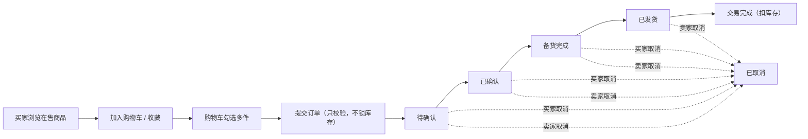
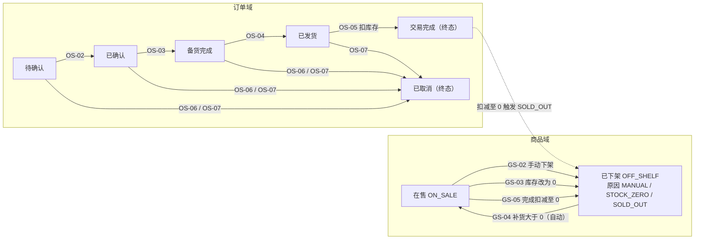
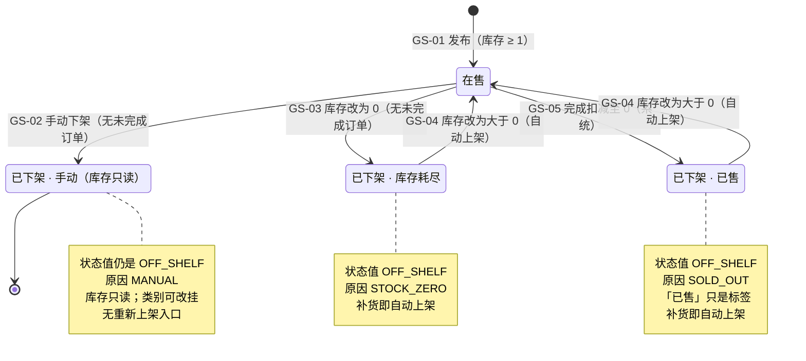
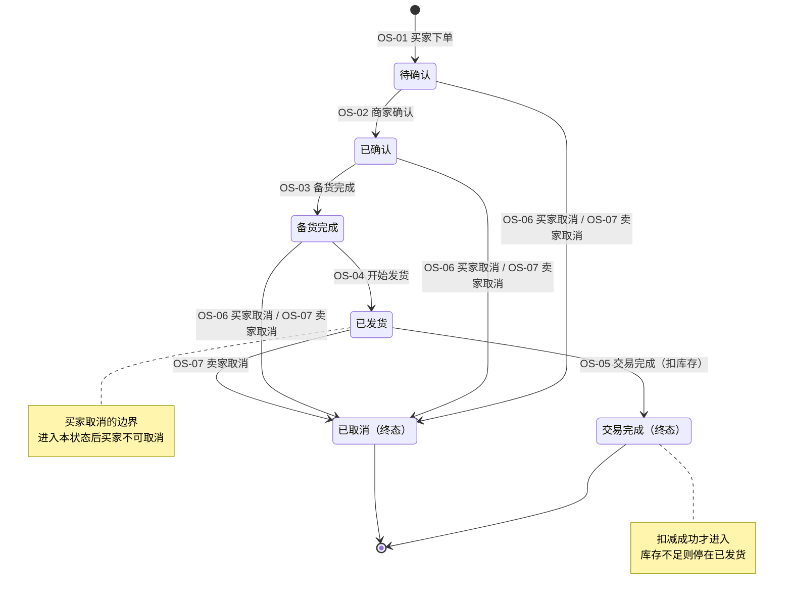
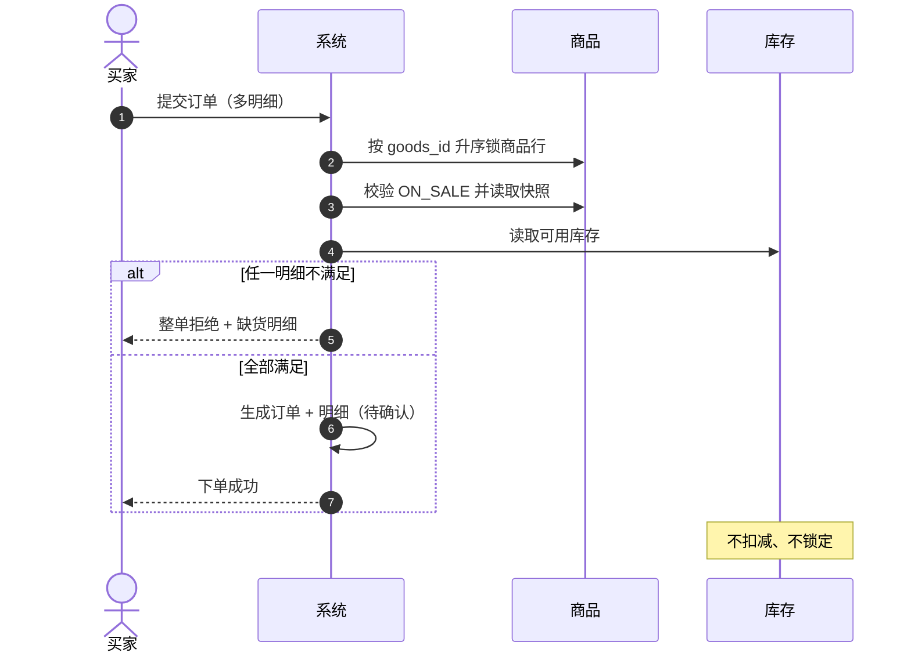
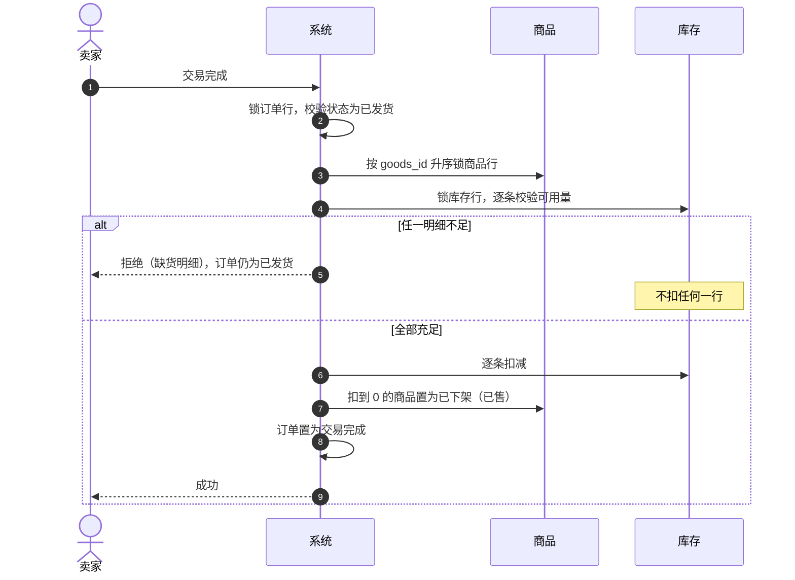

# Simple-Shop 阶段三 · 状态模型设计

> **文档性质**：开发准备阶段的状态模型设计（v0.1 初稿），用于冻结阶段三的商品状态与订单生命周期，供后端、前端、测试与评审共同引用。
> **适用范围**：挑战需求 B（B.1 订单升级 + B.2 商品预选升级）引起的**商品状态两态化改造**与**新增订单实体**；顺带界定购物车、收藏这两个「无状态机」对象的边界。
> **上游依据**：《挑战需求B》、《需求澄清记录》Q1–Q14；团队决策 D1–D6、F1–F3、E1–E2 见 §1.4；阶段二《状态模型设计》仅作差异对照，其状态口径已被本文取代。
> **不在本文范围**：数据表结构与 DDL、接口契约与错误码全集、页面布局与交互细节、测试用例清单、限流改造、数据库重建的执行方案。
> **编号约定**：GS（商品迁移）、OS（订单迁移）、INV（不变量）、BR（业务规则）、CC（并发）、L（联动）、D3（设计决策）均为**阶段三独立编号**，与阶段二同名编号不通用；跨版本引用请带文档名。
> **版本**：v0.1（初稿）　**日期**：2026-11-08

---

## 摘要（一页结论）

- **商品收敛为两态**：「在售 ON_SALE」与「已下架 OFF_SHELF」；下架原因单独记三值：手动 MANUAL、库存耗尽 STOCK_ZERO、已售 SOLD_OUT。阶段二的 FROZEN、OFF_MANUAL、OFF_ZERO、ARCHIVED 全部退出。
- **可复售性由「原因」决定，不由「状态个数」决定**：MANUAL 是终态（库存不可改、无重新上架入口，但类别仍可改挂）；STOCK_ZERO 与 SOLD_OUT 在库存改回大于 0 时**自动上架**，不需要点按钮。
- **「归档」这个动作被取消**：不再有历史表、不再搬表；「历史商品」只是 OFF_SHELF 的查询视图，按原因分三类。商品行永不物理删除，订单、收藏、购物车可以长期引用。
- **订单取代购买意向**：六态（5 个业务态 + 已取消），整单流转，只能按序推进、不可跳过、不可回退、无超时。
- **两个取消出口**：买家在「已发货」之前可取消（待确认 / 已确认 / 备货完成）；卖家在「交易完成」之前可取消（待确认 / 已确认 / 备货完成 / 已发货）。整单取消，无部分取消。
- **取消不动库存**：无预占，下单不扣库存，取消自然没有「回补」；只有交易完成才扣。
- **完成时才校验并扣减库存**：任一明细不足即整单拒绝，不扣任何一行、不部分完成、不自动取消、不出现负库存；订单停在「已发货」，由卖家取消订单或补货后重试。
- **手动下架 / 手动改库存为 0 受未完成订单阻断**；成交扣减到 0 不受此限。因此「有未完成订单的商品」不会处于 MANUAL，但可能已被别的订单买成 SOLD_OUT。
- **订单项、购物车行、收藏行都没有状态**：订单项的有效性由整单状态派生；购物车 / 收藏的「失效」是从商品状态派生的展示结论，不落库、不建枚举。
- **已知取舍**：无预占导致同一商品可被多笔未完成订单引用，先完成者得；后完成者按上面的缺货规则被拒。

---

## 0. 阅读指引

### 0.1 本文回答的问题

1. 阶段三到底要交付什么？与阶段二相比，哪些业务口径被推翻？（§1）
2. 哪些对象有状态机、哪些没有？为什么不给订单项、购物车、收藏建状态？（§2、§4.5、§6）
3. 商品从「四态」收敛成「两态 + 原因」后，每种下架来源的可复售性、历史分类与恢复动作分别是什么？（§3）
4. 订单的六个状态、进入条件、执行者、副作用与终态是什么？（§4）
5. 商品状态与订单状态如何联动：下单、完成、取消、下架各自谁先变、谁后变？（§5）
6. 哪些组合是非法状态组合？并发下如何避免「检查通过后被插队」？（§5.6、§8）
7. 开发落地需要哪些枚举、字段建议、约束、锁与事务边界？（§8、§9）

### 0.2 术语与命名约定

| 术语 | 本文定义 | 不要混淆 |
| --- | --- | --- |
| 在售 | ON_SALE，可被浏览、搜索、打开详情、加购、收藏、下单 | 在售隐含库存 ≥ 1，不存在「在售但无货」 |
| 已下架 | OFF_SHELF，退出买家浏览 / 搜索 / 详情；收藏与购物车仍保留展示 | 已下架不等于删除，也不都等于终态 |
| 手动下架 | OFF_SHELF + MANUAL，卖家主动下架，库存 > 0，不可重新上架；库存只读、类别可改挂 | 与「库存耗尽下架」「已售」共用状态值，靠原因区分 |
| 库存耗尽下架 | OFF_SHELF + STOCK_ZERO，卖家把库存改成 0 触发，可复售 | 补货大于 0 即自动上架 |
| 已售 | OFF_SHELF + SOLD_OUT，订单完成扣减至 0 触发，可复售 | 「已售」只是历史分类标签，不是终态 |
| 历史商品 | 卖家端查看 OFF_SHELF 商品的**查询视图**，可按原因分三类 | 不是历史表，不是独立状态，不是归档 |
| 自动上架 | 库存从 0 改回大于 0 时商品自动回到 ON_SALE，并清空原因与下架时间 | 只适用于 STOCK_ZERO / SOLD_OUT，不适用于 MANUAL |
| 订单 | 买家一次提交的多商品购买记录，整单流转 | 取代阶段二的「购买意向」，不并存 |
| 订单项 | 订单中的一行商品，含商品引用与下单时快照 | 没有独立状态，不单独流转 |
| 未完成订单 | 状态属于待确认 / 已确认 / 备货完成 / 已发货的订单 | 已取消与交易完成都不算 |
| 取消 | 订单在完成前被买家或卖家整单终止，进入 CANCELED 终态 | 不影响库存；不可恢复 |
| 终态 | 不再有任何出边的状态 | 商品只有 MANUAL；订单有 COMPLETED、CANCELED |

### 0.3 建模原则

1. **状态只承载「能力与可见性」，原因承载「分类与可复售性」**。状态值越少，前端判断越稳；把三种下架原因塞进状态名，就会重演阶段二「已售看起来像终态」的问题。
2. **能派生的一律不落库**。购物车失效、收藏失效、订单项有效性都能由商品或订单状态推出，不建字段、不建枚举。
3. **跨聚合只走端口，不共享写路径**。订单不直接写商品表，商品也不直接查订单表；库存永远经由库存聚合。
4. **守卫失败不是状态**。「库存不足不能完成」「有未完成订单不能下架」都是迁移的前置条件，不新增「缺货」「锁定」这类状态。
5. **终态必须唯一可判**。订单的终态只有两个，商品的终态只有一个（MANUAL）；其余都是可逆或可前进的中间态。

### 0.4 与阶段二编号的关系

- 阶段二的 GS-01～GS-10、IS-01～IS-09 描述的是「四态商品 + 四态意向 + 归档搬表」，**整体作废**，不要按旧编号实现。
- 本文沿用 GS / OS 前缀只是为了与项目既有阅读习惯一致；含义以本文表格为准。
- 阶段二《状态模型设计》中与本文冲突的段落，后续应标注「已被阶段三取代」，不得两套口径并存。

---

## 1. 阶段三需求总结

### 1.1 交付范围

阶段三 = 挑战需求 B 的 B.1（订单升级）+ B.2（商品预选升级），以及由此触发的商品状态两态化改造。团队补充的卖家订单管理页、统一订单详情页、历史商品页也计入交付范围。

| 域 | 能力 | Backlog |
| --- | --- | --- |
| 订单 | 购物车多选下单，1 笔订单含多商品明细 | 1 |
| 订单 | 买家「我的订单」：自己的全部订单（进行中 / 已取消 / 已完成） | 2 |
| 订单 | 买家取消订单（发货前） | 3 |
| 订单 | 订单详情页，买卖双方共用、按角色显示可用操作 | 4 |
| 订单 | 卖家订单管理页，按状态 tab 筛选 | 5 |
| 订单 | 卖家按序推进状态（确认 → 备货完成 → 开始发货 → 交易完成） | 6 |
| 订单 | 卖家取消订单（完成前，含已发货） | 7 |
| 订单 | 交易完成时扣库存，库存不足则拒绝完成 | 8 |
| 订单 | 卖家按客户、按商品查订单，进入同一详情页 | 9 |
| 购物车 | 加入购物车；行按「买家 + 商品」唯一 | 10 |
| 购物车 | 列表、改数量、移除（清空 / 全选不做） | 11 |
| 购物车 | 多件转收藏 | 12 |
| 购物车 | 已下架商品保留展示但不可选中 | 13 |
| 收藏 | 收藏 / 取消收藏，只存「买家 + 商品 + 时间」 | 14 |
| 收藏 | 我的收藏，已下架商品保留并标注、不可进详情 | 15 |
| 商品改造 | 商品两态化，废除冻结 | 16 |
| 商品改造 | 手动下架改为终态，删除重新上架入口 | 17 |
| 商品改造 | 库存归零自动下架，补货大于 0 自动上架 | 18 |
| 商品改造 | 历史商品页统一展示三类来源，可按来源筛选 | 19 |
| 商品改造 | 有未完成订单时禁止手动下架 / 手动清库存 | 20 |

### 1.2 主流程

流程约束（全部来自客户确认口径）：

- 没有在线支付、没有物流、没有收货确认、没有退货 / 退款 / 售后、没有超时自动完成。
- 状态推进全部由卖家手动完成；买家除「取消」外不能推进。
- 交易完成即线下钱货两清，订单结束，不可再取消。
- 取消是唯一的「提前终止」出口，点一下立即生效，无对方确认。

### 1.3 已确认的业务口径

| 主题 | 已确认结论 | 依据 |
| --- | --- | --- |
| 订单与意向 | 订单取代购买意向，排队机制整体下线，两者不并存 | Q1 答 1 |
| 订单粒度 | 1 笔订单含多商品明细；5 个状态整单流转，不逐商品流转 | Q1 答 3 |
| 状态推进 | 全部由卖家手动推进；只能按序，不可跳过、不可回退；无超时 | Q1 答 5、Q10 答 3 |
| 买家取消 | 「开始发货」之前可取消；取消立即生效，无审批 | B.1、Q13 答 5 |
| 卖家取消 | 「交易完成」之前可取消，已发货也可；无退款、无召回 | B.1、Q1 答 2 |
| 取消状态 | 新增独立「已取消」；不区分取消方文案；不记录取消时间与原因 | Q4 答 1/2/5 |
| 库存预占 | 无预占：下单只校验、不锁定，购物车更不锁 | Q3 |
| 库存扣减 | 只在交易完成时扣；取消不影响库存（订单从未扣过） | Q3、Q5 答 1 |
| 中间态库存 | 备货完成、开始发货都不校验库存，接受缺货风险 | Q5 答 1 |
| 商品状态 | 只剩「在售」「已下架」，没有冻结 | Q2 答 1 |
| 下架来源 | 状态上共用一个「已下架」，卖家历史按「已售 / 库存耗尽 / 手动下架」区分 | Q9 答 1、Q13 答 4 |
| 复售 | 库存耗尽下架、成交扣到 0 都可复售；补货大于 0 自动上架；手动下架无上架动作 | Q12 答 1/2、Q11 |
| 手动写库存 | 有未完成订单时，不允许手动下架、不允许手动把库存改成 0 | Q5 答 2 |
| 订单字段 | 最小集：下单客户、商品清单（名称 / 单价 / 数量）、总金额、下单时间、状态；订单不记地址 | Q12 答 3、Q4 答 5 |
| 商品编辑 | 名称 / 价格 / 描述 / 图片不可改；库存可调；类别只在删除类别流程中改挂；手动下架后库存只读、类别仍可改挂 | Q7 答 1 + 团队 Q14 + D3-15 |
| 删除与迁移 | 商品不能物理删除；存量数据迁移不在需求范围 | Q8 答 1/4 |
| 上限与频率 | 购物车 / 收藏 / 订单无业务上限；不限制下单频率；无未完成订单数量上限 | Q10 答 1/2 |

### 1.4 团队决策与实现选择

这些不是客户答复，是团队为落地补全的口径，优先级低于客户明确结论。

| 编号 | 决策 | 对状态模型的影响 |
| --- | --- | --- |
| D1 | 备货完成只是流程状态，不代表库存充足；完成时库存不足则不允许完成，卖家取消或补货后重试 | 完成前必须逐项校验；缺货不改变订单状态；不允许部分完成 |
| D2 | 需要卖家订单管理页 + 统一订单详情页，三个入口共用详情 | 订单查询按「范围不同」划分，状态集合一致 |
| D3 | 收藏已下架保留不可进详情；购物车已下架保留不可选中；购物车不存数量与选中；下单不校验购物车 | 购物车 / 收藏无状态机，失效是派生结论 |
| D4 | 进行中、已取消订单买卖双方都可见 | 列表与详情都包含全部状态 |
| D5 | 数据库可重建：V3 建新表、删旧表，不做存量迁移 | 无旧状态映射脚本；旧表与旧枚举直接退场 |
| D6 | 手动下架是终态，库存只读（阶段三按 D3-15 修订：类别仍可改挂） | MANUAL 无出边；拒绝库存写入与重新上架，类别写入保留 |
| F1 | 购物车数量与勾选存前端 localStorage，不落库 | 后端只存「买家 + 商品」行 |
| F2 | 不做购物车「全选」「清空」按钮 | 与状态模型无关 |
| F3 | 订单详情买卖双方共用一套，按角色显示按钮 | 能力矩阵按角色分列 |
| E1 | 阶段二 E2E 保留可运行的、重写作废的 | 测试影响面见 §11.3 |
| E2 | 测试环境必须能整体关闭限流 | 属限流改造，不在本文设计 |

### 1.5 本阶段明确不做

| 事项 | 依据 |
| --- | --- |
| 退货 / 退款 / 售后 | Q7 答 2 |
| 下单后改订单（改数量、部分取消、改地址） | Q7 答 3 |
| 订单存地址 | Q12 答 3 |
| 超时自动取消 / 任何定时任务 | Q10 答 3 |
| 买家确认收货、双方确认 | Q1 答 5 |
| 购物车清空 / 全选 | Q10 答 4 |
| 收藏 → 加购 / 下单 | Q8 答 3 未定义，本期不做 |
| 订单搜索、状态时间线、备注、物流、导出打印 | §4.8、§4.9 |
| 订单主图 | Q12 最小集只到名称 / 单价 / 数量 |
| 商品编辑页 | Q14（团队） |
| 商品物理删除、归档搬表、历史表 | Q8 答 1、§3.8 |

### 1.6 阶段二口径被推翻的部分

| 阶段二 | 阶段三 |
| --- | --- |
| 购买意向 + 先到先得排队 | 订单取代意向，排队与仲裁机制下线 |
| 商品四态：在售 / 冻结 / 手动下架 / 库存清零下架 | 两态：在售 / 已下架，原因另记 |
| 手动下架可点「重新上架」 | 手动下架是终态：库存只读、无重新上架入口 |
| 补齐库存后要手动点重新上架 | 库存从 0 改回大于 0 自动上架 |
| 成交卖完最后一件 → 搬进历史表「归档」 | 不搬表，单表 + 下架原因 + 历史视图 |
| 交易中（冻结）商品禁止改库存 / 类别 | 无冻结状态，该限制整体作废 |

### 1.7 本文的边界

本文只冻结**状态、迁移、联动、约束与事务口径**，不设计表结构。举例说明边界：

- 数据层可以把订单拆成「订单 + 订单项」两张表，但**订单项在本阶段没有状态**：没有部分发货、没有部分取消、没有逐项结果。整单计算状态，订单项只承载商品引用、下单快照与数量。因此本文只给字段语义建议（§9.2），不做订单项的详细设计。
- 同理，购物车行与收藏行都只有「存在」与「失效（派生）」两种展示形态，本文不设计其表结构。
- 接口路径、请求体、错误码文案、页面布局、分页参数细节，均在接口 / 页面设计阶段完成；本文只登记会影响契约的新概念（§9.5）。

---

## 2. 状态模型总览

### 2.1 对象与状态机清单

| 对象 | 是否状态机 | 状态集合 | 终态 | 详见 |
| --- | --- | --- | --- | --- |
| 商品 | 是 | ON_SALE、OFF_SHELF（原因 MANUAL / STOCK_ZERO / SOLD_OUT） | OFF_SHELF(MANUAL)（库存只读） | §3 |
| 订单 | 是 | PENDING_CONFIRM、CONFIRMED、PREPARED、SHIPPED、COMPLETED、CANCELED | COMPLETED、CANCELED | §4 |
| 订单项 | **否** | —（有效性由整单状态派生） | — | §4.5 |
| 购物车行 | **否** | —（有效 / 失效由商品状态派生） | — | §6.2 |
| 收藏 | **否** | —（有效 / 失效由商品状态派生） | — | §6.3 |
| 商品类别 | 弱状态机 | 存在、已删除 | 已删除 | 沿用阶段二，不变 |
| 买家账号 | 否 | 已注册（唯一） | — | 沿用阶段二，不变 |
| 访问态 | 是 | 游客、已登录买家、已登录卖家 | — | 沿用阶段二，不变 |

### 2.2 领域状态总览

### 2.3 「像状态但不是状态」的概念

以下五个概念在讨论中经常被当成状态，开发时必须**不建枚举、不建字段**，否则会立即产生两套互相矛盾的真相。

| 概念 | 正确定性 | 为什么容易误判 |
| --- | --- | --- |
| 历史商品 | OFF_SHELF 的**查询视图**，按原因分三类 | 阶段二它是独立历史表；名字没变，实现全变 |
| 「归档」 | 阶段三**没有这个动作**，只可能残留为 UI 文案 | 阶段二是同事务搬表，容易惯性保留 |
| 购物车 / 收藏失效 | 由商品状态派生的**展示结论** | 看起来像行级状态，实际随商品实时变化 |
| 订单缺货拒绝 | 一次**守卫失败**，不产生状态 | 需求说「避免超卖」，容易误加「缺货」状态 |
| 部分完成 / 部分取消 | **不支持**，所以订单项不需要状态 | 订单有多行，容易以为每行要独立流转 |

---

## 3. 商品状态模型

### 3.1 状态与下架原因

商品状态字段只有两个取值，下架原因与下架时间是**只有下架时才有意义**的伴随字段。

| 字段 | 取值 | 语义 | 买家可见 | 终态 |
| --- | --- | --- | --- | --- |
| status | ON_SALE | 在售：可浏览、搜索、详情、加购、收藏、下单 | 是 | 否 |
| status | OFF_SHELF | 已下架：退出浏览、搜索、详情；收藏与购物车保留展示 | 否（订单内看快照） | 视原因 |
| off_shelf_reason | MANUAL | 卖家主动下架，下架时库存大于 0 | — | 终态（库存只读） |
| off_shelf_reason | STOCK_ZERO | 卖家把库存改成 0 触发的自动下架 | — | 否，可复售 |
| off_shelf_reason | SOLD_OUT | 订单完成扣减至 0 触发的自动下架 | — | 否，可复售 |
| off_shelf_at | UTC 时间 | 进入 OFF_SHELF 的时刻，历史列表排序用 | — | — |

组合约束：

- status = ON_SALE 时，off_shelf_reason 与 off_shelf_at 必须为空。
- status = OFF_SHELF 时，off_shelf_reason 与 off_shelf_at 必须非空。
- 这两个条件必须由数据库与实体共同保证，否则会出现「在售但带着手动下架原因」的脏数据。

### 3.2 为什么是「两态 + 原因」而不是「四态」

阶段二把下架原因编码进了状态名（OFF_MANUAL、OFF_ZERO、ARCHIVED），结果同一个「已下架」在代码里有三个类型，前端筛选、文案、按钮判断都要分别处理，并且 ARCHIVED 让「已售」看起来像永久终态。阶段三按以下理由收敛：

1. **客户只承认两种状态**（Q2 答 1）。卖家后台的三种分类是历史列表的**筛选维度**，不是买家可见性的差异。
2. **买家可见性只有两档**：可见 / 不可见。加状态不会增加任何能力差异，只会增加判断分支。
3. **可复售性只由原因决定**：STOCK_ZERO 与 SOLD_OUT 完全同构（补货即上架），没有理由分成两个状态。
4. **单表后不需要用状态表达数据位置**：阶段二 ARCHIVED 实际在表达「这行在历史表」，搬表取消后该语义消失。
5. **为后续扩展留余地**：若将来新增下架原因（例如违规下架），只加一个原因值，不改状态机。

代价与对策：status 与 reason 必须成对维护，代码里应提供**唯一的入口方法**（例如「下架(reason)」「上架()」），禁止各处直接 set 两个字段；数据库加组合 CHECK；测试覆盖「在售不得带原因」「已下架必须有原因」。

### 3.3 可复售判定（本文最关键的一节）

**决定能否复售的是「库存归零的原因」，不是「库存是否为 0」。**

| 来源 | 触发 | 下架时库存 | 能否复售 | 恢复动作 | 历史分类 |
| --- | --- | --- | --- | --- | --- |
| MANUAL | 卖家手动下架 | 大于 0 | **不能** | 无（无重新上架入口；库存只读，类别可改挂） | 手动下架 |
| STOCK_ZERO | 卖家手动把库存改为 0 | 0 | **能** | 把库存改为大于 0，提交即自动上架 | 库存耗尽下架 |
| SOLD_OUT | 订单完成扣减后库存为 0 | 0 | **能** | 同左，提交即自动上架 | 已售 |

三条推论，开发时最容易踩：

1. **手动下架不会发生在库存为 0 的商品上**。库存为 0 时商品已自动进入 STOCK_ZERO，卖家手上没有「对在售商品手动下架」的入口。因此 MANUAL 恒有库存大于 0。
2. **手动下架后不能再改库存**。否则把库存从正数改成 0 会触发「库存归零自动下架」的写路径，状态与原因组合被改写，终态被破坏（D6）。
3. **「已售」不是终态**。补货后自动回到在售；它只是历史列表里的分类标签。

### 3.4 商品状态图

### 3.5 商品状态迁移表

| 编号 | 当前 | 事件 | 执行者 | 前置条件 | 目标 | 副作用 | 依据 |
| --- | --- | --- | --- | --- | --- | --- | --- |
| **GS-01** | —（不存在） | 发布商品 | 卖家 | 二级类别存在；库存 ≥ 1 | ON_SALE | 创建商品与库存行；原因与下架时间为空 | 阶段二口径沿用；INV-05 |
| **GS-02** | ON_SALE | 手动下架 | 卖家 | 无未完成订单（§5.5） | OFF_SHELF(MANUAL) | 库存不变；写下架原因与时间；此后库存只读，类别仍可改挂 | Q11、Q5 答 2、D6、D3-15 |
| **GS-03** | ON_SALE | 手动把库存改为 0 | 卖家 | 无未完成订单（§5.5） | OFF_SHELF(STOCK_ZERO) | 库存写为 0；写下架原因与时间 | Q6 答 2、Q5 答 2 |
| **GS-04** | OFF_SHELF(STOCK_ZERO 或 SOLD_OUT) | 手动把库存改为大于 0 | 卖家 | 目标库存 ≥ 1 | ON_SALE | 清空下架原因与下架时间；不恢复购物车 / 收藏 | Q12 答 1/2 |
| **GS-05** | ON_SALE | 订单交易完成，本单扣减后库存 = 0 | 系统（订单完成事务内） | 订单为 SHIPPED；本单扣减成功（§5.3） | OFF_SHELF(SOLD_OUT) | 写下架原因与时间；不改变其他订单状态 | Q3、Q6 答 2、Q12 答 1 |
| **GS-06** | OFF_SHELF(MANUAL) | —（终态，无出边） | — | — | — | 库存拒绝写入；无重新上架；类别仍可改挂 | Q11、D6、D3-15 |

**不构成状态迁移的库存写入**（不要为它们发明迁移编号）：

| 当前 | 操作 | 结果 | 说明 |
| --- | --- | --- | --- |
| ON_SALE | 库存改为另一个正数 | ON_SALE，库存改变 | 纯库存更新，不写原因与时间 |
| ON_SALE | 订单完成扣减后库存仍大于 0 | ON_SALE，库存减少 | 状态不变，继续可售 |
| OFF_SHELF(STOCK_ZERO / SOLD_OUT) | 库存改为 0 | 不变 | 无意义写入，建议拒绝或幂等，待定（§10.2） |
| OFF_SHELF(MANUAL) | 任何库存写入 | 拒绝 | 库存只读 |
| 任意 | 改挂二级类别 | 状态不变 | 所有状态均允许，含 MANUAL；这是删除类别前唯一的改挂入口 |

### 3.6 商品状态 × 能力矩阵

**买家侧**

| 商品状态 | 列表 / 搜索 | 详情 | 加购 | 收藏 | 下单 | 购物车 / 收藏中的展示 |
| --- | --- | --- | --- | --- | --- | --- |
| ON_SALE | 可见 | 可打开 | 允许 | 允许 | 允许（校验库存） | 正常 |
| OFF_SHELF(MANUAL) | 不可见 | 不可打开 | 禁止 | 禁止新增 | 禁止 | 保留并标注「已下架」，购物车不可选中，收藏不可进详情 |
| OFF_SHELF(STOCK_ZERO) | 不可见 | 不可打开 | 禁止 | 禁止新增 | 禁止 | 同上，标注「无货 / 已下架」 |
| OFF_SHELF(SOLD_OUT) | 不可见 | 不可打开 | 禁止 | 禁止新增 | 禁止 | 同上，标注「已售 / 已下架」 |

说明：已下架商品在**订单详情**里仍然可见，但展示的是下单快照，不依赖商品详情是否可打开。

**卖家侧**

| 商品状态 | 改库存为正数 | 改为 0 | 手动下架 | 改挂类别 | 重新上架 | 查看历史 / 订单 |
| --- | --- | --- | --- | --- | --- | --- |
| ON_SALE | 允许 | 允许（无未完成订单） | 允许（无未完成订单） | 允许 | 不适用 | 允许 |
| OFF_SHELF(MANUAL) | 禁止 | 禁止 | 不适用 | 允许 | 无此入口 | 允许（库存只读） |
| OFF_SHELF(STOCK_ZERO) | 允许（提交即自动上架） | 无意义（拒绝或幂等） | 不适用 | 允许 | 无独立入口 | 允许 |
| OFF_SHELF(SOLD_OUT) | 允许（提交即自动上架） | 无意义（拒绝或幂等） | 不适用 | 允许 | 无独立入口 | 允许 |

### 3.7 库存与状态一致性

| 规则 | 内容 |
| --- | --- |
| ST-01 | 库存是非负整数，任何路径都不得出现负库存。 |
| ST-02 | ON_SALE 时库存 ≥ 1；不存在「在售且无货」合法组合。 |
| ST-03 | OFF_SHELF(MANUAL) 时库存 ≥ 1（下架时库存大于 0，且库存只读，不会变成 0）。 |
| ST-04 | OFF_SHELF(STOCK_ZERO) 与 OFF_SHELF(SOLD_OUT) 时库存 = 0。 |
| ST-05 | 库存写入只经库存聚合（StockPort），商品状态迁移只经商品聚合；订单代码不得直接写商品表或库存表，只能调用两端口。 |
| ST-06 | 交易完成时按明细数量扣减；任一明细不足则整单不扣（原子，§5.3）。 |
| ST-07 | 下单、确认、备货完成、开始发货、取消都不改变库存。 |
| ST-08 | 库存与商品状态在同一事务内变更：扣减成功后若为 0，立即写下架原因并改状态；不允许「先提交库存、再异步下架」。 |
| ST-09 | 库存为 0 与 ON_SALE 的组合只在事务中间态存在，提交后必须已进入 OFF_SHELF。 |

### 3.8 历史商品视图

| 规则 | 内容 |
| --- | --- |
| H-01 | 「历史商品」= status = OFF_SHELF 的商品集合，不是独立表，不是独立状态。 |
| H-02 | 按原因分三类筛选：已售、库存耗尽下架、手动下架；三类同页展示，手动下架无独立页面。 |
| H-03 | 排序建议按下架时间倒序；下架时间为空的数据视为异常，应在迁移或校验中排除。 |
| H-04 | 复售（GS-04）后商品回到 ON_SALE，自动离开历史列表；历史列表不保留「曾经下架」的痕迹。 |
| H-05 | 历史商品对卖家：可查看详情与关联订单；不可改库存、不可重新上架；类别仍可改挂。 |
| H-06 | 历史商品不持有任何快照字段；订单快照在订单侧，商品名 / 类别展示取当前值（名称发布后不可改，类别可改挂）。 |

### 3.9 相对阶段二的逐项差异

| 维度 | 阶段二 | 阶段三 | 代码落点提示 |
| --- | --- | --- | --- |
| 状态枚举 | ON_SALE / FROZEN / OFF_MANUAL / OFF_ZERO | ON_SALE / OFF_SHELF（+ 原因） | GoodsStatus 收窄为两值；新增原因枚举 |
| 交易冻结 | 存在，商品暂停收意向 | 删除 | 所有 FROZEN 分支、前端筛选与文案 |
| 手动下架 | 可复售，重新上架 + 二次确认 | 终态：库存只读、无重新上架，类别可改挂 | 删除重新上架接口与请求体、前端按钮；放开类别改动 |
| 库存清零下架 | OFF_ZERO，改大于 0 自动上架 | OFF_SHELF(STOCK_ZERO)，行为不变 | updateStock 分支改写 |
| 成交售罄 | ARCHIVED，商品与意向同事务搬入历史表 | OFF_SHELF(SOLD_OUT)，单表标记 | 删除归档服务、历史表映射、归档快照端口 |
| 历史商品 | 两个分区：可复售下架 + 已归档 | 单表视图，三类原因筛选 | 历史查询改为按状态与原因筛选 |
| 商品详情可见性 | ON_SALE 与 FROZEN 可直链 | 仅 ON_SALE | 买家详情查询条件 |
| purchasable | ON_SALE 且库存大于 0 | 等价于 ON_SALE（库存 0 必已下架） | 保留字段语义，前端仍以后端为准 |
| 下架前置 | 无排队中 / 交易中意向 | 无未完成订单 | 队列活动端口替换为订单活动端口 |
| 商品删除 | 不删除 | 不删除（不变） | 无 |

**实现提示**：ARCHIVED 与历史表的退场不只影响商品，还会带走 history 包、归档端口、买家 / 卖家历史查询、客户购买历史读模型。订单上线后，这些查询全部改为「按订单查询」，不要再维护第二套历史数据源。

### 3.10 商品易错点

| 错误做法 | 后果 | 正确做法 |
| --- | --- | --- |
| 给「已售」建独立状态 | 与「库存耗尽」重复，复售时还要跨状态搬移 | 只存 OFF_SHELF + SOLD_OUT |
| 手动下架后允许改库存 | 正数改 0 会把 MANUAL 改写成 STOCK_ZERO，终态丢失 | 库存只读；除类别外的写入一律拒绝 |
| 把类别也一并锁死 | 商品永久引用类别，该类别永远删不掉 | MANUAL 允许改挂类别（D3-15） |
| 手动改库存为 0 时不查未完成订单 | 订单后续无法完成，责任不清 | 阻断并提示先处理订单（§5.5） |
| 成交扣减至 0 时也按「手动清库存」阻断 | 系统路径被自己阻断，订单永远完不成 | 阻断只针对手动操作 |
| 下架时把商品行删掉或搬表 | 订单 / 收藏 / 购物车引用失效 | 单表保留，只改状态与原因 |
| 复售后保留原因与下架时间 | 历史列表出现「在售但已下架」的脏数据 | GS-04 必须清空两个字段 |

---

## 4. 订单状态模型

### 4.1 状态定义

| 代码 | 中文（状态） | 定义 | 进入者 | 终态 |
| --- | --- | --- | --- | --- |
| PENDING_CONFIRM | 待确认 | 买家已提交订单，等待卖家确认 | 买家下单 | 否 |
| CONFIRMED | 已确认 | 卖家已确认接单 | 卖家 | 否 |
| PREPARED | 备货完成 | 卖家标记备货完成；**不代表库存充足** | 卖家 | 否 |
| SHIPPED | 已发货 | 卖家开始发货；从此买家不可取消 | 卖家 | 否 |
| COMPLETED | 交易完成 | 线下成交，系统已扣减库存 | 卖家 | 是 |
| CANCELED | 已取消 | 买家或卖家整单取消 | 买家或卖家 | 是 |

命名说明：

- 需求原文「客户下单 / 商家确认 / 备货完成 / 开始发货 / 交易完成」是**动作名**；状态中文统一为「待确认 / 已确认 / 备货完成 / 已发货 / 交易完成」，按钮文案保留动作名（例如「开始发货」）。Backlog 已按「已发货」书写，两者不矛盾。
- 取消方不进入状态值，也不进入前端文案（Q4 答 2）：前端统一显示「已取消」。取消人与取消时间只写操作日志，不作为订单字段（Q4 答 5）。
- 订单不设「缺货」「异常」「部分完成」等状态，理由见 §2.3 与 §4.7。

### 4.2 订单状态图

### 4.3 订单状态迁移表

| 编号 | 当前 | 事件 | 执行者 | 前置条件 | 目标 | 副作用 | 依据 |
| --- | --- | --- | --- | --- | --- | --- | --- |
| **OS-01** | —（不存在） | 提交订单 | 已登录买家 | 明细非空；每条明细数量 ≥ 1；全部商品 ON_SALE；每条明细数量 ≤ 当前库存 | PENDING_CONFIRM | 生成订单号；写下单快照与总金额；**不扣库存、不锁库存、不改商品状态** | B.1-1、Q1 答 3、Q3、D3 |
| **OS-02** | PENDING_CONFIRM | 商家确认 | 卖家 | — | CONFIRMED | 不改库存；不改商品状态 | B.1-1 |
| **OS-03** | CONFIRMED | 备货完成 | 卖家 | — | PREPARED | **不校验库存** | Q5 答 1、D1 |
| **OS-04** | PREPARED | 开始发货 | 卖家 | — | SHIPPED | 不校验库存；此后买家不可取消 | B.1-2、Q5 答 1 |
| **OS-05** | SHIPPED | 交易完成 | 卖家 | 全部明细库存充足 | COMPLETED | 按明细数量扣减；扣到 0 的商品 → OFF_SHELF(SOLD_OUT)；写审计 | B.1-3、Q3、Q13 答 1、D1 |
| **OS-06** | PENDING_CONFIRM / CONFIRMED / PREPARED | 买家取消 | 买家（订单归属人） | 订单属于该买家；状态在「已发货」之前 | CANCELED | 不影响库存、不影响商品状态；写审计（取消人 / 时间只进日志） | B.1-2、Q13 答 5、Q3、Q4 答 5 |
| **OS-07** | PENDING_CONFIRM / CONFIRMED / PREPARED / SHIPPED | 卖家取消 | 卖家 | 状态在「交易完成」之前 | CANCELED | 同上 | B.1-3、Q1 答 2 |
| **OS-08** | COMPLETED | —（终态，无出边） | — | — | — | 不可取消、不可修改 | Q1 答 2、Q7 答 3 |
| **OS-09** | CANCELED | —（终态，无出边） | — | — | — | 不可恢复、不可重新下单 | Q4 答 1 |

补充说明：

- **OS-05 的失败分支不是迁移**：库存不足时不进入 COMPLETED，订单停留在 SHIPPED，整单不扣任何一行，返回缺货明细。这是守卫失败，不是「失败状态」（§4.7）。
- **状态只能前进一格**：不存在 PENDING_CONFIRM 直接到 PREPARED 的入口，也不存在任何回退入口；前端不渲染跳级按钮，后端仍必须做状态守卫（不能只靠前端）。
- **取消是唯一的分叉**：取消只接受整单，没有部分取消；取消后订单项不再参与任何库存计算。
- **订单创建即定格**：下单后商品清单、单价、数量、总额都不可变（Q7 答 3）；商品后续下架或复售都不改写订单。

### 4.4 订单状态 × 能力矩阵

| 状态 | 买家查看 | 买家取消 | 卖家查看 | 卖家推进 | 卖家取消 |
| --- | --- | --- | --- | --- | --- |
| PENDING_CONFIRM | 允许 | 允许 | 允许 | 允许（确认） | 允许 |
| CONFIRMED | 允许 | 允许 | 允许 | 允许（备货完成） | 允许 |
| PREPARED | 允许 | 允许 | 允许 | 允许（开始发货） | 允许 |
| SHIPPED | 允许 | **禁止** | 允许 | 允许（交易完成，需库存充足） | 允许 |
| COMPLETED | 允许 | 禁止 | 允许 | 禁止 | 禁止 |
| CANCELED | 允许 | 禁止（幂等返回成功，§8.3） | 允许 | 禁止 | 禁止（幂等返回成功，§8.3） |

边界说明：

- 买家取消的边界是「**进入已发货之前**」，即待确认、已确认、备货完成三个状态。「已发货」是买家取消的**边界状态本身不可取消**，与 B.1「处于开始发货状态前」一致。
- 卖家取消的边界是「交易完成之前」，包含已发货；交易完成后不可取消，也不存在退款 / 召回。

### 4.5 订单项没有状态：整单语义

订单项（订单明细）只承载三件事：商品引用、下单快照（商品名 / 单价）、数量。**它没有状态字段，也不参与任何独立迁移**。

| 问题 | 结论 | 理由 |
| --- | --- | --- |
| 订单项要不要 status？ | 不要 | 本期没有部分发货、部分取消、部分完成（Q7 答 3），项级状态没有任何消费者 |
| 取消时订单项怎么变？ | 不变 | 订单取消后明细仍保留用于展示；「不可再参与库存」由整单状态决定，不需要项级标记 |
| 完成时每项要不要记「已扣减」？ | 不要 | 扣减在单事务内全成或全败，不存在「这项扣了、那项没扣」的持久状态 |
| 商品下架后订单项还有效吗？ | 有效 | 订单项引用商品 ID + 快照，不依赖商品当前状态（§5.6） |
| 将来要部分取消怎么办？ | 那时再引入项级状态 | 属于新需求，不能提前用「预留字段」表达 |

因此本文对数据层的建议是：订单与订单项可以分表（原子行、便于按商品查订单），但**订单项只做「行」不做「状态」**，所有状态判断都读订单头。开发时若出现「按订单项筛选状态」的查询，说明模型被写错了。

### 4.6 取消

| 规则 | 内容 |
| --- | --- |
| C-01 | 取消是整单取消，没有部分取消、没有逐项取消。 |
| C-02 | 买家只能在「进入已发货之前」取消；卖家可在「交易完成之前」取消（含已发货）。 |
| C-03 | 取消立即生效，无需对方确认、无审批、无超时自动取消。 |
| C-04 | 取消不改变库存，不改变商品状态，不触发任何下架或上架。 |
| C-05 | 取消不把商品回填购物车、不回填收藏、不恢复任何前端选中状态。 |
| C-06 | 取消后订单进入 CANCELED 终态，不可恢复、不可重新激活；买家可重新下单（生成新订单）。 |
| C-07 | 取消后订单仍出现在买家「我的订单」与卖家各订单列表中，状态显示「已取消」（D4）。 |
| C-08 | 取消时间与取消人不作为订单字段，只写操作日志（Q4 答 5）。前端不区分买卖双方取消的文案（Q4 答 2）。 |
| C-09 | 已取消订单的明细仍可查看，展示下单快照；不参与库存统计与缺货计算。 |
| C-10 | 并发取消以订单行锁串行化；后到者看到终态，按 §8.3 的幂等规则处理。 |

### 4.7 交易完成与缺货拦截

**进入条件**：订单为 SHIPPED，且全部明细在扣减时库存充足。

**执行（单事务）**：

1. 锁订单行，复核状态为 SHIPPED。
2. 按商品 ID 字典序锁商品行与库存行。
3. 逐条校验：该商品当前库存 ≥ 该明细数量。任一条不足 → 整单拒绝，**不扣任何一行**，事务回滚，订单仍为 SHIPPED。
4. 逐条扣减，记录每件扣减后的剩余。
5. 剩余为 0 的商品 → 置 OFF_SHELF(SOLD_OUT) 并写下架时间（同一事务）。
6. 订单 → COMPLETED，写审计。

**拒绝时的返回**：必须带「具体缺货明细」（商品 ID、名称、需要数量、当前可用），而不是笼统的「库存不足」，因为卖家要据此决定取消订单还是补货（D1、Backlog 第 8 条）。

**明确不接受的处理方式**（客户未定义、团队已排除）：

| 方案 | 是否采纳 | 原因 |
| --- | --- | --- |
| 允许负库存 | 否 | Q13 答 1 明确不允许 |
| 部分完成（能扣的扣，扣不了的留下） | 否 | 与「整单流转」冲突，会产生项级结果，需要项级状态 |
| 自动取消整单 | 否 | 取消必须由人触发；自动取消还会掩盖库存问题 |
| 订单进入「缺货 / 失败」状态 | 否 | 缺货是守卫失败，不是生命周期节点 |
| 订单停在已发货，卖家取消或补货后重试 | **是** | D1 的落地口径 |

**已知取舍**：无预占下单，同一件库存可被多笔订单同时下单。先完成者扣减成功，后完成者被拒。这不是缺陷，而是客户确认的无预占模型的直接结果；系统只保证「不出现负库存」，不保证「一笔库存只被一单占用」。

### 4.8 订单字段与快照

**客户确认的最小集**（Q12 答 3、Q4 答 5）：下单客户、商品清单（名称 / 单价 / 数量）、总金额、下单时间、状态。

| 字段 | 必需 | 说明 |
| --- | --- | --- |
| 订单号 | 是 | 人类可读、全局唯一、不可变；建议 SO + 日期 + 序列，具体格式开发阶段定（§10.2） |
| 下单客户 | 是 | 存买家 ID；用户名、电话、默认交易地点展示时从账号读，不落订单 |
| 总金额 | 是 | 服务端按 Σ(单价 × 数量) 计算并落库；不允许客户端传入 |
| 下单时间 | 是 | UTC；列表默认排序键 |
| 状态 | 是 | 六态之一 |
| 明细：商品引用 | 是 | 存商品 ID；商品不删除，引用长期有效 |
| 明细：商品名 | 是 | 下单时快照，防止将来改名污染历史 |
| 明细：单价 | 是 | 下单时快照；金额精度建议 decimal(12,2) 或 BigDecimal |
| 明细：数量 | 是 | 大于等于 1 的整数 |
| 行小计 | 否 | 可由单价 × 数量计算，建议不落库 |

**明确不落库 / 不做**：

| 字段 | 结论 | 依据 |
| --- | --- | --- |
| 地址 | 不做；默认交易地点是账号级选填项 | Q12 答 3 |
| 取消时间、取消原因、取消人 | 订单字段不做；只写操作日志 | Q4 答 5 |
| 状态时间线（确认 / 备货 / 发货 / 完成时间戳） | 本阶段不做；只保留创建与更新时间。若排障需要，走操作日志 | Q12 答 3 最小集 |
| 备注、物流、导出 / 打印 | 不做 | Q12 答 3 最小集 |
| 主图 | 不做；列表用文字明细 | Q12 最小集 |
| 买家用户名 / 电话快照 | 不做；从账号读。买家端本期无改资料入口，不存在信息漂移 | 阶段二 4.2、Q12 答 3 |

> 说明：状态时间戳「不落库」是本文的建议，不是客户结论。若开发阶段认为审计需要，可加内部字段但**不在前端展示时间线**，且不能与「取消时间不记录」的结论冲突（取消相关仍只进日志）。见 §10.2。

### 4.9 查询范围与筛选

| 入口 | 查询范围 | 状态覆盖 |
| --- | --- | --- |
| 买家「我的订单」 | 下单客户 = 当前买家 | 全部六态（D4） |
| 卖家「订单管理」 | 全部订单，按状态 tab 筛选 | 全部六态，已取消独立 tab（D2、D4） |
| 卖家「客户购买历史」 | 下单客户 = 目标客户 | 全部六态（D4） |
| 卖家「商品订单记录」 | 存在明细商品 = 目标商品 | 全部六态（D4） |

规则：

- 三个卖家入口都进入**同一个订单详情页**（D2），列表只负责筛选与跳转；推进与取消只在详情页操作。
- 列表按下单时间倒序；分页沿用 page 从 1 开始、page_size 默认 10、上限 100。
- 卖家列表按状态筛选是**筛选**不是**归档**：已取消与已完成订单不搬走、不隐藏。
- 本阶段不做订单搜索（§1.5）。

---

## 5. 商品与订单的联动

### 5.1 联动规则

| 编号 | 规则 |
| --- | --- |
| **L-01** | 下单只校验、不锁库存、不占库存；同一商品可同时被多笔未完成订单引用。 |
| **L-02** | 下单要求商品 ON_SALE；已下架商品不可下单（购物车 / 收藏中的已下架行也不可被选中）。 |
| **L-03** | 取消不改变库存，也不改变商品状态；不存在「取消回补 +1」。 |
| **L-04** | 交易完成按明细扣减；某商品扣到 0 时自动进入 OFF_SHELF(SOLD_OUT)；不影响其他订单状态。 |
| **L-05** | 完成时若任一明细不足，订单不前移、不扣库存、不自动取消（D1）。 |
| **L-06** | 商品存在未完成订单时，拒绝手动下架与手动把库存改为 0；改为其他正数不拦（Q5 答 2、Q13 答 6）。 |
| **L-07** | 商品下架后，既有订单照常确认、备货、发货、完成、取消；订单详情用快照展示，不依赖商品详情可打开。 |
| **L-08** | 商品复售（GS-04）不恢复任何订单、购物车、收藏状态，也不产生通知。 |
| **L-09** | 商品行永不物理删除，订单项引用永久有效；商品下架不触发任何级联删除。 |
| **L-10** | 交易完成的「扣库存 + 扣到 0 下架 + 订单状态迁移」在同一事务内完成，不允许分步提交。 |

### 5.2 下单

**校验顺序**（任一失败即整单拒绝，返回具体明细）：

1. 已登录买家；明细非空；每条数量 ≥ 1。
2. 按商品 ID 字典序锁商品行（只为与写路径互斥，**不锁库存行、不预占**）。
3. 逐条：商品存在、status = ON_SALE、数量 ≤ 当前库存。
4. 读取名称与单价生成快照，计算总额。
5. 生成订单号，插入订单与明细，状态 PENDING_CONFIRM，写审计。
6. 提交事务，释放商品行锁。

**不下单的情况**（均不产生订单）：商品已下架、数量超过库存、数量非法、商品不存在。

**明确不做的校验**：不校验商品是否在购物车中（D3）；不校验买家未完成订单数量（Q10 答 2）；不做下单频率限制（Q10 答 2）。

### 5.3 交易完成

要点：

- 扣减与下架必须同一事务；不能「先提交完成，再异步下架」。
- 校验与扣减之间不能有其他事务插入，否则会出现「校验时够、扣减时不够」；锁库存行即为此。
- 商品可能在下单后、完成前被**别的订单**扣成 SOLD_OUT。此时本单校验必然不足，按缺货拒绝，符合「先完成者得」。

### 5.4 取消

| 行为 | 结果 |
| --- | --- |
| 取消时扣库存吗？ | 不扣，也不需要回补（从未扣过）。 |
| 取消时改商品状态吗？ | 不改。即使商品此刻是 SOLD_OUT，也不因取消而回到 ON_SALE。 |
| 取消时通知对方吗？ | 无审批、无通知机制；对方刷新列表即可看到「已取消」。 |
| 取消后能恢复吗？ | 不能；买家如需再买，重新下单生成新订单。 |
| 取消会释放「占用」吗？ | 没有占用可释放；无预占模型下取消不改变任何库存数字。 |

### 5.5 阻断规则与竞态

**阻断对象**：只有「手动下架」与「手动把库存改为 0」两个卖家动作。

| 动作 | 是否检查未完成订单 | 说明 |
| --- | --- | --- |
| 手动下架 | 是 | 存在 PENDING_CONFIRM / CONFIRMED / PREPARED / SHIPPED 的订单项即拒绝 |
| 手动改库存为 0 | 是 | 同上 |
| 手动改库存为其他正数 | 否 | Q13 答 6 明确不限制低于未完成订单数量 |
| 交易完成扣减至 0 | 否 | 系统路径，若也拦会导致订单永远完不成 |
| 改挂类别 | 否 | 与订单无关；MANUAL 也允许（D3-15） |

**竞态问题与解法**：下架与下单如果互不知情，会出现「下架事务检查时无订单，下单事务随后插入订单」的窗口。解法是让两者在同一把锁上串行：

1. 下单在读取与校验商品时锁商品行（短锁，事务结束即释放）。
2. 手动下架 / 改库存为 0 也锁同一商品行，再查询未完成订单。
3. 于是两种结局二选一：订单先提交 → 下架看到订单并拒绝；下架先提交 → 下单看到 OFF_SHELF 并拒绝。不存在中间态。

**读查询不加锁**：下架路径对订单表只做只读计数，不加订单行锁。否则「完成（订单 → 商品）」与「下架（商品 → 订单）」会形成锁环。

### 5.6 商品状态 × 订单状态组合的合法性

| 商品状态 | 是否存在未完成订单 | 是否合法 | 说明 |
| --- | --- | --- | --- |
| ON_SALE | 有 | 合法 | 常态：商品在售，订单在流程中 |
| OFF_SHELF(SOLD_OUT) | 有 | 合法 | 被另一笔订单先完成买完；本单完成会因库存不足被拒 |
| OFF_SHELF(STOCK_ZERO) | 有 | **不合法** | 手动改 0 被阻断，不可能发生 |
| OFF_SHELF(MANUAL) | 有 | **不合法** | 手动下架被阻断，不可能发生 |
| 任意状态 | 无 | 合法 | MANUAL 库存大于 0；STOCK_ZERO / SOLD_OUT 库存为 0 |

结论：**「有未完成订单 ⇒ 商品不是 MANUAL」是可依赖的不变量**；但「有未完成订单 ⇒ 商品在售」不成立，因为可能已被别的订单买成 SOLD_OUT。

---

## 6. 购物车与收藏

### 6.1 为什么没有状态机

购物车与收藏是**引用集合**，不是生命周期对象：它们没有「已提交」「已完结」这类阶段，行的有效性完全由商品状态决定，且随商品状态实时变化。如果给它们建状态：

- 需要额外同步逻辑（商品下架 → 批量更新购物车行状态），一旦漏同步就出现两套真相；
- 商品复售时还要再同步回「有效」，复杂度翻倍；
- 而这些「状态」没有任何独立迁移事件，只是商品状态的投影。

因此本期只在**读取时派生**「有效 / 失效」，不落库、不建枚举、不做批量同步。

### 6.2 购物车行

| 规则 | 内容 |
| --- | --- |
| CT-01 | 行按「买家 + 商品」唯一；重复加购不新增行，只保证该行存在（幂等）。 |
| CT-02 | 只存买家与商品，**不存数量、不存选中状态**（D3）；数量与勾选由前端维护（F1）。 |
| CT-03 | 加购要求商品 ON_SALE 且已登录；游客不可加购。 |
| CT-04 | 商品下架后行**保留**，列表置灰、不可被选中，标注「已下架 / 无货」（D3）。 |
| CT-05 | 在售但库存不足的行**仍可选中**；能否下单由提交订单时统一校验，缺货则整单拒绝。 |
| CT-06 | 下单成功后由前端移除成功下单的选中项；服务端不因下单自动清空购物车（下单请求不校验购物车，D3）。 |
| CT-07 | 取消订单不把商品回填购物车。 |
| CT-08 | 已下架行是否提供详情入口：建议与收藏一致不跳转（商品详情不可打开）；属于 UI 细节，不影响状态模型。 |

### 6.3 收藏

| 规则 | 内容 |
| --- | --- |
| FV-01 | 行按「买家 + 商品」唯一；只存买家、商品与收藏时间，不做商品快照。 |
| FV-02 | 收藏与取消收藏都要求已登录；重复收藏幂等。 |
| FV-03 | 商品下架后行保留并标注「已下架 / 无货」，**不可进入商品详情**（D3）。 |
| FV-04 | 商品复售后无需任何同步，收藏行自动恢复为可进入详情。 |
| FV-05 | 本期不做「收藏 → 加购 / 下单」（Q8 答 3 未定义）。 |
| FV-06 | 取消收藏不要求商品在售（失效行也能删）。 |

### 6.4 清空与转收藏

| 场景 | 规则 |
| --- | --- |
| 购物车 → 收藏 | 选中多件转为收藏：写入收藏（幂等）、移除对应购物车行；已下架行不可被选中，因此不会转过去 |
| 收藏 → 购物车 | 不做（§1.5） |
| 下单成功 | 前端移除成功下单的选中项；未选中项保留 |
| 订单取消 | 不回填购物车 / 收藏 |
| 商品下架 | 不删除购物车 / 收藏行，只影响展示与可选性 |

### 6.5 前端临时状态与后端边界

| 数据 | 存放位置 | 说明 |
| --- | --- | --- |
| 购物车行的存在 | 服务端 | 买家 + 商品 |
| 购物车数量 | 前端 localStorage | 换设备不保留，已知取舍（D3、F1） |
| 购物车勾选 | 前端 localStorage | 同上 |
| 购物车总价 | 前端计算 | 单价来自服务端，数量来自本地；下单时服务端重新计算总额 |
| 收藏行 | 服务端 | 买家 + 商品 + 时间 |
| 订单总额 | 服务端 | 只信服务端计算结果 |

注意：后端不得把「前端数量」当作可信数据落库；下单请求必须自带数量，由服务端重新校验库存与计算金额。

---

## 7. 不变量与业务规则

### 7.1 不变量

| 编号 | 不变量 |
| --- | --- |
| **INV-01** | 商品状态只有 ON_SALE、OFF_SHELF 两个取值，不存在第三值。 |
| **INV-02** | ON_SALE 时下架原因与下架时间必须为空。 |
| **INV-03** | OFF_SHELF 时下架原因与下架时间必须非空。 |
| **INV-04** | 库存为非负整数，任何路径都不得扣成负数。 |
| **INV-05** | ON_SALE ⇒ 库存 ≥ 1。 |
| **INV-06** | OFF_SHELF(MANUAL) ⇒ 库存 ≥ 1。 |
| **INV-07** | OFF_SHELF(STOCK_ZERO) 或 OFF_SHELF(SOLD_OUT) ⇒ 库存 = 0。 |
| **INV-08** | 商品行永不物理删除。 |
| **INV-09** | 订单状态只能沿 OS-02～OS-05 单向前进；COMPLETED 与 CANCELED 无出边。 |
| **INV-10** | 订单总额 = Σ(明细单价 × 数量)，创建后不再变化。 |
| **INV-11** | 明细数量 ≥ 1；商品名与单价是下单快照，创建后不再变化。 |
| **INV-12** | 已取消订单不参与任何库存写入。 |
| **INV-13** | 存在未完成订单的商品不处于 MANUAL（可能为 ON_SALE 或 SOLD_OUT）。 |
| **INV-14** | 订单项不持有状态字段。 |
| **INV-15** | 购物车行、收藏行不持有状态字段；失效由商品状态派生。 |
| **INV-16** | 库存只在交易完成时扣减；下单、确认、备货完成、开始发货、取消都不改库存。 |
| **INV-17** | 交易完成的扣减是全成或全败，不存在部分扣减的持久状态。 |

### 7.2 业务规则

| 编号 | 规则 |
| --- | --- |
| **BR-01** | 下单只校验、不锁库存；不存在预占、预留、锁定库存。 |
| **BR-02** | 任一明细不满足（非在售 / 数量超库存 / 数量非法）则整单拒绝，并返回具体商品。 |
| **BR-03** | 下单不校验商品是否在购物车中；订单请求自带明细。 |
| **BR-04** | 同一商品可被多笔未完成订单引用；先完成者得，后完成者按缺货被拒。 |
| **BR-05** | 状态推进只能由卖家按序执行；买家除取消外不能推进。 |
| **BR-06** | 买家取消限「已发货」之前；卖家取消限「交易完成」之前。 |
| **BR-07** | 取消整单生效、立即生效、不可恢复、不影响库存。 |
| **BR-08** | 交易完成前必须全部明细库存充足；不允许部分完成。 |
| **BR-09** | 完成后库存为 0 的商品自动进入 OFF_SHELF(SOLD_OUT)。 |
| **BR-10** | 有未完成订单时拒绝手动下架与手动改库存为 0；改为其他正数不拦。 |
| **BR-11** | 手动下架是终态：库存不可改、无重新上架入口；类别仍可改挂。 |
| **BR-12** | 自动上架只对 STOCK_ZERO / SOLD_OUT 生效，且必须清空原因与下架时间。 |
| **BR-13** | 商品下架不影响既有订单的推进、取消与查看。 |
| **BR-14** | 已下架商品对买家不可见（列表 / 搜索 / 详情），收藏与购物车保留展示。 |
| **BR-15** | 购物车与收藏不落库数量与选中状态；下单请求自带数量。 |
| **BR-16** | 无超时、无定时任务、无自动取消、无自动完成。 |
| **BR-17** | 取消不把商品回填购物车或收藏。 |
| **BR-18** | 购物车、收藏、订单无业务数量上限；仅受请求体与字段长度等技术边界约束。 |

### 7.3 易混淆点对照

| 易混淆对 | 区别 | 判定口径 |
| --- | --- | --- |
| 已下架 vs 手动下架 | 前者是状态，后者是状态加原因 | 看 off_shelf_reason |
| 已售 vs 终态 | 已售可补货复售；只有 MANUAL 是终态 | 看原因是否 MANUAL |
| 库存为 0 vs 已下架 | 已下架必然库存为 0（除 MANUAL 外）；但库存为 0 只是结果 | 状态与原因都要判 |
| 下架 vs 归档 | 阶段三没有归档动作 | 不存在 ARCHIVED 与历史表 |
| 商品「交易中」vs 订单「进行中」 | 阶段三没有商品冻结状态 | 商品只有两态 |
| 订单取消 vs 订单完成 | 取消不动库存；完成扣库存 | 看是否经过 OS-05 |
| 缺货拒绝 vs 订单失败 | 缺货是守卫失败，订单仍是已发货 | 没有「失败」状态 |
| 部分完成 vs 整单完成 | 本期只有整单完成 | 不存在项级结果 |
| 自动上架 vs 重新上架 | 前者由库存写入触发，无按钮；后者阶段三没有 | 不存在 re-list 接口 |
| 购物车失效 vs 库存不足 | 失效=商品已下架；库存不足仍可选中，结算拦截 | 失效看商品状态，不看库存数字 |

---

## 8. 并发、锁与幂等

### 8.1 锁对象与统一顺序

| 顺序 | 对象 | 说明 |
| --- | --- | --- |
| 1 | 订单行 | 订单聚合根；取消与推进以它串行 |
| 2 | 商品行 | 按商品 ID 字典序获取，避免多商品互相死锁 |
| 3 | 库存行 | 与商品行同序；库存是独立聚合，必须单独加锁 |

| 编号 | 规则 |
| --- | --- |
| **CC-01** | 统一加锁顺序：订单行 → 商品行 → 库存行；禁止反向。 |
| **CC-02** | 商品写路径（下架 / 改库存 / 改类别）只锁商品行与库存行，**禁止加订单行锁**；查未完成订单只读不加锁。 |
| **CC-03** | 下单锁商品行（升序），不锁库存行。 |
| **CC-04** | 交易完成锁订单行 → 商品行（升序）→ 库存行（升序）。 |
| **CC-05** | 取消只锁订单行，不触碰商品与库存。 |
| **CC-06** | 加购、收藏不加锁；允许极端竞态下产生一条失效行，读取时按商品状态派生失效即可。 |
| **CC-07** | 状态守卫必须幂等：不满足前置条件的请求不得产生任何副作用，也不得重复扣库存或重复取消。 |
| **CC-08** | 完成的扣减、下架与状态迁移在同一事务内；禁止分步提交或异步补偿。 |
| **CC-09** | 禁止「先无锁查询、再写入」的两段式校验；校验与写入必须在同一事务、同一把锁下完成。 |
| **CC-10** | 死锁重试策略（次数 / 退避）由开发阶段统一约定，不在本文固定。 |

### 8.2 事务边界

| 操作 | 加锁 | 写入 | 失败处理 |
| --- | --- | --- | --- |
| 提交订单 | 商品行（升序） | 订单 + 明细 + 审计 | 任一校验失败整单拒绝，不写入 |
| 商家确认 / 备货完成 / 开始发货 | 订单行 | 订单状态 + 审计 | 状态不匹配返回冲突 |
| 交易完成 | 订单行 → 商品行 → 库存行 | 库存扣减 + 商品下架（若 0）+ 订单状态 + 审计 | 库存不足整单回滚，订单仍为已发货 |
| 买家取消 / 卖家取消 | 订单行 | 订单状态 + 审计 | 角色或状态不符返回冲突 |
| 手动下架 | 商品行 | 商品状态与原因 + 审计 | 有未完成订单、或商品非在售则拒绝 |
| 修改库存 | 商品行 → 库存行 | 库存 + 商品状态（下架 / 自动上架）+ 审计 | 终态库存只读、有未完成订单（仅改 0）则拒绝 |
| 改挂类别 | 商品行 | 商品类别 + 审计 | 商品存在即可（MANUAL 允许） |
| 加入购物车 / 收藏 | 无 | 购物车行 / 收藏行 | 商品非在售则拒绝 |

### 8.3 幂等

| 操作 | 重复提交的行为 | 说明 |
| --- | --- | --- |
| 提交订单 | 不拦，可能生成两笔订单 | Q10 答 2 不限制下单频率；前端按钮防抖，后端不引入幂等键 |
| 确认 / 备货完成 / 开始发货 | 状态不匹配返回冲突 | 不产生副作用 |
| 交易完成 | 状态不匹配返回冲突 | 绝不重复扣库存 |
| 取消 | 已取消时返回成功，状态不变 | 重复点击体验更好，且结果一致（D3-08，可调整） |
| 加入购物车 | 幂等，行仍为一行 | 买家 + 商品唯一 |
| 收藏 | 幂等，不重复插入 | 同上 |
| 自动上架 | 已是 ON_SALE 时忽略 | 库存写入路径需判断当前状态 |

### 8.4 已知取舍

| 取舍 | 影响 | 是否接受 |
| --- | --- | --- |
| 无库存预占 | 同一商品可能被多笔订单下单，后完成者被拒 | 接受（Q3、D1） |
| 不做订单项级状态 | 不支持部分取消 / 部分完成 / 部分发货 | 接受（Q7 答 3） |
| 下单锁商品行 | 同一商品的并发下单会短暂串行 | 接受（单卖家小规模，换取与下架互斥） |
| 加购 / 收藏不加锁 | 极端竞态下可能加购到刚下架的商品 | 接受（展示时派生失效即可） |
| 取消时间 / 原因不入订单表 | 只能从操作日志追溯 | 接受（Q4 答 5） |
| 不落状态时间线 | 无法展示状态流转历史 | 接受（Q12 答 3 最小集） |

---

## 9. 状态到数据的建议映射（非详细设计）

> 本节只给「状态如何在数据上表达」的建议，供 ERD 与迁移设计参考；表结构、字段类型、索引与 DDL 由数据层设计单独定稿。

### 9.1 枚举

| 枚举 | 取值 | 说明 |
| --- | --- | --- |
| GoodsStatus | ON_SALE、OFF_SHELF | 只两值；删除 FROZEN、OFF_MANUAL、OFF_ZERO |
| OffShelfReason | MANUAL、STOCK_ZERO、SOLD_OUT | 与 status = OFF_SHELF 成对出现 |
| OrderStatus | PENDING_CONFIRM、CONFIRMED、PREPARED、SHIPPED、COMPLETED、CANCELED | 六态 |
| 订单项状态 | **不建** | §4.5 |
| 购物车 / 收藏状态 | **不建** | §6.1 |

需要退场的枚举：IntentionStatus、FailType（意向侧）、GoodsHistoryResult、IntentionResult（历史侧）、TradeDisposal、TradeGoodsStatus（交易侧）。

### 9.2 字段建议

| 对象（建议表） | 建议字段 | 说明 |
| --- | --- | --- |
| 商品（simpleshop_goods） | status、off_shelf_reason、off_shelf_at | 新增两个字段；status 约束改为两值；库存仍在独立表 |
| 订单（simpleshop_order） | id、order_no、buyer_id、total_amount、status、create_at、update_at | 不存地址、备注、取消信息、状态时间线 |
| 订单项（simpleshop_order_item） | id、order_id、goods_id、goods_name、unit_price、quantity | 只有行，没有状态 |
| 购物车（simpleshop_cart_item） | id、buyer_id、goods_id、create_at | 唯一（buyer_id, goods_id）；不存数量 / 选中 |
| 收藏（simpleshop_favorite） | id、buyer_id、goods_id、create_at | 唯一（buyer_id, goods_id）；不做快照 |
| 库存（simpleshop_goods_stock） | goods_id、available | 沿用阶段二独立聚合；字段不变 |

### 9.3 约束与索引建议

| 约束 / 索引 | 落地方式 | 说明 |
| --- | --- | --- |
| unique(order_no) | 数据库 | 订单号唯一 |
| unique(cart.buyer_id, goods_id) | 数据库 | 重复加购只保留一行 |
| unique(favorite.buyer_id, goods_id) | 数据库 | 重复收藏幂等 |
| check(quantity ≥ 1) | 数据库 | 明细数量下限 |
| check(total_amount ≥ 0) | 数据库 | 金额非负；建议 decimal 精度 |
| check(status in ...) | 数据库 | 枚举取值受控 |
| check(available ≥ 0) | 数据库 | 库存非负 |
| status 与 reason 的组合 | 数据库 CHECK（同表） | 在售无原因；已下架有原因 |
| status 与库存的组合 | **应用层 + 测试** | 库存是独立表，无法用跨表 CHECK 表达 |
| 未完成订单阻断 | 应用层 + 并发测试 | 跨表计数，无法用约束表达 |
| index(order.buyer_id, create_at) | 数据库 | 买家订单列表 |
| index(order.status, create_at) | 数据库 | 卖家订单管理按状态筛选 |
| index(order_item.goods_id, order_id) | 数据库 | 商品订单记录、未完成订单检查 |
| index(order_item.order_id) | 数据库 | 订单详情 |

### 9.4 迁移与旧数据

| 事项 | 建议 |
| --- | --- |
| 迁移脚本 | 不改已发布的 V1 / V2；新增 V3，只做结构变更，不写业务数据迁移 |
| 新建 | 订单、订单项、购物车、收藏 |
| 修改 | 商品表加下架原因与下架时间；status 约束改为两值 |
| 删除 | 意向表、队列序号表、历史商品表、历史意向表 |
| 旧状态值 | FROZEN、OFF_MANUAL、OFF_ZERO 在新约束下非法。开发库可直接重建；若必须保留数据，映射建议：FROZEN → ON_SALE（视为未成交），OFF_MANUAL → OFF_SHELF(MANUAL)，OFF_ZERO → OFF_SHELF(STOCK_ZERO)；由开发与部署方确认 |
| 历史表数据 | 随表删除；不迁移为订单，也不迁移为商品（需求明确存量迁移不在范围） |
| 发布顺序 | 先结构与枚举，再切接口，最后清旧表；本阶段可直接重建开发库 |

### 9.5 错误码登记建议

新增码位建议按域划分，编号只作登记，具体文案在接口设计阶段定稿。**已删除的旧码位不得复用**（AGENTS 的契约约束），避免旧前端或旧日志误读。

| 建议域 | 场景 | 建议码段 |
| --- | --- | --- |
| 订单 | 订单不存在 | 6xxxx（404） |
| 订单 | 状态不允许该操作（跳级 / 回退 / 重复推进） | 6xxxx（200） |
| 订单 | 该角色在当前状态不可取消 | 6xxxx（200） |
| 订单 | 交易完成时缺货，带具体明细 | 6xxxx（200） |
| 订单 | 明细为空 / 数量非法 / 明细重复 | 6xxxx（200） |
| 购物车 | 行不存在；商品不可加购（已下架） | 7xxxx |
| 收藏 | 行不存在；商品不可收藏 | 7xxxx |

需要废弃的旧码：意向与队列相关（3xxxx）、历史与归档相关（4xxxx）、商品冻结 / 队列非空 / 需要确认等（2xxxx 中与阶段二流程强绑定的部分）。

### 9.6 功能分包与依赖方向（建议）

| 包 | 处理 |
| --- | --- |
| goods | 保留；状态机收窄，删除重新上架、归档联动 |
| inventory | 保留；增加「按数量扣减」，替代「扣 1」 |
| order | 新增；订单与订单项、状态机、查询 |
| cart | 新增；购物车行 |
| favorite | 新增；收藏行 |
| account / category | 保留 |
| intention | 删除 |
| history | 删除（归档与历史表退场，历史查询改为订单查询） |

依赖方向建议（**不形成环**）：

- order → goods.api（商品状态与快照）、inventory.api（库存查询与扣减）
- cart、favorite → goods.api（商品存在性与状态）
- goods 不依赖 order 包：需要「是否有未完成订单」时，在 goods.api 定义端口，由 order 侧实现（与阶段二「商品定义队列活动端口、意向侧实现」的反转方式一致）
- 交易完成触发下架：order 调用 goods.api 的生命周期端口，规则仍归商品聚合

理由：这样 goods 是纯下游，order 是编排方；如果反过来让 goods 直接查订单表，会立刻形成 goods ↔ order 的循环依赖，ArchUnit 会拦下。

---

## 10. 设计决策与推迟项

### 10.1 已定设计决策

| 编号 | 决策 | 理由 | 状态 |
| --- | --- | --- | --- |
| **D3-01** | 商品两态 + 下架原因三值，不用四态 | 买家可见性只有两档；可复售性由原因决定 | 本文确定 |
| **D3-02** | 手动下架为终态：删除重新上架、库存只读；类别仍可改挂（D3-15） | Q11 + D6；避免库存从 0 改回正数误触发上架 | 本文确定 |
| **D3-03** | 取消归档：不搬表、无 ARCHIVED、历史商品为视图 | 订单需长期引用商品；Q8 答 1 商品不可删 | 本文确定 |
| **D3-04** | 订单六态（5 + 已取消），整单流转，订单项无状态 | B.1、Q1 答 3、Q7 答 3 | 本文确定 |
| **D3-05** | 买家取消边界为「已发货」之前；卖家为「交易完成」之前 | B.1 原文 + Backlog 第 3 / 7 条 | 本文确定 |
| **D3-06** | 取消不动库存；重复取消幂等返回成功 | Q3；幂等避免重复点击报错 | 本文确定（可调） |
| **D3-07** | 完成才扣库存，缺货整单拒绝，不部分完成 / 不自动取消 / 不出现负库存 | Q3、Q13 答 1、D1 | 本文确定 |
| **D3-08** | 有未完成订单时拒绝手动下架与手动改 0；成交扣减不受限 | Q5 答 2；Q5 只约束手动操作 | 本文确定 |
| **D3-09** | 自动上架只对 STOCK_ZERO / SOLD_OUT 生效 | Q12 答 1/2、D6 | 本文确定 |
| **D3-10** | 下单锁商品行、不锁库存行（互斥而非预占） | 让下架与下单串行，同时保持「不预占」 | 本文确定 |
| **D3-11** | 历史商品是查询视图，不是状态、不是表 | 单表方案；D5 可重建 | 本文确定 |
| **D3-12** | 购物车 / 收藏无状态机，失效为派生 | 避免批量同步与两套真相 | 本文确定 |
| **D3-13** | 状态时间线不落库；取消人 / 时间只进审计日志 | Q12 答 3 最小集；Q4 答 5 | 建议，可调 |
| **D3-14** | 订单项同时保留商品引用与下单快照 | 商品不可删，引用可长期有效；快照防改名污染 | 本文确定 |
| **D3-15** | 手动下架的类别仍可改挂（库存与其它字段不可改） | 商品不归档、类别引用永久存在；若类别也锁死，该类别将永远无法删除 | 本文确定（修订 Q14 的类别部分） |

### 10.2 推迟到开发阶段的技术细节

以下问题不影响状态模型本身，可在开发阶段结合实际实现决定，不需要在本文冻结。

| 事项 | 倾向 | 影响 |
| --- | --- | --- |
| 订单号格式与序列实现 | SO + yyyyMMdd + 每日序列，唯一约束 | 只影响生成器与测试断言 |
| 同一订单内重复商品明细 | 拒绝或合并 | 影响下单校验与错误码 |
| 已下架且库存 0 时再改库存为 0 | 拒绝或幂等 | 影响一个分支的响应 |
| 重复取消返回成功还是冲突 | 倾向成功（D3-06） | 影响前端提示 |
| 状态时间戳是否落库 | 倾向不落；需要时走操作日志 | 影响表字段，不影响迁移 |
| 死锁重试次数与退避 | 统一由框架或切面处理 | 不影响状态语义 |
| 错误码具体编号与文案 | 按域分配，废弃码不复用 | 影响契约与两端 types |
| 订单列表是否支持状态筛选（买家侧） | 可选，默认可不做 | 影响查询参数 |
| 历史商品列表是否分页 | 沿用分页 | 影响接口 |

### 10.3 上游口径冲突的采纳

| 冲突 | 内容 | 采纳口径 |
| --- | --- | --- |
| Q1 答 4 vs Q3 | 前者说「取消后库存回补」，后者说无预占、取消不影响库存 | **以 Q3 为准**：取消不回补，完成才扣 |
| Q6 答 2 vs Q12 答 2 | 前者说「补货后由卖家手动重新上架」，后者说自动上架 | **以 Q12 为准**：库存改回大于 0 自动上架 |
| Q2 答 3 vs Q11 / D6 | 前者说商品「没有永久终态」，后者说手动下架实际是终态 | **调和**：没有「商品删除」这种永久移除；手动下架是终态（库存只读），记录保留、仍可查 |
| Q8 答 1 vs D2 | 前者说订单详情页不是必需，后者要详情页 | **以 D2 为准**：团队补充，三个入口共用详情 |
| Q13 答 2/3 vs D2 / D3 | 客户未定义卖家全局订单页、收藏/购物车失效处理 | **以 D2 / D3 为准**：团队补充口径 |
| Q5 答 2 vs D1 | 前者约束手动下架与手动清库存，未定义完成时缺货 | **不冲突**：Q5 管手动写路径，D1 管完成校验 |
| Q14 类别只读 vs D3-15 | Q14（团队）说手动下架后库存与类别一并只读；本版发现会导致类别永久无法删除 | **以 D3-15 为准**：手动下架只锁库存与其它字段，类别仍可改挂 |
| 「开始发货」状态文案 | 需求原文动作与状态同名，Backlog 写「已发货」 | 状态中文统一「已发货」，按钮文案「开始发货」 |

---

## 11. 影响面（供排期，不展开实施）

### 11.1 后端

- **删除**：intention 功能包（含队列、交易裁决）、history 功能包（归档与历史表）、队列活动端口、归档端口与快照、意向枚举、队列上限配置与相关错误码。
- **修改**：GoodsStatus 收窄为两值；Goods 实体增加下架原因与下架时间；卖家商品服务的下架 / 改库存 / 自动上架逻辑；删除重新上架接口与请求体；买家商品详情只允许在售；purchasable 语义；库存端口增加「按数量扣减」；错误码新增与废弃。
- **新增**：order、cart、favorite 三个功能包；订单状态机；订单 / 购物车 / 收藏的 Controller、Service、Repository、DTO；订单活动端口（供商品侧判断未完成订单）。
- **限流**：删除意向提交 scope；不加订单 / 购物车 / 收藏限流。限流改造另行处理。
- **客户购买历史**：从「意向读模型」改为「按订单查询」，卖家客户详情、商品订单记录一并切换。

### 11.2 前端

- **买家端**：商品详情增加加购与收藏；新增购物车、我的收藏、我的订单、订单详情；订单详情的取消按钮按状态启用；已下架商品在收藏 / 购物车置灰；数量与勾选存 localStorage。
- **卖家端**：商品列表状态筛选改为两态；删除重新上架按钮与意向名单 / 交易裁决页面；历史商品页改为三类原因筛选；新增订单管理页与订单详情页；客户详情的购买历史、商品详情的订单记录都跳转同一详情；手动下架加不可撤销提示。
- 两端都要更新状态文案、按钮可用性、空态与错误态；业务码映射同步。

### 11.3 测试

- 阶段二的意向、队列、冻结、归档相关后端用例大量失效，需要删除或重写；新增订单状态机、缺货完成、取消边界、购物车 / 收藏、三类下架、自动上架、非终态订单阻断的用例。
- E2E 按 E1 处理：交易裁决整批作废；买家提交意向改写为加购 / 下单；卖家商品管理中「手动下架 → 重新上架」改为终态不可恢复；契约与客户历史按新端点重写；认证与安全基本保留。
- 并发用例至少覆盖：同一商品两笔订单先后完成（先成后拒）、手动下架与下单竞态、重复取消、重复完成不重复扣库存。
- 限流相关测试改为依赖可关闭开关。

### 11.4 文档

| 文档 | 当前处理 | 后续 |
| --- | --- | --- |
| AGENTS.md | 已按阶段三约定更新：状态不变量、功能分包、库存扣减、限流、文档时效 | 随实现细节补充 |
| 根 README.md | 已精简：只保留定位、仓库结构与阶段三目录链接，进度记为「阶段三进行中」 | 阶段三交付后统一更新 |
| simple-shop-doc/README.md | 已加入阶段三入口，阶段一 / 二标为历史 | 随交付补充 |
| 阶段三/目录.md | 已新建，列出需求、澄清记录、Backlog、状态模型 | 随交付补充 |
| 阶段二文档 | 各文档顶部统一标注「已失去时效性」，不逐段加注 | 不再维护 |
| 阶段一文档 | 已标注为历史参考 | 不再维护 |
| 后端 / 买家端 / 卖家端 / E2E 的 README | 只标注「阶段三开发进行中」 | 各工程完成时统一修订 |
| OpenAPI | 未改动 | 接口设计阶段产出 |

> 文档维护已按上述口径执行；各工程 README 的正文在对应工程开发完成后统一修订。

---

## 附录 A　状态迁移索引

**商品**

| 编号 | 迁移 |
| --- | --- |
| GS-01 | — → ON_SALE（发布） |
| GS-02 | ON_SALE → OFF_SHELF(MANUAL)（手动下架） |
| GS-03 | ON_SALE → OFF_SHELF(STOCK_ZERO)（手动改库存为 0） |
| GS-04 | OFF_SHELF(STOCK_ZERO / SOLD_OUT) → ON_SALE（补货自动上架） |
| GS-05 | ON_SALE → OFF_SHELF(SOLD_OUT)（完成扣减至 0） |
| GS-06 | OFF_SHELF(MANUAL) → 终态 |

**订单**

| 编号 | 迁移 |
| --- | --- |
| OS-01 | — → PENDING_CONFIRM（买家下单） |
| OS-02 | PENDING_CONFIRM → CONFIRMED（商家确认） |
| OS-03 | CONFIRMED → PREPARED（备货完成） |
| OS-04 | PREPARED → SHIPPED（开始发货） |
| OS-05 | SHIPPED → COMPLETED（交易完成，扣库存） |
| OS-06 | PENDING_CONFIRM / CONFIRMED / PREPARED → CANCELED（买家取消） |
| OS-07 | PENDING_CONFIRM / CONFIRMED / PREPARED / SHIPPED → CANCELED（卖家取消） |
| OS-08 | COMPLETED → 终态 |
| OS-09 | CANCELED → 终态 |

## 附录 B　事件-状态合法性速查

**商品事件**

| 事件 | ON_SALE | OFF_SHELF(MANUAL) | OFF_SHELF(STOCK_ZERO) | OFF_SHELF(SOLD_OUT) |
| --- | --- | --- | --- | --- |
| 发布 | — | — | — | — |
| 手动下架 | 允许（无未完成订单） | 拒绝 | 拒绝 | 拒绝 |
| 改库存为正数 | 允许 | 拒绝 | 允许（自动上架） | 允许（自动上架） |
| 改库存为 0 | 允许（无未完成订单） | 拒绝 | 拒绝或幂等 | 拒绝或幂等 |
| 完成扣减至 0 | 允许（系统） | 拒绝 | 拒绝 | 拒绝 |
| 改挂类别 | 允许 | 允许 | 允许 | 允许 |
| 买家打开详情 | 允许 | 拒绝 | 拒绝 | 拒绝 |

**订单事件**

| 事件 | PENDING_CONFIRM | CONFIRMED | PREPARED | SHIPPED | COMPLETED | CANCELED |
| --- | --- | --- | --- | --- | --- | --- |
| 商家确认 | 允许 | 拒绝 | 拒绝 | 拒绝 | 拒绝 | 拒绝 |
| 备货完成 | 拒绝 | 允许 | 拒绝 | 拒绝 | 拒绝 | 拒绝 |
| 开始发货 | 拒绝 | 拒绝 | 允许 | 拒绝 | 拒绝 | 拒绝 |
| 交易完成 | 拒绝 | 拒绝 | 拒绝 | 允许（库存充足） | 拒绝 | 拒绝 |
| 买家取消 | 允许 | 允许 | 允许 | 拒绝 | 拒绝 | 幂等返回成功 |
| 卖家取消 | 允许 | 允许 | 允许 | 允许 | 拒绝 | 幂等返回成功 |

---

## 修订记录

| 版本 | 日期 | 说明 |
| --- | --- | --- |
| v0.1 | 2026-11-08 | 初稿：阶段三需求总结、商品两态化、订单生命周期、联动与不变量；数据层只给建议 |

---

**文档结束**
