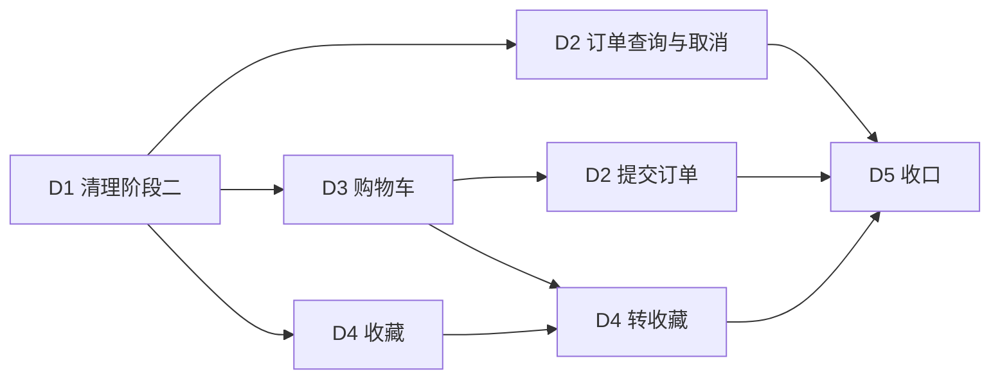

# Simple-Shop 阶段D · 买家端开发计划

> **文档性质**：阶段三买家端实施计划（v0.1），说明工作项、顺序、依赖与验收口径；**不含**接口契约细节与页面视觉设计。
> **适用范围**：`simple-shop-buyer-frontend`（Vue 3 + TypeScript + Vite + Pinia + Vue Router）。
> **上游依据**：阶段三《状态模型设计》《挑战需求B》《后端开发计划》、后端 README 的「订单口径 / 订单错误码」。
> **口径关系**：商品状态、订单状态、取消边界与错误码以后端文档为准；本文只谈前端做什么、按什么顺序做、做到什么算完成。
> **边界**：E2E 用例、视觉稿、组件库选型不在本文范围。
> **版本**：v0.1　**日期**：2026-11-09

---

## 摘要（一页结论）

| 问题 | 结论 |
| --- | --- |
| 起点 | 5 个视图（商品列表 / 详情 / 历史 / 登录 / 注册）、1 个 api 模块、1 个认证 store；购买意向与「我的历史」仍在 |
| 目标 | 阶段二意向与历史整体退场；补齐购物车、收藏、下单、我的订单（列表 + 详情 + 取消） |
| 实施顺序 | **D1 清理（串行前置）→ D2 订单查询与取消 与 D3 购物车 并行 → D2 下单接通 → D4 收藏/转收藏 → D5 收口** |
| 为什么先清理 | 意向/历史的方法、类型与文案与阶段三的类型定义冲突；不先删，后面每加一个模块都要绕开旧代码 |
| 并行点 | 订单查询与购物车没有调用关系；收藏不依赖订单 |
| 硬依赖 | 下单入口只能来自购物车勾选，因此「提交订单」排在购物车列表可用之后 |
| 完成定义（DoD） | 代码 + `npm run build` 通过 + 手工回归清单通过 + 错误码文案与后端码表一致 |
| 工时 | 本文不记录估算 |

**一句话判断**：买家端的难点不在页面数量，而在「购物车数量与勾选只在 localStorage」这条口径——服务端只记「谁收藏了/加了什么」，前端要自己维护数量、勾选，并在下单失败、行失效时把本地状态收干净。

---

## 1. 现状盘点

### 1.1 现有模块

| 模块 | 现状 | 处置 |
| --- | --- | --- |
| 商品列表 / 详情 | 公共接口免登录；详情有「我要购买」按钮 | 保留并改造：按钮改为「加入购物车 / 收藏」（见 D3、D4） |
| 登录 / 注册 / 退出 | 认证 store + 令牌持久化 | 保留，不改语义 |
| 我的历史 | 独立路由与视图，展示意向终态 | **删除**（D1） |
| 提交购买意向 | 详情页动作 + api 方法 + 成功提示 | **删除**（D1） |
| 购物车 | 不存在 | 新增（D3） |
| 收藏 | 不存在 | 新增（D4） |
| 我的订单 | 不存在 | 新增（D2） |

### 1.2 阶段二遗留与影响

- 「购买意向」是阶段二交易模型的入口，阶段三由订单取代；后端接口已下线，当前详情页按钮点击必然失败。
- 「我的历史」读取的是意向终态记录；阶段三没有历史表，历史商品只是已下架商品的查询视图，与买家无关。
- 商品侧文案仍假设「交易中」这一中间态（详情页提示语、`purchasable` 注释），阶段三只有在售 / 已下架两态。
- 页面级错误文案里残留意向阶段的业务码，需要与新码表对齐。

### 1.3 工具与验收现状

- 构建即类型检查：`npm run build`（含 `vue-tsc`）。
- 没有单元测试工程；本文不新增测试框架，验收以构建 + 手工回归清单为准。
- 开发期 Vite 已把 `/api`、`/media` 代理到后端，联调不需要额外配置。

---

## 2. 目标形态（按功能域）

### 2.1 功能域

| 功能域 | 能力 |
| --- | --- |
| 浏览 | 在售商品列表与搜索、商品详情（免登录） |
| 账号 | 注册、登录、退出；需要身份的功能统一跳登录并回原页 |
| 购物车 | 加购、列表、改数量、勾选、移除；失效商品保留展示但不可选中 |
| 收藏 | 收藏 / 取消收藏、我的收藏；失效商品保留并标注 |
| 订单 | 从购物车提交、我的订单（全部状态 + 筛选）、订单详情、发货前取消 |
| 转收藏 | 购物车多选转收藏，成功后从购物车移除 |

### 2.2 共享约定（全部页面复用，不各写一套）

- **响应拆壳与错误处理**集中在 `api/http.ts`：业务码 → 中文文案；界面不直接展示后端 `message` 原文。
- **字段命名**保持后端返回的 snake_case，不做驼峰转换。
- **登录守卫**集中一处：需要登录的路由与动作统一跳登录，登录后回原页；401 统一跳登录，不在页面里各自处理。
- **时间**：后端返回 UTC ISO-8601，前端按本地时区渲染，统一走 `format` 工具。
- **金额**：一律用后端给的总价与小计，不在前端重新相乘累加（避免浮点尾数）。
- **购物车本地状态**（数量、勾选）只存 `localStorage`，按买家身份隔离；退出登录时清理。

### 2.3 与阶段二的关键差异

| 维度 | 阶段二买家端 | 阶段三买家端 |
| --- | --- | --- |
| 交易入口 | 提交购买意向、等待卖家裁决 | 加入购物车 → 勾选多件 → 提交订单 |
| 结果查看 | 我的历史（只有终态） | 我的订单（全部状态，进行中也在） |
| 买家可做的操作 | 提交意向 | 下单、取消（发货前）、加购、收藏 |
| 商品可见性 | 在售 + 交易中 | 只有在售 |
| 购物车/收藏 | 无 | 有，且数量与勾选在前端 |

---

## 3. 阶段划分与依赖

| 阶段 | 目标 | 可并行 | 完成标志 |
| --- | --- | --- | --- |
| D1 清理 | 意向与历史退场、商品口径对齐 | 否，必须先行 | 构建通过，页面无死链与旧文案 |
| D2 订单 | 下单、我的订单、详情、取消 | 查询部分与 D3 并行 | 下单到取消全链路可用 |
| D3 购物车 | 加购、列表、数量与勾选、失效派生 | 与 D2 查询部分并行 | 购物车可增删改选，合计正确 |
| D4 收藏 | 收藏、我的收藏、转收藏 | 与 D2 并行 | 收藏幂等、失效标注、转收藏可用 |
| D5 收口 | 全量回归、文案与契约核对 | 否 | 交付清单齐全 |

---

## 4. 阶段 D1：清理阶段二（串行前置）

### D1-1 移除购买意向

- **范围**：详情页的购买动作、提交意向的 api 方法与成功提示、与之相关的按钮禁用条件（「交易中」）。
- **不做**：不在此任务里补「加入购物车 / 收藏」按钮，避免一次改两处；动作留空到 D3-2、D4-2 接入。
- **验收**：全局搜索不到意向相关调用与类型；详情页在售商品可正常浏览，页面上没有不可用按钮。

### D1-2 移除「我的历史」

- **范围**：路由、顶部导航入口、历史视图、翻页与结果文案。
- **验收**：访问旧路径不再渲染历史页；导航只剩商品与账号入口；无未使用组件残留。

### D1-3 清理 api 与类型

- **范围**：删除意向/历史方法与其返回类型；清理意向阶段的业务码映射；`purchasable` 注释与使用处改为「在售且有库存」。
- **验收**：`api` 目录与 `types` 里没有指向已下线能力的方法、类型与注释；构建通过。

### D1-4 商品两态口径

- **范围**：列表与详情不再出现「交易中/冻结」分支与提示；已下架商品按后端行为处理（详情不可见、列表不出现）。
- **验收**：全局搜索不到四态相关文案与判断；后端返回 404 时详情页给出「商品已下架或不存在」的空态，而不是报错崩溃。

### D1-5 清理回归

- **范围**：浏览、搜索、详情、注册、登录、退出各走一遍。
- **验收**：`npm run build` 通过；控制台无报错；无 404 请求（除刻意访问已下架商品）。

---

## 5. 阶段 D2：订单

### D2-1 订单 api 模块与类型

- **范围**：新建订单 api 模块（列表、详情、明细、提交、取消）；定义订单头、明细、提交入参、状态枚举类型；按后端码表补订单域错误码映射。
- **约束**：订单列表与详情只回订单头，明细必须按订单 id 二次查询——类型上就要区分「订单头」与「明细」两种结构。
- **验收**：类型与后端 DTO 字段逐字对应（snake_case）；状态枚举与后端六个值一致。

### D2-2 我的订单列表

- **范围**：登录后可进入；默认全部状态、按下单时间倒序、分页；状态筛选（进行中 / 已取消 / 已完成等）；空态与加载态。
- **验收**：只显示自己的订单；切筛选与翻页结果正确；空列表有明确提示。

### D2-3 订单详情

- **范围**：进入详情先取订单头，再按订单 id 取明细；两块独立处理加载失败；展示订单号、状态、下单时间、总额、明细与小计。
- **约束**：不展示其他买家的信息；明细顺序稳定（以后端返回为准）。
- **验收**：订单头加载成功但明细失败时，页面仍可读订单基本信息并可重试；总额与明细小计之和对得上。

### D2-4 取消订单

- **范围**：详情内取消入口，只在可取消状态出现；二次确认；成功后就地刷新状态；重复点击防抖。
- **口径**：取消边界以后端为准（发货前可取消），前端不自行推断其它状态迁移。
- **验收**：取消成功后状态变为已取消、按钮消失；已发货订单不出现取消入口；后端拒绝时按错误码给中文提示。

### D2-5 提交订单（依赖 D3）

- **范围**：把购物车勾选的明细与数量提交；提交中禁用重复提交；成功后跳订单详情并清理本地勾选；失败按错误码区分提示。
- **口径**：请求只带明细与数量，不带金额；同一订单内不出现重复商品（购物车行天然唯一）。
- **验收**：成功路径进入详情页；商品下架 / 库存不足 / 参数错误三类失败各有可读提示，并引导回购物车调整；失败后勾选与数量不丢。

### D2-6 订单回归

- **验收**：列表 → 详情 → 取消；下单 → 详情；刷新页面后状态与列表一致；未登录访问订单相关页被拦到登录并回原页。

---

## 6. 阶段 D3：购物车

### D3-1 购物车 api 与本地状态模型

- **范围**：加购、列表、移除三个动作的 api；本地状态结构（商品 → 数量、是否勾选），按买家隔离存储。
- **口径**：服务端只存「买家 + 商品 + 加购时间」，数量与勾选**只在前端**；不实现服务端数量。
- **验收**：本地状态在刷新后恢复；退出登录后清空；换账号不串数据。

### D3-2 详情页加购入口

- **范围**：在售商品可加购；未登录先跳登录；重复加购按幂等处理（提示已在购物车）；加购后可进入购物车。
- **验收**：重复点击不产生重复行；已下架商品没有加购入口。

### D3-3 购物车列表

- **范围**：展示行、删除行、编辑数量、勾选 / 取消勾选、合计（只算已勾选且有效的行）；失效行（已下架）保留展示但不可勾选、不可编辑数量。
- **验收**：合计随勾选与数量实时变化；失效行有明确标注且不参与下单；空购物车有引导。

### D3-4 本地状态与服务端行对齐

- **范围**：服务端行变化（在别处删除、商品下架）后，本地数量与勾选要能自愈：孤儿记录清理、失效行保留但取消勾选。
- **验收**：多标签页操作后刷新不出现「幽灵行」；失效行不会带进下单请求。

### D3-5 从购物车下单

- **范围**：勾选多件 → 触发 D2-5 的提交；提交成功后清除这些行的本地勾选与数量，刷新购物车。
- **验收**：未勾选任何行时不能提交；提交失败时本地状态保持原样。

### D3-6 购物车回归

- **验收**：加购 → 改数量 → 勾选 → 下单 → 回购物车，行与数量符合预期。

---

## 7. 阶段 D4：收藏

### D4-1 收藏 api 与类型

- **范围**：收藏、取消收藏、我的收藏三个动作；条目字段以后端为准（商品引用 + 收藏时间，商品信息实时读取）。
- **验收**：类型与后端 DTO 一致。

### D4-2 详情页收藏入口

- **范围**：收藏 / 取消收藏切换；状态回显（进入详情时知道自己是否已收藏）；幂等。
- **验收**：连点不产生重复记录；未登录先跳登录。

### D4-3 我的收藏

- **范围**：按收藏时间倒序、分页；失效商品（已下架）保留展示、标注不可用、不可进详情。
- **验收**：商品下架后收藏行仍在并可读；点击失效行有提示而不是 404 页。

### D4-4 转收藏

- **范围**：购物车多选 → 转收藏；成功后从购物车移除这些行；入参含失效商品时整体拒绝并指出商品。
- **口径**：转收藏是「先写收藏（幂等）→ 再删购物车行」，前端不做中间态展示；失败时不删行。
- **验收**：重复转收藏不报错、不重复收藏；失败时购物车行保持原样。

### D4-5 收藏回归

- **验收**：收藏 → 取消 → 再收藏；收藏列表分页；失效与恢复（补货后自动上架）后的展示自动更新。

---

## 8. 阶段 D5：收口

### D5-1 全量回归

- **范围**：按第 9 节清单逐项走查，覆盖登录态与未登录态。
- **验收**：`npm run build` 通过；清单全部通过。

### D5-2 文案与错误码一致性

- **范围**：所有业务拒绝都有中文提示；不直接展示后端 `message`；同一业务码在不同页面文案一致。
- **验收**：错误码表与后端 README 的码表逐条对得上。

### D5-3 契约核对

- **范围**：用后端 OpenAPI 快照核对字段名、枚举值、分页结构。
- **验收**：差异清零，或差异项登记为已知问题并写明原因。

### D5-4 交接与文档

- **范围**：买家端 README 更新（功能域、路由、本地存储约定）；给 E2E 的交接说明（哪些路径已稳定）。
- **验收**：新接手的人只看文档就能跑起来并联调。

---

## 9. 测试与验收

### 9.1 手工回归清单（最小集）

- 未登录：浏览列表与详情、搜索、注册、登录；访问购物车/收藏/订单被拦到登录。
- 购物车：加购（含重复）、改数量、勾选、删除、失效行、合计、刷新恢复。
- 下单：单件、多件、含失效行（应被拦）、库存不足（应被拒并提示）。
- 订单：列表筛选、分页、详情（含明细二次加载）、取消、已发货不可取消。
- 收藏：收藏/取消、列表、失效标注、转收藏。

### 9.2 质量门禁

- 每次改动至少跑 `npm run build`（类型检查 + 构建）。
- 不引入 UI 组件库；样式沿用现有原生 CSS 约定。
- 不把业务规则复制到前端：可取消状态、可购买判断、失效判定都以接口返回为准。

---

## 10. 风险与待定

| 项 | 说明 | 处置 |
| --- | --- | --- |
| 本地状态与服务端行漂移 | 数量与勾选在本地，服务端行可能被别处删除 | D3-4 做对齐与自愈，孤儿记录清理 |
| 下单失败后的勾选状态 | 失败要能回到购物车继续调整 | 失败不清理本地状态；成功才清 |
| 两处二次查询 | 详情与明细分两次调用，弱网下可能一半成功 | D2-3 独立处理失败块，可单块重试 |
| 错误码文案漂移 | 前后端各写一套 | 统一在 `api/http.ts` 映射，对照后端码表 |
| 失效商品展示 | 购物车与收藏都要保留但不可用 | 失效是读取时派生的展示结论，不落本地标记 |
| 时间与金额格式 | 时区与小数容易各写一套 | 统一走 `format` 工具；金额只用后端值 |

---

## 11. 交付物

- 买家端代码：意向与历史退场；购物车、收藏、订单全链路。
- 本地存储约定说明（购物车数量与勾选的键与生命周期）。
- 错误码文案映射表（与后端码表一致）。
- 更新后的买家端 README 与 E2E 交接说明。

---

## 12. 任务完成登记区

> 这里是**唯一**记录阶段 D 进度的位置。
> 登记规则：
> 1. 只改「状态 / 负责人 / 完成日期 / 备注」，不改编号与任务名。
> 2. 新任务追加新编号（D6-1…）；取消的任务标「取消」并写原因，不删行。
> 3. 状态取值：未开始 / 进行中 / 已完成 / 阻塞 / 取消。
> 4. 「已完成」= 代码合并 + `npm run build` 通过 + 手工回归 + 文案与契约对齐。
> 5. 日期用 YYYY-MM-DD；备注写分支、PR 或提交号。

| 编号 | 任务 | 前置 | 状态 | 完成日期 | 备注 |
| --- | --- | --- | --- | --- | --- |
| D1-1 | 移除购买意向 | — | 已完成 | 2026-11-11 | 详情页「我要购买」按钮、意向提交逻辑与成功提示整体删除；按钮位置留空，待 D3-2 / D4-2 接入加购与收藏。分支 `feature.d-buyer-frontend`。 |
| D1-2 | 移除「我的历史」 | — | 已完成 | 2026-11-11 | 「我的历史」路由、顶部导航入口与 `views/History.vue` 一并删除；旧路径 /history 落到 catch-all，重定向到 /goods。 |
| D1-3 | 清理 api 与类型 | D1-1、D1-2 | 已完成 | 2026-11-11 | `api/buyer.ts` 删 `submitIntention`、`fetchHistory`；`api/types.ts` 删 `IntentionAccepted`、`BuyerHistoryEntry`；`status` 相关注释改为两态口径，`purchasable` 注释改为「在售且有库存」。 |
| D1-4 | 商品两态口径 | D1-1 | 已完成 | 2026-11-11 | 详情页已下架/不存在改为空态（「商品已下架或不存在」+ 返回列表），不再落到通用错误分支；列表与详情不再出现「交易中/冻结」分支与文案。 |
| D1-5 | 清理回归 | D1-1 至 D1-4 | 已完成 | 2026-11-11 | `npm run build`（含 `vue-tsc`）通过；Playwright + msedge 冒烟 15 项通过：列表、搜索有/无结果、在售详情、已下架空态、旧路径重定向、注册、登录、退出；页面级报错 0 条。 |
| D2-1 | 订单 api 模块与类型 | D1-5 | 未开始 |  |  |
| D2-2 | 我的订单列表 | D2-1 | 未开始 |  |  |
| D2-3 | 订单详情（头 + 明细两次加载） | D2-1 | 未开始 |  |  |
| D2-4 | 取消订单 | D2-3 | 未开始 |  |  |
| D2-5 | 提交订单 | D2-1、D3-3 | 未开始 |  |  |
| D2-6 | 订单回归 | D2-2 至 D2-5 | 未开始 |  |  |
| D3-1 | 购物车 api 与本地状态模型 | D1-5 | 未开始 |  |  |
| D3-2 | 详情页加购入口 | D3-1 | 未开始 |  |  |
| D3-3 | 购物车列表（数量/勾选/失效/合计） | D3-1 | 未开始 |  |  |
| D3-4 | 本地状态与服务端行对齐 | D3-3 | 未开始 |  |  |
| D3-5 | 从购物车下单 | D2-5、D3-3 | 未开始 |  |  |
| D3-6 | 购物车回归 | D3-2 至 D3-5 | 未开始 |  |  |
| D4-1 | 收藏 api 与类型 | D1-5 | 未开始 |  |  |
| D4-2 | 详情页收藏入口 | D4-1 | 未开始 |  |  |
| D4-3 | 我的收藏（含失效标注） | D4-1 | 未开始 |  |  |
| D4-4 | 转收藏 | D3-3、D4-1 | 未开始 |  |  |
| D4-5 | 收藏回归 | D4-2 至 D4-4 | 未开始 |  |  |
| D5-1 | 全量回归 | D2、D3、D4 完成 | 未开始 |  |  |
| D5-2 | 文案与错误码一致性 | D5-1 | 未开始 |  |  |
| D5-3 | 契约核对（OpenAPI） | D5-1 | 未开始 |  |  |
| D5-4 | 交接与文档 | D5-2、D5-3 | 未开始 |  |  |

---

**文档结束**
