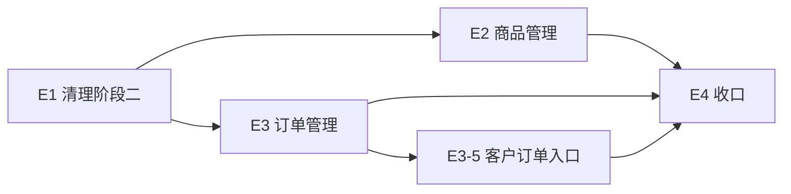

# Simple-Shop 阶段E · 卖家端开发计划

> **文档性质**：阶段三卖家端实施计划（v0.1），说明工作项、顺序、依赖与验收口径；**不含**接口契约细节与页面视觉设计。
> **适用范围**：`simple-shop-seller-frontend`（Vue 3 + TypeScript + Vite + Pinia + Vue Router + Vitest）。
> **上游依据**：阶段三《状态模型设计》《挑战需求B》《后端开发计划》、后端 README 的「订单口径 / 订单错误码」。
> **口径关系**：商品状态、订单状态、库存联动与错误码以后端文档为准；本文只谈前端做什么、按什么顺序做、做到什么算完成。
> **边界**：E2E 用例、视觉稿、组件库选型不在本文范围。
> **版本**：v0.5（E1、E2、E3 完成；E4-2/E4-3/E4-4 核对完成，E4-1 由 E2E 联调覆盖）　**日期**：2026-11-14

---

## 摘要（一页结论）

| 问题 | 结论 |
| --- | --- |
| 起点 | 14 个视图、10 个 api 模块；意向队列、交易裁决、历史商品两页、客户购买历史、四态商品与「重新上架」仍在 |
| 目标 | 意向/交易/归档整套退场；商品收敛为两态 + 下架原因；补齐订单管理、推进、取消、完成与客户视角入口 |
| 实施顺序 | **E1 清理（串行前置）→ E2 商品管理 与 E3 订单管理 并行 → E4 收口** |
| 为什么先清理 | 意向与交易裁决是阶段二的交易模型，与订单模块在详情页抢占同一区域；四态与「重新上架」和后端新口径直接冲突 |
| 并行点 | 商品管理与订单管理互不依赖（除订单完成会改变商品状态，靠刷新自愈即可） |
| 硬依赖 | 客户购买历史改为「内嵌该客户的订单列表」，因此 E3-2 先于 E3-5 |
| 完成定义（DoD） | 代码 + `npm run build` 通过 + `npm test` 通过 + 手工回归清单通过 + 错误码文案与后端码表一致 |
| 工时 | 本文不记录估算 |

**一句话判断**：卖家端不是「加两个订单页」，而是先把阶段二的交易中间态（意向、排队、裁决、归档、重新上架）整块拆掉，再按「两态商品 + 订单」重建操作入口；拆不干净，商品详情页会同时存在两套相互矛盾的操作。

---

## 1. 现状盘点

### 1.1 现有模块

| 模块 | 现状 | 处置 |
| --- | --- | --- |
| 登录 / 改密 | 独立视图 + 认证 store | 保留 |
| 商品列表 | 四态筛选、下架与重新上架入口 | 改造为两态 + 下架原因（E2-1） |
| 商品详情 | 状态操作、库存行内编辑、意向队列、进入交易 / 裁决、重新上架 | 改造：删除意向后半段与重新上架（E1、E2-2、E2-3） |
| 发布商品 | 类别、库存、描述块、媒体上传 | 保留，只按新口径回归（E2-4） |
| 类别管理 | 两级类别树 | 保留，不改语义 |
| 客户列表 / 详情 | 详情内嵌购买历史分页 | 改造：去掉内嵌历史，改为跳订单列表筛选（E3-5） |
| 历史记录（列表 / 详情） | 归档商品查询 | **删除**（E1-2）；由「已下架 + 原因」筛选承担 |
| 意向队列与交易裁决 | 商品详情内嵌队列、进入交易、标记成功/失败（含归档与库存处置） | **删除**（E1-1） |
| 订单管理 | 不存在 | 新增（E3） |

### 1.2 阶段二遗留与影响

- **交易模型整体失效**：意向、队列、裁决、冻结（`FROZEN`）在后端已下线，详情页的队列区域与交易按钮当前点击必然失败。
- **归档概念失效**：没有历史表，「历史商品」只是已下架商品的查询视图；历史两页与 `ARCHIVED` 状态需要整体删除。
- **商品四态残留**：`ON_SALE / FROZEN / OFF_MANUAL / OFF_ZERO` 的类型、标签、筛选项与「重新上架」按钮都与新口径冲突；新口径是两态 + 三种下架原因，手动下架是终态。
- **业务码语义变化**：`20020` 原本表示「商品不在已下架状态」，现在表示「商品被未完成订单引用」；`20021`（冻结）已下线。旧映射必须清理，否则文案会指错方向。
- **客户详情当前会报错**：后端已不返回内嵌购买历史，页面仍按旧字段读取，需要随 E3-5 修正。

### 1.3 工具与验收现状

- 构建与类型检查：`npm run build`；单元测试：`npm test`（Vitest，现有用例仅覆盖连通性）。
- 部署口径不变：生产构建的 base 为 `/seller/`，开发期仍在根路径。
- 开发期 Vite 已代理 `/api`、`/media`。

---

## 2. 目标形态（按功能域）

### 2.1 功能域

| 功能域 | 能力 |
| --- | --- |
| 商品管理 | 两态列表（在售 / 已下架）、按下架原因筛选、详情、库存调整、手动下架、类别改挂、发布 |
| 订单管理 | 订单列表（按状态）、订单详情与明细、确认 / 备货 / 发货 / 完成 / 取消 |
| 客户 | 客户列表与详情；详情内嵌该客户的订单列表（按买家筛选） |
| 类别 | 两级类别维护（不变） |
| 账号 | 登录、退出、改密（不变） |

### 2.2 共享约定（全部页面复用，不各写一套）

- **响应拆壳与错误处理**集中在 `api/http.ts`；业务码 → 中文文案；界面不直接展示后端 `message`。
- **字段命名**保持 snake_case。
- **401 与登录跳转**统一处理，不在页面里各写一套。
- **时间**统一走 `format` 工具（UTC → 本地）；**金额**只用后端返回值。
- **状态与能力分离**：状态只来自接口；按钮是否可用按状态与角色判断，不自行推断后端未承诺的迁移。
- **分页结构**沿用统一分页组件；列表筛选条件进 URL query，刷新与分享后仍能恢复当前视图。

### 2.3 与阶段二的关键差异

| 维度 | 阶段二卖家端 | 阶段三卖家端 |
| --- | --- | --- |
| 交易入口 | 商品详情内的意向队列与交易裁决 | 独立订单管理：确认 → 备货 → 发货 → 完成 |
| 商品状态 | 四态（含交易中、归档） | 两态 + 三种下架原因 |
| 手动下架 | 可重新上架 | 终态，库存只读（类别仍可改挂） |
| 历史商品 | 独立历史页 + 归档搬表 | 「已下架」列表按原因筛选 |
| 客户历史 | 客户详情内嵌意向历史 | 跳订单列表，按买家筛选 |
| 库存扣减 | 裁决成交扣 1 | 交易完成时按明细数量一次性扣 |

---

## 3. 阶段划分与依赖

| 阶段 | 目标 | 可并行 | 完成标志 |
| --- | --- | --- | --- |
| E1 清理 | 意向/交易/归档/四态/旧码退场 | 否，必须先行 | 构建与单测通过，页面无死链与旧文案 |
| E2 商品管理 | 两态口径下的列表、详情、库存、下架、改挂 | 与 E3 并行 | 商品全生命周期操作可用 |
| E3 订单管理 | 列表、详情、推进、取消、客户入口 | 与 E2 并行 | 订单全流程可用 |
| E4 收口 | 买卖联调、文案与契约核对 | 否 | 交付清单齐全 |

> **UI 技术栈改造（阶段 U）已完成（2026-11-11）**：卖家端已切到 Tailwind CSS 4 + daisyUI 5 并落地深浅两套主题，公共件与全部页面已改造完毕。范围与结果见[《阶段U-卖家端UI改造计划》](阶段U-卖家端UI改造计划.md)。E1-3 的页面口径改造（原因展示、原因筛选、手动下架库存只读）回到本计划继续，并入 E2-1、E2-2。

---

## 4. 阶段 E1：清理阶段二（串行前置）

### E1-1 删除意向与交易裁决

- **范围**：意向 api、意向表格与交易失败弹窗组件、商品详情内的队列区域与「进入交易 / 标记成功 / 标记失败」动作、意向校验、意向文案与消息常量、相关类型。
- **不做**：不在原位置补「商品订单记录」入口，留到 E3-2 以筛选方式进入，避免一次改两处。
- **验收**：全局搜索不到意向、排队、裁决、冻结相关代码与文案；商品详情只保留商品信息与状态操作；构建通过。

### E1-2 删除历史记录

- **范围**：历史 api、历史列表与详情两个视图、路由与菜单入口、`ARCHIVED` 相关类型与文案、客户详情内嵌的购买历史字段与请求参数。
- **验收**：导航只剩商品、订单、客户、类别、改密；旧历史路径不再渲染页面；客户详情不再请求历史字段。

### E1-3 商品两态化

- **范围**：商品状态类型收敛为在售 / 已下架；状态标签与配色；列表筛选项改为「状态 + 下架原因」；删除「重新上架」按钮与其确认文案；详情页库存编辑按新口径（手动下架库存只读、改 0 触发下架、补货自动上架）。
- **验收**：全站不出现四态与「重新上架」；状态与原因成对展示；手动下架商品库存输入不可用但类别可改。

### E1-4 错误码与文案对齐

- **范围**：删除意向阶段与归档阶段的业务码映射；`20020` 改为「商品有未完成订单，暂不能下架或清零」；补充订单域错误码（订单不存在、状态不允许、不可取消、完成缺货）与商品域新增码。
- **验收**：`api/types` 的码表与后端 README 的码表逐条对得上；不残留 `3xxxx / 4xxxx` 映射。

### E1-5 清理回归

- **范围**：登录、商品列表、商品详情、发布、类别、客户、改密各走一遍。
- **验收**：`npm run build` 与 `npm test` 通过；控制台无报错；无指向已删接口的请求。

---

## 5. 阶段 E2：商品管理

### E2-1 商品列表

- **范围**：两态筛选；已下架按下架原因分三类（手动下架 / 库存耗尽 / 已售），承担原「历史商品」的查询视图；关键词与类别筛选保留；筛选条件进 URL。
- **验收**：三种原因都能单独筛出对应商品；「已售」与「库存耗尽」商品可被补货，手动下架的不出现上架入口。

### E2-2 商品详情与库存

- **范围**：状态、下架原因、下架时间展示；库存编辑与保存反馈；改 0 的下架后果提示；补货后自动上架的状态回显；类别改挂入口在所有状态可用。
- **验收**：手动下架商品库存只读、类别仍可改；补货成功后列表与详情都显示在售且原因清空。

### E2-3 下架动作与阻断提示

- **范围**：手动下架二次确认；终态提示（不可恢复）；有未完成订单时按错误码给出「暂不能下架」的说明；改库存为 0 被拒时给出同类提示。
- **验收**：被拒后页面状态不变；提示文案能说清原因与下一步（先处理订单）。

### E2-4 发布回归

- **范围**：发布流程（类别、库存、描述块、主图/图集）按新口径回归，不新增功能。
- **验收**：发布成功后进入在售列表；库存至少 1 的约束提示正确。

---

## 6. 阶段 E3：订单管理

### E3-1 订单 api 与类型

- **范围**：新建订单 api 模块（列表、详情、明细、推进、取消、完成）；订单头与明细两种类型；六个状态枚举；订单域错误码映射。
- **约束**：列表与详情只回订单头，明细按订单 id 二次查询；类型上区分两者。
- **验收**：字段 snake_case 与后端一致；状态枚举完整。

### E3-2 订单列表

- **范围**：按状态分 tab（全部 + 六个状态）；分页；筛选条件进 URL。
- **口径**：订单列表只有一份实现——订单管理页按状态浏览；客户详情、商品详情各自**内嵌**一份，并按 `buyer_id` / `goods_id` 固定筛选。详情一律按 `order_id` 进。
- **验收**：独立页刷新后条件不丢；内嵌列表只显示对应客户/商品的订单，且不改动宿主页地址；空态明确。
- **落地**：三处共用一个 `components/order/OrderList.vue`，差异只在传入的 `buyer-id` / `goods-id` / `sync-query`。订单主键字段是 `order_id`（不是 `id`），详情路由 `/orders/:id` 用它，行内已接上跳转（支持 Enter 键）。写回 URL 时**只动 `status` / `page`**，不覆盖别人带来的 `buyer_id` / `goods_id`；内嵌模式 `sync-query=false`，状态 tab 与翻页只留在组件内部。`/orders?buyer_id=` / `?goods_id=` 深链仍可用，只是界面上不再有跳转按钮。

### E3-3 订单详情

- **范围**：订单头加载后按 id 取明细；展示订单号、买家用户名、状态、下单时间、总额、明细与小计；可用操作**只看订单状态**（卖家端只有卖家一个角色，没有角色维度），并给出该状态的下一步说明。
- **约束**：订单头与明细两次请求各自持有加载态、失败态与重试入口，任一块失败不阻塞另一块。
- **验收**：两块数据独立处理失败与重试；状态与「下一步」说明一致，终态（交易完成/已取消）不再出现任何下一步提示；五个动作按钮随 E3-4 接入。
- **落地**：`views/OrderDetailView.vue` 挂在 `/orders/:id`。订单头与明细各自 loading / error / 重试；`60001` 时只给「返回列表」（重试没有意义），并隐藏明细区。明细合计优先用订单头的 `total_amount`，头没加载出来时退回按明细小计相加并标注。状态说明取 `ORDER_STATUS_HINTS`，**本页只做展示**，确认/备货/发货/完成/取消五个动作按计划留给 E3-4。

### E3-4 推进与取消

- **范围**：确认、备货完成、开始发货、交易完成、取消五个动作；每个动作二次确认；提交中防重复点击；成功后就地刷新状态。
- **口径**：完成失败（库存不足）是整单拒绝——订单停在已发货，需提示卖家补货后重试或取消；不做部分完成。重复取消按成功后处理，不弹错。
- **验收**：每次只能推进一格，跳级入口不存在；完成缺货时有明确提示且订单状态不变；取消后所有推进入口消失。
- **落地**：动作入口由状态直接推出（`NEXT_ACTION` 只登记四个进行中状态，没有「下一步」就没有按钮）；另外新增 `OrderProgress` 状态流程图——横向铺「待确认 → 已确认 → 备货完成 → 已发货 → 交易完成」，走过的淡色、当前实心、未到的灰底，终态订单整条不渲染（没有下一步，画出来会误导）。取消放在动作区左侧并用 `btn-error` 描边，确认弹窗的文案与取消按钮名都随动作变（避免「取消 / 取消订单」两个同名按钮）。

### E3-5 客户订单入口

- **范围**：客户列表与详情去掉购买历史；客户详情与商品详情**内嵌**对应的订单列表（同一份列表组件按 buyer_id / goods_id 固定筛选），不提供跳出到订单管理页的按钮。
- **验收**：客户详情不再请求历史字段；内嵌列表只显示该客户（该商品）的订单；内嵌处的状态 tab 与翻页不改动宿主页地址。
- **落地**：购买历史早在 E1-2 就随意向/归档一起删掉了，本轮补的是内嵌列表：客户详情在基本信息卡下方、商品详情在描述区下方各挂一个 `OrderList`，`page-size=5`、`sync-query=false`（不写宿主 URL），客户详情再关掉「买家」列。行内仍可点进订单详情。
- **为什么不做成跳转**：阶段二的意向列表就是内嵌在商品详情里的，卖家看客户/商品时要的是「就地看到相关订单」，跳一次再返回会丢掉上下文；`/orders?buyer_id=` 这类深链仍保留，只是界面上不再放按钮。

### E3-6 订单回归

- **验收**：列表筛选 → 详情 → 推进 → 完成；取消分支；异常分支（缺货、重复点击）。
- **落地**：以拦截接口造状态机的方式回归（dev 库没有订单）——三个 tab 入口、行跳详情、四步推进到完成、取消后入口全消失、60002 被拒后状态不变、空态与「查看全部订单」清除；另用真实后端跑 8 条路由冒烟，控制台 0 报错。真实买卖联调留到 E4-1（本阶段暂停，等买家端）。

---

## 7. 阶段 E4：收口

> **E4 状态（2026-11-14）**：买家端已就绪，E4-2 文案与错误码、E4-3 契约、E4-4 文档均已完成；E4-1 的联调不再单独手工演练，改由阶段三 E2E（买家下单 → 卖家推进全链路）承担。

### E4-1 买卖两端联调

- **范围**：买家下单 → 卖家确认 → 备货 → 发货 → 完成；以及发货前买家取消、发货后卖家取消两条分支。
- **验收**：状态在两端同步可见；商品状态与库存随完成正确变化。

### E4-2 文案、错误码与空态

- **范围**：所有业务拒绝有中文提示；同码同文案；空态与加载态一致。
- **验收**：对照后端码表逐条核对，无遗漏。

### E4-3 契约核对

- **范围**：用后端 OpenAPI 快照核对字段、枚举与分页结构。
- **验收**：差异清零或登记为已知问题。

### E4-4 交接与文档

- **范围**：卖家端 README 更新（功能域、菜单、订单口径、错误码文案表）。**给 E2E 的交接说明已取消**（E2E 由本阶段直接落地，不再走文档交接）。
- **验收**：新接手的人只看 README 就能跑起来并联调。

---

## 8. 测试与验收

### 8.1 手工回归清单（最小集）

- 商品：发布 → 列表筛选（两态 + 原因）→ 详情 → 改库存（含改 0、补货）→ 手动下架 → 类别改挂。
- 阻断：有未完成订单时下架 / 清零被拒，提示可读。
- 订单：列表三入口、状态 tab、详情、五个动作、缺货完成失败、重复点击。
- 客户：列表与详情，跳转其订单列表。
- 类别：增删改与引用校验（回归，不改语义）。

### 8.2 质量门禁

- 每次改动至少跑 `npm run build`；涉及逻辑再跑 `npm test`。
- 不引入 UI 组件库；沿用现有原生 CSS 与 `components/common` 复用。（**已废止**：卖家端自阶段 U 起改为 Tailwind CSS 4 + daisyUI 5，样式口径见 `AGENTS.md` §5 与[《阶段U-卖家端UI改造计划》](阶段U-卖家端UI改造计划.md)；但「不把业务规则复制到前端」仍然有效。）
- 不把业务规则复制到前端：可用动作、失效判定、库存后果都以接口返回为准。

---

## 9. 风险与待定

| 项 | 说明 | 处置 |
| --- | --- | --- |
| 详情页改造面大 | 意向队列与交易操作整块移除，详情页结构变化明显 | E1-1 先删干净，再在 E2 中补状态操作，不边删边加 |
| `20020` 语义变化 | 旧文案指向「不在已下架状态」，新语义是「有未完成订单」 | E1-4 统一改文案，对照后端码表 |
| 完成缺货 | 卖家容易以为「点了完成就成功」 | 提示整单拒绝、订单停在已发货、补货后可重试 |
| 列表筛选组合 | 三入口共用一个列表，条件容易丢 | 条件进 URL；空态说明当前筛选 |
| 商品状态与库存联动 | 补货自动上架、改 0 自动下架 | 不本地推断，操作后重新拉取详情 |
| 客户历史入口 | 删除内嵌历史后要给出替代路径 | E3-5 提供跳订单列表并带买家筛选 |
| 部署 base | 生产 `/seller/`，开发根路径 | 路由与静态资源沿用现有约定，不自造 URL |

---

## 10. 交付物

- 卖家端代码：意向/交易/归档退场；两态商品管理；订单管理全流程；客户订单入口。
- 错误码文案映射表（与后端码表一致）。
- 更新后的卖家端 README 与 E2E 交接说明。

---

## 11. 任务完成登记区

> 这里是**唯一**记录阶段 E 进度的位置。
> 登记规则：
> 1. 只改「状态 / 负责人 / 完成日期 / 备注」，不改编号与任务名。
> 2. 新任务追加新编号（E5-1…）；取消的任务标「取消」并写原因，不删行。
> 3. 状态取值：未开始 / 进行中 / 已完成 / 阻塞 / 取消。
> 4. 「已完成」= 代码合并 + `npm run build` 通过 + `npm test` 通过 + 手工回归 + 文案与契约对齐。
> 5. 日期用 YYYY-MM-DD；备注写分支、PR 或提交号。

| 编号 | 任务 | 前置 | 状态 | 完成日期 | 备注 |
| --- | --- | --- | --- | --- | --- |
| E1-1 | 删除意向与交易裁决 | — | 已完成 | 2026-11-11 | 分支 feature.refactor-phase3 |
| E1-2 | 删除历史记录与客户购买历史 | — | 已完成 | 2026-11-11 | 分支 feature.refactor-phase3 |
| E1-3 | 商品两态化 | E1-1 | 已完成 | 2026-11-11 | 页面口径随 E2-1/E2-2 落地：原因成对展示、原因可筛、手动下架库存只读 |
| E1-4 | 错误码与文案对齐 | E1-1、E1-2 | 已完成 | 2026-11-11 | 卖家可达的 41 个码与后端 ErrorCode 同名同值；7xxxx 属买家域未登记 |
| E1-5 | 清理回归 | E1-1 至 E1-4 | 已完成 | 2026-11-11 | build 与 test 通过；Edge 冒烟：登录、商品列表/详情、客户、类别、改密无控制台报错，/history 不再渲染 |
| E2-1 | 商品列表（两态 + 原因筛选） | E1-5 | 已完成 | 2026-11-11 | 状态与原因合并为一个下拉（避免后端拒绝无效组合）；筛选条件（status/reason/l1/l2/keyword/page）进 URL |
| E2-2 | 商品详情与库存口径 | E1-5 | 已完成 | 2026-11-11 | 状态+原因+下架时间展示；手动下架库存只读；改 0 后果提示；补货后自动上架回显 |
| E2-3 | 下架动作与阻断提示 | E2-2 | 已完成 | 2026-11-11 | 下架确认补「有未完成订单会被拒绝」；20020 文案改为「…先处理完这些订单再操作」；被拒后状态不变 |
| E2-4 | 发布回归 | E1-5 | 已完成 | 2026-11-11 | 全流程回归通过；修了描述编辑器 Backspace/Delete 删不掉媒体的老 bug（并在删媒体后合并左右文本行，否则会留下互不相通的空行），发布表单加 `novalidate` |
| E3-1 | 订单 api 与类型 | E1-5 | 已完成 | 2026-11-11 | `api/orders.ts` + 订单头/明细/状态四种类型 + 六态枚举；明细按 `order_id` 二次查询；状态文案与配色进 `constants/labels.ts` |
| E3-2 | 订单列表（三入口 + 状态 tab） | E3-1 | 已完成 | 2026-11-11 | 列表组件 + `/orders` 宿主页 + 状态 tab + status/page 进 URL + 行内跳详情；客户/商品改为内嵌同一组件（见 E3-5） |
| E3-3 | 订单详情（头 + 明细两次加载） | E3-1 | 已完成 | 2026-11-11 | 头/明细各自独立失败与重试；60001 只给返回列表；合计优先用订单头、退化时按明细相加；状态说明走 `ORDER_STATUS_HINTS`；动作按钮留 E3-4 |
| E3-4 | 推进与取消（含完成缺货） | E3-3 | 已完成 | 2026-11-11 | 五个动作各带二次确认与提交中禁用（实测连点只发一次请求）；完成缺货 60004 提示后停在已发货；新增 `OrderProgress` 状态流程图，终态不渲染 |
| E3-5 | 客户订单入口 | E3-2 | 已完成 | 2026-11-11 | 客户详情、商品详情各内嵌一份订单列表（buyer_id / goods_id 固定筛选，不写宿主 URL）；客户详情隐藏买家列；购买历史已于 E1-2 删除 |
| E3-6 | 订单回归 | E3-2 至 E3-5 | 已完成 | 2026-11-11 | 拦截接口造状态机回归：三入口、行跳详情、四步推进、取消分支、60002 被拒、空态清除；真实后端 8 条路由冒烟 0 报错 |
| E4-1 | 买卖两端联调 | E2、E3 完成 | 已完成 | 2026-11-14 | 由 E2E 联调用例覆盖 |
| E4-2 | 文案、错误码与空态 | E4-1 | 已完成 | 2026-11-14 | 脚本比对：卖家可达的 41 个码与后端 ErrorCode 同名同值且逐条有中文文案；补 10005~10010、50004、50005 文案，10004 改为「至少 8 位且 ≤72 字节」，未登记码兜底改「操作失败，请稍后重试」；类别空态不再在请求失败时误报「暂无一级类别」；未知路由兜底回商品列表；`var(--warning)` 改 `var(--color-warning)`；build 与 103 条单测通过 |
| E4-3 | 契约核对（OpenAPI） | E4-1 | 已完成 | 2026-11-14 | 卖家 21 个路径 + 公共 4 个逐个核对：路径、查询参数、请求体、响应结构与 `types.ts` 一致；补 `ApiResponse.errors` / `FieldErrorData`；快照未标可空字段登记为已知偏离（README §八） |
| E4-4 | 交接与文档 | E4-2、E4-3 | 已完成 | 2026-11-14 | README 补「错误码 → 界面文案」表（37 个码 + 2 条兜底）、未知路由口径、契约已知偏离；E2E 交接说明按最新要求取消 |

---

**文档结束**
