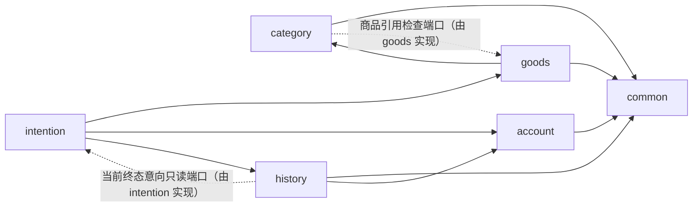
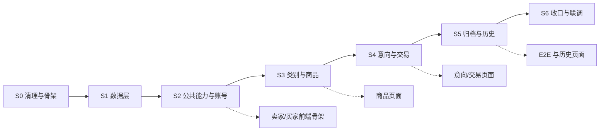

# Simple-Shop 阶段二 · 后端开发计划

> **文档性质**：开发计划（总体规划），不展开逐接口、逐类的实现细节。  
> **适用范围**：后端重构、数据库重建、JSP 移除、前后端分离。  
> **上游依据**：《升级需求A》《需求澄清记录》《状态模型设计》。  
> **说明**：本文档盘点现有实现并给出处置结论；不把阶段一需求规格说明书作为阶段二口径依据。  
> **口径关系**：状态与迁移以《状态模型设计》为准；本文只谈后端重构与实施计划。  
> **版本**：v1.0（草案）　**日期**：2026-10-22

---

## 摘要（一页结论）

| 问题 | 结论 |
| --- | --- |
| 现有后端规模 | 84 个主代码 Java 文件、约 10,575 行；31 个测试源文件（含测试工具）、484 个用例；7 个实体、7 个仓储、6 个枚举；4 个 JSP、3 个买家 JSP Controller；5 个卖家 Controller、16 个卖家接口 |
| 能直接复用的 | 时间/密码/JSON/统一响应/图片类型/文本规则/UTC 转换/限流/审计等基础设施；Maven+war+Flyway+JPA+UTC 的工程约定；Vue 卖家端的 HTTP、登录态、布局与通用组件 |
| 需要改造的 | 会话与鉴权（支持买家/卖家两种角色）、配置、异常与错误码、图片存储（主图+图集）、限流、审计、卖家登录、部署脚本、卖家前端壳 |
| 需要删除的 | 买家 JSP 及其 Controller/静态资源/JSP 依赖；口令码全链路；交易流水表；手动冻结；买家撤销/改资料；单商品槽位假设；阶段一的文档化注释 |
| 需要重写的 | 数据库基线、实体/仓储/枚举、商品/类别/意向/交易/归档/历史/账号服务、全部卖家 Controller 与 DTO、校验器、大部分测试、卖家前端业务页面 |
| 需要新增的 | 两级类别、买家账号、多商品与库存、商品主图/图集、买家历史、卖家客户管理、买家前端工程、接口契约 |
| 目标分包 | common + account + category + goods + intention + history；每个功能下再分 entity/repository/service/controller/dto，controller 再分 seller/buyer |
| 数据库 | 阶段二使用全新基线；阶段一数据不迁移；删除交易流水表；新增类别、买家账号、商品图集、按商品队列序号、历史快照等表 |
| 实施节奏 | S0 清理与骨架 → S1 数据层 → S2 公共能力与账号 → S3 类别与商品 → S4 意向与交易 → S5 归档与历史 → S6 收口、联调、测试与部署 |
| 粗估工作量 | 后端约 30～39 人日（1 人，含自测）；前端另计：卖家端约 8～10 人日、买家端约 8～10 人日、E2E 约 3～5 人日 |

**一句话判断**：阶段二不是“在现有后端上改字段”，而是**保留基础设施、重写业务主干**。现有代码里真正值得原样保留的是公共能力与工程约定；商品、意向、交易、归档、账号这些业务代码基本要按新模型重写。

---

## 1. 现状盘点

### 1.1 代码规模

| 项 | 现状 |
| --- | --- |
| 主代码 | 84 个 Java 文件，约 10,575 行 |
| 测试 | 31 个测试源文件（含测试工具），484 个用例 |
| 分层 | persistence（7 实体 / 7 仓储 / 6 枚举）+ service + web + config/session/security |
| 卖家接口 | 5 个 Controller、16 个接口（会话 2、账号 1、商品 6、意向 5、历史 2） |
| 买家页面 | 3 个 JSP Controller、7 个端点、4 个 JSP |
| 前端 | 1 个 Vue 3 + Vite 卖家 SPA（17 个 Vue 组件/视图、27 个 TS 文件） |
| 数据库 | 7 张表，Flyway V1/V2 两个脚本 |
| 部署 | 可执行 war + nginx + Docker Compose（单机/云端两套） |
| 文档 | 后端 docs 目录约 27 份阶段一设计/过程文档，约 550KB |

### 1.2 现有包结构

```text
com.simpleshop
  SimpleShopApplication
  config/            AppProperties、JacksonConfig
  security/          PasswordHasher、PasswordHashTool
  session/           SessionStore
  service/           SellerAuth/Goods/Intention/History、BuyerIntention、
                     Archive、ImageStorage、OperationLog、Passcode、SubmitRateLimiter
    dto/             卖家响应 DTO、买家结果/口令码 DTO
    support/         校验器、文本规则、图片类型、UTC 转换
    exception/       ErrorCode、BusinessException
  web/               5 个卖家 Controller、3 个买家 JSP Controller
                     ApiResponse、GlobalExceptionHandler、SellerAuthInterceptor、WebMvcConfig
    dto/             卖家请求 DTO
  persistence/
    entity/          7 个实体 + EntityFactory
    enums/           6 个枚举
    repository/      7 个仓储
    time/            DatabaseTimeProvider
```

### 1.3 与阶段二的主要差距

| 维度 | 现有实现 | 阶段二 |
| --- | --- | --- |
| 商品数量 | 全局至多 1 件在售/冻结 | 可同时多件在售，无在售数量上限 |
| 库存 | 无库存字段 | 每件商品有库存；发布≥1；成交扣减；库存 0 自动下架 |
| 类别 | 无类别 | 两级类别；商品必须挂二级；类别可删除/重命名/改挂 |
| 买家身份 | 姓名+电话，无账号 | 注册账号（用户名唯一、手机号不唯一）；提交意向绑定账号 |
| 凭证 | 口令码 | 废止；改为买家登录会话 |
| 买家操作 | 可凭口令码查/改/撤销 | 只能提交意向、查看自己的终态历史；不能改/撤销 |
| 商品图片 | 单张图片 | 主图可无 + 图集≤8；无主图禁止图集 |
| 商品描述 | 纯文本 | 富文本，可内嵌图片/视频 |
| 商品状态 | 在售/冻结/已下架 | 在售/交易中/下架·手动/下架·库存清零/已归档 |
| 下架语义 | 手动下架即归档 | 手动/库存清零下架可复售；只有成交售罄归档 |
| 交易流水 | 独立流水表 | 删除；意向只保留最终结果 |
| 买家可见性 | 买家看不到结果 | 买家可见自己的终态历史 |
| 分包 | 按技术分层 | 按功能分包，功能内再分 entity/repository/service/controller/dto |
| 注释 | 大量文档编号与“为什么”长文 | 精简，只保留非显然的技术约束；不引用文档 |
| 买家端 | 服务端渲染 JSP | 前后端分离，独立 buyer-frontend |
| 卖家端 | 单商品 Vue SPA | 多商品/类别/客户/历史 Vue SPA |

### 1.4 主要问题

1. **按技术分层，不按功能分层**：改一个商品状态要跨 entity/repository/service/controller/dto 五个包，功能边界不可见。
2. **注释与文档强耦合**：类注释里大量文档编号与长篇“为什么”，单个 Service 动辄 300～580 行，文档一改注释就过期。
3. **JSP 与 SPA 混合部署**：后端既出 REST 又出 HTML；WebMvcConfig 同时管视图解析、静态图片、鉴权拦截器，职责混杂。
4. **业务模型整体过时**：单商品槽位、口令码、手动冻结、交易流水、手动下架即归档，均与阶段二冲突。
5. **测试绑定旧行为**：484 个用例里相当一部分验证的是口令码、JSP、单商品、交易流水；模型一变即失效。
6. **前端只有卖家端且是单商品模型**：不能直接支撑多商品、类别、客户管理；买家端没有独立工程。
7. **数据库基线不可复用**：现有 7 张表需要整体替换，不能靠加字段演进。

---

## 2. 目标架构

### 2.1 技术基线

| 项 | 阶段二取值 | 说明 |
| --- | --- | --- |
| Java | 21 | 保持不变 |
| Spring Boot | 3.5.x | 保持不变 |
| 持久化 | Spring Data JPA + Hibernate | 保持不变 |
| 数据库 | MySQL 8.0.16+ | 保持不变 |
| 迁移 | Flyway + 手写 SQL | 新基线 |
| 构建 | Maven，war | 保留 war；移除 JSP 依赖 |
| 会话 | 服务端 token（进程内） | 扩展为买家/卖家两种角色 |
| 前端 | Vue 3 + Vite + TypeScript + Pinia | 卖家端沿用，买家端新建 |
| 接口文档 | springdoc-openapi | 生成 OpenAPI 与 Swagger UI |
| 测试 | JUnit 5 + MockMvc + Playwright | 沿用测试栈 |

### 2.2 分包原则

1. **功能优先**：一个功能一个包；功能包内再分 entity、repository、service、controller、dto。
2. **买卖分离**：controller 下再分 seller、buyer；共享领域服务放在功能包的 service 下。
3. **common 只放横切能力**：统一响应、异常、鉴权、会话、配置、图片、文本、审计、时间；common 不依赖任何功能包。
4. **单一 Maven 模块**：先不拆多模块；用包边界 + ArchUnit（或等价检查）约束依赖，避免过早引入模块化成本。
5. **跨功能只读用端口**：反向读取（如类别删除前检查商品引用、卖家客户详情读购买历史）由调用方定义小接口，由被调用方实现，避免包级循环依赖。
6. **Controller 不直接碰 Repository**：Controller 只调用本功能 Service；跨功能组合放在 Service 或只读端口。

### 2.3 目标包结构

```text
com.simpleshop
  SimpleShopApplication
  common/
    api/          ApiResponse、PageResponse、ErrorCode、GlobalExceptionHandler
    auth/         SessionStore、AuthPrincipal、AuthInterceptor、CurrentUser
    config/       AppProperties、JacksonConfig、WebMvcConfig、CorsConfig
    media/        ImageStorageService、ImageType
    text/         TextRules、UtcIso8601、RichTextSanitizer
    audit/        OperationLogService
    time/         DatabaseTimeProvider
  account/
    entity/       BuyerAccount、SellerAccount
    repository/   BuyerAccountRepository、SellerAccountRepository
    service/      BuyerAuthService、SellerAuthService、SellerCustomerService
    controller/   buyer/BuyerAuthController、seller/SellerAuthController、seller/SellerCustomerController
    dto/
  category/
    entity/       Category（两级，parent_id/level）
    repository/   CategoryRepository
    service/      CategoryService
    controller/   seller/SellerCategoryController
    dto/
  goods/
    entity/       Goods、GoodsImage
    repository/   GoodsRepository、GoodsImageRepository
    service/      SellerGoodsService、BuyerGoodsQueryService、GoodsStateService、GoodsImageService
    controller/   seller/SellerGoodsController、buyer/BuyerGoodsController
    dto/
  intention/
    entity/       Intention、QueueSequence
    repository/   IntentionRepository、QueueSequenceRepository
    service/      BuyerIntentionService、SellerTradeService、SellerIntentionQueryService、BuyerHistoryService
    controller/   seller/SellerIntentionController、buyer/BuyerIntentionController、buyer/BuyerHistoryController
    dto/
  history/
    entity/       GoodsHistory、IntentionHistory
    repository/   GoodsHistoryRepository、IntentionHistoryRepository
    service/      ArchiveService、SellerHistoryService、SellerCustomerHistoryService
    controller/   seller/SellerHistoryController、seller/SellerCustomerHistoryController
    dto/
```

### 2.4 功能职责

| 功能包 | 负责 | 核心实体 | 主要接口 |
| --- | --- | --- | --- |
| account | 买家注册/登录/退出；卖家登录/改密；卖家查看注册客户列表/基本信息 | BuyerAccount、SellerAccount | /api/buyer/auth/**、/api/seller/auth/**、/api/seller/customers/** |
| category | 两级类别新增/重命名/删除；删除前检查商品引用 | Category | /api/seller/categories/**、/api/public/categories |
| goods | 多商品发布、列表、详情、搜索、库存、状态、主图/图集 | Goods、GoodsImage | /api/seller/goods/**、/api/public/goods/** |
| intention | 买家提交意向、按商品排队、卖家交易裁决、买家历史 | Intention、QueueSequence | /api/buyer/intentions/**、/api/seller/intentions/**、/api/buyer/history |
| history | 成交售罄归档、历史商品/历史意向查询、客户购买历史 | GoodsHistory、IntentionHistory | /api/seller/history/**、/api/seller/customers/{id} |
| common | 统一响应、错误码、鉴权、会话、配置、图片、文本、审计、时间 | — | 无业务接口 |

### 2.5 依赖规则



规则说明：

- **history 是汇聚点**：依赖自己的历史实体、account（客户基本信息）与 common；归档写入接收快照 DTO，避免反向依赖 goods/intention 的当前实体。
- **intention 依赖 goods/account/history**：交易要锁商品、扣库存、写归档；买家身份来自 account；买家历史要读历史意向。
- **goods 依赖 category**：发布/改挂要校验二级类别；类别删除的商品引用检查由 category 定义端口、goods 实现。
- **account 不依赖 intention/history**：只负责账号与客户列表/基本信息；客户购买历史由 history 提供。
- **history 的客户购买历史**：SellerCustomerHistoryService 放在 history；当前表中已终态的意向通过 intention 提供的只读端口读取，避免 history 反向依赖 intention 实现。
- 跨功能**禁止直接注入对方的 Repository**；确需读取时走 Service 或只读端口。

### 2.6 API 分组与契约

| 组 | 前缀 | 鉴权 | 典型内容 |
| --- | --- | --- | --- |
| 公共 | /api/public/** | 无 | 在售商品列表/搜索/详情、类别树、健康检查 |
| 买家 | /api/buyer/** | 除注册/登录外需买家 token | 注册、登录、退出、提交意向、我的历史 |
| 卖家 | /api/seller/** | 除登录外需卖家 token | 登录、改密、商品、类别、意向/交易、客户、历史 |

- 响应继续使用 {code, message, data}；业务拒绝默认 HTTP 200 + 业务码，鉴权失败 401，参数错误 400，资源不存在 404，服务端错误 500。
- 错误码重新分域：1xxxx 账号与会话、2xxxx 类别与商品、3xxxx 意向与交易、4xxxx 历史与归档、5xxxx 通用。
- 分页统一 page（从 1 起）、page_size（默认 10，上限 100）；商品/历史按时间倒序，队列按队列序号升序。
- 接口文档引入 springdoc-openapi，生成 OpenAPI 与 Swagger UI；前端 TS 类型据此维护，不把契约散落在 Java 注释里。生产环境应关闭或限制 Swagger UI 访问。

---

## 3. 存量代码处置

### 3.1 处置总览

| 处置 | 主要内容 |
| --- | --- |
| 直接复用 | 时间、密码哈希、JSON 配置、统一响应、图片类型识别、文本规则、UTC 转换、限流、审计、测试工具、Maven/Flyway/JPA/war/部署骨架 |
| 改造后复用 | 会话与鉴权、配置、异常与错误码、图片存储、限流、审计、卖家登录、卖家前端壳、Docker/nginx |
| 直接删除 | 买家 JSP 及其 Controller/静态资源/JSP 依赖；口令码；交易流水；手动冻结；买家撤销/改资料；单商品假设 |
| 重写 | 数据库基线、实体/仓储/枚举、商品/类别/意向/交易/归档/历史/账号业务、Controller、DTO、校验器、大部分测试、卖家前端业务页面 |
| 新增 | 两级类别、买家账号、多商品/库存、主图/图集、买家历史、卖家客户管理、买家前端、接口契约 |

### 3.2 可直接复用

| 现有对象 | 复用方式 | 说明 |
| --- | --- | --- |
| persistence/time/DatabaseTimeProvider | 原样保留 | 全项目唯一 UTC 时间来源；阶段二继续用 |
| security/PasswordHasher | 原样保留 | BCrypt；卖家与买家账号共用 |
| security/PasswordHashTool | 原样保留 | 生成种子账号密码哈希 |
| config/JacksonConfig | 保留，精简注释 | 保留未知字段拒绝、日期不当时间戳的策略 |
| web/ApiResponse | 原样保留 | 统一响应外壳；只调整错误码引用 |
| service/support/ImageType | 原样保留 | JPG/PNG 魔数识别 |
| service/support/TextRules | 原样保留 | 字符计数、尖括号/换行判断 |
| service/support/UtcIso8601 | 原样保留 | UTC 时间转 ISO 8601 |
| service/SubmitRateLimiter | 保留算法 | 扩展为注册/登录/提交三类限流键 |
| service/OperationLogService | 保留骨架 | 更新操作类型；删除口令码相关操作 |
| resources/logback-spring.xml | 保留结构 | 审计日志独立 appender、UTC、90 天保留 |
| 测试工具 | 保留 | AuditLogCapture、CsvValues、TestImageDirectory |
| 工程约定 | 保留 | Maven、war、Flyway、JPA validate、UTC、主键“前缀+UUID”、open-in-view=false |
| 部署骨架 | 保留 | 多阶段 Dockerfile、nginx 反向代理、Compose 网络/卷/健康检查 |
| 卖家前端壳 | 保留并改名 | http.ts、token.ts、auth store、AppLayout、ConfirmDialog、Pagination、ToastHost、StatusTag、base.css |

### 3.3 改造后复用

| 现有对象 | 改造点 | 去向 |
| --- | --- | --- |
| session/SessionStore | 会话主体从“账号字符串”改为“角色 + 主体 ID + 用户名”；买家/卖家共用 | common/auth |
| web/SellerAuthInterceptor | 改为角色感知的 AuthInterceptor；按 /api/seller/**、/api/buyer/** 分别校验 | common/auth |
| web/WebMvcConfig | 移除 JSP 视图解析；保留拦截器/图片映射；增加 CORS（如需要） | common/config |
| config/AppProperties | 重写配置项：图片、会话、限流、分页、队列；保留队列上限 1000，值可配置 | common/config |
| service/exception/ErrorCode | 保留枚举/HTTP 策略；重写编号与文案域 | common/api |
| web/GlobalExceptionHandler | 保留统一翻译骨架；删除 JSP/视图相关分支，新增买家/卖家错误码 | common/api |
| service/ImageStorageService | 支持主图+图集多文件上传；保留魔数/大小/路径穿越校验 | common/media + goods |
| service/SellerAuthService | 抽出“账号密码校验+建会话”的公共逻辑；卖家改密保留 | account/service |
| service/SellerGoodsService | 重写为多商品/库存/类别/图片；保留发布校验与分页骨架 | goods/service |
| service/SellerIntentionService | 重写为按商品队列/交易/库存/归档；保留状态迁移与加锁思路 | intention/service |
| service/SellerHistoryService | 重写查询与 DTO；保留分页骨架 | history/service |
| service/BuyerIntentionService | 重写为账号绑定、无口令码、无撤销；保留提交/限流/排队思路 | intention/service |
| service/ArchiveService | 重写为新历史表与快照；保留“同事务复制后删除”骨架 | history/service |
| pom.xml | 移除 JSP/JSTL 依赖；保留 war、web、validation、JPA、Flyway、security-crypto | 构建 |
| application.yml | 移除 spring.mvc.view；更新数据源/会话/图片/限流；增加 CORS | 配置 |
| Dockerfile/nginx/compose | 后端不再出 HTML；健康检查改为 API；nginx 增加 /seller、/buyer | 部署 |
| 卖家前端壳 | 改名为 seller-frontend；保留 http/token/auth/layout/通用组件；重写业务页面 | 前端 |

### 3.4 直接删除

| 对象 | 原因 |
| --- | --- |
| web/BuyerHomeController、BuyerIntentController、BuyerQueryController | 买家端改前后端分离，JSP Controller 全部作废 |
| src/main/webapp/WEB-INF/views/*.jsp（4 个） | 不再服务端渲染 |
| src/main/resources/static/buyer/** | 买家样式/占位图迁到 buyer-frontend 后删除 |
| pom.xml 中 tomcat-embed-jasper、JSTL API/实现 | 不再需要 JSP 引擎 |
| application.yml 中 spring.mvc.view | 不再需要视图解析 |
| service/PasscodeService、PasscodeData、PasscodeQueryResult、相关测试 | 口令码机制整体废止 |
| ErrorCode 中口令码域（4xxxx 的旧码） | 由历史/归档域重新使用 |
| persistence/entity/TradeHistory、repository/TradeHistoryRepository、dto/TradeData、enum/TradeResult、trade_history 表 | 阶段二不记录交易流水 |
| enum/FreezeBy、商品 freeze_by 字段、freeze/unfreeze 接口 | 手动冻结取消；只有交易冻结 |
| enum/GoodsResult 的 offline 值 | 手动下架不再归档；历史只保留“成交售罄” |
| enum/IntentionStatus 的 revoked 值、FailType 的 revoked/requeued 值 | 买家撤销取消；重排不是失败原因 |
| service/support/IntentionValidator、BuyerPrompt、BuyerResult、SubmitResultData | 买家提交不再填姓名/电话，不再有口令码成功页 |
| EntityFactory | 旧实体工厂；新实体建议用构造器/功能内工厂 |
| persistence/**/package-info.java | 纯文档说明，且引用阶段一文档 |
| 后端 docs/ 目录（阶段一设计/过程文档） | 移出代码仓库或归档到阶段一目录，不参与构建 |
| 旧测试：Passcode*、BuyerWebControllerTest、IntentionValidatorTest | 验证的行为已不存在 |
| 旧 V1/V2 迁移脚本 | 从活动 migration 目录移出并归档；由阶段二新基线替换 |
| 旧卖家前端单商品页面/API/类型 | 业务模型变化，内容整体重写 |

### 3.5 需要重写

| 对象 | 重写原因 |
| --- | --- |
| 数据库基线 V1/V2 | 表结构、字段、约束全部变化；阶段一数据不迁移 |
| persistence/entity（Goods、Intention、GoodsHistory、IntentionHistory、QueueSequence、ShopUser 等） | 多商品、库存、类别、买家、快照、按商品队列 |
| persistence/repository | 查询口径全部变化；删除交易流水仓储；队列序号按商品 |
| persistence/enums | 商品状态 5 值、意向状态 4 值、失败原因 2 值；删除冻结来源/交易结果 |
| goods 功能 | 多商品、库存、类别、主图/图集、富文本、状态机 |
| category 功能 | 两级类别 CRUD、删除前置、改挂、历史快照 |
| intention 功能 | 按商品队列、账号绑定、交易裁决、库存扣减、售罄归档 |
| history 功能 | 归档快照、卖家历史、买家历史 union |
| account 功能 | 买家注册/登录、卖家登录/改密、卖家客户列表/详情 |
| 全部卖家 Controller 与 DTO | 接口按阶段二重新设计 |
| 校验器（GoodsValidator、TradeFailureValidator 等） | 字段与规则变化；删除 IntentionValidator |
| 大部分测试 | 旧行为失效；按新状态机/接口重写 |
| 卖家前端业务页面 | 单商品 → 多商品/类别/客户/历史 |
| README | 从“阶段一设计说明”改为“阶段二开发/运行说明” |

### 3.6 需要新增

| 新增项 | 说明 |
| --- | --- |
| 两级类别功能 | Category 实体/仓储/Service/卖家 Controller；商品引用检查端口 |
| 买家账号功能 | BuyerAccount 实体/仓储/注册/登录/退出；用户名唯一、手机号不唯一 |
| 多商品与库存 | Goods 增加 stock；发布≥1；成交扣减；库存 0 自动下架 |
| 主图与图集 | GoodsImage；主图可无；无主图禁止图集；图集≤8 |
| 买家历史 | 当前表终态 ∪ 历史表；按时间倒序分页 |
| 卖家客户管理 | 注册客户列表/详情/购买历史；只读、不导出、不搜索、不统计 |
| 买家前端工程 | buyer-frontend：列表/搜索/详情/注册/登录/我的历史 |
| 接口文档 | springdoc-openapi + Swagger UI；前端 TS 类型据此维护，不把契约写进 Java 注释 |
| 质量门禁 | ArchUnit 包依赖检查；注释中禁止文档编号的 grep 门禁 |

---

## 4. 数据库改造

### 4.1 目标表

| 表 | 作用 | 关键字段 |
| --- | --- | --- |
| seller_account | 卖家单账号 | id、account、password、create_at、update_at |
| buyer_account | 买家账号 | id、username、password、phone、default_location、create_at |
| category | 两级类别（单表 parent_id/level） | id、parent_id、name、level、create_at |
| goods | 当前商品 | id、name、description_html、price、stock、category_id、status、create_at、update_at |
| goods_image | 商品图片（主图+图集） | id、goods_id、url、is_main、sort_no |
| goods_queue_sequence | 按商品的队列序号 | goods_id、current_value |
| intention | 当前意向 | id、goods_id、buyer_id、queue_order、create_at、status、fail_type、finish_at |
| goods_history | 历史商品（快照） | id、name、description_html、price、stock、category_l1_name、category_l2_name、result、create_at、archived_at |
| intention_history | 历史意向（快照） | id、goods_id、goods_name、buyer_id、buyer_username、buyer_phone、queue_order、create_at、result、fail_type、finish_at、archived_at |

> 表名沿用 simpleshop_ 前缀；上表为简写。

**删除**：trade_history（交易流水）。

### 4.2 关键变化

- **商品**：单商品槽位改为多行；增加 stock、category_id、status（在售/交易中/下架·手动/下架·库存清零）；移除 freeze_by；商品名称/价格/描述/图片发布后不可改，库存可调、类别可改挂。
- **类别**：新增两级类别；商品必须挂二级；删除前先改挂；历史商品只存类别名快照，不建外键。
- **图片**：从单张 pic_url 改为 goods_image 多行；is_main 标识主图；无主图时禁止图集。
- **意向**：从“姓名+电话+口令码”改为 buyer_id + 账号快照；删除 token/name/tel 字段；queue_order 按商品唯一；状态只保留 queued/trading/succeeded/failed。
- **队列**：从全库单行 sequence 改为每商品一行 goods_queue_sequence；重新上架不重置序号。
- **归档**：只由“成交且库存归零”触发；商品与全部意向同事务迁移；历史表存快照，不再引用当前类别/账号/商品。
- **交易流水**：整表删除；重新排队不记流水，只保留最终结果。

### 4.3 迁移策略

阶段二是破坏性变更，且阶段一匿名记录无法归属到账号，**不做数据迁移**。已确认：

1. **切换到新库**：新建数据库（如 simple_shop_v2），使用阶段二全新的 V1/V2 脚本；阶段一库保留为备份/只读，不参与运行。
2. **不修改已发布的 V1/V2**：Flyway 校验和会失配；旧脚本移到 db/legacy 或阶段一分支归档。
3. **同库 V3 仅作开发/测试兜底**：如确需复用同一库，才新增 V3 破坏性脚本，先删旧表再建新表；脚本必须明确标注“会清空阶段一数据”。

**切换步骤**：备份旧库与图片卷 → 建新库 → 启动后端跑 Flyway → 校验表结构与种子账号 → 配置新环境变量 → nginx 切换 → 验证 → 保留回滚路径。

### 4.4 种子数据

- 卖家账号 1 个（沿用 seller 账号；密码用 PasswordHashTool 生成 BCrypt）。
- 初始类别可选（如一级“数码/服饰”，二级若干）；类别可删，不作为强依赖。
- 不预置买家账号；买家通过注册产生。
- 不预置商品/意向/历史数据。
- 队列序号随商品创建，不再有全局初始行。

### 4.5 索引与约束建议

- unique(buyer_account.username)；seller_account.account 唯一。
- unique(category.parent_id, category.name)（同一父级下不重名；一级 parent_id 为 NULL 时由应用层校验唯一）。
- unique(goods_queue_sequence.goods_id)。
- unique(intention.goods_id, intention.queue_order)。
- check(goods.stock >= 0)；check(goods.status/stock 一致)。
- 索引：goods(status, category_id, create_at)；intention(goods_id, status, queue_order)；intention(buyer_id, status, create_at)；goods_history(archived_at)；intention_history(buyer_id, create_at)。
- 外键：goods→category；intention→goods；intention_history→goods_history；历史商品不引用 category。

### 4.6 归档与历史一致性

- 归档只在“成交且扣减后库存=0”时触发，必须与成交在同一事务内完成。
- 归档前先将其余排队中意向置失败，再置本次意向成功，最后复制商品与全部意向到历史表并删除当前行。
- 历史商品保存一级/二级类别名快照；历史意向保存商品名、用户名、电话快照；历史表不再引用当前商品/账号/类别。
- 买家历史 = 当前表中已终态的意向 ∪ 历史意向表；分页在 UNION 之后做。
- 不记录交易流水；重新排队只刷新队列序号，不改下单时间。

---

## 5. JSP 移除与前后端分离

### 5.1 后端改造清单

| 动作 | 内容 |
| --- | --- |
| 删除买家 JSP 层 | 删除 BuyerHomeController、BuyerIntentController、BuyerQueryController、4 个 JSP、static/buyer 静态资源 |
| 移除 JSP 依赖 | pom.xml 删除 tomcat-embed-jasper、JSTL API/实现；application.yml 删除 spring.mvc.view |
| 保留 war | 继续使用可执行 war，保留 SpringBootServletInitializer；不再承载 JSP |
| 纯 REST | 所有 Controller 改为 RestController；不再返回视图名/Model |
| 鉴权分组 | /api/public/** 公开；/api/buyer/** 买家 token；/api/seller/** 卖家 token |
| 图片访问 | /images/** 公开，映射到本地图片目录 |
| 跨域 | 生产同源（nginx 反代）；开发用 Vite proxy；如独立域名再开 CORS |
| 健康检查 | 从 GET / 改为 GET /api/public/health，供 Docker/负载均衡探活 |

### 5.2 API 分组与鉴权

| 组 | 前缀 | 鉴权 | 说明 |
| --- | --- | --- | --- |
| 公共 | /api/public/** | 无 | 在售商品列表/搜索/详情、类别树、健康检查 |
| 买家 | /api/buyer/** | 除注册/登录外需买家 token | 注册、登录、退出、提交意向、我的历史 |
| 卖家 | /api/seller/** | 登录接口除外需卖家 token | 登录、改密、商品、类别、意向/交易、客户、历史 |

- 买家浏览商品不登录；提交意向、查看历史必须登录。
- 卖家单账号；卖家改密后使全部卖家会话失效。
- 买家与卖家 token 分开存储、分开校验；同一 SessionStore 用角色区分。
- 业务拒绝继续 HTTP 200 + 业务码；鉴权失败 401；参数错误 400；资源不存在 404；服务端错误 500。

### 5.3 前端拆分

| 工程 | 来源 | 复用 | 重写/新增 |
| --- | --- | --- | --- |
| seller-frontend | 现有 simple-shop-frontend 改名 | Vite/Vue/Pinia/Axios、http.ts、token.ts、auth store、AppLayout、ConfirmDialog、Pagination、ToastHost、StatusTag、base.css | 路由、api/product、api/intention、api/history、types、validation、Home/Publish/History/Detail 页面；新增类别管理、客户管理、多商品列表、库存/下架/重上架/交易 |
| buyer-frontend | 新建 | 同栈；可复制 http.ts/token.ts 模板与基础样式 | 商品列表/搜索、商品详情、注册、登录、我的历史；无购物车、无支付、无收货地址 |

**卖家端页面建议**：商品管理（列表+发布+详情+库存+下架/重上架+交易）、类别管理、用户管理（客户列表/详情/购买历史）、历史记录、修改密码。

**买家端页面建议**：商品列表/搜索、商品详情、注册、登录、我的历史（仅终态）。

**共享约定**：

- 两个工程各自构建，不引入复杂 monorepo；HTTP 封装、错误码映射、设计变量可复制或抽小包。
- token key 区分：simple-shop.seller.token 与 simple-shop.buyer.token。
- API base 统一 /api；图片 /images；开发期 Vite proxy 到后端。
- 前端按业务码映射文案，不直接展示后端 message。

### 5.4 部署拓扑

| 组件 | 阶段二职责 |
| --- | --- |
| backend | 只提供 /api/** 与 /images/**；war 内嵌 Tomcat；无 HTML |
| gateway/nginx | /seller/ 静态卖家 SPA；/buyer/ 静态买家 SPA；/api/ 与 /images/ 反代后端 |
| mysql | 新库/新基线；数据卷持久化 |
| 前端构建 | 两个工程分别构建；可在一个 nginx 镜像里放两份产物，或两个静态容器 + 一个网关 |

部署要点：

- 单网关可避免 CORS，保持一个对外端口。
- 后端 Dockerfile 删除 JSP 相关说明；健康检查改为 /api/public/health。
- nginx 不再把 / 全部代理给后端；/ 可重定向到 /buyer/ 或落地页。
- 图片目录与审计日志继续挂持久卷。
- 部署配置中的数据库名、健康检查、前端路径同步更新。

### 5.5 开发联调

1. 先定接口契约（springdoc/OpenAPI），再并行开发前后端。
2. 卖家端、买家端分别用 Vite dev server；/api、/images 代理到后端。
3. 后端提供 /api/public/health 与种子数据，前端可先接 mock。
4. 联调顺序：账号 → 类别 → 商品 → 意向/交易 → 历史/客户。
5. E2E 用 Playwright：卖家一条主流程，买家一条主流程。

### 5.6 JSP 移除检查表

- [ ] 删除 3 个买家 Controller 与 4 个 JSP。
- [ ] 删除 static/buyer 与 spring.mvc.view。
- [ ] 删除 pom 中 JSP/JSTL 依赖。
- [ ] 所有 Controller 均为 RestController。
- [ ] Dockerfile 健康检查改为 API。
- [ ] nginx 配置改为 /seller、/buyer、/api、/images。
- [ ] README/部署手册不再提 JSP。
- [ ] E2E 不再访问 JSP 路径。

---

## 6. 注释与文档解耦

### 6.1 现状问题

- 类/方法注释里大量引用章节号、决策号、需求号、错误码编号；文档一改，注释即过期。
- 注释承担了“设计说明书”的职责：一个 300～580 行的 Service，真正代码可能只有一半。
- package-info、README、docs 目录与代码注释互相复制，形成多处“唯一真相”。
- 新人读代码要先读文档编号，才能理解一个方法在做什么，耦合成本高。

### 6.2 注释规范

| 层级 | 保留 | 不保留 |
| --- | --- | --- |
| 类 | 1～3 行：职责 + 关键不变量/并发约束 | 需求编号、文档章节、长篇选型论证 |
| 方法 | 前置条件、副作用、事务/加锁、幂等、安全边界 | “为什么选这个方案”的长文、接口契约全文 |
| 字段 | 非显然含义、单位、UTC/时区 | 与字段名重复的解释 |
| 行内 | 非显然的边界、并发、坑 | 逐行翻译代码的注释 |

**明确禁止**：在 src/main/java 的注释中出现 §、DEC-、FR-、BR-、INV-、I11-、P10-、Q- 等文档编号。这些内容属于阶段二设计文档，不属于代码。

**允许保留的技术性注释**：

- 时间一律 UTC，必须用 DatabaseTimeProvider。
- 加锁顺序：商品行 → 队列序号行 → 意向行。
- 归档必须与成交同事务。
- 买家 token 与卖家 token 的角色隔离。
- 富文本必须服务端白名单过滤。
- 图片路径必须做目录穿越校验。

### 6.3 执行步骤

1. **先移文档**：把后端 docs/ 目录移出代码工程（归档到阶段一目录或独立文档库），让代码不再有“可引用”的文档。
2. **再删注释**：按包逐个重写类注释；方法注释只保留前置/副作用/并发/安全。
3. **统一术语**：代码内使用与状态模型一致的术语（在售、交易中、下架·手动、下架·库存清零、已归档、排队中、交易中、交易成功、交易失败）。
4. **禁止编号**：删除所有文档编号；错误码只保留在 ErrorCode 枚举中，不在注释里重复列表。
5. **README 重写**：只保留构建、运行、目录结构、环境变量、测试命令、部署入口；设计理由放阶段二文档。
6. **建立门禁**：CI 增加注释编号 grep；代码评审检查“注释是否在复述文档”。

### 6.4 质量门禁

- CI 执行：在 src/main/java 中检索 §、DEC-、FR-、BR-、INV-、I11-、P10-、Q-，命中即失败。
- 单类超过约 300 行时，评审必须说明是否应拆分（Service 优先按读/写、seller/buyer 拆）。
- 新增/修改的类，类注释不超过 3 行；方法注释不写需求编号。
- README 与 package-info 不复制设计文档；package-info 可删除或只留一行。

### 6.5 目标

- 代码只表达“怎么做”和“必须遵守的约束”；“为什么这样设计”放阶段二文档。
- 注释量显著下降，单类可读性提高；新人不依赖文档编号也能读懂主流程。
- 文档变更不再要求同步改代码注释。

---

## 7. 实施计划

### 7.1 阶段划分

| 阶段 | 范围 | 主要交付 | 依赖 | 粗估（1 人） |
| --- | --- | --- | --- | --- |
| S0 清理与骨架 | 冻结阶段一、移文档、删 JSP/口令码/交易流水、建包骨架、CI 门禁 | 可编译的空骨架；删除清单落地；README 初版 | 无 | 2～3 人日 |
| S1 数据层 | 新基线、实体、仓储、枚举、种子、数据层测试 | 新库可启动；ddl-auto=validate 通过；基础仓储测试 | S0 | 3～4 人日 |
| S2 公共能力与账号 | 统一响应/异常/错误码、springdoc、会话与鉴权（双角色）、配置、图片上传、审计、买家注册/登录、卖家登录/改密 | 公共件 + 账号接口 + 测试 | S1 | 4～5 人日 |
| S3 类别与商品 | 两级类别、商品发布/列表/详情/搜索、库存、主图/图集、下架/重上架、买家商品查询 | 类别/商品 API + 测试 | S2 | 6～8 人日 |
| S4 意向与交易 | 买家提交、按商品队列、卖家交易裁决、库存扣减、售罄归档触发、买家历史 | 意向/交易 API + 并发测试 | S3 | 7～9 人日 |
| S5 归档与历史 | 归档快照、卖家历史、买家历史 union、客户购买历史 | 历史/客户 API + 测试 | S4 | 3～4 人日 |
| S6 收口 | springdoc 文档收口、卖家/买家前端联调、E2E、性能、部署、文档 | 可演示系统 + 部署包 + 测试报告 | S5 | 5～6 人日 |

**后端合计约 30～39 人日**，不含前端；加 20% 缓冲约 36～47 人日。若两人并行，S3 与 S4 的部分工作可拆，但数据库/接口契约必须先定。

### 7.2 依赖关系



### 7.3 里程碑与验收

| 里程碑 | 验收标准 |
| --- | --- |
| M0 骨架 | 工程可编译；JSP/口令码/交易流水代码已删除；包骨架建立；CI 注释门禁生效 |
| M1 数据层 | 新库 Flyway 成功；ddl-auto=validate 通过；实体/仓储测试通过；种子卖家可登录 |
| M2 公共与账号 | 买家注册/登录、卖家登录/改密可用；双角色 token 隔离；统一错误响应；图片上传可用 |
| M3 类别与商品 | 类别 CRUD + 删除前置；商品发布/列表/详情/搜索/库存/下架/重上架可用 |
| M4 意向与交易 | 买家提交、队列、进入交易、成功/失败、库存扣减、售罄归档触发可用；并发用例通过 |
| M5 历史 | 卖家历史商品/意向、买家历史 union、客户购买历史可用；快照字段核对通过 |
| M6 收口 | 卖家/买家主流程 E2E 通过；性能达标；部署包可用；README/接口契约更新 |

### 7.4 工作量与并行

- **后端**：1 人约 30～39 人日；2 人可压缩到约 20～26 人日，但需要先完成 S1/S2 的公共契约。
- **卖家前端**：约 8～10 人日；可在 M2 后开始壳与登录，M3 后接商品，M4 后接意向/交易。
- **买家前端**：约 8～10 人日；可在 M2 后开始壳与账号，M3 后接商品，M4 后接提交/历史。
- **E2E/部署**：约 3～5 人日；M5 后集中做。
- **总周期**：2 名开发（1 后端 + 1 前端）约 6～8 周；若 1 人全栈约 9～12 周。

### 7.5 开发顺序建议

1. 先定接口契约与数据库基线，避免前后端各写一套。
2. 先做公共件（统一响应/异常/会话/鉴权/图片），再做业务功能。
3. 类别先于商品；商品先于意向；意向先于历史。
4. 买家账号尽早做，因为提交意向依赖登录。
5. 每阶段结束跑 mvn clean verify + 前端 type-check/build + 相关 E2E。

---

## 8. 测试与质量

### 8.1 测试层次

| 层次 | 重点 | 工具 |
| --- | --- | --- |
| 单元测试 | 校验器、状态迁移、队列序号、归档映射、快照字段 | JUnit 5 |
| 数据层测试 | 新表结构、唯一约束、外键、索引、分页查询 | Spring Boot Test + MySQL |
| 接口测试 | 鉴权、角色隔离、错误码、分页、搜索、状态迁移 | MockMvc |
| 并发测试 | 重复提交、并发进入交易、并发扣库存、归档与查询 | JUnit + 多线程 |
| E2E | 卖家发布/类别/库存/交易；买家注册/浏览/提交/历史 | Playwright |
| 性能 | 商品列表/搜索、提交、交易、归档、历史 | 现有 PerformanceTest 改造 |

### 8.2 旧测试处置

| 处置 | 测试 |
| --- | --- |
| 保留/小改 | UtcIso8601Test、ImageTypeTest、SubmitRateLimiterTest、SessionStoreTest、CsvValuesTest、ApiContractTest |
| 改写 | AppPropertiesTest、SellerImageUploadContainerTest、DataLayerTestBase、ShopFixtures、TestEntities |
| 重写 | BuyerIntentionServiceTest、SellerAuthApiTest、SellerGoodsApiTest、SellerIntentionApiTest、SellerHistoryApiTest、ArchiveServiceTest、ArchiveAndUtcTest、InvariantAndConcurrencyTest、StructureAndUniqueConstraintTest、PerformanceTest、EntityFactoryTest |
| 删除 | PasscodeServiceTest、PasscodeGenerationTest、PasscodeQueryResultTest、BuyerWebControllerTest、IntentionValidatorTest |

### 8.3 关键测试清单

- 商品状态机：GS-01～GS-10 的正向/逆向用例；库存与状态一致性。
- 意向状态机：IS-01～IS-09；重新排队复用记录、序号至队尾、下单时间不变。
- 不变量：同一商品至多 1 条交易中意向；库存≥0；下架/归档无排队中意向；归档后当前表无数据。
- 并发：同一买家重复提交（允许）、并发进入交易（仅一个成功）、并发扣库存（不超卖）、归档时队列全部终态。
- 买家历史：当前表终态与历史表 UNION、排序、分页、只读、只含自己。
- 卖家客户：注册即可见、购买历史含成功/失败、电话不脱敏、不导出、不搜索、不统计。
- 类别：两级、商品必须挂二级、删除前改挂、一级删前先删二级、历史快照旧名。
- 图片：主图可无、无主图禁止图集、图集≤8、JPG/PNG≤5MB、路径穿越拒绝。
- 富文本：脚本/事件属性/危险标签被过滤；正常图片/视频标签保留。
- 鉴权：买家/卖家 token 不能互用；未登录不能提交意向；公开商品接口无需 token。

### 8.4 质量门禁

- 后端：mvn clean verify 全绿；ddl-auto=validate 通过；无文档编号注释。
- 包依赖：ArchUnit 检查 common 不依赖功能包、功能包不反向依赖、Controller 不直接依赖 Repository。
- 前端：npm run type-check、npm run build、npm run test 全绿。
- E2E：卖家主流程 + 买家主流程通过。
- 部署：docker compose 起三件套，健康检查通过，静态资源/图片/接口可达。
- 安全：密码哈希、token 隔离、上传校验、富文本过滤、错误信息不泄漏内部细节。

### 8.5 性能与安全建议

- 列表/搜索：goods(status, category_id, create_at) 索引；默认分页；避免全表扫描。
- 队列：intention(goods_id, status, queue_order) 索引；取队首用最小序号查询。
- 归档：批量插入/删除（Hibernate batch_size），归档大队列时监控耗时。
- 历史：买家历史 UNION 分页；数据量大时再考虑读模型，不提前引入。
- 安全：富文本采用服务端白名单过滤，具体过滤器与标签白名单在开发时确定；图片魔数+大小+路径校验；密码 BCrypt；token 不落日志。

---

## 9. 风险与实现决策

### 9.1 主要风险

| 风险 | 影响 | 应对 |
| --- | --- | --- |
| 数据库切换 | 旧数据/旧卷误用，启动失败或数据错乱 | 新库新基线；备份旧库；明确切换与回滚步骤；开发用重置脚本 |
| 包级循环依赖 | 功能边界失效，编译/维护困难 | 依赖规则 + ArchUnit；反向读取用端口；history 接收快照 |
| JSP 移除不彻底 | 部署后首页 404、健康检查失败 | 5.6 检查表；Docker/nginx 同步改；E2E 覆盖 |
| 买家会话设计不清 | 买家/卖家 token 混用或越权 | 角色化 SessionStore；拦截器分组；接口测试覆盖 |
| 富文本 XSS | 存储型 XSS，影响买家/卖家 | 服务端白名单过滤；前端不直接插入未过滤 HTML |
| 图集/图片存储 | 主图缺失、路径穿越、磁盘写满 | 主图可选规则；魔数/大小/路径校验；持久卷与容量监控 |
| 并发扣库存/交易 | 超卖、重复成交、队列错乱 | 商品行锁；统一加锁顺序；幂等状态守卫；并发测试 |
| 类别删除/改挂 | 删除被商品引用，或历史商品受类别改名影响 | 删除前置检查；改挂；历史快照；测试覆盖 |
| 归档快照/买家历史 | 历史字段缺失、UNION 分页错误 | 归档逐列核对测试；分页在 UNION 后；索引 |
| 测试重写量大 | 进度被测试拖慢 | 先写状态机/不变量核心用例；旧测试能删则删；E2E 覆盖主流程 |
| 前端拆两套重复 | 代码重复、契约漂移 | 统一 HTTP/错误码/样式约定；接口契约先行；可抽小共享包 |
| 注释精简过度 | 丢失关键“为什么” | 只保留非显然约束；设计理由放阶段二文档；评审把关 |

### 9.2 已确认的实现决策

| 编号 | 决策 | 落地方式 |
| --- | --- | --- |
| D-01 | 队列上限保留 1000，值可配置 | 配置项 simple-shop.queue.max-size，默认 1000；按商品统计非终态意向，达到上限拒绝提交 |
| D-02 | 数据库切换到新库 | 新库 + 阶段二 V1/V2 新基线；不迁移阶段一数据；旧库保留备份 |
| D-03 | 生产同源 nginx 反代，开发 Vite proxy，仅独立域名启用 CORS | nginx 托管 /seller、/buyer、/api、/images；开发代理；CORS 只对独立域名开放 |
| D-04 | 接口文档引入 springdoc | 后端加 springdoc-openapi；生成 OpenAPI/Swagger UI；生产关闭或限制访问 |
| D-05 | 富文本与具体设计开发时确定 | 原则：服务端白名单过滤；不把具体标签白名单写死在本计划 |
| D-06 | 图片继续本地存储 | 本地磁盘目录 + 持久卷；数据库只存相对路径 |
| D-07 | 卖家客户购买历史放在 history | history 提供 SellerCustomerHistoryService；account 只负责客户列表/基本信息；当前终态意向通过只读端口读取 |

---

## 10. 交付物

| 交付物 | 内容 |
| --- | --- |
| 后端代码 | 按功能分包的新代码；删除清单落地；注释精简 |
| 数据库 | 阶段二 V1/V2 新基线；种子数据；迁移/切换说明 |
| 接口文档 | springdoc-openapi/Swagger UI；错误码表；分页/鉴权约定 |
| 测试 | 单元/数据层/接口/并发/E2E/性能报告 |
| 前端 | seller-frontend、buyer-frontend 可构建产物 |
| 部署 | Dockerfile、nginx、Compose、环境变量、健康检查 |
| 文档 | README、部署手册、数据库切换说明、阶段二设计文档索引 |
| 质量门禁 | ArchUnit/注释检查/CI 脚本 |

---

## 附录 A　API 轮廓

| 组 | 方法与路径 | 说明 |
| --- | --- | --- |
| 公共 | GET /api/public/health | 健康检查 |
| 公共 | GET /api/public/categories | 类别树 |
| 公共 | GET /api/public/goods | 在售商品列表/搜索（keyword、category_id、page、page_size） |
| 公共 | GET /api/public/goods/{id} | 在售/交易中商品详情；下架/归档不可见 |
| 买家 | POST /api/buyer/auth/register | 注册（用户名、密码、电话、默认交易地点） |
| 买家 | POST /api/buyer/auth/session | 登录 |
| 买家 | DELETE /api/buyer/auth/session | 退出 |
| 买家 | POST /api/buyer/intentions | 提交意向（goods_id；无需表单字段） |
| 买家 | GET /api/buyer/history | 我的历史（终态，倒序分页） |
| 卖家 | POST /api/seller/auth/session | 登录 |
| 卖家 | DELETE /api/seller/auth/session | 退出 |
| 卖家 | PUT /api/seller/auth/password | 修改密码 |
| 卖家 | GET /api/seller/goods | 商品列表（按状态/类别筛选） |
| 卖家 | POST /api/seller/goods | 发布商品（含类别、库存、主图/图集、富文本） |
| 卖家 | GET /api/seller/goods/{id} | 商品详情 |
| 卖家 | PUT /api/seller/goods/{id}/stock | 修改库存；0 触发库存清零下架（要求队列为空），库存清零下架提交>0 自动上架 |
| 卖家 | POST /api/seller/goods/{id}/off-shelf | 手动下架（要求队列为空） |
| 卖家 | POST /api/seller/goods/{id}/re-list | 手动下架后重新上架（二次确认） |
| 卖家 | POST /api/seller/goods/{id}/images | 上传主图/图集 |
| 卖家 | GET/POST/PUT/DELETE /api/seller/categories | 类别管理 |
| 卖家 | GET /api/seller/goods/{id}/intentions | 意向名单（按队列序号） |
| 卖家 | POST /api/seller/intentions/{id}/trade | 进入交易（仅队首） |
| 卖家 | POST /api/seller/intentions/{id}/success | 标记成交 |
| 卖家 | POST /api/seller/intentions/{id}/failure | 标记失败（作废/重新排队） |
| 卖家 | GET /api/seller/customers | 注册客户列表 |
| 卖家 | GET /api/seller/customers/{id} | 客户详情 + 购买历史 |
| 卖家 | GET /api/seller/history/goods | 历史商品列表 |
| 卖家 | GET /api/seller/history/goods/{id} | 历史商品详情 + 意向名单 |

> 上表是轮廓，最终路径/字段以接口契约为准；实现时不把这份表复制进 Java 注释。接口文档由 springdoc 生成：/v3/api-docs 与 /swagger-ui/index.html；生产环境关闭或加访问控制。

---

## 附录 B　建议的推进顺序（一页版）

1. 冻结阶段一，拉阶段二分支；移动 docs、删除 JSP/口令码/交易流水/手动冻结。
2. 建新库与新基线，先让实体/仓储/validate 跑通。
3. 做公共件：统一响应/异常/错误码/会话/双角色鉴权/图片/审计。
4. 做账号：买家注册/登录、卖家登录/改密。
5. 做类别，再做商品（多商品/库存/主图/图集/状态）。
6. 做意向与交易（按商品队列、库存、售罄归档触发）。
7. 做归档/历史/客户购买历史。
8. 前端联调、E2E、性能、部署、文档收口。

---

**文档结束**
