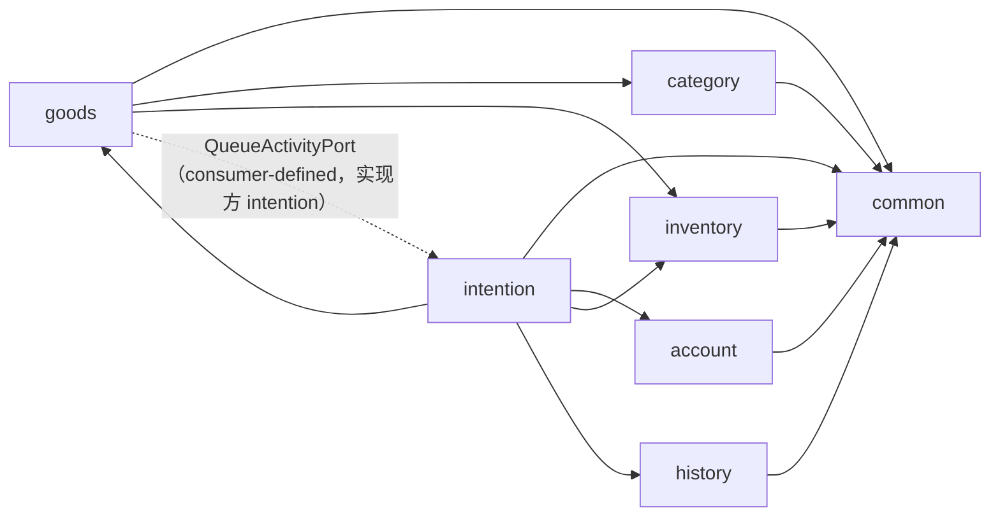

# 阶段二 · 后端架构改造设计（库存解耦 / 服务接口化 / 依赖收紧）

> **文档性质**：改造设计（草案），给出目标结构、迁移脚本与实施步骤，不重复业务口径。  
> **上游依据**：《后端开发计划》《状态模型设计》《升级需求A》；本轮后端架构评审结论。  
> **适用范围**：`simple-shop-backend`，阶段二 S6 前置改造。  
> **版本**：v0.7（S1–S6 已执行）　**日期**：2026-10-30  
> **执行状态**：S1～S6 已落地；S6 默认 Testcontainers 与本机 MySQL 兜底两条路径均通过。  
> **配套脚本**：`../../simple-shop-backend/db/draft/refactor/`（草案，不参与 Flyway）

---

## 0. 范围与结论

### 0.1 问题映射

| 编号 | 问题 | 本文处置 | 步骤 |
| --- | --- | --- | --- |
| A1 | 商品聚合同时承担展示、库存与交易状态，且被 intention 直接改写 | 库存拆为独立聚合；交易状态写权限收敛到商品侧 | S2 / S3 |
| A2 | 跨模块共享 JPA 实体，没有防腐层 | 跨模块只走 `api` 端口与快照 DTO；实体依赖列入冻结清单逐步清除 | S1 / S3 |
| A3 | 端口只做了一半：goods 发布事务写 intention 的队列表 | 队列序号改为惰性创建，删除 `GoodsQueuePort.initialize` | S1 |
| A4 | history ⇄ intention 包级循环依赖 | `FailType` 归属 history，intention 在归档边界做映射 | S1 |
| B1 | Service 全为具体类，跨模块调用具体服务 | 统一「被谁调用决定是否接口化」，S1 先落地 4 个端口，其余随 S2/S3 增补 | S1 |
| B2 | 交易编排没有边界，`GoodsTradeSupport` 把仓储级操作租给 intention | 收敛为 `GoodsLifecyclePort` 的粗粒度用例方法 | S1 / S3 |
| B3 | 历史读模型写在 intention 的原生 SQL 里 | UNION 查询迁入 history | S1 |
| C1 | 无乐观锁，热点行全串行 | 提交意向改共享锁；库存独立行；交易唯一性落库 | S2 / S3 |
| C2 | 状态/库存一致性只有应用层保证 | 新增不变量与校验 SQL；基线唯一索引兜底 | S2 / S3 |
| D1 | 契约类型不安全（ARCHIVED / String 枚举） | 补 Java 枚举，值不变，前端零改动 | S4 |
| D2 | validation 依赖空转，校验两套 | 边界用 Bean Validation，领域规则留 `*Rules` | S4 |
| E1 | 审计/会话副作用在事务内 | 统一 afterCommit | S5 |
| E2 | 质量门禁未落地 | ArchUnit 4 条硬规则 | S1 |
| E3 | 测试依赖本机 MySQL | Testcontainers | S6 |

### 0.2 结论

1. **库存拆成独立聚合**：新增 `inventory` 功能包与 `simpleshop_goods_stock` 表，商品表不再有 `stock` 列；商品只负责展示属性与上下架语义。
2. **Service 按调用方接口化**：被 Controller 或其它功能调用的服务一律「接口 + 实现」；跨功能只允许依赖对方的 `api` 包，`api` 只暴露端口与 record。
3. **交易状态不删除**：`FROZEN` 已确认保留；写权限收敛到商品侧（`GoodsLifecyclePort`），并用数据库唯一索引保证「一商品至多一条 TRADING」。

### 0.3 非目标

- 不拆 Maven 多模块、不引入服务注册/消息中间件；
- 不引入 Redis（只把 `SessionStore`/`RateLimiter` 抽成接口，为将来留位）；
- 不改 API 路径、不改响应字段名、不改前端交互；
- 不做读写分离、缓存、分库分表；
- 不重写业务规则（状态迁移仍以《状态模型设计》为准）；
- 不删除 `FROZEN`（已确认保留）。

### 0.4 验收口径

- `mvn clean verify` 全绿，用例数不减少（S6 后 212，默认容器与本地兜底各跑一遍）；
- `ddl-auto=validate` 通过；
- ArchUnit 规则通过，新增违规为零；
- 提交意向的事务不再持有商品行排他锁（用 `performance_schema.data_locks` 或日志验证）；
- `simpleshop_goods` 在库存调整后 `update_at` 不变（除状态联动）；
- 前端 `npm run type-check`、`npm run build` 无需修改即通过。

---

## 1. 目标结构

### 1.1 分层约定

```text
com.simpleshop
  common/                 统一响应、异常、鉴权、会话、配置、媒体、文本、审计、时间
  <feature>/
    api/                  跨功能契约：端口接口 + record；唯一允许被其它功能 import 的包
    application/          用例编排（跨聚合/跨功能时才建）
    controller/           seller | buyer | publicapi
    dto/                  HTTP 请求/响应
    service/              领域服务接口
    service/impl/         领域服务实现（@Transactional 在这一层）
    entity/ repository/ enums/ support/
```

功能包：`account`、`category`、`goods`、`inventory`（新增）、`intention`、`history`。

### 1.2 依赖规则

| 编号 | 规则 | 说明 |
| --- | --- | --- |
| R1 | `common` 不依赖任何功能包 | 现状已满足 |
| R2 | 功能包之间只允许依赖对方的 `api` 包 | 受控例外 E1 见下 |
| R3 | `controller` 只依赖本功能 `service`/`api`，不依赖任何 `repository` | 现状已满足 |
| R4 | `entity` 只被本功能依赖 | 存量违规用冻结清单，只减不增 |
| R5 | `api` 包只依赖 `common` 与本功能 `enums`，不得依赖 `service/entity/repository` | 保证契约轻量 |
| R6 | 功能包之间不得成环 | 现在 history ⇄ intention 违反 |

**受控例外**：

- **E1**：`goods.entity` 允许引用 `category.entity.CategoryL2`。类别是商品的固有维度、无反向写依赖，且商品列表查询依赖 `join fetch` 的读性能；拆成端口会引入批量查询或丢失 join。ArchUnit 中显式声明，不视为违规。
- **E2**（临时）：`intention.entity.Intention` 对 `BuyerAccount` 的关联。S7 之后降级为「仅 `buyerId` 列」，届时删除该例外。

**落地方式**：`archunit-junit5`。S1 先落地 4 条当前即可满足的规则（common 隔离、controller 不碰仓储、api 不反向依赖实现、功能包无环）；R2/R4 的存量违规（intention → goods/account 实体、goods → category 实体）在 S3 解关联后直接启用，不使用冻结基线。

### 1.3 功能包依赖



要点：

- `goods → intention` 只有一条虚线，且是 **consumer-defined 端口**：接口定义在 `goods.api`，实现放在 intention，goods 的编译期不依赖 intention。
- `inventory` 是叶子：只依赖 `common`，不认识 goods 实体，只认 `goodsId` 字符串。
- `history` 不再依赖 `intention`；归档由 intention 主动调用 `ArchivePort`。

### 1.4 端口清单

| 端口 | 定义在 | 实现 | 消费方 | 关键方法 |
| --- | --- | --- | --- | --- |
| `StockPort` | `inventory.api` | inventory | goods、intention | `initialize` / `availableOf` / `availableAll` / `setAvailable` / `deductOne` |
| `GoodsQueryPort` | `goods.api` | goods | intention | `require` / `findAll` |
| `GoodsLifecyclePort` | `goods.api` | goods | intention | `requireOnSaleForNewIntention` / `lockForTrading` / `startTrading` / `requireTrading` / `backToOnSale` / `snapshotForArchive` / `removeArchived` |
| `QueueActivityPort` | `goods.api` | intention | goods | `hasActiveIntentions` |
| `AccountQueryPort` | `account.api` | account | intention | `requireBuyer` / `findBuyers` |
| `ArchivePort` | `history.api` | history | intention | `archive` |
| `CategoryGoodsReferencePort` | `category.api` | goods | category | `existsByCategoryId`（现有，迁移包名） |

> `StockPort`、`GoodsLifecyclePort`、`AccountQueryPort` 分别在 S2/S3 引入；S1 已落地其余 4 个。

端口约定：

1. 入参与返回值只用 ID、基本类型、record，不出现实体；
2. 端口实现必须参与调用方事务（`Propagation.MANDATORY` 或默认 REQUIRED），不自行开新事务；
3. 方法名表达业务动作，不暴露「加锁/查询」实现细节。

### 1.5 Service 接口化

| 现类 | 新接口 | 实现 | 主要调用方 |
| --- | --- | --- | --- |
| `BuyerAuthService` | `service/BuyerAuthService` | `service/impl/BuyerAuthServiceImpl` | controller |
| `SellerAuthService` | `service/SellerAuthService` | `service/impl/...` | controller |
| `SellerCustomerService` | `service/SellerCustomerService` | `service/impl/...` | controller |
| `CategoryService` | `service/CategoryService` | `service/impl/...` | controller、goods |
| `SellerGoodsService` | `service/SellerGoodsService` | `service/impl/...` | controller |
| `SellerGoodsQueryService` | `service/SellerGoodsQueryService` | `service/impl/...` | controller（intention 经 `GoodsQueryPort`） |
| `BuyerGoodsQueryService` | `service/BuyerGoodsQueryService` | `service/impl/...` | controller |
| `SellerMediaService` | `service/SellerMediaService` | `service/impl/...` | controller |
| `StockService`（新） | `api/StockPort` | `service/impl/StockServiceImpl` | goods、intention |
| `BuyerIntentionService` | `service/BuyerIntentionService` | `service/impl/...` | controller |
| `SellerTradeService` | `service/SellerTradeService` | `service/impl/...` | controller |
| `SellerIntentionQueryService` | `service/SellerIntentionQueryService` | `service/impl/...` | controller |
| `BuyerHistoryService` | `service/BuyerHistoryService` | `service/impl/...` | controller |
| `ArchiveService` | `api/ArchivePort` | `service/impl/ArchiveServiceImpl` | intention |
| `SellerHistoryService` | `service/SellerHistoryService` | `service/impl/...` | controller |

约定：

- 接口只声明被调用方真正使用的方法，不复制实现类的全部 public 方法；
- `@Transactional` 放在实现类；接口用于替换实现与测试打桩；
- 同功能内部允许直接注入接口（Spring 注入实现），不必为每个私有协作类造接口；
- `assembler`、`preparer`、`rules` 这类纯计算组件保持类，不接口化。

### 1.6 事务与锁

**统一锁序**：`商品行 → 队列序号行 → 意向行 → 库存行`。所有涉及两个以上聚合的用例必须按此顺序取锁。

| 用例 | 事务 | 加锁 | 说明 |
| --- | --- | --- | --- |
| 发布商品 | 单事务 | 无既有行锁 | goods insert → stock insert |
| 提交意向 | 单事务 | 商品 **共享锁** → 队列序号行排他 | 共享锁之间兼容，提交不再互相排队 |
| 改库存 | 单事务 | 商品排他 → 库存排他 | 状态联动需要商品行 |
| 手动下架/重上架 | 单事务 | 商品排他 + 活跃意向计数（只读） | |
| 进入交易 | 单事务 | 商品排他 → 意向排他 | 人操作，频率低 |
| 标记成功 | 单事务 | 商品排他 → 意向排他 → 库存排他 | 售罄时继续归档、删行 |
| 标记失败 | 单事务 | 商品排他 → 队列序号排他 → 意向排他 | 重排队 |
| 查询 | `readOnly` | 无 | 走 MVCC |

**为什么提交意向用共享锁**：提交只校验「商品在售」并追加一条排队记录，不修改商品行。用 `SELECT ... FOR SHARE`（JPA `PESSIMISTIC_READ`）：

- 多个提交之间共享锁兼容，可以并发；
- 下架/改库存需要排他锁，会等待进行中的提交；提交完成后再下架会看到活跃意向并拒绝，消除「下架瞬间插入意向」的竞态；
- 锁持有时间 = 一次短事务，远小于原排他锁的串行窗口。

### 1.7 数据归属

| 表 | 归属 | 允许的跨功能读取 |
| --- | --- | --- |
| `goods`、`goods_image`、`goods_content_block` | goods | intention 经 `GoodsQueryPort`/`GoodsLifecyclePort` |
| `goods_stock` | inventory | goods、intention 经 `StockPort` |
| `category_l1`、`category_l2` | category | goods 直接 join（E1） |
| `seller_account`、`buyer_account` | account | intention 经 `AccountQueryPort` |
| `intention`、`goods_queue_sequence` | intention | history 的只读 UNION 查询（读模型） |
| `goods_history`、`intention_history` | history | 无 |

---

## 2. 库存解耦

### 2.1 现状

- `Goods` 同时持有 `stock` 与 `status`，且 `changeStock`/`changeStatus` 是公开无守卫方法（`goods/entity/Goods.java` 43–88 行）。
- 扣库存由 `SellerTradeService` 直接改商品实体（第 122–125 行），即 intention 写 goods 聚合。
- 提交意向虽然只读商品，却先取商品排他锁（`BuyerIntentionService` 第 64 行），与改库存、上下架、交易共用同一把锁。

### 2.2 模型与不变量

```text
simpleshop_goods_stock
  fk_goods_id  varchar(50) PK   -- 与商品一对一，FK ON DELETE CASCADE
  available    int              -- 可售库存
  update_at    datetime         -- UTC
```

不变量：

1. `available >= 0`（数据库 CHECK + 实体守卫）；
2. `ON_SALE ⇒ available >= 1`；
3. `OFF_ZERO ⇔ available = 0`；
4. 不设 `reserved`：提交意向不占库存，只有成交扣减（与现行口径一致）；
5. 库存行随商品行级联删除，归档无需额外清理。

### 2.3 写路径

**发布**（goods 应用服务，单事务）：

```java
Goods goods = goodsRepository.saveAndFlush(Goods.publish(name, price, category)); // category 为 CategoryL2（E1）
stockPort.initialize(goods.getId(), stock);   // stock >= 1，由 GoodsRules.publishStock 校验
```

**改库存**（goods 应用服务，单事务）：

```java
Goods goods = lockGoods(id);                  // 状态联动需要排他锁
switch (goods.getStatus()) {
    case FROZEN     -> throw GOODS_FROZEN;
    case OFF_MANUAL -> throw GOODS_STATUS_MISMATCH;
    case ON_SALE    -> {
        if (stock == 0) { requireEmptyQueue(id); stockPort.setAvailable(id, 0); goods.markOffZero(); }
        else            { stockPort.setAvailable(id, stock); }
    }
    case OFF_ZERO   -> {
        if (stock == 0) throw STOCK_INVALID;
        stockPort.setAvailable(id, stock);
        goods.markOnSale();
    }
}
```

**成交扣减**（intention 交易服务，单事务）：

```java
int remaining = stockPort.deductOne(goodsId);  // 不足抛 STOCK_INVALID，理论不可达
if (remaining > 0) { intention.markSucceeded(); goodsLifecycle.backToOnSale(goodsId); }
else               { archiveSoldOut(goodsId, intention); }   // 传入 finalStock = 0
```

**归档快照**：`GoodsArchiveSnapshot.stock` 改由用例传入 `finalStock`，不再读实体字段。

**下架**：手动下架与库存清零下架都只改状态；清零时先 `requireEmptyQueue` 再写库存，最后改状态，保证「先无排队、再归零、再下架」。

### 2.4 读路径

- 列表：先分页查 goods，再 `stockPort.availableAll(ids)` 一次批量取库存，交给 assembler；**不逐条查询**。
- 详情：`stockPort.availableOf(id)`。
- `purchasable`：`status == ON_SALE && available > 0`，仍由读模型计算。
- 归档读：历史表已有 `stock` 列（最终库存，售罄为 0），不依赖库存表。

### 2.5 兼容性

- API 响应字段 `stock` 保留，值来自 `StockPort`；
- 请求字段 `stock` 保留，语义不变（发布 ≥1，调整 ≥0）；
- 数据层 `Goods` 实体不再有 `getStock()`，改由 assembler 注入，避免读路径依赖实体。

### 2.6 失败与回滚

- 库存写入失败 → 整个事务回滚，商品不会出现「无库存行」的状态；
- 若出现历史脏数据（有商品无库存行），启动不报错，但列表读会抛 `IllegalStateException`；用 `verify.sql` 第 2 项在迁移后立即排查；
- 不引入补偿任务：单库本地事务，无跨服务调用。

---

## 3. 交易状态归属

### 3.1 选择

| 方案 | 内容 | 成本 | 结论 |
| --- | --- | --- | --- |
| A | 保留 `FROZEN`，但只允许 goods 写，intention 通过 `GoodsLifecyclePort` 请求 | 低，API/前端零改动 | **本次采用** |
| B | 删除 `FROZEN`，交易中由 TRADING 意向表达，读模型合成状态 | 中高，读模型、列表过滤、前端提示都要改 | 不采用（已确认保留 FROZEN） |

方案 A 消除的是「intention 直接改商品实体」这一层耦合；锁仍存在，但只落在人工操作（进交易、成交、失败）上，不在买家提交路径上。

### 3.2 端口化

```java
public interface GoodsLifecyclePort {
    void requireOnSaleForNewIntention(String goodsId);  // 共享锁 + 在售校验
    TradingStart lockForTrading(String goodsId);        // 排他锁 + 状态预检，不改状态
    void startTrading(String goodsId);                  // 排他锁 + 在售 → FROZEN
    GoodsTradeView requireTrading(String goodsId);      // 排他锁 + 校验 FROZEN
    void backToOnSale(String goodsId);                  // 排他锁 + FROZEN → ON_SALE
    GoodsArchiveSnapshot snapshotForArchive(String goodsId, int finalStock);
    void removeArchived(String goodsId);                // 删除当前商品行（级联）
}
```

实现放在 goods，全部方法要求调用方已开启事务；端口内部完成加锁与状态校验，调用方不再碰 `Goods` 实体。

### 3.3 数据库兜底

新基线 V1 已包含生成列与唯一索引：

```sql
trading_flag = CASE WHEN status = 'TRADING' THEN 1 ELSE NULL END  -- STORED
UNIQUE (fk_goods_id, trading_flag)
```

这样即使应用校验被绕过（并发、脚本、未来新入口），数据库也不会出现两条 TRADING。应用捕获 `DataIntegrityViolationException` 并翻译成 `TRADING_ALREADY_EXISTS`。

### 3.4 方案 B 的成本（记录，不实施）

- 商品列表/详情需要批量查询「哪些商品正在交易」，否则会把交易中商品当在售展示；
- 公开列表过滤条件从 `status = ON_SALE` 变成 `status = ON_SALE AND 无 TRADING`；
- 前端 `FROZEN` 标签改为由 `trading` 布尔驱动；
- 历史报表若直接读 `goods.status` 需要同步改。

---

## 4. 依赖环与队列

### 4.1 FailType 归属

现状：`history.entity.IntentionHistory` 与 `history.service.ArchiveService` 引用 `intention.enums.FailType`，而 intention 又引用 `history.service.ArchiveService` 与 `history.enums.IntentionResult`。

处置：

- 历史侧定义自己的 `history.enums.FailType`（SOLD_OUT / SELLER_VOIDED）；
- intention 在归档边界把 `intention.enums.FailType` 映射为 history 的枚举；
- 两个枚举当前取值相同，但语义独立：历史是持久化词表，当前态词表可以继续演进（例如新增当前态失败原因但不进入历史）。

### 4.2 归档方向

- `ArchiveService` 只接收 `ArchivePort` 定义的快照命令（record），不接收实体；
- intention 负责「何时归档」，history 负责「怎么写入」；
- history 不反向调用 intention。

### 4.3 队列序号惰性创建

现状：发布商品时 `queuePort.initialize` 往 intention 的表插行，goods 事务跨聚合写。

处置：

- 删除 `GoodsQueuePort.initialize` 与 `GoodsQueueAdapter.initialize`；
- 首次提交时惰性建行：

```sql
INSERT IGNORE INTO simpleshop_goods_queue_sequence (fk_goods_id, current_value)
VALUES (?, 0);
SELECT ... FOR UPDATE;   -- 再取行锁并 nextValue
```

- `INSERT IGNORE` 与唯一主键保证并发安全；失败重试一次即可；
- 影响：发布后不再有队列序号行；现有测试中「发布即有序号行」的断言改为「首次提交后有序号行」；
- 迁移不需要 DDL：历史商品若缺少序号行，首次提交时自动补齐。

### 4.4 历史读模型

两条 UNION 查询（买家历史、客户购买历史）从 `intention.repository.IntentionRepository` 迁到 `history.repository.HistoryQueryRepository`：

- SQL 不变，分页仍在 UNION 之后；
- 归属改为 history（它读的是「当前终态 + 历史」的合并视图）；
- intention 不再出现对 `intention_history` 的引用；
- 可选优化（不在本次）：建数据库视图，把跨表细节进一步收口。

---

## 5. 数据库基线重建

### 5.1 已确认的决策

| 事项 | 结论 |
| --- | --- |
| 迁移方式 | **重建 V1 基线**，不再引入 V3/V4/V5 增量脚本 |
| 适用前提 | 目前只有开发环境，无生产数据；数据丢失可接受 |
| 商品状态 | `FROZEN` 保留，不删除、不改读模型 |
| 种子数据 | V2 不变 |

### 5.2 基线变化

| 对象 | 变化 |
| --- | --- |
| `simpleshop_goods` | 删除 `stock` 列与 `ck_goods_stock`；注释改为「只存展示属性与上下架语义」 |
| `simpleshop_goods_stock` | 新增：`fk_goods_id` 主键、`available`、`update_at`；FK 级联删除；`CHECK available >= 0` |
| `simpleshop_intention` | 增加生成列 `trading_flag` 与唯一索引 `uk_intention_trading(fk_goods_id, trading_flag)` |
| 其余 9 张表 | 不变 |
| 业务表数量 | 11 → 12 |

重建后的完整脚本已写入 `../../simple-shop-backend/src/main/resources/db/migration/V1__baseline_schema.sql`（2026-10-30 生效）。

### 5.3 为什么重建而不是增量

- 增量需要回填、双写、回滚三套逻辑，而当前数据没有保留价值；
- 重建后 `ddl-auto=validate` 一次对齐，不会出现「脚本已跑、实体没改」的中间态；
- 减少 Flyway 版本数量，开发环境反复重置时不容易错。

**前提必须成立**：一旦出现共享演示环境或真实数据，立即改回增量迁移（从 V3 起追加），不能继续改 V1。

### 5.4 切换步骤（与 S2 代码同批，已于 2026-10-30 执行）

> 开发环境已执行完毕；下列步骤保留为其他环境的重建手册。

1. 代码侧先去掉 `Goods.stock` 及所有读写点（否则 `validate` 会失败）；
2. 停止后端与测试进程；
3. 执行 `db/draft/refactor/dev_reset.sql`，或在 MySQL Shell 中手工 `DROP/CREATE` 开发库与测试库；
4. 用重建后的 V1 **覆盖** `src/main/resources/db/migration/V1__baseline_schema.sql`（草案已合并，不再保留副本）；
5. 启动后端：Flyway 执行新 V1、V2，随后 `ddl-auto=validate`；
6. 执行 `verify.sql`（12 张表、无 `stock` 列、库存行数一致、不变量为空）；
7. 冒烟：发布 → 提交意向 → 进入交易 → 成交 → 归档；
8. 代码与 V1 放在**同一个提交**，避免中间态。

### 5.5 回滚

重建方案没有增量回滚脚本，回滚方式：

1. `git revert` 该提交（代码与 V1 一起回到旧版）；
2. 再次执行 `dev_reset.sql` 重建空库；
3. 启动旧版应用，Flyway 重新执行旧 V1/V2。

因为开发库无数据，回滚成本是一次重置。**生产环境不适用本方案。**

### 5.6 本次演练记录

2026-10-30，MySQL Shell 8.0.46 连接 MySQL 8.0.44：

| 检查 | 结果 |
| --- | --- |
| 临时库执行 V1 + V2 | 成功，12 张业务表 |
| `simpleshop_goods` 列 | 无 `stock` |
| `simpleshop_intention.trading_flag` | `STORED GENERATED` |
| `uk_intention_trading` | 唯一索引生效 |
| 负库存写入 | 被 `ck_goods_stock_available` 拒绝（3819） |
| 同商品第二条 `TRADING` | 被 `uk_intention_trading` 拒绝（1062） |
| S2 全量测试（重建后的测试库） | 197 用例通过，`ddl-auto=validate` 通过 |
| S3 全量测试（无 DDL） | 200 用例通过，ArchUnit 6 条规则全绿 |
| S4 全量测试（无 DDL） | 203 用例通过，卖家/买家前端构建通过 |
| S5 全量测试（无 DDL） | 211 用例通过 |
| S6 默认容器模式（无 DDL） | 212 用例通过，Testcontainers `mysql:8.0` |
| S6 本地 MySQL 兜底（无 DDL） | 212 用例通过，本机 8.0.44 |
| 开发库与测试库 | 已按新基线重建（2026-10-30） |
| 多条 `QUEUED` | 正常（`trading_flag` 为 NULL） |
| 删除商品 | `goods_stock` 行级联删除 |
| 开发库 | 未改动，验证库已删除 |

### 5.7 注意事项

- V1 修改后，旧库的 Flyway 校验和必然失配；`flyway repair` 只改校验和，表结构仍旧，**不能替代重建**。
- 测试库名若不是 `simple_shop_test`（`TEST_DB_URL` 改过），要同步修改 `dev_reset.sql` 与测试配置。
- 重建后首次启动会重建全部 12 张表并写入卖家种子账号。
- 本次验证只覆盖 DDL 与约束，应用层 `validate` 要等 S2 代码完成后才能最终验证。

---

## 6. 实施步骤

| 步骤 | 主题 | DDL | 估时 |
| --- | --- | --- | --- |
| S1 | 契约、接口与门禁 | 无 | 1–1.5 人日 |
| S2 | 库存拆出 + 基线重建 | V1 | 2–3 人日 |
| S3 | 交易所有权 | 无（V1 已含） | 1–1.5 人日 |
| S4 | 契约类型化与校验 | 无 | 1–1.5 人日 |
| S5 | 副作用与可观测性 | 无 | 0.5–1 人日 |
| S6 | 测试与文档收口 | 无 | 1–2 人日 |
| 合计 | | | **6.5–10.5 人日** |

每一步独立可发布、可回滚；建议 S1、S2 之间不留长间隔，避免接口与实现长期不一致。

### S1 契约、接口与门禁

**目标**：先立边界，不动数据、不改行为。

改动：

- 新增/收敛 4 个端口：`goods.api`（`GoodsQueryPort`、`QueueActivityPort` + `GoodsSnapshot`）、`history.api`（`ArchivePort` + 两个命令 record）、`category.api`（`CategoryGoodsReferencePort` 从 service 迁入）；`StockPort`、`GoodsLifecyclePort`、`AccountQueryPort` 随 S2/S3 增补；
- 13 个 Service 抽接口 + `service/impl` 子包；`ArchiveService` 改为 `ArchivePort` 实现，`BuyerHistoryService` 随读模型迁到 history；
- `FailType` 迁到 history，intention 在归档边界映射；
- 队列序号惰性创建，删除 `GoodsQueuePort.initialize`，发布不再写 intention 的表；
- 买家历史/客户购买历史的 UNION 查询迁到 `history.repository.HistoryQueryRepository`，买家历史控制器迁到 `history.controller.buyer`；
- 新增 `archunit-junit5` 与 `PackageDependencyTest`：common 隔离、controller 不碰仓储、api 不反向依赖实现、功能包无环（4 条硬规则，当前全绿）；
- Controller 注入接口（包名不变，URL 与响应不变）。

验收：

- `mvn clean verify` 全绿（S1 完成时 196 用例全绿）；
- 发布商品后不再生成序号行（已调整 `SellerGoodsApiTest` 断言）；
- ArchUnit 4 条规则全绿；
- 无行为变更（API 响应逐字段比对）。

回滚：纯代码，回退提交即可。

### S2 基线重建与库存拆出

**目标**：商品表不再有库存，库存独立加锁。

改动：

- 已用重建后的 V1 覆盖活动基线（2026-10-30），并重建开发/测试库；
- 新增 `inventory`：`GoodsStock`、`GoodsStockRepository`、`StockServiceImpl`、`StockPort`；
- `Goods` 删除 `stock` 字段与 `changeStock`；`publish` 去掉 stock 参数；
- `SellerGoodsService` 发布/改库存/重上架改走 `StockPort`；
- `GoodsAssembler` 的 `stock` 由调用方传入；两个查询服务批量取库存；
- `SellerTradeService` 成交扣减改走 `StockPort`，售罄判定用返回值；
- `GoodsTradeSupport.buildArchiveSnapshot` 接收 `finalStock`；
- 测试：数据层、API、并发、归档逐列核对。

验收：

- `grep -rE "getStock|changeStock" src/main` 为空（历史实体除外，已完成）；
- `ddl-auto=validate` 通过；
- 列表 20 条商品只多 1 条库存查询（日志计数）；
- 库存调整不再更新 `goods.update_at`（状态未变时）。

回滚：回退该提交（代码与 V1 一起），并重置开发/测试库。

### S3 交易所有权

**状态**：已执行（2026-10-30），200 用例全绿。

**目标**：intention 不再直接改商品实体；唯一性由数据库保证。

改动：

- 唯一索引已由新 V1 提供，无需额外 DDL；
- 新增 `GoodsLifecyclePort`，intention 全部改用端口；
- 删除 `GoodsTradeSupport`，锁商品、归档快照与删行逻辑并入 `GoodsLifecycleAdapter`；
- `Intention.goods` 改为 `goodsId` 列（去掉 `@ManyToOne`），派生查询改名，商品实体不再进入 intention；
- `BuyerIntentionService` 使用共享锁校验在售，提交不再与卖家操作互斥；
- ArchUnit 新增两条边界规则：intention 只能依赖 `goods.api`，goods 不得依赖 intention。

验收：

- 并发进入交易用例：仅 1 成功，其余 `TRADING_ALREADY_EXISTS`；
- 直接 SQL 插入第二条 TRADING 被数据库拒绝；
- `grep -r "goods.entity.Goods" src/main/java/com/simpleshop/intention` 为空；
- `mvn clean test` 200 用例通过，ArchUnit 6 条规则全绿。

回滚：回退该提交即可；V1 无需回滚（仅代码使用该索引）。

### S4 契约类型化与校验

**状态**：已执行（2026-10-30），203 用例全绿。

**目标**：前端类型与后端一致，字段校验可解释。

改动：

- 新增 `intention.enums.TradeDisposal`（VOIDED / REQUEUED）与 `TradeGoodsStatus`（ON_SALE / ARCHIVED）；
  `TradeFailureRequest.disposal`、`TradeResultData.goodsStatus`、`IntentionEntryData.status/failType`
  改为枚举，JSON 值不变；
- 卖家意向名单的 `status` 查询参数改为 `IntentionStatus`，非法值由 Spring 类型转换直接返回 400；
- 14 个请求体入口加 `@Valid`；DTO 增加 `@NotBlank/@NotNull/@Size/@DecimalMin/@DecimalMax/@Min`。
  存在性、长度、上下界在边界拦截；字符规则、金额精度、描述块组合、状态迁移仍留在
  `*Rules` / Service，避免把语义错误降级成统一的参数错误；
- 文本长度改用 `common.validation.CodePointLength` 按码点计数，与 `TextRules.charCount`
  和数据库字符口径一致，避免标准 `@Size` 把 50 个 emoji 误判为 100 个字符；
- `ApiResponse` 新增可选 `errors`（`@JsonInclude(NON_NULL)`，成功响应不出现该键）；
  `GlobalExceptionHandler` 把 `BindException`、`ConstraintViolationException`、JSON 解析失败、
  缺参/类型不匹配统一为 400 + 50002 + 字段列表；字段名转 snake_case，嵌套块形如
  `description[0].type`；
- 重新导出 `simple-shop-doc/阶段二/openapi.json`（30 个路径 / 59 个 schema）。

契约影响：

- 纯结构性问题（缺字段、超长、越界、非法枚举）由原来的部分领域码改为 400/50002；
  语义问题（尖括号、空白、重复名、价格小数位、库存清零下架）仍返回原领域码；
- `errors` 是新增可选字段，原 `code/message/data` 不变；前端本地校验已覆盖大部分
  结构性问题，`type-check` / `build` 无需改动。

验收：

- `mvn clean verify`：203 用例全绿，ArchUnit 6 条规则全绿；
- 空 body、缺字段、超长字段、非法枚举均返回 400/50002，`errors` 能定位字段；
  嵌套描述块路径为 `description[0].type`；
- `TradeResultData.goods_status` 与 `IntentionEntryData.status/fail_type` 的输出值不变；
- 卖家 `npm run type-check`、`npm run build-only` 与买家 `npm run build` 通过。

回滚：纯代码，回退该提交即可；无 DDL，OpenAPI 快照随代码回退。

### S5 副作用与可观测性

**状态**：已执行（2026-10-30），211 用例全绿。

**目标**：事务回滚不再留下假审计、不再误踢会话。

改动：

- 新增 `common.tx.AfterCommit`：有活动事务时注册 `afterCommit`，没有事务时立即执行；回滚不执行；
- `OperationLogService.log` 先捕获操作者，再经 `AfterCommit` 写日志；写日志异常吞掉，不影响业务；
- `SellerAuthServiceImpl.changePassword` 的会话撤销移到 `AfterCommit`；
  密码事务回滚时会话仍然有效，提交后才让旧令牌失效；
- 新增 `AfterCommitTest`、`OperationLogServiceTest`、`SellerAuthServiceImplTest`；
  `AuthApiTest` 在测试事务内手动触发 afterCommit，模拟真实提交。

未实施（文档可选项）：

- 媒体孤儿清理定时任务：未实施，运维需按磁盘增长预期监控；
- 健康检查数据库探活：未改，`/api/public/health` 仍只返回进程状态，
  避免把数据库抖动放大为实例重启。

验收：

- 事务回滚：审计无记录（`OperationLogServiceTest.dropsRecordWhenTransactionRollsBack`）；
- 改密回滚：会话仍有效（`SellerAuthServiceImplTest.keepsSessionsWhenTransactionRollsBack`）；
- 提交后：审计写一条、旧会话失效；
- `mvn clean verify`：211 用例全绿，ArchUnit 6 条规则全绿。

回滚：纯代码，回退该提交即可；无 DDL。

### S6 测试与文档收口

**状态**：已执行（2026-10-30），默认容器模式与本机 MySQL 兜底均为 212 用例全绿。

**目标**：脱离本机 MySQL 也能跑全量测试，同时保留无 Docker 的兜底路径。

改动：

- 新增 `TestDatabase`：默认按需启动 `mysql:8.0` 一次性容器，
  经 `@DynamicPropertySource` 注入 datasource；`DataLayerTestBase` 与 `ConcurrencyTestBase` 共用；
- Maven profile `local-mysql` 把 `simple-shop.test.database` 切为 `local`，
  不再启动容器，沿用 `application-test.yml` 的 `TEST_DB_URL` 连接本机 `simple_shop_test`；
- 新增 `MigrationTest`：容器模式启动独立空库；本地模式在本机 MySQL 创建随机命名临时库，
  跑 V1→V2 后断言 12 张业务表、`goods` 无 `stock`、库存表存在、种子卖家与 Flyway 历史，
  再用 Hibernate `hbm2ddl.auto=validate` 校验实体；用完立即删库；
- 确认 Testcontainers/JUnit/ArchUnit 都是 `test` scope，`jar tf target/simple-shop.war`
  不含这些依赖，部署产物不变；
- 更新后端 README 的测试命令、阶段二部署手册副本、文档索引；
- ArchUnit 已在 S1/S3 落地，S6 只做全量回归，不重复新增规则。

验收：

- 默认 `mvn clean verify`：212 用例全绿（需要 Docker，镜像 `mysql:8.0`）；
- `mvn -Plocal-mysql clean verify`：212 用例全绿（本机 MySQL 8.0.44，无需 Docker）；
- 新机器只需 Docker，无需预装 MySQL；无 Docker 时用本机 profile 兜底；
- WAR 不含 Testcontainers/JUnit/ArchUnit；
- 仓库暂无内置 CI 配置；接入流水线时执行同一条 `mvn clean verify`，由 runner 提供 Docker 即可。

回滚：纯代码与测试依赖，回退该提交即可；无 DDL，生产部署不变。

### 可选 S7（不在本次排期）

- `Intention.buyer` 改为 `buyerId`，买家信息经 `AccountQueryPort` 批量补齐；
- 删除 E2 例外，ArchUnit 全量生效。

---

## 7. 测试计划

| 层次 | 新增/改造 | 覆盖点 |
| --- | --- | --- |
| 单元 | `StockServiceImplTest` | 扣减下限、设置、批量查询 |
| 数据层 | `SchemaDataTest` 改造 | 新表、FK 级联、CHECK、唯一索引 |
| 接口 | `SellerGoodsApiTest`、`SellerTradeApiTest` | stock 字段、状态联动、归档 |
| 契约 | `SellerGoodsApiTest`、`SellerTradeApiTest`、`BuyerIntentionApiTest` | 字段错误列表、嵌套路径、枚举序列化、非法枚举 |
| 副作用 | `AfterCommitTest`、`OperationLogServiceTest`、`SellerAuthServiceImplTest` | 提交后执行、回滚不执行、审计与会话撤销 |
| 并发 | `IntentionConcurrencyTest` | 提交不排队、唯一交易、不超卖、下架竞态 |
| 迁移 | `MigrationTest` | 容器/本机临时库 V1→V2、12 表、Hibernate validate |
| 架构 | `PackageDependencyTest` | R1–R6 |
| 前端 | 现有 type-check/build | 契约未破坏 |

并发用例建议：

1. 同一商品 100 线程提交 → 全部成功、`queue_order` 唯一、无商品行排他锁等待；
2. 提交与下架同时发生 → 下架要么成功且无排队，要么 `QUEUE_NOT_EMPTY`；
3. 进入交易 10 线程 → 1 成功、9 个 `TRADING_ALREADY_EXISTS`；
4. 成交与改库存并发 → 不出现负库存，不出现 `ON_SALE + 0`。

---

## 8. 风险

| 风险 | 影响 | 应对 |
| --- | --- | --- |
| 基线切换期间停服 | 短暂不可用 | 单副本既定前提；开发环境影响有限 |
| 基线重建后数据为空 | 开发数据丢失 | 已确认只有开发环境；重建后跑 `verify.sql` 并重新造数 |
| 旧版本残留 | 实体与表不一致，启动失败 | `ddl-auto=validate` 会直接失败，不会带病运行 |
| 基线重建失败 | 应用无法启动 | 修正 V1 后重置库重来；开发环境无数据损失 |
| 接口化遗漏 | 旧调用点仍注入实现 | ArchUnit 规则 + 全量编译；`impl` 包设为包内可见 |
| 共享锁误用 | 阻塞下架 | 只用于提交意向；下架/改库存仍排他 |
| 测试改造量大 | 进度风险 | S6 单独排期；先跑通核心 3 个并发用例 |
| 构建机没有 Docker | 默认测试无法启动容器 | 用 `-Plocal-mysql` 连本机库兜底；CI runner 需提供 Docker |

---

## 9. 未决事项

1. **实体解关联范围**：S3 只处理 `Intention.goods`；`Intention.buyer` 留到可选 S7。
2. **媒体孤儿清理**：S5 可选；若不实施，需在运维手册标注磁盘增长预期。
3. **ErrorCode 拆域**：不在本次范围，建议后续按域拆，避免 `common` 持续膨胀。
4. **CI 配置**：仓库暂无流水线文件；Testcontainers 默认命令已就绪，接入 CI 时只需给 runner 提供 Docker。

---

## 附录 A　端口签名

```java
// inventory.api
public interface StockPort {
    void initialize(String goodsId, int available);
    int availableOf(String goodsId);
    Map<String, Integer> availableAll(Collection<String> goodsIds);
    void setAvailable(String goodsId, int available);
    int deductOne(String goodsId);          // 返回扣减后剩余；不足抛 STOCK_INVALID
}

// goods.api
public record GoodsSnapshot(
        String id, String name, BigDecimal price, GoodsStatus status,
        String categoryL1Name, String categoryL2Name, LocalDateTime createAt) {}

public record GoodsTradeView(String id, String name, BigDecimal price, GoodsStatus status) {}

// 归档快照由 goods 构建，intention 负责映射为 history 的 GoodsArchiveCommand
public record GoodsArchiveSnapshot(
        String id, String name, BigDecimal price, int finalStock,
        String categoryL1Name, String categoryL2Name,
        String descriptionSnapshot, String imagesSnapshot, LocalDateTime createAt) {}

public interface GoodsQueryPort {
    GoodsSnapshot require(String goodsId);
    Map<String, GoodsSnapshot> findAll(Collection<String> goodsIds);
}

public interface GoodsLifecyclePort {
    void requireOnSaleForNewIntention(String goodsId);   // 共享锁
    TradingStart lockForTrading(String goodsId);         // 排他锁，状态预检
    void startTrading(String goodsId);                   // 排他锁，ON_SALE → FROZEN
    GoodsTradeView requireTrading(String goodsId);       // 排他锁，校验 FROZEN
    void backToOnSale(String goodsId);                   // 排他锁，FROZEN → ON_SALE
    GoodsArchiveSnapshot snapshotForArchive(String goodsId, int finalStock);
    void removeArchived(String goodsId);
}

public interface QueueActivityPort {
    boolean hasActiveIntentions(String goodsId);
}

// account.api
public record BuyerProfile(String id, String username, String phone, String defaultLocation) {}

public interface AccountQueryPort {
    BuyerProfile requireBuyer(String buyerId);
    Map<String, BuyerProfile> findBuyers(Collection<String> buyerIds);
}

// history.api
public record GoodsArchiveCommand(
        String id, String name, BigDecimal price, int finalStock,
        String categoryL1Name, String categoryL2Name,
        String descriptionSnapshot, String imagesSnapshot, LocalDateTime createAt) {}

public record IntentionArchiveCommand(
        String id, String goodsName, String buyerId, String buyerUsername, String buyerPhone,
        LocalDateTime createAt, IntentionResult result, FailType failType, LocalDateTime finishAt) {}

public interface ArchivePort {
    void archive(GoodsArchiveCommand goods, List<IntentionArchiveCommand> intentions);
}

// 说明：history 不依赖 goods.api；intention 在调用 ArchivePort 前把
// GoodsArchiveSnapshot 映射为 GoodsArchiveCommand，并把 current FailType 映射为 history FailType。
```

---

## 附录 B　锁对比

| 用例 | 改造前 | 改造后 |
| --- | --- | --- |
| 提交意向 | 商品排他锁 → 队列序号排他锁 | 商品共享锁 → 队列序号排他锁 |
| 改库存 | 商品排他锁（同一行含库存） | 商品排他锁 → 库存行排他锁 |
| 改类别 | 商品排他锁 | 商品排他锁 |
| 进入交易 | 商品排他锁 → 意向排他锁 | 商品排他锁 → 意向排他锁 |
| 成交 | 商品排他锁 → 意向排他锁 | 商品排他锁 → 意向排他锁 → 库存行排他锁 |
| 库存扣减 | 随商品行锁 | 独立库存行，不再影响商品行 |
| 查询 | 无锁 | 无锁 |

改造后同一商品的写操作仍按「商品行」串行，但**买家提交不再与卖家操作互斥**，热点从「所有提交排一条队」变成「提交并发、仅与状态变更互斥」。

---

## 附录 C　关键链路（改造后）

**提交意向**

1. `BuyerIntentionController` → `BuyerIntentionService.submit`；
2. 限流（`RateLimiter`，进程内）；
3. `GoodsLifecyclePort.requireOnSaleForNewIntention(goodsId)`：`SELECT ... FOR SHARE` + 在售校验；
4. `INSERT IGNORE` 队列序号行，再 `SELECT ... FOR UPDATE`；
5. 统计非终态意向，超过上限拒绝；
6. 插入 intention（`queue_order = nextValue`）；
7. 审计 afterCommit。

**进入交易**

1. `SellerTradeService.enterTrade`；
2. `GoodsLifecyclePort.enterTrading(goodsId)`：排他锁 + `ON_SALE → FROZEN`；
3. `IntentionRepository.findWithLockById`：校验 `QUEUED` 且为队首；
4. 尝试置 `TRADING`；唯一索引冲突 → `TRADING_ALREADY_EXISTS`。

**标记成功**

1. `GoodsLifecyclePort.requireTrading(goodsId)`：排他锁 + 校验 `FROZEN`；
2. `IntentionRepository.findWithLockById`：校验 `TRADING`；
3. `StockPort.deductOne(goodsId)`，返回剩余；
4. 剩余大于 0：意向置成功 → `backToOnSale`；
5. 剩余为 0：其余 `QUEUED` 置失败 → 本次置成功 → `snapshotForArchive(goodsId, 0)` → `ArchivePort.archive` → 删除当前意向 → `removeArchived`；
6. 审计 afterCommit。

**归档边界**：`GoodsArchiveSnapshot`（goods.api）→ `GoodsArchiveCommand`（history.api）的字段映射由 intention 完成；history 不 import goods。
