# Simple-Shop 阶段二 · 状态模型设计

> **文档性质**：开发准备阶段的设计文档（定稿），不是需求规格说明书。  
> **适用范围**：升级需求 A 中所有涉及状态、状态迁移、状态联动与归档的设计。  
> **上游依据**：《升级需求A》（§A.1、§A.2）、《需求澄清记录》（Q1–Q27）。  
> **独立性声明**：本文档独立成篇，不引用阶段一需求规格说明书；阶段一文档中的状态口径在阶段二已被本文档取代。  
> **版本**：v1.2（定稿修订）　**日期**：2026-10-24  
> **v1.2 修订**：goods 不设 trade_start，进入交易不单独记录开始时间（无界面/查询消费该字段）；队列序号行明确为随商品归档删除，与基线外键级联一致。

---

## 摘要（一页结论）

- **商品五态**：在售、交易中（冻结）、下架·手动、下架·库存清零、已归档；只有「已归档」是终态。
- **决定终态的是「库存归零的原因」，不是「库存是否为 0」**：卖家手动把库存改成 0 → 可复售下架；成交把最后一件卖掉 → 归档，不可恢复。
- **意向四态**：排队中、交易中、交易成功、交易失败；买家只能看到自己的终态，看不到排队中/交易中，也看不到位次。
- **成交分支**：扣减后库存 > 0 → 商品回在售、队列继续；扣减后库存 = 0 → 商品归档、其余排队中意向自动失败。
- **下架前提**：手动下架和库存清零下架都要求队列为空；排队意向由卖家通过正常交易流程（进入交易 → 标记失败 + 作废）逐笔清空，不设独立的「作废排队中意向」动作。
- **恢复路径**：手动下架后点「重新上架」并二次确认；库存清零下架后点「修改库存」，输入 >0 提交即自动重新上架，不设「重新上架」按钮。
- **归档 = 商品 + 全部意向同事务迁移**；类别名、商品名、用户名等写成快照，历史不再引用当前表。
- **交易流水表取消**；重新排队复用原意向记录，只刷新该商品队尾序号，下单时间不变。
- **图片规则**：主图不必填，允许无图片；图集最多 8 张；无主图禁止上传图集；主图由卖家手动指定。

## 0. 阅读指引

### 0.1 本文回答的问题

1. 阶段二有哪些对象需要状态机？每个状态机的状态集合与终态是什么？
2. 每个状态由哪些事件触发进入、由哪些事件触发离开？前置条件与副作用是什么？
3. 商品状态与意向状态如何联动？谁先变、谁后变？
4. 「手动下架」「库存清零下架」「成交售罄归档」这三个极易混淆的出口如何区分？
5. 归档发生在什么时刻？归档后当前表、历史表、买家历史、卖家历史分别是什么形态？
6. 开发落地时需要哪些枚举、字段、约束、锁与事务边界？

本文档中的 **GS-xx**（商品迁移）、**IS-xx**（意向迁移）、**INV-xx**（不变量）、**BR-xx**（业务规则）、**D-xx**（设计决策）编号，供开发、测试与后续文档直接引用。

### 0.2 术语与命名约定

| 术语 | 本文定义 | 不要混淆 |
| --- | --- | --- |
| 商品 | 卖家发布、具有库存数量的可售对象；可同时存在多件 | 与「商品类别」不同 |
| 在售 | 商品对买家可见、可接收新意向的状态 | 不等于「有库存」；下架商品也可能有库存 |
| 交易中（冻结） | 卖家已选定一名买家进入交易，商品暂停接收新意向 | 与意向的「交易中」同名，但一个是商品、一个是意向 |
| 下架 | 商品退出买家可见范围 | 下架不等于终态；下架分「可复售」与「归档」 |
| 可复售下架 | 手动下架、库存清零下架 | 手动下架用重新上架按钮+二次确认；库存清零下架用修改库存>0提交 |
| 归档 | 商品及其全部意向迁入历史表，永久不可恢复 | 只有「成交售罄」一条入口 |
| 售罄 | 库存数量为 0 | 售罄不等于归档；手动把库存改成 0 也是售罄 |
| 交易成功 | 一笔交易成交，库存减 1 | 不等于商品归档 |
| 交易成功下架 | 「成交后库存归零并触发归档」这一迁移事件 | **不是独立状态，不要建状态枚举** |
| 意向 | 买家对某一件商品提交的一次购买意愿 | 同一买家可对同一商品提交多条 |
| 终态 | 不再有任何出边的状态 | 商品只有「已归档」；意向有「成功」「失败」 |
| 队列 | 某商品下全部「排队中」意向按序号形成的次序 | 不同商品各自独立排队 |

### 0.3 状态建模的五条原则

1. **触发原因决定终态**。同样落到「库存 0」，手动改 0 可复售，成交清零则归档。
2. **状态决定能力，能力决定可见性**。不要用「买家看不看得见」反推状态。
3. **归档只有一条入口**：成交且库存归零。其他下架都不归档。
4. **买家只看结果**。排队中、交易中对买家完全不可见，也不展示排队位次。
5. **历史靠快照**。归档时把类别名、商品名、用户名等写死，切断对当前表的外键引用。

---

## 1. 状态模型总览

### 1.1 对象与状态机清单

| 对象 | 是否状态机 | 状态集合 | 终态 | 详见 |
| --- | --- | --- | --- | --- |
| 商品 | 是 | 在售、交易中（冻结）、下架·手动、下架·库存清零、已归档 | 已归档 | §2 |
| 购买意向 | 是 | 排队中、交易中、交易成功、交易失败 | 交易成功、交易失败 | §3 |
| 商品类别 | 弱状态机 | 存在、已删除 | 已删除 | §4.1 |
| 买家账号 | 否 | 已注册（唯一） | — | §4.2 |
| 访问态 | 是 | 游客、已登录买家、已登录卖家 | — | §4.2 |

### 1.2 领域状态总览

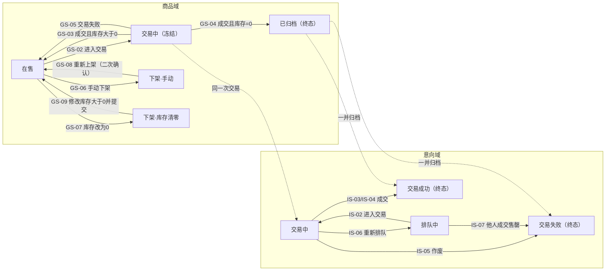

### 1.3 本文的边界

本文只覆盖**状态、状态迁移、状态联动、归档与历史形态**。以下内容不在本文展开：接口字段与错误码、页面布局与交互细节、性能指标、部署形态、图片存储实现、富文本 XSS 过滤。线下议价、付款、交付不在系统内，本文只把它们当作触发卖家登记交易结果的外部事实。

---

## 2. 商品状态模型

### 2.1 状态定义

| 代码 | 状态名 | 定义 | 终态 | 买家可见性 | 数据位置 |
| --- | --- | --- | --- | --- | --- |
| **ON_SALE** | 在售 | 可被列表、搜索、详情发现，可接收新意向 | 否 | 列表、搜索、详情均可见 | 当前商品表 |
| **FROZEN** | 交易中（冻结） | 已选定买家，暂停新意向，等待卖家登记结果 | 否 | 仅直链详情可见，只读 | 当前商品表 |
| **OFF_MANUAL** | 下架·手动 | 卖家主动撤下，库存保留 | 否 | 不可见 | 当前商品表 |
| **OFF_ZERO** | 下架·库存清零 | 卖家把库存改为 0 触发的自动下架；库存=0，通过修改库存表单提交>0 重新上架 | 否 | 不可见 | 当前商品表 |
| **ARCHIVED** | 已归档 | 最后一件成交后进入历史，永久不可恢复 | **是** | 不可见 | 历史商品表 |

说明：

- 当前商品表不出现 **ARCHIVED**；该状态只在历史商品表出现。
- **FROZEN** 只有一种来源：卖家「进入交易」。阶段二不再有手动冻结，因此不需要「冻结来源」字段。
- **OFF_MANUAL** 与 **OFF_ZERO** 都是「可复售下架」，区别在于恢复路径不同。

### 2.2 下架原因与终态判定（本文最关键的一节）

**核心结论：决定是否终态的是「库存归零的原因」，不是「库存是否为 0」。**

同样是库存 0：

- 卖家在在售阶段把库存改成 0 → 商品「下架·库存清零」，**不是终态**，通过「修改库存」表单提交 >0 后重新上架；
- 成交把最后一件卖掉 → 商品「已归档」，**是终态**，永远不再上架。

| 离开在售的方式 | 目标状态 | 是否终态 | 库存 | 队列中的意向 | 恢复方式 |
| --- | --- | --- | --- | --- | --- |
| 卖家手动下架 | 下架·手动 | 否 | 不变 | 必须已无排队中意向（由卖家通过正常交易流程清空） | 重新上架（按钮 + 二次确认） |
| 卖家把库存改为 0 | 下架·库存清零 | 否 | 0 | 必须已无排队中意向（由卖家通过正常交易流程清空） | 修改库存 >0 并提交（自动重新上架） |
| 成交且扣减后库存=0 | 已归档 | **是** | 0 | 系统自动全部置为交易失败 | 不可恢复 |
| 成交且扣减后库存>0 | 回到在售 | 否 | 减 1 后仍 >0 | 保留排队中意向 | — |
| 交易失败 | 回到在售 | 否 | 不变 | 保留；当事意向作废或重排 | — |

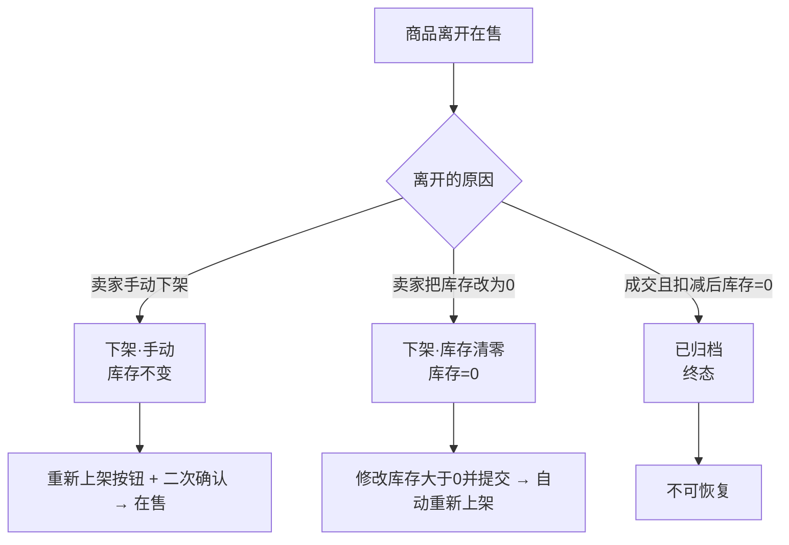

**队列清空规则**：手动下架与库存清零下架都要求队列中没有排队中意向。若不为空，卖家必须对队首执行正常交易流程：先进入交易（IS-02），再标记交易失败并作废（IS-05），重复直到队列为空。**不存在**「作废排队中意向」的独立动作。

**命名禁令**：不要把「交易成功下架」建成一个状态。它是 **GS-04** 这个迁移事件；状态名统一用「已归档」。否则开发时极易出现「交易成功但库存还有 1 件，却把商品置成交易成功下架」的错误。

### 2.3 商品状态图

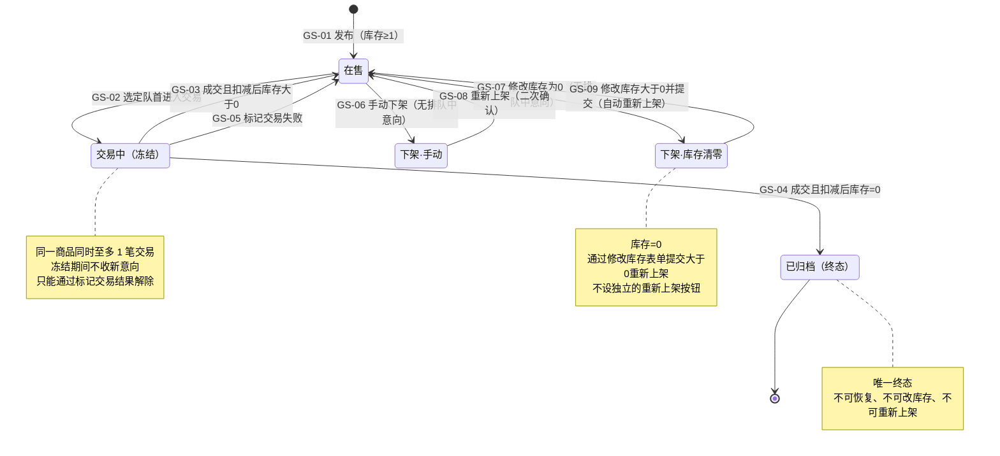

### 2.4 商品状态迁移表

| 编号 | 当前状态 | 事件 | 执行者 | 前置条件 | 目标状态 | 副作用 | 依据 |
| --- | --- | --- | --- | --- | --- | --- | --- |
| **GS-01** | —（无） | 发布商品 | 卖家 | 二级类别存在；库存≥1 | 在售 | 创建商品；该商品队列序号初始化为 0 | A.1、Q2、Q14 |
| **GS-02** | 在售 | 选定队首进入交易 | 卖家 | 存在排队中意向；库存≥1 | 交易中（冻结） | 该意向→交易中（商品与意向同一事务） | Q1、Q3、Q9 |
| **GS-03** | 交易中（冻结） | 标记交易成功，扣减后库存>0 | 卖家 | 商品交易中；存在交易中意向；库存≥2 | 在售 | 库存减 1；该意向→交易成功；其余排队中意向不变 | Q13、Q25、Q26 |
| **GS-04** | 交易中（冻结） | 标记交易成功，扣减后库存=0 | 卖家 | 商品交易中；存在交易中意向；库存=1 | 已归档 | 库存减 1（=0）；该意向→交易成功；其余排队中→交易失败（商品已售出）；商品与全部意向归档 | Q24、Q25、Q26 |
| **GS-05** | 交易中（冻结） | 标记交易失败并裁决 | 卖家 | 商品交易中；存在交易中意向 | 在售 | 库存不变；该意向→交易失败（作废）或排队中（重新排队） | Q9、Q20 |
| **GS-06** | 在售 | 手动下架 | 卖家 | 无排队中意向 | 下架·手动 | 库存不变；不归档 | Q17、Q22 |
| **GS-07** | 在售 | 修改库存为 0 | 卖家 | 无排队中意向 | 下架·库存清零 | 库存变为 0；不归档 | Q22、Q26 |
| **GS-08** | 下架·手动 | 重新上架（二次确认） | 卖家 | 二次确认通过；库存≥1 | 在售 | 不恢复旧队列（已为空）；不重置队列序号 | Q18、Q20 |
| **GS-09** | 下架·库存清零 | 修改库存表单提交>0 | 卖家 | 库存>0 | 在售 | 库存更新；自动重新上架；不恢复旧队列 | Q20、Q22 |
| **GS-10** | 已归档 | —（终态，无出边） | — | — | — | 不可恢复、不可改库存、不可重新上架 | Q24 |

补充说明：

- **在售商品改库存为非 0 值**（例如 5→3）不构成状态迁移，只更新库存。
- **在售商品改库存为 0 前必须队列为空**；若不为空，先按正常交易流程清空队列（IS-02 → IS-05），再执行 GS-07。
- **GS-03 与 GS-04 的分界点是「扣减后库存是否为 0」**，不是「是否成交」。成交但仍有库存时，商品必须回到在售（Q25、Q26）。
- **GS-06 与 GS-07 的队列清空**：卖家对队首执行 IS-02（进入交易）→ IS-05（标记失败+作废），商品侧同步 GS-02 → GS-05，重复至队列为空。该处理属于正常交易流程，不设独立的「作废排队中意向」动作。
- **GS-08 与 GS-09 的恢复路径不同**：手动下架用「重新上架」按钮 + 二次确认；库存清零下架用「修改库存」表单提交 >0，提交即重新上架，没有「重新上架」按钮。

### 2.5 商品状态 × 能力矩阵

**买家侧**

| 商品状态 | 列表/搜索 | 详情 | 提交意向 |
| --- | --- | --- | --- |
| 在售 | 可见 | 可见 | 允许 |
| 交易中（冻结） | 不可见 | 仅直链，只读 | 禁止 |
| 下架·手动 | 不可见 | 不可打开 | 禁止 |
| 下架·库存清零 | 不可见 | 不可打开 | 禁止 |
| 已归档 | 不可见 | 不可打开 | 禁止 |

**卖家侧**

| 商品状态 | 改库存 | 重新上架 | 手动下架 | 进入交易 | 标记交易结果 | 改挂类别 | 查看意向 |
| --- | --- | --- | --- | --- | --- | --- | --- |
| 在售 | 允许（>0 随时；=0 需无排队中意向） | — | 允许（无排队中意向） | 允许（有队首） | — | 允许 | 允许 |
| 交易中（冻结） | 禁止 | 禁止 | 禁止 | 禁止 | 允许 | 禁止 | 允许 |
| 下架·手动 | 禁止 | 允许（二次确认） | — | 禁止 | — | 允许 | 允许 |
| 下架·库存清零 | 允许（表单>0，提交即上架） | — | — | 禁止 | — | 允许 | 允许 |
| 已归档 | 禁止 | 禁止 | — | — | — | 禁止 | 允许（历史） |

说明：

- 「—」表示该动作在此状态下不适用。
- 交易中禁止改库存、改类别、下架，是为了保证「一次交易期间商品信息稳定」，也避免冻结期间库存被改到 0 造成状态矛盾。
- 库存清零下架状态没有「重新上架」按钮；卖家用「修改库存」表单提交 >0 即恢复在售。
- 已归档商品只能从历史表读取，所有写操作一律禁止。

### 2.6 库存与状态的一致性

| 规则 | 内容 |
| --- | --- |
| ST-01 | 库存为非负整数。 |
| ST-02 | 在售、交易中（冻结）、下架·手动 时，库存≥1。 |
| ST-03 | 下架·库存清零时库存=0；通过「修改库存」表单提交 >0 会立即重新上架，不存在「库存>0 且仍停留在该状态」的合法组合。 |
| ST-04 | 已归档时，库存=0（最后一件成交的结果）。 |
| ST-05 | 发布时库存≥1，不允许发布即下架。 |
| ST-06 | 「在售」允许改库存（>0 随时；=0 需无排队中意向）；「下架·库存清零」允许通过修改库存表单输入>0（提交即上架）；其他状态禁止改库存。 |
| ST-07 | 成交时库存减 1；提交意向、交易失败都不改变库存。 |
| ST-08 | 库存不限制队列长度；库存 3 时允许超过 3 人排队。 |
| ST-09 | 在售商品把库存改为 0 前必须队列为空；不存在「在售且库存=0」的合法组合。 |

库存变化示例：

| 初始 | 操作 | 结果状态 | 结果库存 |
| --- | --- | --- | --- |
| 在售 5 | 改为 3 | 在售 | 3 |
| 在售 5 | 改为 0（队列为空） | 下架·库存清零 | 0 |
| 在售 5 | 不进交易，直接手动下架（队列为空） | 下架·手动 | 5 |
| 下架·手动 5 | 重新上架（二次确认） | 在售 | 5 |
| 下架·库存清零 0 | 修改库存为 5 并提交 | 在售 | 5 |
| 交易中 5 | 标记成功 | 在售 | 4 |
| 交易中 1 | 标记成功 | 已归档 | 0 |
| 交易中 5 | 标记失败 | 在售 | 5 |

## 3. 购买意向状态模型

### 3.1 状态定义

| 代码 | 状态名 | 定义 | 终态 | 买家可见 | 卖家可见 |
| --- | --- | --- | --- | --- | --- |
| **QUEUED** | 排队中 | 已提交，在所属商品的队列中等待 | 否 | 否 | 是 |
| **TRADING** | 交易中 | 卖家已选定该买家，正在线下交易 | 否 | 否 | 是 |
| **SUCCEEDED** | 交易成功 | 成交，该买家获得一件商品 | **是** | 是（仅自己的历史） | 是 |
| **FAILED** | 交易失败 | 未成交（售罄、作废、下架） | **是** | 是（仅自己的历史） | 是 |

相对既有实现，本版意向状态的关键变化：

- **取消「已撤销」**：买家没有撤销入口，撤销是口令码时代的操作，已随口令码一并废除（Q4、Q9、Q20）。
- **取消口令码有效性维度**：意向绑定账号，口令码整体不存在（Q9、Q15）。
- **取消「重新排队」作为独立状态**：重新排队是「交易中 → 排队中」的迁移（IS-06），不是终态，也不新建记录（Q9、Q23）。
- **买家不可见非终态**：排队中、交易中对买家完全不可见，也不展示位次（Q6、Q16）。

### 3.2 意向状态图

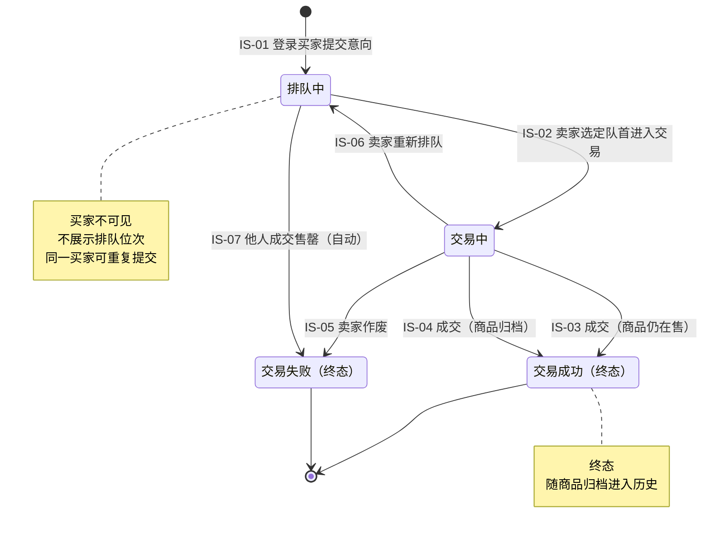

**队列清空**：手动下架/库存清零下架前若队列非空，卖家对队首执行 IS-02（进入交易），再执行 IS-05（标记失败+作废），商品侧同步 GS-02/GS-05，重复至队列为空。该处理是正常交易流程，不产生独立的「作废排队中意向」迁移。

### 3.3 意向状态迁移表

| 编号 | 当前状态 | 事件 | 执行者 | 前置条件 | 目标状态 | 副作用 | 依据 |
| --- | --- | --- | --- | --- | --- | --- | --- |
| **IS-01** | —（无） | 提交购买意向 | 已登录买家 | 商品在售；买家已登录；允许重复提交 | 排队中 | 分配该商品的队列序号；快照账号联系方式；不扣库存 | A.2、Q3、Q13、Q21、Q27 |
| **IS-02** | 排队中 | 选定队首进入交易 | 卖家 | 商品在售；该意向为队首 | 交易中 | 商品→交易中（冻结） | Q1、Q3、Q9 |
| **IS-03** | 交易中 | 标记交易成功，扣减后库存>0 | 卖家 | 商品交易中 | 交易成功 | 库存减 1；商品→在售；其余排队中意向不变 | Q25、Q26 |
| **IS-04** | 交易中 | 标记交易成功，扣减后库存=0 | 卖家 | 商品交易中 | 交易成功 | 库存减 1；商品→已归档；该商品其余排队中→交易失败（售罄） | Q24、Q25、Q26 |
| **IS-05** | 交易中 | 标记交易失败并作废 | 卖家 | 商品交易中 | 交易失败 | 商品→在售；库存不变 | Q9、Q20 |
| **IS-06** | 交易中 | 标记交易失败并重新排队 | 卖家 | 商品交易中 | 排队中 | 商品→在售；队列序号刷新至该商品队尾；下单时间不变 | Q9、Q23 |
| **IS-07** | 排队中 | 他人成交导致售罄（自动） | 系统 | 同一商品另一意向成交且扣减后库存=0 | 交易失败 | 随商品归档；失败原因=商品已售出 | Q13、Q14 |
| **IS-08** | 交易成功 | —（终态，无出边） | — | — | — | — | Q4 |
| **IS-09** | 交易失败 | —（终态，无出边） | — | — | — | — | Q4 |

补充说明：

- **IS-03 与 IS-04 的区别只在商品侧结果**：意向都是交易成功，区别是商品回到在售还是归档。开发时应把两者实现为同一段「成交」逻辑里的分支，而不是两个互斥的业务动作。
- **IS-06 复用原意向记录**：不新建记录，不新建账号绑定，不产生「重新排队流水」（Q23）。下单时间保持原值，只有队列序号刷新。
- **手动下架/库存清零下架前的队列清空**：卖家对队首执行 IS-02（进入交易）→ IS-05（标记失败+作废），商品侧同步 GS-02/GS-05，逐笔清空，直到队列为空。该处理属于正常交易流程，不新增「作废排队中意向」动作，也不产生额外的意向迁移编号。
- **没有「买家撤销」**：买家端只有「提交意向」与「查看历史」两项能力（Q4、Q16、Q20）。

### 3.4 商品状态与意向状态的联动

| 编号 | 联动规则 |
| --- | --- |
| **L-01** | 商品处于交易中（冻结）时，该商品有且仅有 1 条交易中意向，且该意向属于该商品。 |
| **L-02** | 商品处于交易中（冻结）时，不允许任何新意向提交；详情仅直链只读（Q19）。 |
| **L-03** | 进入交易是「商品→交易中」与「意向→交易中」的同一个事务，二者必须同时成功或同时失败。 |
| **L-04** | 成交且库存>0：商品→在售，当事意向→交易成功，其余排队中意向保留。 |
| **L-05** | 成交且库存=0：商品→已归档，当事意向→交易成功，其余排队中意向→交易失败。 |
| **L-06** | 交易失败：商品→在售，当事意向→交易失败（作废）或排队中（重排），其余排队中意向不变。 |
| **L-07** | 商品进入下架·手动、下架·库存清零、已归档时，不得存在排队中或交易中意向。 |
| **L-08** | 归档时，商品与其全部意向在同一事务内迁移；归档后当前表不再有该商品及其意向。 |

### 3.5 队列模型

**按商品独立排队。** 既有的全局队列序号不再适用；每个商品维护自己的序号计数器。

| 规则 | 内容 |
| --- | --- |
| QU-01 | 每个商品维护独立的队列序号，初值 0；提交意向时 +1 并赋给该意向。 |
| QU-02 | 队列序号在**同一商品内**唯一、单调递增；不同商品之间可以重复。 |
| QU-03 | 重新排队时，该意向的队列序号刷新为当前商品序号 +1，排到队尾；下单时间不变。 |
| QU-04 | 作废、失败、成功都不回收或压缩序号；序号可以出现空洞。 |
| QU-05 | 卖家查看的位次 = 同商品中队列序号小于自己的「排队中」意向数 + 1；买家不展示位次。 |
| QU-06 | 进入交易只能选队首（队列序号最小的排队中意向），保证先到先得（Q3、Q9）。 |
| QU-07 | 商品重新上架时，不重置队列序号；新意向继续使用更大的序号，避免与历史终态意向冲突。 |
| QU-08 | 队列长度不受库存限制；库存 3 时允许多于 3 人排队（Q13）。 |
| QU-09 | 同一买家可对同一商品提交多条意向，各自独立排队，不去重（Q3）。 |
| QU-10 | 队列另有可配置的技术上限（默认 1000），按商品统计非终态意向；达到上限时拒绝新意向。该上限与库存无关，不改变先到先得。 |

**为什么不能重置序号**：商品下架后重新上架，旧的终态意向仍留在当前表（未归档），它们保有旧序号。若重置为 0，新意向会与旧序号冲突，破坏「同商品内唯一」。因此序号只能继续递增。

**队列上限**：队列长度不受库存限制，但受一个可配置的技术上限约束（默认 1000）。该上限只用于防止异常刷单/内存与写放大，不是业务上的「库存限制」；达到上限时拒绝新意向，不影响先到先得。

### 3.6 买家可见性

| 规则 | 内容 |
| --- | --- |
| V-01 | 买家只能看到自己的意向，看不到同队列其他买家的任何信息（Q6）。 |
| V-02 | 买家只能看到终态意向（交易成功/交易失败），看不到排队中、交易中（Q6、Q16）。 |
| V-03 | 买家历史字段：商品名称、下单时间、交易结果（成功/失败）、交易时间；不含价格、图片、卖家信息、当前状态（Q6、Q15）。 |
| V-04 | 买家历史按时间倒序、支持翻页；不可删除、不可修改，只读（Q6）。 |
| V-05 | 商品下架或归档后，买家仍可看到自己的历史记录（Q6）。 |
| V-06 | 买家看不到排队位次，也没有「取消意向」入口（Q6、Q16、Q20）。 |
| V-07 | 交易时间取意向进入终态的时间（finish_at）；失败记录同样取终态时间，不取下单时间。 |

---

## 4. 辅助模型

### 4.1 商品类别（两级）

**状态机**

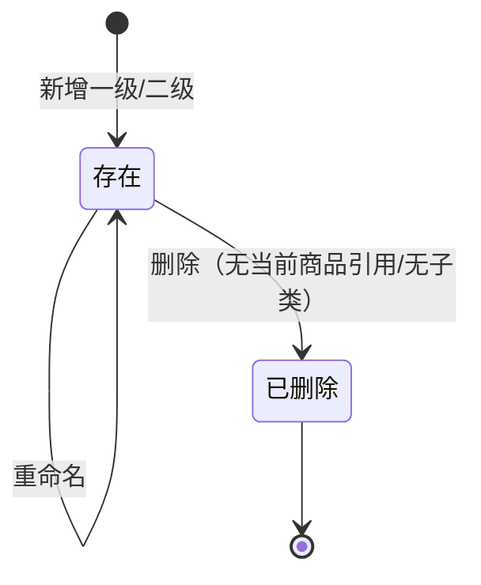

**结构与规则**

| 规则 | 内容 |
| --- | --- |
| C-01 | 类别只有两级：一级类别、二级类别。一级只做分组，商品必须挂到某个二级类别（Q2）。 |
| C-02 | 类别操作只有新增、重命名、删除；没有「停用/启用」（Q2）。 |
| C-03 | 删除二级类别前，该类别下不能有当前商品引用（在售、交易中、下架·手动、下架·库存清零）；卖家需先把商品改挂到其他二级类别（Q14、Q18）。 |
| C-04 | 删除一级类别前，其下不能有二级类别；需先删完二级子类（D-09）。 |
| C-05 | 商品可以改挂到其他二级类别；这是商品发布后少数允许修改的引用之一（Q14、Q18）。 |
| C-06 | 交易中的商品禁止改挂类别（D-07）。 |
| C-07 | 归档商品不再引用类别；归档时把一级、二级类别名写成字符串快照（D-08）。 |
| C-08 | 类别重命名后，当前商品显示新名称；已归档商品显示归档时的快照名称（D-08）。 |
| C-09 | 按一级类别筛选/浏览时，结果包含其下所有二级类别的商品（D-08）。 |
| C-10 | 「删除类别时把商品移除」在本文档中解释为「改挂到其他二级类别」；商品本身不能删除（Q18）。 |

**为什么归档要消除类别引用**：类别可以被重命名、删除。如果历史商品还持有类别外键，删除类别就会被历史数据阻塞，或者历史商品会随类别改名而改变展示。用字符串快照可以同时解决这两个问题。

### 4.2 账号与会话

**买家账号**

| 项 | 规则 |
| --- | --- |
| 注册字段 | 用户名、密码、电话、默认交易地点；电话必填，默认交易地点选填（Q15、Q27）。 |
| 唯一性 | 用户名唯一；手机号不唯一，同一手机号可注册多个账号（Q3、Q15）。 |
| 密码 | 加密存储，不得明文；强度要求与卖家账号一致（Q15）。 |
| 注册后修改 | 买家端没有改资料、改密码、找回密码的入口（Q4、Q15、Q16）。 |
| 手机验证 | 不做短信验证码，电话只作为交易联系字段（Q5）。 |
| 状态 | 只有「已注册」一种；没有禁用、注销、删除。 |

**卖家账号**

| 项 | 规则 |
| --- | --- |
| 数量 | 单账号（A.2、Q15）。 |
| 密码 | 可修改；建议修改后使全部会话失效并要求重新登录（沿用既有安全策略）。 |
| 权限 | 商品管理、类别管理、用户管理、历史记录、修改密码。 |

**访问态与能力**

| 访问态 | 浏览列表/搜索 | 查看详情 | 提交意向 | 查看自己的历史 | 卖家后台 |
| --- | --- | --- | --- | --- | --- |
| 游客 | 允许（仅在售） | 允许（在售；冻结仅直链） | 禁止 | 禁止 | 禁止 |
| 已登录买家 | 允许 | 允许 | 允许 | 允许（仅自己的终态） | 禁止 |
| 已登录卖家 | 允许 | 允许 | 不适用 | 不适用 | 允许 |

说明：

- 浏览商品不需要登录；提交意向必须先注册并登录（Q15、Q21）。
- 游客不能提交意向、不产生记录，因此也不会出现在卖家的客户列表中（Q7）。
- 买家历史只读；买家不能删除历史（Q6）。

### 4.3 图片与富媒体（无状态，但有约束）

| 规则 | 内容 |
| --- | --- |
| M-01 | 商品图片分两类：主图最多 1 张（可无）+ 图集最多 8 张；无主图时禁止上传图集；有主图时合计最多 9 张（Q10、D-15）。 |
| M-02 | 列表页与搜索结果只显示主图；无主图时显示占位图；详情页显示全部图片（Q10）。 |
| M-03 | 图片格式 JPG/PNG，单张不超过 5MB（Q10）。 |
| M-04 | 商品描述为富文本，可内嵌图片和视频；描述中的媒体不计入 9 张限制（Q8、Q10、D-15）。 |
| M-05 | 商品发布后，名称、价格、描述、图片均不可修改；只有库存可调、类别可改挂（Q12、Q18）。 |
| M-06 | 图片采用上传存储，不是外链（D-15）。 |
| M-07 | 富文本必须做脚本过滤与 XSS 防护；这是实现约束，不改变状态模型（Q8）。 |

---

## 5. 关键业务流程

### 5.1 发布商品（支持多商品）

**前置**：卖家已登录；目标二级类别已存在。

**步骤**

1. 选择二级类别（必须；不能只挂一级）。
2. 填写名称、价格、库存（≥1）、描述（富文本）。
3. 可选：上传主图；只有上传主图后，才允许上传图集（最多 8 张；单张 JPG/PNG、≤5MB）。
4. 提交；系统校验通过后创建商品，状态为在售。
5. 卖家可继续发布下一件，在售商品数量无上限（Q1）。

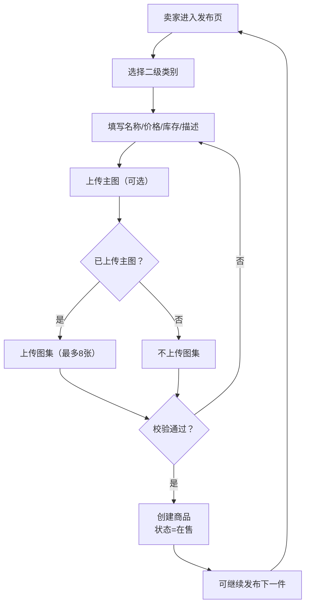

**规则**

- 库存必须≥1；不允许发布即下架（Q14、ST-05）。
- 必须绑定二级类别（Q2）。
- 主图不必填，允许无图片；无主图时禁止上传图集；图集最多 8 张；有主图时合计最多 9 张（Q10、D-15）。
- 主图由卖家手动指定（Q10、D-15）。
- 发布后名称、价格、描述、图片固定；库存可调、类别可改挂（Q12、Q18）。
- 多件商品各自独立排队、独立冻结、独立交易（Q1）。

### 5.2 浏览 / 搜索 / 详情 / 提交意向

**浏览与搜索**

- 列表与搜索只返回在售商品（Q11、Q19）。
- 搜索支持名称关键字 + 类别筛选；列表按发布时间倒序；分页展示。
- 列表字段：名称、价格、主图、所属类别（Q11）；无主图时显示占位图。
- 详情字段：全部图片、描述、价格、类别、库存数量等。
- 游客可浏览；提交意向必须登录（Q21）。

**详情访问规则**

| 商品状态 | 列表/搜索 | 直链详情 | 能否提交意向 |
| --- | --- | --- | --- |
| 在售 | 可见 | 可见 | 能 |
| 交易中（冻结） | 不可见 | 可见，只读 | 不能 |
| 下架·手动 | 不可见 | 不可打开 | 不能 |
| 下架·库存清零 | 不可见 | 不可打开 | 不能 |
| 已归档 | 不可见 | 不可打开 | 不能 |

**提交意向**

- 买家登录后点击「我要购买」即可，不需要填写任何表单；系统直接使用账号的用户名、电话、默认交易地点（Q27）。
- 提交时不扣库存；库存不限制排队人数（Q13）。
- 同一买家可对同一商品重复提交，每条独立记录、独立排队（Q3）。
- 提交成功后，商品状态不变，意向进入排队中；买家看不到位次（Q6）。

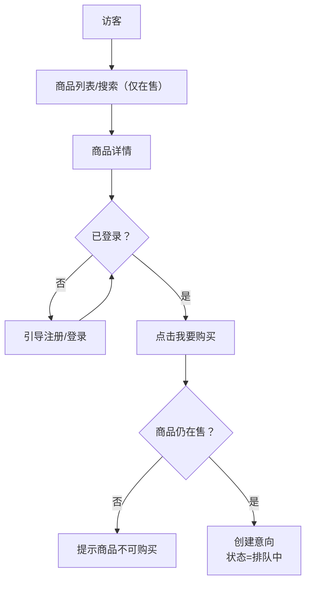

### 5.3 成交：库存>0 与库存=0 两条分支

**进入交易**

1. 卖家在商品的意向名单中确认队首。
2. 卖家点击「进入交易」：商品→交易中（冻结），该意向→交易中（同一事务）。
3. 线下协商与交割，系统不参与。

**标记成交**

1. 卖家标记交易成功。
2. 库存减 1。
3. 若扣减后库存>0：该意向→交易成功；商品→在售；其余排队中意向保留。
4. 若扣减后库存=0：其余排队中意向→交易失败（商品已售出）；该意向→交易成功；商品与全部意向归档。

**顺序要求**：先处理其余排队中意向→再置本次意向成功→最后归档。该顺序保证归档时「商品名下所有意向均已终态」。

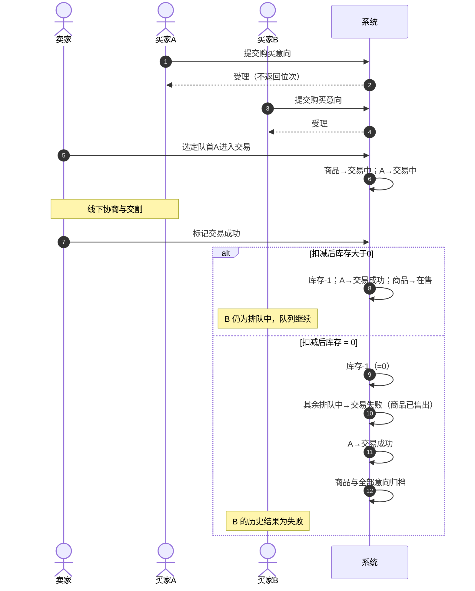

**易错点**

- 不要在「成交」时无条件下架商品。库存>0 必须回到在售（Q25、Q26）。
- 不要在库存>0 时把队列中其他意向置失败。它们仍然有效。
- 不要在归档前提交事务；归档必须与成交在同一事务内。

### 5.4 交易失败与卖家裁决

**步骤**

1. 卖家标记交易失败，并选择裁决：作废或重新排队。
2. 商品→在售；库存不变。
3. 作废：该意向→交易失败（卖家作废），退出队列。
4. 重新排队：该意向→排队中，队列序号刷新至该商品队尾；下单时间不变。

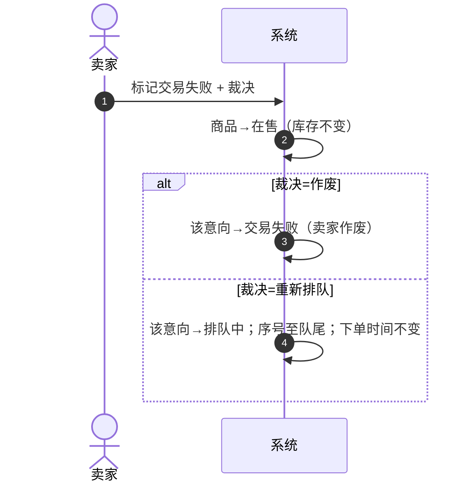

**规则**

- 交易失败只影响当事意向与商品状态，不批量影响其他排队中意向（Q9）。
- 重新排队不新建记录，不保留「第几次排队」的流水；最终只落交易结果（Q23、D-11）。
- 买家看不到「重新排队」这一过程，只会在最终成功或失败后看到结果（Q6、Q16）。

### 5.5 下架与复售：手动下架 vs 库存清零下架

二者共同点：都可复售；都要求队列为空；都不归档。区别在触发方式与恢复路径。

| 维度 | 手动下架 | 库存清零下架 |
| --- | --- | --- |
| 触发 | 卖家点「下架」 | 卖家点「修改库存」，输入 0 并提交 |
| 商品状态 | 下架·手动 | 下架·库存清零 |
| 是否终态 | 否 | 否 |
| 库存 | 不变 | 0 |
| 队列前提 | 必须无排队中意向 | 必须无排队中意向 |
| 队列清空方式 | 卖家通过正常交易流程逐笔处理：进入交易→标记失败+作废 | 同左 |
| 恢复方式 | 点「重新上架」→ 二次确认表单 → 确认 | 点「修改库存」→ 输入>0 → 提交，自动重新上架 |
| 恢复后原队列 | 不恢复（已空） | 不恢复（已空） |
| 是否归档 | 否 | 否 |

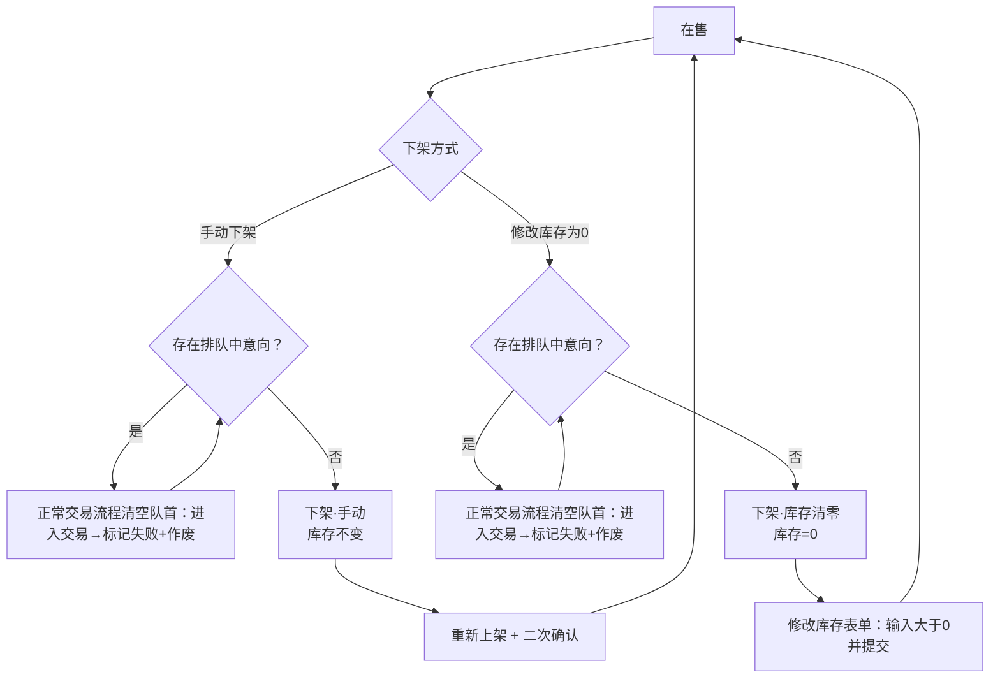

**规则**

- 手动下架和库存清零下架都要求队列中没有排队中意向；若不为空，卖家必须先通过正常交易流程（对队首进入交易，再标记交易失败并作废；商品侧同步 ON_SALE → FROZEN → ON_SALE）逐笔清空。该处理不是独立的「作废排队中意向」动作。
- 在售商品直接点「修改库存」输入 0 提交，即触发库存清零下架；不需要先手动下架。
- 手动下架恢复：点「重新上架」进入二次确认表单，确认后恢复在售，库存保持下架前的值。
- 库存清零下架恢复：点「修改库存」进入表单，输入>0 提交，商品立即重新上架；没有单独的「重新上架」按钮。
- 两种下架都不归档；归档只发生在成交售罄（GS-04）。
- 重新上架后重新收新意向，不恢复旧队列（Q14）。
- 系统没有补货通知；买家只能自己刷新看到商品重新上架（Q14）。

### 5.6 归档与历史查询

**归档触发**：只有 GS-04（成交且扣减后库存=0）触发归档。

**归档动作（同一事务）**

1. 其余排队中意向→交易失败（商品已售出）。
2. 本次意向→交易成功。
3. 商品行从当前表删除，插入历史商品表；写入结果=成功卖出、归档时间、类别名快照、最终库存=0。
4. 该商品全部意向从当前表删除，插入历史意向表；写入商品名快照、用户名快照、交易结果、交易时间、归档时间。

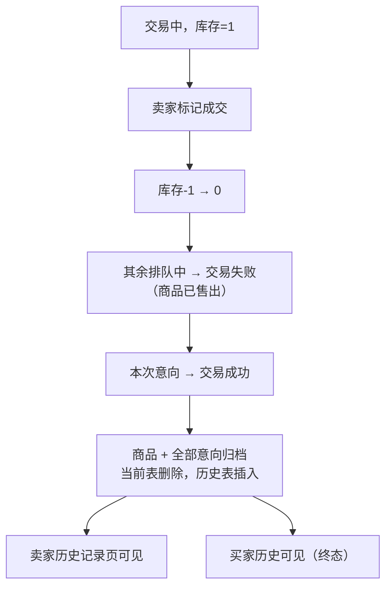

**历史查询**

| 查询方 | 入口 | 数据来源 | 内容 |
| --- | --- | --- | --- |
| 卖家 | 历史记录页（已下架/已归档）→ 商品详情 | 当前表下架商品 + 历史商品表；当前意向表 + 历史意向表 | 商品信息、类别快照、成交结果、意向购买人列表 |
| 卖家 | 用户管理 → 客户详情 | 当前意向表终态 + 历史意向表 | 用户名、电话、默认交易地点、注册时间、购买历史 |
| 买家 | 历史记录页 | 当前意向表终态 + 历史意向表 | 商品名、下单时间、交易结果、交易时间 |

**规则**

- 历史只读：不可删除、不可修改（Q6）。
- 买家历史同时包含当前表中已终态但商品尚未归档的意向，以及历史表中的意向（D-12）。
- 历史商品不再引用类别；类别名是快照（C-07、D-08）。
- 归档后当前表不再有该商品及其意向；任何「按商品 ID 查当前意向」的逻辑都必须能处理空结果。
- 卖家「历史记录页」分两个分区：「已下架（可复售）」与「已归档（终态）」。前者来自当前表（下架·手动、下架·库存清零）；手动下架用「重新上架」+二次确认，库存清零下架用「修改库存」>0 提交；后者来自历史表，只读。这样同时满足「下架后仍能在历史里看到」与「只有成交售罄才归档」。
- 商家查看客户时，电话不脱敏、完整展示；客户字段仅限用户名、电话、默认交易地点、注册时间，不提供累计交易次数、累计成交金额等统计字段（Q7、Q15）。
- 匿名时期（无账号）的记录不迁移到账号下；买家历史只包含账号绑定后的意向（Q6）。

### 5.7 类别删除的前置流程

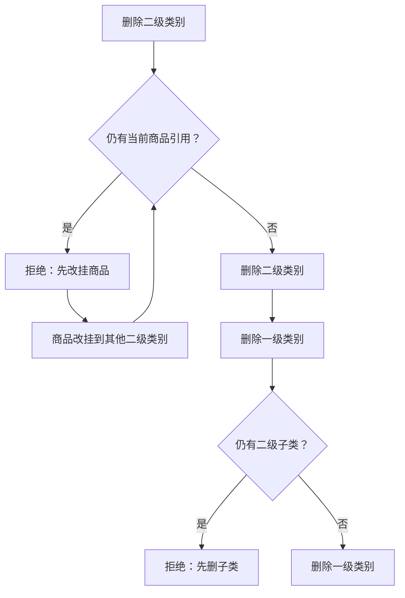

**说明**

- 「当前商品」包括在售、交易中、下架·手动、下架·库存清零；已归档商品不在其中（无类别引用）。
- 商品不能删除，所以「移除商品」实际只能通过改挂完成（C-10）。
- 交易中的商品禁止改挂；需先完成交易（D-07）。

### 5.8 流程与状态对照表

| 流程 | 商品状态变化 | 意向状态变化 | 是否归档 |
| --- | --- | --- | --- |
| 发布商品 | — → 在售 | — | 否 |
| 提交意向 | 不变（在售） | — → 排队中 | 否 |
| 进入交易 | 在售 → 交易中 | 排队中 → 交易中 | 否 |
| 成交且库存>0 | 交易中 → 在售 | 交易中 → 交易成功 | 否 |
| 成交且库存=0 | 交易中 → 已归档 | 交易中 → 交易成功；其余排队中 → 交易失败 | 是 |
| 交易失败（作废） | 交易中 → 在售 | 交易中 → 交易失败 | 否 |
| 交易失败（重排） | 交易中 → 在售 | 交易中 → 排队中（队尾） | 否 |
| 手动下架（队列已清空） | 在售 → 下架·手动 | — | 否 |
| 库存清零下架（队列已清空） | 在售 → 下架·库存清零 | — | 否 |
| 手动下架后重新上架 | 下架·手动 → 在售（二次确认） | — | 否 |
| 库存清零后修改库存>0 | 下架·库存清零 → 在售（提交即上架） | — | 否 |
| 删除类别 | 不变 | — | 否 |

说明：手动下架或库存清零下架前，若队列非空，需先通过 IS-02 → IS-05 逐笔清空；表中「队列已清空」即指该前置条件已满足。

## 6. 不变量与业务规则

### 6.1 不变量

| 编号 | 不变量 |
| --- | --- |
| **INV-01** | 商品库存为非负整数；在售、交易中、下架·手动时库存≥1；下架·库存清零与已归档时库存=0。 |
| **INV-02** | 只有「在售」商品接收新意向；「交易中」「下架」「已归档」都不接收。 |
| **INV-03** | 商品处于交易中时，该商品恰有 1 条交易中意向，且该意向属于该商品。 |
| **INV-04** | 同一商品同一时刻至多 1 笔交易；不同商品可以并行交易。 |
| **INV-05** | 同一商品内队列序号唯一且单调递增；不同商品之间可重复。 |
| **INV-06** | 进入交易的意向必须是当时的队首。 |
| **INV-07** | 下架·手动、下架·库存清零、已归档的商品，不得存在排队中或交易中意向。 |
| **INV-08** | 归档商品只存在于历史表；当前表不得有该商品行；其全部意向只存在于历史表。 |
| **INV-09** | 归档商品不持有类别外键，只有类别名快照。 |
| **INV-10** | 买家只能看到自己的终态意向，不能看到他人意向或非终态意向。 |
| **INV-11** | 已提交意向的内容（商品、买家、下单时间）不可修改；只有卖家裁决可以改变状态与队列序号。 |
| **INV-12** | 买家用户名唯一；手机号不唯一。 |
| **INV-13** | 商品名称、价格、描述、图片、初始类别发布后不可修改；库存可调、类别可改挂。 |
| **INV-14** | 库存只在成交时减 1；提交意向、交易失败都不改变库存。 |
| **INV-15** | 成交售罄归档时，该商品全部排队中意向必须已转终态。 |

### 6.2 业务规则

| 编号 | 规则 |
| --- | --- |
| **BR-01** | 浏览商品不需要登录；提交意向必须注册并登录。 |
| **BR-02** | 同一买家可对同一商品重复提交，不去重、不合并。 |
| **BR-03** | 库存不限制排队人数；排队人数可以超过库存。 |
| **BR-04** | 进入交易只能选队首，保证先到先得。 |
| **BR-05** | 交易中商品不收新意向，详情仅直链只读。 |
| **BR-06** | 交易中只能通过「标记交易成功/失败」解除，没有手动解冻。 |
| **BR-07** | 成交且库存>0：商品回在售，其余排队保留。 |
| **BR-08** | 成交且库存=0：商品归档，其余排队失败。 |
| **BR-09** | 交易失败：商品回在售，当事意向作废或重排，库存不变。 |
| **BR-10** | 重新排队刷新队列序号至队尾，下单时间不变。 |
| **BR-11** | 手动下架、库存清零下架都要求无排队中意向；排队意向由卖家通过正常交易流程（进入交易→标记失败+作废）逐笔清空，不设独立的作废动作。 |
| **BR-12** | 手动下架后通过「重新上架」按钮 + 二次确认恢复；库存清零下架后通过「修改库存」表单提交>0 自动重新上架。 |
| **BR-13** | 下架·手动、下架·库存清零、已归档商品对买家不可见。 |
| **BR-14** | 商品不能删除；只能下架或归档。 |
| **BR-15** | 归档与成交在同一事务内；归档后当前表不再有该商品及其意向。 |
| **BR-16** | 买家历史只读、只含终态、只含自己。 |
| **BR-17** | 商家客户信息仅限交易所需字段，不导出、不提供搜索筛选。 |
| **BR-18** | 不记录交易流水；意向只保留最终结果与最近一次失败原因。 |

### 6.3 易混淆点对照

| 易混淆对 | 区别 | 判定口径 |
| --- | --- | --- |
| 交易成功 vs 交易成功下架 | 前者是一笔交易成交；后者是成交后库存归零并归档的事件 | 只有扣减后库存=0 才归档 |
| 库存为 0（手动改） vs 售罄（成交清零） | 前者可复售；后者终态 | 看归零原因 |
| 下架 vs 归档 | 下架可复售；归档不可恢复 | 只有成交售罄归档 |
| 商品「交易中」 vs 意向「交易中」 | 商品状态与意向状态同名但不同对象 | 商品 FROZEN，意向 TRADING |
| 交易失败 vs 商品失败 | 意向失败；商品回到在售 | 商品没有「失败」状态 |
| 重新排队 vs 新建意向 | 重排复用原记录；新建是另一条意向 | 重排不改下单时间 |
| 手动下架 vs 库存清零下架 | 触发方式与恢复路径不同；两者都要求队列为空 | 手动：重新上架+二次确认；清零：修改库存>0提交自动上架 |
| 商品「售罄」 vs 商品「终态」 | 售罄只是库存 0；终态是归档 | 售罄可复售，终态不可 |
| 类别删除 vs 商品删除 | 商品不能删除；类别可删但需先清引用 | 商品只能下架/归档 |
| 买家看不到 vs 商品不存在 | 交易中商品买家看不到列表，但直链仍可打开 | 可见性按状态矩阵 |

### 6.4 并发、锁与幂等

| 规则 | 内容 |
| --- | --- |
| CC-01 | 以「商品行」作为聚合锁；同一商品的写操作串行化。 |
| CC-02 | 统一加锁顺序：商品行 → 该商品队列序号行 → 意向行。禁止反向取锁。 |
| CC-03 | 提交意向：锁商品行校验在售，再取序号行 +1，再插入意向。 |
| CC-04 | 进入交易：锁商品行 → 取队首 → 锁意向行 → 改两方状态。 |
| CC-05 | 成交/失败：锁商品行 → 锁意向行（重排时先取序号行）→ 改状态/库存 → 归档。 |
| CC-06 | 改库存/下架/重新上架：锁商品行；下架或改 0 前校验无排队中意向；库存清零下架的「修改库存>0」在同一事务内完成上架。 |
| CC-07 | 不同商品之间不共享锁；多商品可并行交易。 |
| CC-08 | 状态守卫必须幂等：对已不处于前置状态的请求返回冲突，不得重复扣库存或重复归档。 |
| CC-09 | 归档必须在成交事务内完成；禁止「先提交成交、再异步归档」。 |
| CC-10 | 类别删除/改挂时，先锁类别或商品，再校验引用；禁止在无锁情况下先查后删。 |

---

## 7. 状态到数据的映射

### 7.1 枚举与字段

**商品状态（当前表）**

| 枚举 | 说明 |
| --- | --- |
| ON_SALE | 在售 |
| FROZEN | 交易中（冻结） |
| OFF_MANUAL | 下架·手动 |
| OFF_ZERO | 下架·库存清零 |

历史商品表不存状态，存结果：

| 枚举 | 说明 |
| --- | --- |
| SOLD_OUT | 成交售罄归档（唯一归档原因） |

**意向状态**

| 枚举 | 说明 |
| --- | --- |
| QUEUED | 排队中 |
| TRADING | 交易中 |
| SUCCEEDED | 交易成功 |
| FAILED | 交易失败 |

**失败原因（内部字段，买家只看「失败」）**

| 枚举 | 说明 |
| --- | --- |
| SOLD_OUT | 他人成交售罄 |
| SELLER_VOIDED | 卖家作废（交易失败裁决） |

**核心字段**

| 表 | 字段 | 说明 |
| --- | --- | --- |
| goods | id、name、description_html、price、stock、category_l2_id、status、create_at、update_at | 当前商品 |
| goods_history | id、name、description_html、price、stock、category_l1_name、category_l2_name、result、create_at、archived_at | 历史商品，类别为快照 |
| intention | id、goods_id、buyer_id、queue_order、create_at、status、fail_reason、finish_at | 当前意向 |
| intention_history | id、goods_id、goods_name、buyer_id、buyer_username、buyer_phone、queue_order、create_at、result、fail_reason、finish_at、archived_at | 历史意向 |
| buyer_account | id、username、password_hash、phone、default_location、create_at | 买家账号 |
| category_l1 | id、name | 一级类别 |
| category_l2 | id、l1_id、name | 二级类别 |
| goods_image | id、goods_id、url、is_main、sort_no | 主图 + 图集 |
| goods_queue_sequence | goods_id、current_value | 按商品的队列序号 |

### 7.2 当前表与历史表

| 数据 | 当前表 | 历史表 | 迁移时机 |
| --- | --- | --- | --- |
| 商品 | 在售/交易中/下架·手动/下架·库存清零 | 已归档 | GS-04 |
| 意向 | 排队中/交易中/交易成功/交易失败 | 交易成功/交易失败 | 随商品归档 |
| 类别 | 存在 | 不迁移，仅快照 | 不适用 |
| 买家账号 | 已注册 | 不迁移 | 不适用 |

### 7.3 归档内容

归档时写入历史表的内容：

- 商品：原 ID、名称、描述、价格、最终库存（0）、一级类别名、二级类别名、结果（成功卖出）、创建时间、归档时间。
- 意向：原 ID、商品 ID、商品名快照、买家 ID、用户名快照、电话快照、队列序号、下单时间、结果、失败原因、交易时间、归档时间。
- 队列序号：随商品归档删除（基线外键 ON DELETE CASCADE）；商品 ID 不复用，排障依赖历史表快照。
- 交易时间取该意向进入终态的时间（finish_at）；失败记录同样取终态时间，不取下单时间。

### 7.4 约束与索引建议

| 约束/索引 | 说明 |
| --- | --- |
| unique(buyer_account.username) | 用户名唯一 |
| unique(goods_queue_sequence.goods_id) | 每商品一行序号 |
| unique(intention.goods_id, intention.queue_order) | 同商品队列序号唯一 |
| check(goods.stock >= 0) | 库存非负 |
| check(status in (...)) | 状态取值受控 |
| check(在售/交易中/下架·手动 → stock >= 1) | 状态与库存一致 |
| check(下架·库存清零/已归档 → stock = 0) | 状态与库存一致 |
| index(intention.goods_id, status, queue_order) | 卖家查看队列、取队首 |
| index(intention.buyer_id, status, create_at) | 买家历史 |
| index(goods.status, category_l2_id) | 买家列表/搜索 |
| index(intention_history.buyer_id, create_at) | 买家历史（归档部分） |
| index(goods_history.archived_at) | 卖家历史列表 |

### 7.5 买家历史的跨表查询

买家历史 = 当前表中已终态的意向 ∪ 历史表中的意向。

```sql
SELECT g.name AS goods_name, i.create_at, i.status AS result, i.finish_at
FROM intention i
JOIN goods g ON g.id = i.goods_id
WHERE i.buyer_id = :buyerId
  AND i.status IN ('SUCCEEDED', 'FAILED')
UNION ALL
SELECT ih.goods_name, ih.create_at, ih.result, ih.finish_at
FROM intention_history ih
WHERE ih.buyer_id = :buyerId
ORDER BY create_at DESC
LIMIT :pageSize OFFSET :offset;
```

注意：

- 两边的「交易结果」字段名不同（当前表是 status，历史表是 result），需要在查询层统一别名。
- 分页必须作用在 UNION 之后，不能先分别分页再合并。
- 数据量增大后，可考虑独立的买家历史读模型；本期先按 UNION 实现。

---

## 8. 相对既有实现的模型变化（重构提示）

| 维度 | 既有实现 | 阶段二 |
| --- | --- | --- |
| 商品数量 | 全局至多 1 件在售/冻结 | 可同时多件在售，各自独立 |
| 队列序号 | 全库单一序号 | 每个商品独立序号 |
| 买家身份 | 姓名 + 电话，无账号 | 注册账号，用户名唯一 |
| 凭证 | 口令码 | 废止，改为登录会话 |
| 买家撤销 | 支持 | 取消 |
| 手动冻结 | 支持 | 取消，只有交易冻结 |
| 手动下架 | 终态归档 | 可复售下架；恢复时重新上架+二次确认 |
| 库存清零下架 | 不存在 | 新增，可复售；恢复时修改库存>0提交即自动上架 |
| 成交后商品 | 一律下架归档 | 库存>0 回在售；=0 才归档 |
| 交易流水 | 有独立流水表 | 删除，只保留最终结果 |
| 类别 | 单层/无类别 | 两级类别，商品挂二级 |
| 买家可见性 | 买家看不到结果 | 买家可见自己的终态历史 |
| 归档内容 | 商品 + 意向 | 商品 + 意向 + 类别/用户名快照 |
| 买家历史来源 | 不适用 | 当前表终态 ∪ 历史表 |

**重构提示**

- 不要沿用「单商品槽位」的查询与锁设计；所有商品相关接口都必须带商品 ID 或按列表返回。
- 不要沿用「口令码有效性」判断；权限判断改为「登录会话 + 账号归属」。
- 不要沿用「下架即归档」；必须按 GS-03/GS-04/GS-06/GS-07 分支处理。
- 交易流水表删除后，任何依赖「每次交易记录」的页面/接口都要同步删除或改为只读最终结果。

---

## 9. 设计决策与最终结论

### 9.1 设计决策清单

| 编号 | 决策 | 理由 | 状态 |
| --- | --- | --- | --- |
| **D-01** | 商品采用五态：在售、交易中、下架·手动、下架·库存清零、已归档 | 用状态名直接编码下架原因，避免「状态 + 原因」双字段不一致 | 已确认 |
| **D-02** | 手动下架要求无排队中意向；排队意向通过正常交易流程（进入交易→标记失败+作废）处理 | 不新增独立的「作废排队中意向」动作 | 已确认 |
| **D-03** | 库存清零下架同样要求无排队中意向；不自动失败队列 | 由卖家通过正常交易流程清空队列后再改库存 | 已确认 |
| **D-04** | 成交售罄归档自动失败全部排队中意向 | 商品已归档，队列不可能继续 | 已确认 |
| **D-05** | 成交且库存>0 时商品直接回在售，其余排队保留 | 需求明确一件一件卖，卖到 0 才下架 | 已确认 |
| **D-06** | 手动下架后：重新上架按钮+二次确认；库存清零下架后：修改库存表单提交>0 自动重新上架 | 两条恢复路径的入口与确认方式不同 | 已确认 |
| **D-07** | 商品改挂类别允许于在售/下架，禁止交易中 | 交易期间商品信息稳定 | 已确认 |
| **D-08** | 归档消除类别引用，改存类别名快照；一级筛选包含二级商品 | 类别可改名/删除，历史不能受其影响 | 已确认 |
| **D-09** | 删除一级类别前必须先删完二级子类 | 避免级联删除不可控 | 已确认 |
| **D-10** | 重新排队复用原意向记录，序号至队尾，下单时间不变 | 不新建记录、不记流水 | 已确认 |
| **D-11** | 删除交易流水表，意向只保留最终结果 | 需求只要求结果，不要求过程流水 | 已确认 |
| **D-12** | 买家历史 = 当前表终态 ∪ 历史表 | 商品未归档时，终态意向仍在当前表 | 已确认 |
| **D-13** | 归档与成交同事务，商品与全部意向一起迁移 | 避免「商品已归档、队列还有排队」的脏数据 | 已确认 |
| **D-14** | 队列序号按商品独立分配，唯一约束（goods_id, queue_order） | 多商品独立排队 | 已确认 |
| **D-15** | 主图不必填，允许无图片；图集最多 8 张；无主图禁止上传图集；主图手动指定；图片上传存储 | 需求允许无图，且主图决定列表展示 | 已确认 |
| **D-16** | 商品名称/价格/描述/图片发布后不可改；库存可调、类别可改挂 | 需求明确无编辑入口 | 已确认 |
| **D-17** | 买家列表/搜索：名称关键字 + 类别筛选，按发布时间倒序，分页展示 | 需求要求浏览与搜索两种入口 | 已确认 |
| **D-18** | 买家历史「交易时间」取意向终态时间（finish_at） | 无交易流水，只保留终态 | 已确认 |

### 9.2 澄清记录内部冲突与采纳口径

| 冲突 | 冲突内容 | 采纳口径 |
| --- | --- | --- |
| Q20 vs Q25/Q26 | Q20 说「成交后即使有库存也下架」；Q25/Q26 说「库存 2 成交 1 后库存 1，继续在售」 | **以 Q25/Q26 为准**：成交后库存>0 回在售，只有库存=0 才归档 |
| Q18 vs Q26 | Q18 说「下架之后商品进历史记录」；Q26 说「手动调 0 下架可补货重新上架」 | **两者调和**：只有成交售罄进入历史表并归档；手动/库存清零下架仍是当前表商品，但会出现在卖家「历史记录页」的「已下架（可复售）」分区；手动下架用重新上架+二次确认，库存清零下架用修改库存>0提交 |
| Q22 vs Q24 | Q22 说手动下架后可「等我重新上架」；Q24 说「重新上架只有一种情况」 | **以 Q22 与 Q26 的语义为准**：手动下架、库存清零下架都可重新上架；Q24 的「只有一种情况」是在「交易成功下架仍有库存」这一不成立前提下作出的回答 |
| Q14 自身 | 先说库存「非负整数，0 也算」，随后改为「发布时要求库存≥1」 | **以最终结论为准**：发布库存≥1 |
| Q2 自身 | 先问「停用」，答「没有停用，只有新增/重命名/删除」 | **以最终结论为准**：无停用状态 |
| Q13/Q14/Q22 | 库存清零/手动下架时队列怎么处理 | **已确认**：两种下架都要求队列为空，由卖家通过正常交易流程（进入交易→标记失败+作废）清空；成交售罄时系统自动失败其余排队意向 |

### 9.3 最终结论

1. 手动下架、库存清零下架都要求队列为空；排队意向由卖家通过正常交易流程（进入交易 → 标记失败 + 作废）逐笔清空，不设独立的「作废排队中意向」动作。
2. 手动下架后点「重新上架」并二次确认；库存清零下架后点「修改库存」，输入 >0 提交即自动重新上架，没有「重新上架」按钮。
3. 成交后扣减库存：库存 >0 时商品回在售、队列延续；库存 =0 时商品归档，其余排队中意向自动失败。
4. 主图不必填，允许无图片；无主图禁止上传图集；图集最多 8 张；主图由卖家手动指定。
5. 类别可改挂；历史商品用类别名快照；一级类别筛选包含其下二级类别商品；一级类别删除前需先删完二级。
6. 重新排队保留，卖家只能对队首操作进入交易；买家只能看到自己的终态记录，交易时间取终态时间。

## 附录 A　状态迁移索引

**商品**

| 编号 | 迁移 |
| --- | --- |
| GS-01 | — → 在售（发布） |
| GS-02 | 在售 → 交易中（进入交易） |
| GS-03 | 交易中 → 在售（成交且库存>0） |
| GS-04 | 交易中 → 已归档（成交且库存=0） |
| GS-05 | 交易中 → 在售（交易失败） |
| GS-06 | 在售 → 下架·手动（手动下架） |
| GS-07 | 在售 → 下架·库存清零（修改库存为0） |
| GS-08 | 下架·手动 → 在售（重新上架+二次确认） |
| GS-09 | 下架·库存清零 → 在售（修改库存>0并提交） |
| GS-10 | 已归档 → 终态 |

**意向**

| 编号 | 迁移 |
| --- | --- |
| IS-01 | — → 排队中（提交） |
| IS-02 | 排队中 → 交易中（进入交易） |
| IS-03 | 交易中 → 交易成功（成交，商品在售） |
| IS-04 | 交易中 → 交易成功（成交，商品归档） |
| IS-05 | 交易中 → 交易失败（作废） |
| IS-06 | 交易中 → 排队中（重新排队） |
| IS-07 | 排队中 → 交易失败（成交售罄，自动） |
| IS-08 | 交易成功 → 终态 |
| IS-09 | 交易失败 → 终态 |

## 附录 B　事件-状态合法性速查

| 事件 | 在售 | 交易中 | 下架·手动 | 下架·库存清零 | 已归档 |
| --- | --- | --- | --- | --- | --- |
| 发布 | — | — | — | — | — |
| 提交意向 | 允许 | 拒绝 | 拒绝 | 拒绝 | 拒绝 |
| 进入交易 | 允许（有队首） | 拒绝 | 拒绝 | 拒绝 | 拒绝 |
| 标记成交 | 拒绝 | 允许 | 拒绝 | 拒绝 | 拒绝 |
| 标记失败 | 拒绝 | 允许 | 拒绝 | 拒绝 | 拒绝 |
| 手动下架 | 允许（无排队中） | 拒绝 | 拒绝 | 拒绝 | 拒绝 |
| 修改库存 | 允许（>0；=0 需无排队中） | 拒绝 | 拒绝 | 允许（>0，提交即上架） | 拒绝 |
| 重新上架 | 拒绝 | 拒绝 | 允许（二次确认） | —（改用修改库存） | 拒绝 |
| 改挂类别 | 允许 | 拒绝 | 允许 | 允许 | 拒绝 |

---

**文档结束**