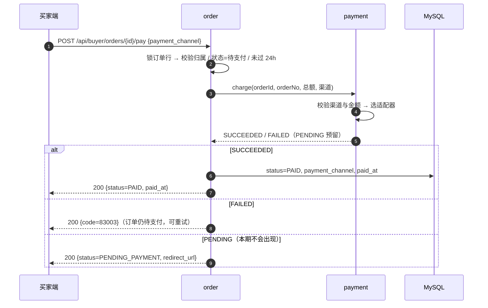
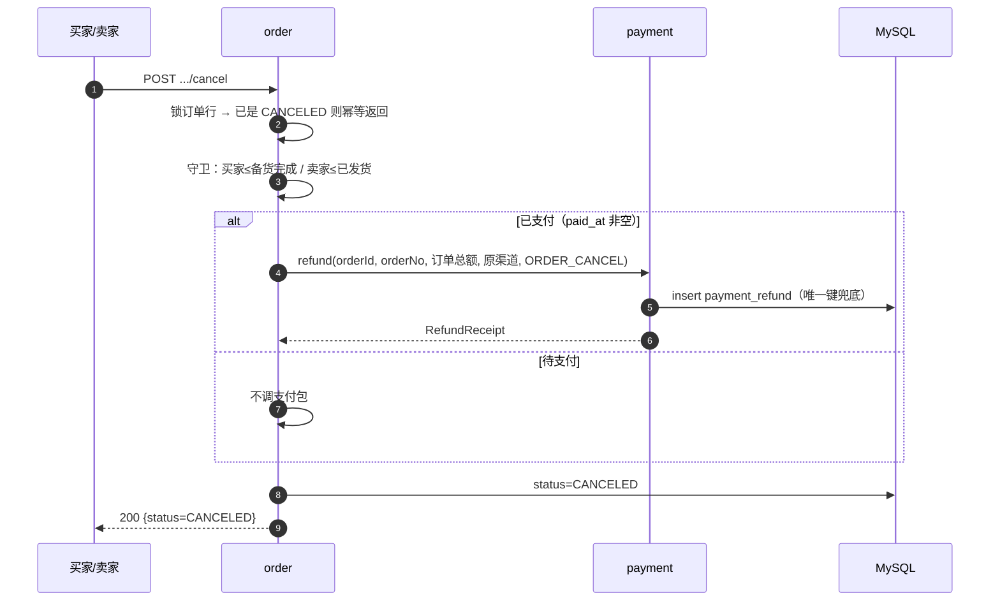

# 阶段四 · 支付包设计

> **文档性质**：支付包的实现基线（v1.0）。冻结端口形状、Mock 行为、流水语义与扩展边界，供 T2 与 T4 共同遵守。
> **适用范围**：`simple-shop-backend` 的 `com.simpleshop.payment` 包，以及订单侧调用支付的那几条边。
> **上游依据**：《挑战需求C-需求总结》2.1 / 3.3、《团队自决实现项》A1 / A2 / B14 / D2 / D7、V4 迁移脚本、阶段三代码。
> **本期定位**：**Mock 网关优先**，把订单生命周期先跑通；支付宝沙箱是阶段四的**可选扩展**，不阻塞任何验收（§11）。

---

## 0. 一页结论

| 问题 | 结论 |
| --- | --- |
| 支付包负责什么 | 渠道适配（下单支付 / 退款）+ 退款流水；**不读订单表、不改订单状态** |
| 谁编排 | order。`order → payment.api` 单向编译依赖；payment 不 import 任何业务包 |
| 本期实现到哪 | 四个渠道统一走 Mock，同步返回结果；真实渠道只留接口位 |
| 支付失败 | 不产生状态：订单停在待支付，买家可重试，超时由订单侧任务取消 |
| 退款 | 只做「取消已支付订单」的整单退款，写一条流水；售后退款**不进本包**（记在售后单） |
| 幂等 | 支付靠订单状态守卫 + 行锁；退款靠流水唯一键 `(order_id, reason)` |
| 事务 | Mock 是纯本地写，与订单状态同事务；真实渠道必须改成「先落待处理流水 → 调网关 → 回写」，本期不做 |
| 回调 | 预留 `payment.api` 事件；payment 绝不反调 order service |
| 测试钩子 | 失败用配置注入（`mock.fail-channels`），**不往请求体里加 `simulate` 字段** |

**一句话**：支付包是「渠道翻译 + 记账」，不是「支付业务」。凡是涉及订单能不能付、取消要不要退、钱退多少的判断，都在 order 侧；支付包只回答「这个渠道这次调用成没成」。

---

## 1. 范围

### 1.1 做

- 四个渠道的枚举与合法性校验：`BANK_CARD`、`CREDIT_CARD`、`ALIPAY`、`WECHAT`。
- `PaymentPort`：发起支付、发起退款、查询某订单的退款合计。
- Mock 网关：四渠道默认成功，可按配置把指定渠道置为失败。
- 退款流水：落库、按订单查、合计（供订单详情聚合「已退款」）。
- 退款幂等：同一订单同一原因只退一次。

### 1.2 不做

- 不做真实网关对接（沙箱见 §11，且是可选任务）。
- 不存卡号、有效期、CVV；不存网关请求/响应原文；不做对账、对账单导入。
- 不做「退款中 / 退款失败」的订单状态——需求已明确退款即时完成、不设失败态。
- 不碰库存、不碰订单状态机、不判断订单是否超时。
- 不做支付流水（只做退款流水）：支付结果已经写在订单的 `payment_channel` / `paid_at` 上，再记一份就是第三处真相。

---

## 2. 关键决策

| 编号 | 决策 | 理由 / 约束 |
| --- | --- | --- |
| P1 | **单向依赖**：`order → payment.api`，payment 不引用 order、goods、aftersale | 反向依赖会让 ArchUnit 的环检查失败；支付的异步回调改走事件（P7） |
| P2 | **payment 不读订单表**：入参自带 `orderId / orderNo / amount / channel` | 支付包能独立测试、独立替换；也避免它顺手改订单状态 |
| P3 | **渠道枚举只有一处**：`payment.api.PaymentChannel`，订单实体直接用它 | 已有实现；加渠道只改枚举 + 适配器，不动表结构（数据库不 CHECK 渠道） |
| P4 | **同步 Mock + `PaymentResult` 三态** | 本期只会出现 SUCCEEDED / FAILED；PENDING 预留给真实渠道重定向，order 侧先按「保持待支付 + 回跳转地址」写好分支 |
| P5 | **退款即时、流水唯一** | 需求口径：取消已支付订单直接置已取消并全额原路退；`(fk_order_id, reason)` 唯一键是幂等最后一道保险 |
| P6 | **售后退款不进本包** | 售后按订单项退，字段在售后单；若也写流水，订单详情的「已退款」会把同一笔钱算两遍 |
| P7 | **回调走事件，不走反向调用** | payment 收回调后发布 `payment.api` 事件，order 侧监听落状态；payment 编译期不认识 order |
| P8 | **失败不落订单字段** | 支付失败时 `payment_channel` / `paid_at` 保持为空，避免「有渠道没付款」的脏数据；库里有 `ck_order_paid_pair` 兜底 |
| P9 | **测试钩子只走配置** | 请求体不接受「模拟失败」这类字段，契约里不出现测试语义 |

---

## 3. 包结构与端口

```text
com.simpleshop.payment
├── api/
│   ├── PaymentChannel          渠道枚举（已有）
│   ├── PaymentPort             对外端口（本设计冻结）
│   ├── PaymentRequest          支付入参
│   ├── PaymentResult           支付结果（SUCCEEDED / PENDING / FAILED）
│   ├── PaymentStatus           结果状态
│   ├── RefundRequest           退款入参
│   ├── RefundReceipt           退款回执
│   └── PaymentSucceededEvent   预留：真实渠道异步支付成功
├── entity/
│   └── PaymentRefund           退款流水（已有）
├── repository/
│   └── PaymentRefundRepository 流水仓储（已有）
└── service/
    ├── PaymentService          实现 PaymentPort：选渠道 → 调网关 → 落流水
    ├── ChannelGateway          渠道适配器接口（charge / refund）
    ├── MockPaymentGateway      Mock 实现（本期唯一实现）
    └── gateway/                （扩展位）AlipaySandboxGateway
```

### 3.1 端口签名（冻结）

```java
public interface PaymentPort {
    PaymentResult charge(PaymentRequest request);

    RefundReceipt refund(RefundRequest request);

    /** 某订单已退金额（只含取消退款；售后退款由 aftersale 自己算）。 */
    BigDecimal refundedTotal(String orderId);
}

public record PaymentRequest(String orderId, String orderNo, BigDecimal amount, PaymentChannel channel) {}

public record PaymentResult(
        PaymentStatus status,          // SUCCEEDED / PENDING / FAILED
        PaymentChannel channel,
        LocalDateTime paidAt,          // 仅 SUCCEEDED
        String reference,              // 渠道流水号，仅 SUCCEEDED
        String redirectUrl) {}         // 仅 PENDING

public record RefundRequest(
        String orderId, String orderNo, BigDecimal amount, PaymentChannel channel, String reason) {}

public record RefundReceipt(String refundId, BigDecimal amount, LocalDateTime refundedAt) {}
```

约定：

- `charge` **不抛业务异常表达「渠道失败」**，用 `FAILED` 返回；order 侧统一转成 83003。参数非法（金额、渠道为空）抛 `IllegalArgumentException`，属于调用错误而不是业务分支。
- `refund` 失败抛 `BusinessException(REFUND_FAILED)`：退款没有「部分成功」的中间态，调用方要么拿到回执要么拿到失败。
- 所有金额两位小数，在 `PaymentRequest` / `RefundRequest` 的构造器里校验 `> 0` 且小数位 ≤ 2——参数形状由类型自己守，服务层不必重复。

---

## 4. 支付流程



订单侧要点（T2-2 实现）：

1. 先锁订单行，再校验 `canPay()` 与截止时间；校验不通过返回 83002，**不调用支付包**。
2. 支付成功后由实体方法 `pay(channel, paidAt)` 一次写入渠道与时间，状态转 `PAID`；不允许 service 里零散 set。
3. 失败只回错误码，订单字段一个都不写（P8）。
4. 审计记 `ORDER_PAY`，只记订单 ID，不记金额与渠道原文以外的信息。

---

## 5. 退款流程

只有一条链路：**取消已支付订单**。触发点是 order 的取消动作（买家/卖家），payment 只负责落流水。



约束：

- 退款金额 = 订单总额（本系统没有运费与优惠），由 order 传入，payment 不读订单。
- 退款渠道 = 订单 `payment_channel`；为空的订单（待支付）不会走到这里。
- 重复取消：订单已是 `CANCELED` 时直接返回成功，不再调 `refund`。并发靠订单行锁串行化（两个取消只有第一个会走到退款），流水唯一键是最后一道保险；真撞上唯一键时按 `REFUND_FAILED` 返回——事务此刻已被标记不可继续，吞掉冲突再查只会留下半截状态。
- 同一事务内完成「写流水 + 置已取消」。Mock 是纯本地写，安全；真实渠道的处理见 §11.4。

---

## 6. 流水与对账

表 `simpleshop_payment_refund`（V4 已建）：

| 列 | 含义 |
| --- | --- |
| `id` | `RF + UUID` |
| `fk_order_id` / `order_no` | 订单引用 + 订单号快照（支付包不读订单表，账要能独立看懂） |
| `channel` | 原支付渠道 |
| `amount` | 退款金额（取消退款 = 订单总额） |
| `reason` | 本期只有 `ORDER_CANCEL`；扩展时新增，不复用旧值 |
| `refunded_at` | 退款时间（UTC） |

- 唯一键 `uk_payment_refund_order_reason (fk_order_id, reason)`：同一订单同一原因只退一次。
- 没有「支付流水」表：支付结果在订单上。**对账口径**：订单的 `paid_at` 之和 = 取消订单的流水之和 + 仍在履约的订单金额。
- 查询接口只在后端内部用（`refundedTotal`），不对外暴露流水页面（需求明确不做）。

---

## 7. 错误码与失败语义

| 码 | 常量 | 场景 | HTTP |
| --- | --- | --- | --- |
| 83001 | `PAYMENT_CHANNEL_INVALID` | 渠道不在四个枚举内 | 200 |
| 83002 | `PAYMENT_NOT_ALLOWED` | 订单非待支付，或已过支付时限 | 200 |
| 83003 | `PAYMENT_FAILED` | 渠道返回失败，订单仍待支付、可重试 | 200 |
| 83004 | `REFUND_FAILED` | 退款失败（Mock 基本不触发，留给真实渠道） | 200 |

- 83001–83003 随 T2-2 落地；83004 供退款实现使用（T4-3 补齐退款查询与合计时复核）。统一在 T6-1 登记码表，**不得复用 3xxxx / 4xxxx**。
- 支付失败**不新增订单状态**，也不记「支付失败次数」：需求明确「停在待支付、可重试、超时取消」。

---

## 8. 配置

| 配置项 | 默认 | 说明 |
| --- | --- | --- |
| `simple-shop.payment.mock.enabled` | `true` | Mock 模式开关；置 false 且没有真实适配器时，启动给出明确告警而不是静默失败 |
| `simple-shop.payment.mock.fail-channels` | 空 | 逗号分隔的渠道名，测试用来注入失败（如 `ALIPAY,WECHAT`） |

- 配置全部可被环境变量覆盖，便于 E2E 与部署。
- E2E 与接口测试一律走 Mock，不连真实渠道。

---

## 9. 与订单的边界（谁校验什么）

| 判断 | 归属 | 说明 |
| --- | --- | --- |
| 订单是不是这个买家的 | order | 他人订单按不存在（60001） |
| 订单能否支付 | order | `canPay()` + 截止时间；不通过 83002 |
| 渠道合不合法 | payment | 入口校验，非法 83001 |
| 金额对不对 | order 计算、payment 只校验 > 0 | 总额由订单项快照算出，前端不传 |
| 该不该退款 | order | 状态 + `paid_at`；payment 不判断 |
| 退款金额 | order 传入 | 取消退款 = 订单总额 |
| 退款幂等 | 两边 | order 用状态防抖，payment 用唯一键兜底 |

---

## 10. 测试策略

| 层 | 用例 |
| --- | --- |
| 单元 | 渠道选择器：四个渠道各命中一次；非法渠道 83001；金额 0 / 三位小数被拒 |
| 单元 | Mock 网关：默认成功、`fail-channels` 命中返回 FAILED、`reference` 非空 |
| 接口 | 支付成功 → 订单 PAID 且 `payment_channel` / `paid_at` 落库；审计不记金额 |
| 接口 | 支付失败 → 83003，订单仍待支付且两个支付字段都为空，可再次支付成功 |
| 接口 | 非待支付/超时支付 → 83002；他人订单 → 60001；非法渠道 → 83001 |
| 接口 | 已支付取消 → 一条 `ORDER_CANCEL` 流水，金额等于订单总额；待支付取消 → 零流水 |
| 并发 | 支付 vs 超时取消：一个成功，另一个看到新状态退出；支付只落一次 PAID |
| 并发 | 重复取消：流水仍只有一条（唯一键兜底不抛 500） |
| 数据 | 流水金额两位小数、`order_no` 快照非空、唯一键生效（已在 V4 验证） |
| 架构 | payment 不依赖 order/goods/aftersale/address（ArchUnit 规则在 T6-3 补） |

不测：真实网关、退款失败重试、对账（本期没有这些能力）。

---

## 11. 扩展：支付宝沙箱（可选任务）

### 11.1 前置条件

以下条件**全部满足**才开工，否则不做：

1. 阶段四的买家端、卖家端、E2E 已完成并通过；
2. 有公网可达的部署地址（沙箱回调必须能被支付宝访问；仅本机 `localhost` 收不到异步通知）；
3. 有沙箱应用（AppID、商户私钥、支付宝公钥）；
4. 团队确认「退款即时」在真实网关下的语义取舍（§11.4）。

### 11.2 改动点

| 改动 | 说明 |
| --- | --- |
| `AlipaySandboxGateway` | 实现 `ChannelGateway`；`mock.enabled=false` 时按渠道选它 |
| `charge` 返回 PENDING | 生成支付链接放 `redirectUrl`，order 侧保持待支付并把链接回给前端；买家跳转后完成付款 |
| 回调入口 | `POST /api/payments/alipay/notify`：不在 buyer/seller 拦截器范围内，**必须验签**，并校验金额与订单号 |
| 回调处理 | 验签通过 → 发布 `payment.api.PaymentSucceededEvent` → order 监听落 PAID（幂等：已是 PAID 直接忽略） |
| 退款异步 | 流水需要 `status`（PENDING/SUCCEEDED/FAILED）与 `gateway_refund_no`，新增 **V5** 迁移；退款结果由回调或查询回写 |
| 售后退款 | 现在只落售后单、不调网关；接真实渠道后**必须补调用**，否则「原路退回」名不副实。届时流水 `reason` 增加 `AFTERSALE`，唯一键改为按售后单维度 |

### 11.3 安全与配置

- 密钥只走环境变量，不写进仓库与镜像；沙箱与生产用两套凭据。
- 回调必须做：验签、金额比对、订单号存在性、重复通知幂等；任一项不过直接拒绝，不落状态。
- 回调日志不打印签名原文与密钥。

### 11.4 「退款即时」的真实语义

需求口径是退款即时完成、没有「退款中／退款失败」状态。真实网关下退款是异步的，不可能真正即时。扩展时按下面取舍，并写进部署说明：

- 本地仍然立即置 `CANCELED` 并写流水（`status=PENDING`），不引入订单新状态；
- 网关退款结果异步回写流水状态；失败的流水留痕，靠人工处理与告警，**不自动重试、不回滚订单状态**；
- 这是「用户看到的即时」与「钱的最终状态」之间的落差，属于已知取舍，不假装它是即时的。

---

## 12. 已知局限

1. Mock 不验证渠道真实错误码映射，接真实渠道时 `FAILED` 的判定逻辑要重写一遍。
2. 没有支付流水表，只有订单上的 `paid_at`；做真实对账时需要补一张支付单表（扩展任务）。
3. 退款没有失败重试与补偿任务；真实渠道下「退款失败但订单已取消」会出现账不平，需要人工介入。
4. 支付回调链路（事件）本期只留接口与文档，没有实现与测试。

---

## 13. 落地分工（与开发任务计划的对应）

| 内容 | 落点 | 说明 |
| --- | --- | --- |
| `PaymentPort` + Mock 网关 + 支付接口 | **T2-2** | 没有它支付链路无法闭环，所以接口与 Mock 提前到 T2-2，而不是等 T4 |
| 83001 / 83002 / 83003 | T2-2 | 支付入口的三个拒绝/失败分支 |
| 退款流水写入 + `refundedTotal` | **T4-3** | 随取消退款（T2-5）一起被调用，T4 补齐查询与合计 |
| 83004 + 流水查询接口 | T4-3 | 与退款一起落地 |
| 渠道扩展位、沙箱 | T4-4（可选） | 不阻塞验收 |
| 本文档维护 | T4-1 | 实现与文档出现偏差时，先改本文再改代码 |

---

**文档结束**
